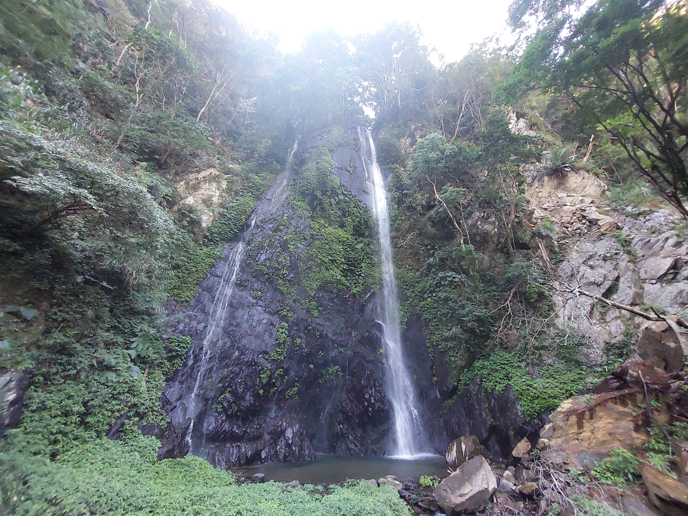
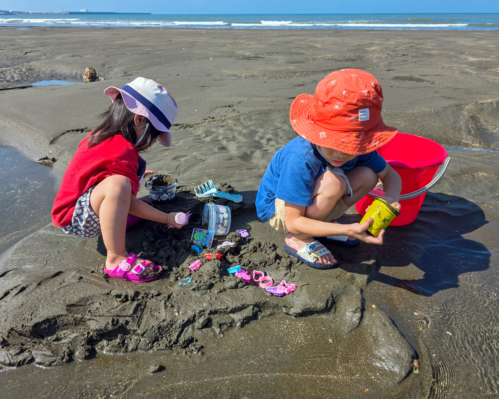
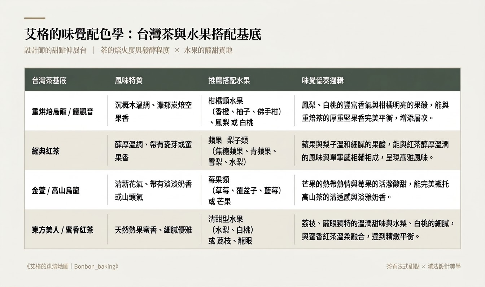

# #觀音 - 推薦內容｜方格子 vocus

- ID：page009_2
- 父頁面 ID：page009
- 深度：1
- 網站：vocus.cc
- 原始網址：https://vocus.cc/tags/%E8%A7%80%E9%9F%B3
- 狀態：success
- 發表日期：2026-11-16T22:30:11+08:00
- 主題：自然景觀與生態、歷史文化與信仰、觀光景點與活動
- 關鍵字：地方旅遊、觀光資訊、在地資訊
- 擷取時間：2026-11-17T07:31:23.461227+00:00

## 清理後正文

觀音
含有「觀音」共 441 篇內容
全部內容
發佈日期由新至舊
linct的沙龍
2026/11/16
觀音瀑布
埔里觀音瀑布位於南投縣埔里鎮台14線約64K處，是通往霧社、清境與合歡山必經的自然景點，以步道平緩好走、負離子豐富及多層次瀑群聞名。園區歷經多次風災受損與災害復建工程關係，曾關閉多年今年 2026 年 8 月 11 日重新啟用，無需門票免費開放。
#
生活
#
文化
#
瀑布
10秒童心實驗室10-Second Joy Lab
2026/11/14
■人生話西遊-卷26：收服紅孩兒：真正的慈悲，不是縱容錯誤，而是讓生命有改變的機會
紅孩兒憑藉三昧真火，讓孫悟空吃盡苦頭。

最後，觀音菩薩出面收服紅孩兒，使他成為善財童子。

在這段神話故事中，原本的敵人，最後卻有了另一種生命方向。

人生中，我們容易用一次錯誤定義一個人。

然而，一個人的過去不必完全決定他的未來。

包容並不是對傷害視而不見，也不是要求受傷的人無條件原諒。
#
紅孩兒
#
豆瓣醬
#
人生
10秒童心實驗室10-Second Joy Lab
2026/11/14
■人生話西遊-卷15：觀音指路：真正的貴人，不是替你走路，而是讓你重新相信自己
觀音菩薩東行尋找取經人，為曾經犯錯的悟空、八戒與沙僧提供了新的方向。

她給予的不是毫無條件的成功，而是一個重新選擇人生的機會。

回想生命中那些艱難時刻，最令人難忘的，往往不是錦上添花的人，而是願意在我們失意時伸手相助的人。

一句鼓勵、一份信任、一個重新開始的機會，都可能成為生命的轉折。

然而
#
人生
#
善意
#
貴人
10秒童心實驗室10-Second Joy Lab
2026/11/14
■人生話西遊-卷8：觀音東行：當人生走到無路可走的地方，也許另一條路正在出現
《西遊記》第八回：我佛造經傳極樂，觀音奉旨上長安。

如來欲將真經傳往東土，觀音菩薩奉命東行，沿途尋找能夠參與取經之旅的人。

原本各自陷入困境的悟空、八戒、沙僧與白龍馬，也因此迎來改變人生的契機。

他們或曾犯錯，或曾失去原有的地位，卻並未因此被故事永遠遺忘。

人生有時也是如此。

一份工作結束
#
人生
#
觀音
#
豆瓣醬
付費限定
理柴知道，法說．年報一起報!
2026/11/13
(4119)旭富法說會 2026/11、旭富財報、旭富展望、旭富財報投資亮點
關鍵字：原料藥API、觀音新廠啟用、青光眼原料藥、糖尿病神經病變藥、CDMO新藥代工、前三季EPS 0.43元

摘要： 原料藥（API）與 CDMO 專業廠旭富製藥（4119）召開法說會公佈 2026 年前三季財務報告，累計營收約新台幣 11.50 億元，年增約 16%；營業毛利約 2.66 億元
含 AI 應用內容
#
原料藥
#
觀音
#
青光眼
魯家生活
2026/11/13
親子海邊玩沙推薦｜觀音濱海遊憩區免費停車，11月人少又好玩
夏天太熱不敢帶孩子玩沙，天氣轉涼後，我們去了觀音濱海遊憩區。這裡有免費停車場、洗腳區和細沙沙灘，退潮時還能看小螃蟹。分享這趟親子海邊玩沙的心得，以及沒有救生員、水母季節等需要留意的地方。
含 AI 應用內容
#
育兒
#
親子
#
海邊
艾格的烘焙地圖 Bonbon_baking
2026/11/12
💎【設計師的甜點伸展台】長方形空間的秘密：從查理·蒙格的逆向思維，將「金磚」費南雪雕琢成鑲鑽黑金
作者｜艾格 Agnes（Bonbon_baking）
「長方形轉一下，可能是直線，也可能是菱形；面對一個長方形的框，你看到的是邊框，還是裡面的面積？」
有時候，我們看事情的角度，應該學著查理·蒙格（Charlie Munger）所說的：「反過來想（Invert, always invert）。」
在
#
甜點
#
黑金
#
設計師
悠遊時光
2026/11/09
佳里營頂佳福寺一日遊｜300年觀音古寺、參拜攻略、親子溜滑梯、花旗木與周邊景點
佳里營頂佳福寺，是臺南佳里營頂地區歷史悠久的佛教信仰中心，創建於清康熙五十年（1711年），距今已有三百多年歷史。

佳福寺最特別的地方，不只是主祀觀音佛祖，更在於它把古老寺院、地方歷史、傳統信仰與休閒園區巧妙融合在一起。寺內供奉觀音佛祖、天上聖母、註生娘娘、清水祖師、韋馱菩薩、十八羅漢等神佛，寺外
#
特色
#
廟宇
#
參拜
Hank吳的沙龍
2026/11/07
教學影片旁白腳本：用 MiniMax H3 做 9:16 對嘴 MV
範例：《藏传大悲咒》・仙靈電影風格　｜　配音：女聲（台灣姐，Fish Audio）　｜　影片 1920×1080、30 fps
教學影片已放置於 youtube: 
https://www.youtube.com/watch?v=CEnsz-6kTag總長 4:06.4，共 11 段。
#
對嘴
#
教學
#
觀音
匠選科技
2026/11/09
阿米塔
2026/11/07
念念3
這時代邏輯規劃統整的能力，

已經被人工智慧提升到人類無法超越的地步了。

而人類理性似乎走到盡頭了

而金剛經和心經告訴你

不不不，你所謂的理性不過是一種概念

是一種人類物種一種先驗式的直覺

非經驗的學習而來的

愛因斯坦因為讚嘆宇宙的規律之美

因先體驗到其美而突發奇想的再用數學描述

目
#
人類
#
懺悔
#
觀世音菩薩
‌
‌
‌
‌
‌
‌
‌
‌
‌
‌
‌
‌
‌
‌
‌
‌
‌
‌
‌
‌
‌
‌
‌
‌
‌
‌
‌
‌
‌
‌
‌
‌
‌
‌
‌
‌
‌
‌
‌
‌
‌
‌
‌
‌
‌
‌
‌
‌
‌
‌
‌
‌
‌
‌
‌
‌
‌
‌
‌
‌
‌
‌
‌
‌
‌
‌
‌
‌
‌
‌
‌
‌
‌
‌
‌
‌
‌
‌
‌
‌
‌
‌
‌
‌
‌
‌
‌
‌
‌
‌

## 圖片
-  — [原始圖片來源](https://images.vocus.cc/ee108897-8af9-44be-a7e6-a88abbaf4490.jpg) 
-  — [原始圖片來源](https://images.vocus.cc/39f3190f-9f9b-4f26-9b58-af1452e966d7.jpg) 
-  — [原始圖片來源](https://images.vocus.cc/7218b5ff-57b2-4eca-a12b-e873f0adbc16.jpg) 

## 頁面連結
- [linct的沙龍 2026/11/16](https://vocus.cc/salon/linct)
- [觀音瀑布](https://vocus.cc/article/6afb0726fd897800016615cb)
- [# 生活](https://vocus.cc/tags/%E7%94%9F%E6%B4%BB)
- [# 文化](https://vocus.cc/tags/%E6%96%87%E5%8C%96)
- [# 瀑布](https://vocus.cc/tags/%E7%80%91%E5%B8%83)
- [■人生話西遊-卷26：收服紅孩兒：真正的慈悲，不是縱容錯誤，而是讓生命有改變的機會](https://vocus.cc/article/6af846f6fd89780001eb39ce)
- [# 紅孩兒](https://vocus.cc/tags/%E7%B4%85%E5%AD%A9%E5%85%92)
- [■人生話西遊-卷15：觀音指路：真正的貴人，不是替你走路，而是讓你重新相信自己](https://vocus.cc/article/6af84488fd89780001eacb9e)
- [# 善意](https://vocus.cc/tags/%E5%96%84%E6%84%8F)
- [# 貴人](https://vocus.cc/tags/%E8%B2%B4%E4%BA%BA)
- [10秒童心實驗室10-Second Joy Lab 2026/11/14](https://vocus.cc/salon/10-SecondJoyLab)
- [■人生話西遊-卷8：觀音東行：當人生走到無路可走的地方，也許另一條路正在出現](https://vocus.cc/article/6af84224fd89780001ea5f6b)
- [# 人生](https://vocus.cc/tags/%E4%BA%BA%E7%94%9F)
- [# 豆瓣醬](https://vocus.cc/tags/%E8%B1%86%E7%93%A3%E9%86%AC)
- [理柴知道，法說．年報一起報! 2026/11/13](https://vocus.cc/salon/ShibaInustock)
- [(4119)旭富法說會 2026/11、旭富財報、旭富展望、旭富財報投資亮點](https://vocus.cc/article/6af71638fd89780001b0ad88)
- [# 原料藥](https://vocus.cc/tags/%E5%8E%9F%E6%96%99%E8%97%A5)
- [# 青光眼](https://vocus.cc/tags/%E9%9D%92%E5%85%89%E7%9C%BC)
- [魯家生活 2026/11/13](https://vocus.cc/salon/lufamily)
- [親子海邊玩沙推薦｜觀音濱海遊憩區免費停車，11月人少又好玩](https://vocus.cc/article/6af46721fd897800012fa47c)
- [# 育兒](https://vocus.cc/tags/%E8%82%B2%E5%85%92)
- [# 親子](https://vocus.cc/tags/%E8%A6%AA%E5%AD%90)
- [# 海邊](https://vocus.cc/tags/%E6%B5%B7%E9%82%8A)
- [艾格的烘焙地圖 Bonbon_baking 2026/11/12](https://vocus.cc/salon/bonbonbaking)
- [💎【設計師的甜點伸展台】長方形空間的秘密：從查理·蒙格的逆向思維，將「金磚」費南雪雕琢成鑲鑽黑金](https://vocus.cc/article/6af5d23afd897800016f12fc)
- [# 甜點](https://vocus.cc/tags/%E7%94%9C%E9%BB%9E)
- [# 黑金](https://vocus.cc/tags/%E9%BB%91%E9%87%91)
- [# 設計師](https://vocus.cc/tags/%E8%A8%AD%E8%A8%88%E5%B8%AB)
- [悠遊時光 2026/11/09](https://vocus.cc/salon/688b0b79fd897800010bfb2f)
- [佳里營頂佳福寺一日遊｜300年觀音古寺、參拜攻略、親子溜滑梯、花旗木與周邊景點](https://vocus.cc/article/6ac72ef8fd897800018697ae)
- [# 特色](https://vocus.cc/tags/%E7%89%B9%E8%89%B2)
- [# 廟宇](https://vocus.cc/tags/%E5%BB%9F%E5%AE%87)
- [# 參拜](https://vocus.cc/tags/%E5%8F%83%E6%8B%9C)
- [Hank吳的沙龍 2026/11/07](https://vocus.cc/salon/hank)
- [教學影片旁白腳本：用 MiniMax H3 做 9:16 對嘴 MV](https://vocus.cc/article/6aef3e79fd89780001ffd6b9)
- [# 對嘴](https://vocus.cc/tags/%E5%B0%8D%E5%98%B4)
- [# 教學](https://vocus.cc/tags/%E6%95%99%E5%AD%B8)
- [# 觀音](https://vocus.cc/tags/%E8%A7%80%E9%9F%B3)
- [https://vocus.cc/user/6ac8c15b737136f56ec99c53](https://vocus.cc/user/6ac8c15b737136f56ec99c53)
- [阿米塔 2026/11/07](https://vocus.cc/salon/69606977fd897800011cf1df)
- [念念3](https://vocus.cc/article/6aef2670fd89780001fbbc67)
- [# 人類](https://vocus.cc/tags/%E4%BA%BA%E9%A1%9E)
- [# 懺悔](https://vocus.cc/tags/%E6%87%BA%E6%82%94)
- [# 觀世音菩薩](https://vocus.cc/tags/%E8%A7%80%E4%B8%96%E9%9F%B3%E8%8F%A9%E8%96%A9)
