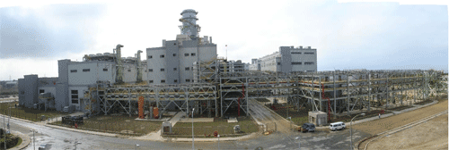

# page020_2

- ID：page020_2
- 父頁面 ID：page020
- 深度：1
- 網站：web.archive.org
- 原始網址：https://web.archive.org/web/20170923002036/http://www.mhi.co.jp/power/news/sec1/2007_jan_07.html
- 狀態：success
- 主題：地方產業與農漁業
- 關鍵字：地方旅遊、觀光資訊、在地資訊
- 擷取時間：2026-11-17T07:31:44.690533+00:00

## 清理後正文

ページの先頭です。
ページの本文へ
メインメニューへ
フッタへ
メインメニューです。
文字サイズを大きくするには
HOME
三菱重工グループ
MHI Global
サイトマップ
お問い合わせ
ページの本文です。
2007年1月
台湾大潭発電所Stage-I で2号系列の商業運転を開始
台湾電力公司向け大潭(Dah-Tarn)発電所は総出力4,200MWの世界最大のガスタービン・コンバインドサイクル(GTCC)発電プラントです。
三菱重工業は2003年6月にターンキー工事として受注後、台湾北部桃園県大潭において土建据付工事を進め、2006年6月26日に1号系列が、また2号系列も2006年11月7日に運転を開始し、商業運転に入りました。
大潭発電所の建設は2段階に分かれています。Stage-I は台湾国内で稼動実績のあるM501F型ガスタービンを採用、このガスタービン3台と排熱回収ボイラ3台および蒸気タービン1台を組み合わせた3on1という構成のGTCC発電プラントが2系列で合計出力は1,400MWです。またStage-II は、大容量高効率ガスタービンであるM501G型ガスタービンを採用、このガスタービン2台と排熱回収ボイラ2台及び蒸気タービン1台を組み合わせた2on1という構成のGTCC発電プラント4系列が含まれており、合計出力は2,800MWです。
台湾の昨今の旺盛な電力需要に答え、プロジェクト全体工程は1年6ヶ月前倒しで工事を進めており、最終号機である6号系列の運転開始は2008年12月を予定しています。
Stage-I 全景
ページの先頭へ
ページのトップへ戻る

## 圖片
-  — [原始圖片來源](https://web.archive.org/web/20170923002036im_/http://www.mhi.co.jp/power/news/sec1/images/2007_jan_07.gif) 

## 頁面連結
- [文字サイズを大きくするには](https://web.archive.org/web/20170923002036/http://www.mhi.co.jp/size.html)
- [https://web.archive.org/web/20170923002036/http://www.mhi.co.jp/index.html](https://web.archive.org/web/20170923002036/http://www.mhi.co.jp/index.html)
- [三菱重工グループ](https://web.archive.org/web/20170923002036/http://www.mhi.co.jp/company/net/index.html)
- [MHI Global](https://web.archive.org/web/20170923002036/http://www.mhi-global.com/index.html)
- [サイトマップ](https://web.archive.org/web/20170923002036/http://www.mhi.co.jp/sitemap.html)
- [お問い合わせ](https://web.archive.org/web/20170923002036/http://www.mhi.co.jp/inquiry/index.html)
- [https://web.archive.org/web/20170923002036/http://www.mhi.co.jp/products/index.html](https://web.archive.org/web/20170923002036/http://www.mhi.co.jp/products/index.html)
- [https://web.archive.org/web/20170923002036/http://www.mhi.co.jp/technology/index.html](https://web.archive.org/web/20170923002036/http://www.mhi.co.jp/technology/index.html)
- [https://web.archive.org/web/20170923002036/http://www.mhi.co.jp/company/index.html](https://web.archive.org/web/20170923002036/http://www.mhi.co.jp/company/index.html)
- [https://web.archive.org/web/20170923002036/http://www.mhi.co.jp/finance/index.html](https://web.archive.org/web/20170923002036/http://www.mhi.co.jp/finance/index.html)
- [https://web.archive.org/web/20170923002036/http://www.mhi.co.jp/csr/index.html](https://web.archive.org/web/20170923002036/http://www.mhi.co.jp/csr/index.html)
- [https://web.archive.org/web/20170923002036/http://www.mhi.co.jp/recruit/index.html](https://web.archive.org/web/20170923002036/http://www.mhi.co.jp/recruit/index.html)
- [サイトのご利用条件](https://web.archive.org/web/20170923002036/http://www.mhi.co.jp/conditions.html)
- [個人情報保護方針](https://web.archive.org/web/20170923002036/http://www.mhi.co.jp/privacy.html)
- [ページの本文へ](https://web.archive.org/web/20170923002036/http://www.mhi.co.jp/power/news/sec1/2007_jan_07.html)

> 備註：進階解析失敗，已使用內建解析器：AttributeError: 'NoneType' object has no attribute 'get'
