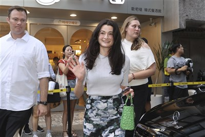

# 大潭電廠大門倒塌壓死工程師 檢警釐清事故原因 | 社會 | 中央社 CNA

- ID：page020_4
- 父頁面 ID：page020
- 深度：1
- 網站：中央社 CNA
- 原始網址：https://www.cna.com.tw/news/firstnews/202112160401.aspx
- 狀態：success
- 作者：中央通訊社
- 發表日期：2021-12-16T21:59:00+08:00
- 主題：自然景觀與生態
- 關鍵字：觀音區、桃園市、藻礁
- 擷取時間：2026-11-17T07:31:47.131713+00:00

## 清理後正文

大潭電廠大門倒塌壓死工程師 檢警釐清事故原因
2021/12/16 21:59
（12/16 22:11 更新）
請同意我們的隱私權規範，才能啟用聽新聞的功能。
（中央社記者葉臻桃園16日電）桃園市觀音區大潭電廠昨天發生工安意外，屬於外包商的林姓工程師在關閉西側大門時，遭疑似脫軌倒塌的大門壓死。桃園市警方表示，已報請檢察官相驗，事故原因及肇事責任待釐清。
桃園市政府警察局大園分局向中央社記者表示，昨天傍晚近6時，大潭電廠外包商46歲林姓工程師在接獲通知西側大門未關閉後，與女同事前往查看、關門，不料大門疑似發生脫軌，整片倒在林男身上。
警方表示，女同事與其餘工人協力將大門抬起、拉出林男後，由趕到現場的消防隊員將林男送往醫院急救，但林男仍在今天凌晨宣告不治，目前已報請檢察官相驗，並通報桃園市政府勞檢處進行工安事故調查，確切事故原因及肇事責任仍待釐清。（編輯：方沛清）1101216
#大潭電廠
#工安意外
#桃園市
#桃園市政府警察局大園分局
延伸閱讀
大潭輸出電力僅一迴路？台電闢謠：多重線路供電
立院委員會視察三接 經濟部：僅棧橋落墩影響藻礁
國民黨17日民主守夜 侯友宜盧秀燕未規劃參加
三接是能源轉型接棒 台電：重啟核四遠水救不了近火
支持中央社
選擇與事實站在一起，您的每一份贊助，都是守護新聞自由的力量
小額贊助
下載中央社「一手新聞」APP，即時掌握最新消息
本網站之文字、圖片及影音，非經授權，不得轉載、公開播送或公開傳輸及利用。

## 圖片
-  — [原始圖片來源](https://imgcdn.cna.com.tw/www/webphotos/WebCover/420/20261117/1600x1199_640244202818.jpg) 
-  — [原始圖片來源](https://imgcdn.cna.com.tw/www/WebPhotos/400/20261110/2000x1334_wmky_63605257611401_202605250148000003.jpg) 
-  — [原始圖片來源](https://imgcdn.cna.com.tw/www/WebPhotos/400/20261117/1175x768_wmky_0_C20261117000045.jpg) 

## 頁面連結
- [立刻加入](https://lin.ee/ilN5e75)
- [“Focus Taiwan”](https://focustaiwan.tw?utm_source=cna.lang)
- [「フォーカス台湾」](https://japan.focustaiwan.tw?utm_source=cna.lang)
- [媒體識讀](https://www.cna.com.tw/topic/newstopic/4374.aspx)
- [新聞專題](https://www.cna.com.tw/topic/newstopic.aspx)
- [九合一](https://www.cna.com.tw/topic/newstopic/5056.aspx)
- [翡翠水庫光電議題　沈伯洋尊重經濟部、蔣萬安稱應說明立場](https://www.cna.com.tw/news/aloc/202611170107.aspx)
- [陳素月發表競選廣告　籲遊子回家投票](https://www.cna.com.tw/news/aloc/202611170101.aspx)
- [何欣純：若當選　家屬配偶不包中市府工程](https://www.cna.com.tw/news/aloc/202611170087.aspx)
- [即時](https://www.cna.com.tw/list/aall.aspx)
- [政治](https://www.cna.com.tw/list/aipl.aspx)
- [國安官員揭中國介選手段　免費機票、貴賓室都在列](https://www.cna.com.tw/news/aipl/202611170157.aspx)
- [高雄市長選舉封關民調陸續出爐　藍綠皆呼籲踴躍投票](https://www.cna.com.tw/news/aipl/202611170164.aspx)
- [賴總統連跑板橋三重3宮廟　全力為蘇巧慧助選衝刺](https://www.cna.com.tw/news/aipl/202611170163.aspx)
- [外交特考將錄取80人　創歷史新高](https://www.cna.com.tw/news/aipl/202611170160.aspx)
- [南非駐處遭降格　外交部：已回覆協商建議、目前正常運作](https://www.cna.com.tw/news/aipl/202611170155.aspx)
- [立院協商普發2萬特別條例　朝野無共識送院會協商](https://www.cna.com.tw/news/aipl/202611170152.aspx)
- [沈伯洋22日辦大洋流嘉年華　盼傳遞台北文化底蘊](https://www.cna.com.tw/news/aipl/202611170145.aspx)
- [林佳龍訪美會晤民主黨議員　盼深化台美合作](https://www.cna.com.tw/news/aipl/202611170135.aspx)
- [以廚藝拚外交 劉世忠化身「大使主廚」拉近台越距離](https://www.cna.com.tw/news/aipl/202611170132.aspx)
- [國際](https://www.cna.com.tw/list/aopl.aspx)
- [紐時：黃仁勳女兒黃敏珊在輝達呼風喚雨　強勢管理風格惹議](https://www.cna.com.tw/news/aopl/202611170149.aspx)
- [貪汙指控與彈劾威脅夾擊　蒙古國總統宣布請辭](https://www.cna.com.tw/news/aopl/202611170158.aspx)
- [研究：美大型資料中心碳排量堪比一些國家全年](https://netzero.cna.com.tw/news/202611170153/)
- [中加領袖APEC峰會前會晤　同意進一步減免關稅](https://www.cna.com.tw/news/aopl/202611170146.aspx)
- [美晶片禁令下另闢蹊徑　中企藉美AI模型訓練自家系統](https://www.cna.com.tw/news/aopl/202611170144.aspx)
- [金融時報：克宮推動美中俄峰會後發表聯合聲明](https://www.cna.com.tw/news/aopl/202611170137.aspx)
- [輝達主管籲黃仁勳回任　警告恐流失無可取代人才](https://www.cna.com.tw/news/aopl/202611170122.aspx)
- [泰國與美國將簽貿易聯合聲明　泰方堅守農產、安全紅線](https://www.cna.com.tw/news/aopl/202611170110.aspx)
- [加中關係升溫　駐溫哥華處長提醒留意中國灰色地帶戰術](https://www.cna.com.tw/news/aopl/202611170100.aspx)
- [兩岸](https://www.cna.com.tw/list/acn.aspx)
- [APEC深圳峰會前夕　中國喊話：AI不該是某國獨有](https://www.cna.com.tw/news/acn/202611170106.aspx)
- [俄媒：普丁與習近平將於18日舉行雙邊會談](https://www.cna.com.tw/news/acn/202611170113.aspx)
- [美中俄領袖歷史性峰會　學者：要關注後續發展](https://www.cna.com.tw/news/acn/202611170067.aspx)
- [APEC工商領導人峰會登場　規劃發布「深圳倡議」](https://www.cna.com.tw/news/acn/202611170058.aspx)
- [25年間3次主辦APEC　中國從融入世界到遭遇「去風險」抵制](https://www.cna.com.tw/news/acn/202611170045.aspx)
- [港媒：美中俄有矛盾　元首會晤達成具體協議機會不高](https://www.cna.com.tw/news/acn/202611170038.aspx)
- [華為加碼具身人工智慧　切入清掃機器人領域](https://www.cna.com.tw/news/acn/202611160296.aspx)
- [APEC成員磋商聲明文件　為亞太自貿區打造務實框架](https://www.cna.com.tw/news/acn/202611160287.aspx)
- [APEC深圳峰會週　禁鳴喇叭、計程車駕駛學英文](https://www.cna.com.tw/news/acn/202611160264.aspx)
- [產經](https://www.cna.com.tw/list/aie.aspx)
- [美嚴控先進AI晶片出口　供應鏈：製造流向有既定機制監管](https://www.cna.com.tw/news/afe/202611170130.aspx)
- [壽險業前10月新契約保費1.28兆　投資型保單年增逾1.2倍](https://www.cna.com.tw/news/afe/202611170108.aspx)
- [新台幣午盤貶8.7分　暫收32.973元](https://www.cna.com.tw/news/afe/202611170091.aspx)
- [調查：企業年終平均將發1.61個月　金融業2.85個月居冠](https://www.cna.com.tw/news/afe/202611170083.aspx)
- [竹科管理局領軍前進德國　爭取醫療器材商機](https://www.cna.com.tw/news/afe/202611170079.aspx)
- [台股早盤跌勢拖累　新台幣重貶逾1.2角摜破33元](https://www.cna.com.tw/news/afe/202611170066.aspx)
- [星宇航空進軍大洋洲 插旗雪梨、奧克蘭雙航點](https://www.cna.com.tw/news/afe/202611170060.aspx)
- [黃仁勳離開後輝達首份財報將登場　AI前景市場屏息以待](https://www.cna.com.tw/news/afe/202611170031.aspx)
- [證券](https://www.cna.com.tw/list/asc.aspx)
- [台股再挫947點守4萬點　信驊跌破萬元剩34千金](https://www.cna.com.tw/news/afe/202611170148.aspx)
- [科技股下挫　日股收黑](https://www.cna.com.tw/news/afe/202611170161.aspx)
- [三大法人賣超台股547.25億元](https://www.cna.com.tw/news/afe/202611170159.aspx)
- [11月台股期指跌708點](https://www.cna.com.tw/news/afe/202611170141.aspx)
- [11月電子期金融期齊跌](https://www.cna.com.tw/news/afe/202611170139.aspx)
- [台股跌947.97點](https://www.cna.com.tw/news/afe/202611170136.aspx)
- [台股盤中震盪1747點力守4萬點　電子權值股金融抗跌](https://www.cna.com.tw/news/afe/202611170057.aspx)
- [台股早盤一度跌逾1200點　權值股翻紅守穩4萬點](https://www.cna.com.tw/news/afe/202611170024.aspx)
- [科技](https://www.cna.com.tw/list/ait.aspx)
- [電磁波化為可見空間體驗　蘋果科技助陣坂本龍一特展](https://www.cna.com.tw/news/ait/202611160277.aspx)
- [Google：首見AI代理無需人類介入　自動開發漏洞攻擊](https://www.cna.com.tw/news/ait/202611170120.aspx)
- [日本超級電腦遭不當存取　日媒：企業機密恐外洩](https://www.cna.com.tw/news/ait/202611160223.aspx)
- [LINE無聲訊息功能完成階段性測試　轉為訂閱會員專屬](https://www.cna.com.tw/news/ait/202611160151.aspx)
- [碳價疲軟加深資金缺口　歐洲碳捕捉恐累及公共財政](https://netzero.cna.com.tw/news/202611160133/)
- [輝達風波未平仍獲美力挺　傳將列AI國家冠軍企業](https://www.cna.com.tw/news/ait/202611160117.aspx)
- [東協簽署備忘錄　強化跨境能源互聯](https://www.cna.com.tw/news/ait/202611160097.aspx)
- [Anthropic拚史上最大IPO　自曝價格戰與巨額成本隱憂](https://www.cna.com.tw/news/ait/202611160069.aspx)
- [Threads開放愛心圖示自訂可選珍奶、滷肉飯　3步驟快速設定](https://www.cna.com.tw/news/ait/202611165002.aspx)
- [生活](https://www.cna.com.tw/list/ahel.aspx)
- [網路叫車平台19日起納管　1年內須取得營業執照](https://www.cna.com.tw/news/ahel/202611170125.aspx)
- [疾管署升級美國全境麻疹旅遊警示 孕婦嬰兒避免前往](https://www.cna.com.tw/news/ahel/202611170156.aspx)
- [更生美展台中登場　逾200件作品傳遞復歸溫度](https://www.cna.com.tw/news/ahel/202611170154.aspx)
- [中國烘焙紙逾1.3萬公斤不合格　採逐批100%查驗](https://www.cna.com.tw/news/ahel/202611170121.aspx)
- [3歲童睡覺打呼、呼吸中斷　扁桃腺及腺樣體肥大惹禍](https://www.cna.com.tw/news/ahel/202611170119.aspx)
- [AI衝擊人類智慧　台師大倡從閱讀創造意義](https://www.cna.com.tw/news/ahel/202611170114.aspx)
- [中生來台讀學位未恢復　剩34人註冊碩博班](https://www.cna.com.tw/news/ahel/202611170102.aspx)
- [CRPD報告審查展開　鄭麗君：人權立國是台灣努力目標](https://www.cna.com.tw/news/ahel/202611170086.aspx)
- [北檢宣導反賄選　走進高齡者據點及宗教場所](https://www.cna.com.tw/news/asoc/202611170140.aspx)
- [高雄電動車行電池倉庫火警延燒鄰戶 判經銷商賠887萬](https://www.cna.com.tw/news/asoc/202611170138.aspx)
- [台64線八里段4車碰撞 4人送醫其中1人命危](https://www.cna.com.tw/news/asoc/202611170126.aspx)
- [檢追查雲林斗南、北港賄選案　2人交保](https://www.cna.com.tw/news/asoc/202611170115.aspx)
- [屏東潮州貨車掉落疑似小雞　警：未綁妥可罰3千元起](https://www.cna.com.tw/news/asoc/202611170098.aspx)
- [高雄女訪視員遭男個案性騷擾　雄檢聲請簡易判決](https://www.cna.com.tw/news/asoc/202611170096.aspx)
- [高雄左營2男涉持BB槍射擊貓隻　警方查緝到案](https://www.cna.com.tw/news/asoc/202611170094.aspx)
- [誤植縮刑日數5人提早出獄　基隆監獄：1人返監2人將報到](https://www.cna.com.tw/news/asoc/202611170088.aspx)
- [地方](https://www.cna.com.tw/list/aloc.aspx)
- [中山大學揭古地震判讀盲點　深海岩心追溯億年板塊活動](https://www.cna.com.tw/news/aloc/202611170151.aspx)
- [彰化歲末演唱會卡司揭曉　告五人壓軸搭配煙火秀](https://www.cna.com.tw/news/aloc/202611170162.aspx)
- [童子瑋22日造勢晚會　賴總統、蔡英文、沈伯洋力挺](https://www.cna.com.tw/news/aloc/202611170150.aspx)
- [選舉將至　陳其邁：全力維護治安、確保選務順利](https://www.cna.com.tw/news/aloc/202611170143.aspx)
- [身心障礙青年藝術創作　嘉義朴子配天宮開展](https://www.cna.com.tw/news/aloc/202611170142.aspx)
- [侯友宜：一定反對在翡翠水庫設光電板](https://www.cna.com.tw/news/aloc/202611170133.aspx)
- [台南技職大聯盟成立　深化產學合作及人才培育](https://www.cna.com.tw/news/aloc/202611170129.aspx)
- [台南永康大灣里臨時活動中心謝土　續推正式館舍](https://www.cna.com.tw/news/aloc/202611170127.aspx)
- [選舉公報政見未提松機遷建　蔣萬安：已清楚說明](https://www.cna.com.tw/news/aloc/202611170124.aspx)
- [文化](https://www.cna.com.tw/list/acul.aspx)
- [藝術家許家維東南亞首次個展 馬來西亞登場](https://www.cna.com.tw/news/acul/202611160250.aspx)
- [中央社報導廚餘挑戰、外送專法　獲消費者權益報導獎2優勝](https://www.cna.com.tw/news/acul/202611160189.aspx)
- [【文化普拉斯】培育一片文化森林！文化部部長李遠打造台灣文化生態系](https://www.cna.com.tw/news/acul/202611165004.aspx)
- [朱宗慶打擊樂團再登世界打擊樂年會　打破5年邀演慣例](https://www.cna.com.tw/news/acul/202611160094.aspx)

> 備註：進階解析失敗，已使用內建解析器：AttributeError: 'NoneType' object has no attribute 'get'
