# 桃園觀音區探訪｜台版撒哈拉沙漠和百年燈塔藏在西海岸｜草漯沙丘・白沙岬燈塔・觀音飛機場【IROIRO】｜重點

- YouTube Video ID：2hbu5n9VLZY
- 原始網址：https://youtu.be/2hbu5n9VLZY?si=JC29M3MbFRsFELoU
- 字幕來源：上傳者提供（zh-TW）
- 重點數量：24
- 重點怎麼挑的：由 AI（Claude）逐句讀完整支上傳者字幕（1002 句、約 38 分鐘）後挑選：每個景點或主題挑一個重點，說明只用字幕裡講到的內容。字幕本身有少數錯字，摘要時已避開；未經人工確認。
- 注意：重點是依字幕內容挑選，未經人工確認。

## 1. 觀音區的位置與沿革　[00:01:19]

位於桃園市西部沿海，舊稱石觀音；源自1860年農民在小溪拾得酷似觀音佛像的石頭而得名。2015年桃園升格直轄市後改為觀音區，以客家族群為主，境內有北台灣最大的觀音工業區，近半人口仍從事農漁業。

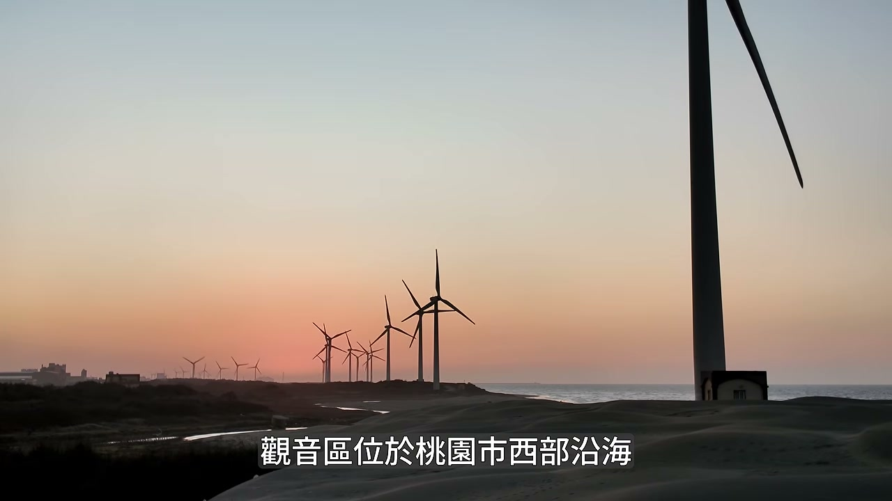

- [00:01:15] 怎麼覺得觀音隨時都會看到飛機
- [00:01:19] **觀音區位於桃園市西部沿海**
- [00:01:21] 東鄰大園區與中壢區

## 2. 蓮花之鄉與千塘之鄉　[00:02:02]

每年夏季的蓮花祭與南部白河齊名，有「北觀音、南白河」美譽；桃園素有千塘之鄉稱號，埤塘與水圳的密度世界罕見。

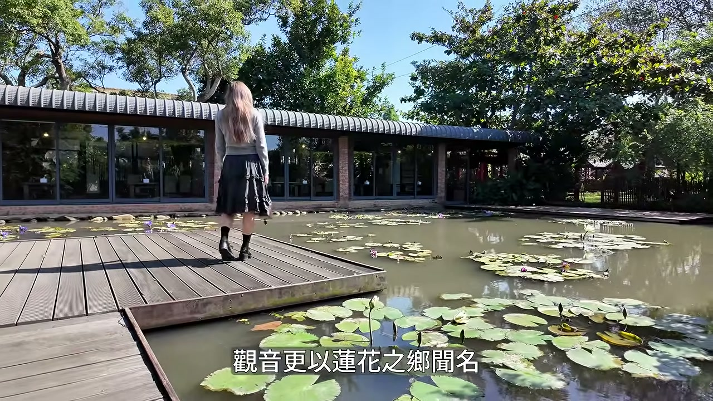

- [00:01:58] 是桃園最重要的農業區之一
- [00:02:02] **觀音更以蓮花之鄉聞名**
- [00:02:04] 每年夏季舉辦的蓮花祭盛會

## 3. 林家古厝的 TR 磚　[00:02:49]

TR 是台灣煉瓦株式會社的英文縮寫，代表日治時期最高品質的紅磚，早期多用在公家機關建築，民間也用它砌在外牆彰顯財力。

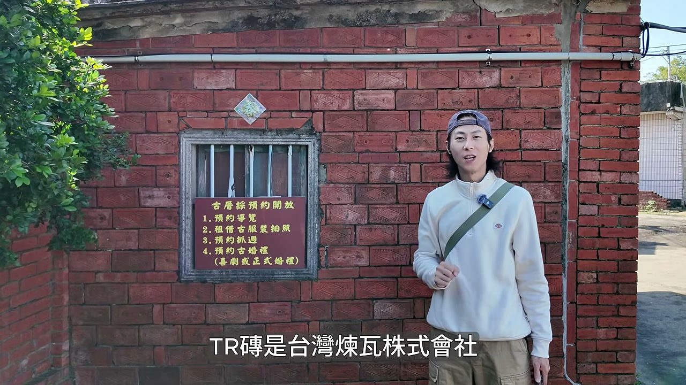

- [00:02:47] 非常漂亮的TR磚
- [00:02:49] **TR磚是台灣煉瓦株式會社**
- [00:02:52] 英文的縮寫

## 4. 林家古厝休閒農場　[00:04:03]

紅磚堆砌的閩式三合院，已有一百多年歷史、保存完整。林家世代務農，到第五代才把稻田改種荷花，成為觀音地區首座觀光休閒農場。

- [00:04:00] 謝謝您
- [00:04:03] **我們現在在林家古厝休閒農場**
- [00:04:06] 林家古厝它是由紅磚所堆砌而成的

## 5. AI 智慧化管理的草莓園溫室　[00:05:20]

老闆說草莓園採AI智慧化管理，是台灣目前規模最大的草莓園溫室大棚。

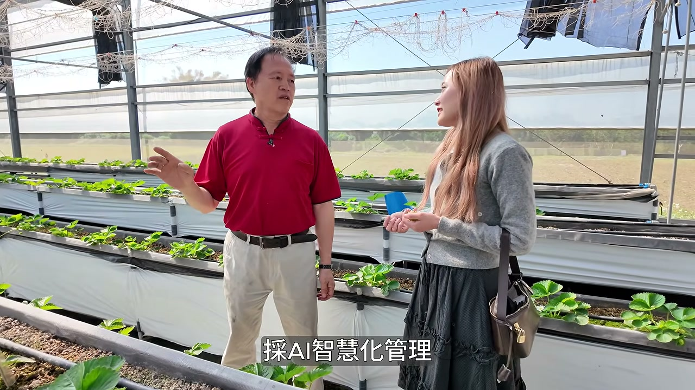

- [00:05:18] 老闆說這裡的草莓園
- [00:05:20] **採AI智慧化管理**
- [00:05:22] 是台灣目前規模最大的

## 6. 大崛溪的由來與魚梯　[00:06:26]

大崛溪以前叫大窟，據說因上游桃園台地長年侵蝕形成洞窟而得名；溪上一階一階的設施是魚梯，讓魚能順利迴游產卵。

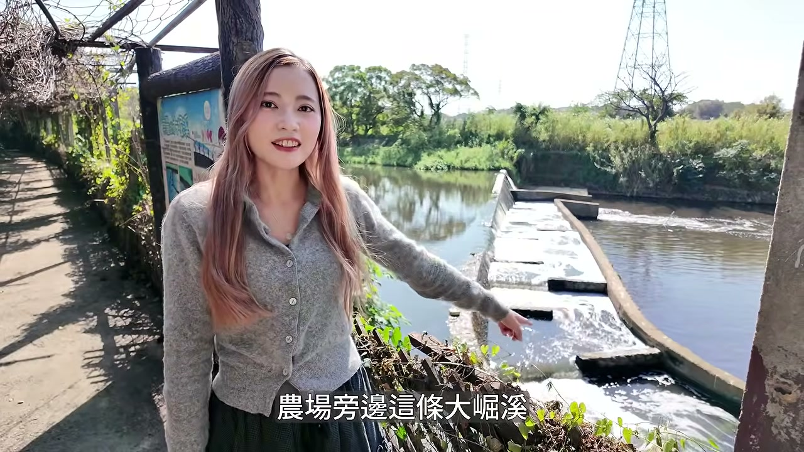

- [00:06:22] 回頭是岸 各位
- [00:06:26] **農場旁邊這條大崛溪**
- [00:06:28] 以前其實是叫大窟

## 7. 崙坪文化地景園區　[00:09:00]

前身是國際電話株式會社觀音崙坪受信所，1986年設施轉移後逐漸荒廢，由桃園市政府都發局整建，2018年登錄歷史建築，2019年正式對外開放。

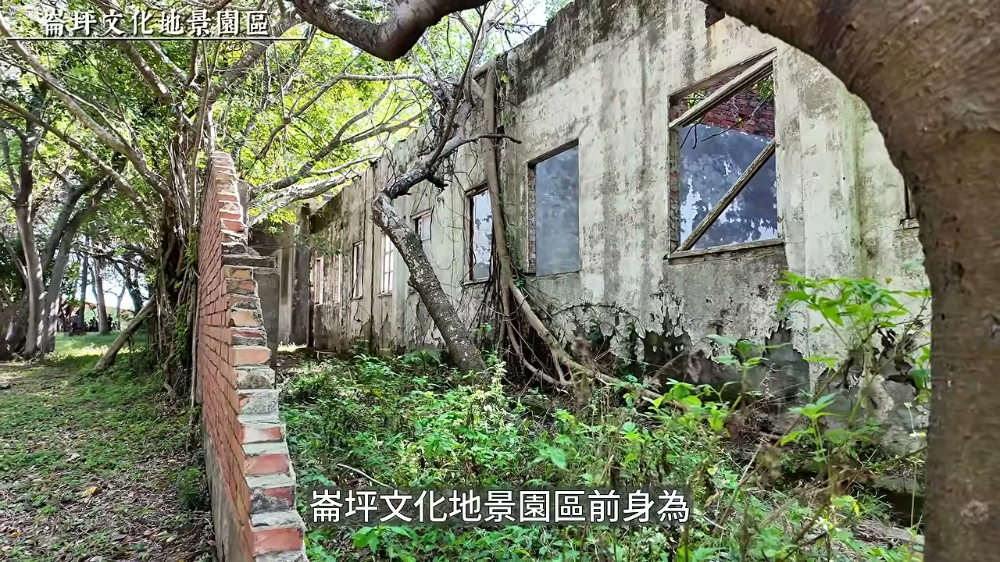

- [00:08:50] 對 真的是很棒的一個環境
- [00:09:00] **崙坪文化地景園區前身為**
- [00:09:03] 國際電話株式會社

## 8. 龜殼劇場　[00:10:24]

以仿生龜殼造型木結構打造，榮獲2021年國家卓越建築獎，以拱形曲線呈現開放又有秩序的空間。

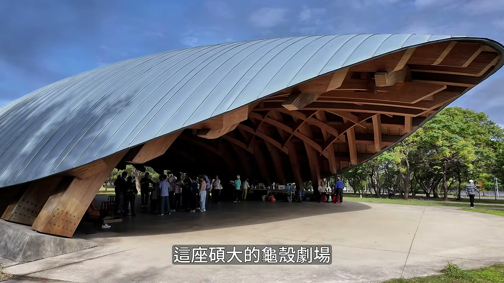

- [00:10:20] 是洗石子嗎
- [00:10:24] **這座碩大的龜殼劇場**
- [00:10:26] 以仿生龜殼造型木結構打造

## 9. 全村的希望麵包工廠　[00:11:45]

外觀像一棟別墅，招牌小小的但生意很好；賣巨型的現烤麵包，披薩與麵包用窯烤加溫；2024年才開業，成為觀音新亮點。

- [00:11:36] 全村的希望的麵包來了
- [00:11:45] **全村的希望麵包工廠**
- [00:11:47] 這名字會不會太趣味了 對啊

## 10. 白千層綠色隧道　[00:15:03]

位於福新路上，全長約2.8公里，沿途近700棵白千層，樹皮會一層層脫落，所以又叫脫皮樹，適合散步、騎單車與拍照。

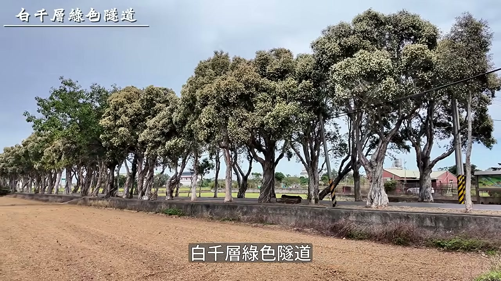

- [00:15:02] 一樣位於福新路上的
- [00:15:03] **白千層綠色隧道**
- [00:15:05] 全長大約2.8公里

## 11. 和美幼兒園的龍貓巴士站　[00:16:53]

幼兒園教職員用海邊漂流垃圾、保麗龍、浮球與工業區舊棧板做成龍貓與裝置，原本為社區美化，後來成為打卡景點；園內不對外開放，只能在外面拍照。

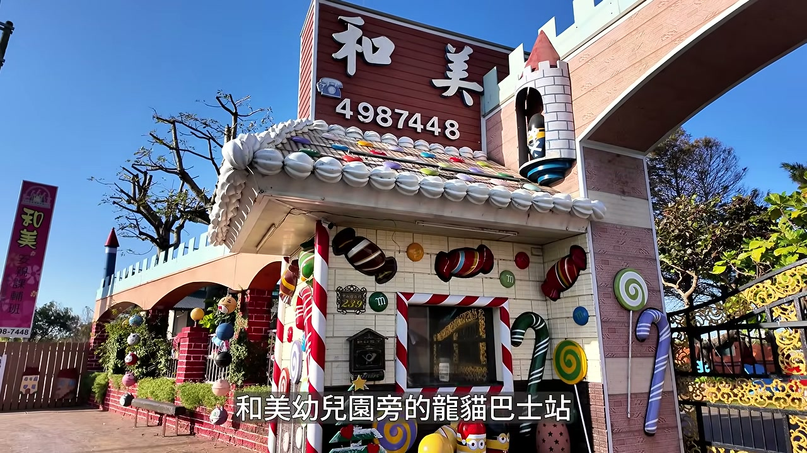

- [00:16:51] 沒有錯 我們現在是在
- [00:16:53] **和美幼兒園旁的龍貓巴士站**
- [00:16:55] 那這邊比較特別的是

## 12. 觀音飛機場　[00:18:42]

前身是長美休閒農場，結合民航元素，收藏退役的空中巴士A300與波音747；目前整修中不對外開放，拍攝當天是老闆同意才進入。

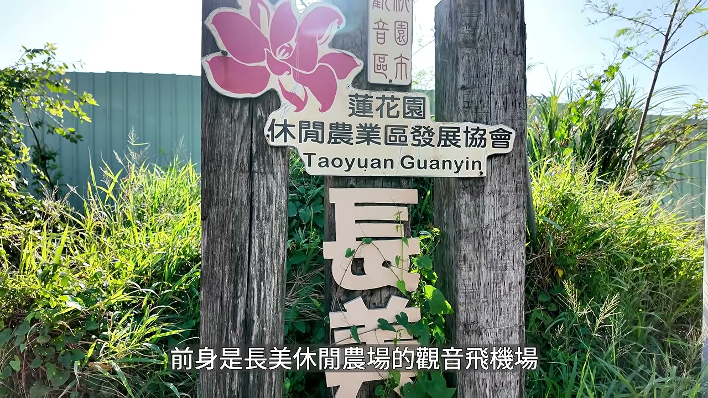

- [00:18:40] 現在來到的是在觀音中山路
- [00:18:42] **前身是長美休閒農場的觀音飛機場**
- [00:18:45] 它就曾經是結合民航元素

## 13. 來來牛家莊牛肉麵　[00:20:35]

位在觀音工業區裡、外觀低調的牛肉麵店，菜單只有清燉牛肉麵、牛肉湯、蔥油拌麵三樣，牛肋條鋪滿整個碗。

- [00:20:23] 以全新面貌再次對外亮相
- [00:20:35] **現在我們來到了位於觀音工業區**
- [00:20:38] 裡面的來來牛家莊

## 14. 台灣燈塔高度比較　[00:23:57]

白沙岬燈塔27.7公尺，高於富貴角、鼻頭角、三貂角、鵝鑾鼻、花嶼與漁翁島燈塔，被宣布在這個比較中勝出。

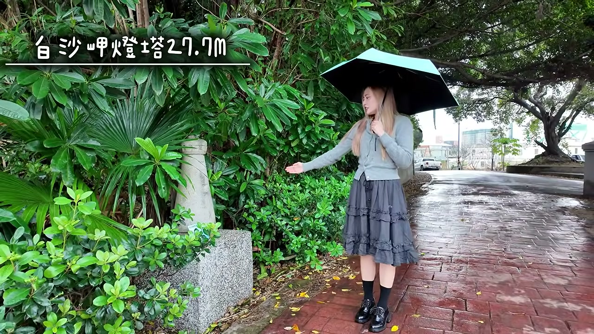

- [00:23:53] 人不可貌相
- [00:23:57] **白沙岬燈塔27.7公尺**
- [00:24:01] 富貴角燈塔14.3公尺

## 15. 白沙岬燈塔　[00:24:35]

日治時期1898年開始興建，已有百年歷史，2021年升格國定古蹟，是台灣保存最完整的日治初期燈塔。原高約37公尺，二戰後受損重建為27.7公尺。

- [00:24:22] 一日多塔成功
- [00:24:35] **位於桃園觀音海岸的白沙岬燈塔**
- [00:24:38] 是於日治時期1898年開始興建

## 16. 日治時期的防空洞　[00:26:03]

停車場旁有兩棟白色凸起建築是日治時期防空洞，因燈塔位在航運要道、容易成為轟炸目標，成為燈塔守護者的避難所。

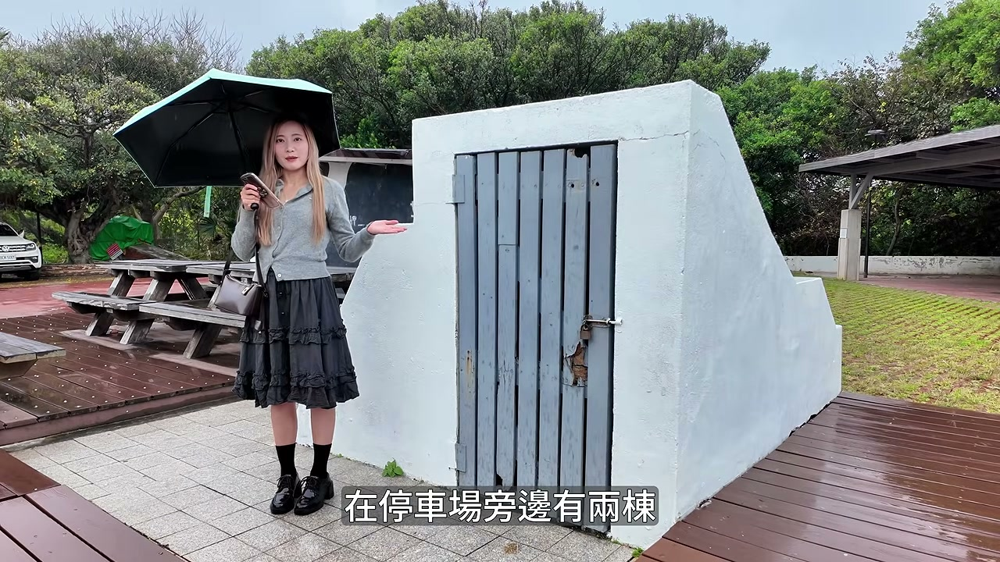

- [00:25:58] 享受遼闊的海岸風光
- [00:26:03] **在停車場旁邊有兩棟**
- [00:26:05] 白色的凸起建築物

## 17. 紅塘埤　[00:26:52]

清治時期先民開墾，是觀音地區歷史最悠久的埤塘之一，蓄水量在大桃園排名前三；石門水庫與桃園大圳建成後轉型，興建環塘步道成為休憩空間。

- [00:26:24] 可以提早發現提早治療
- [00:26:52] **紅塘埤為清治時期**
- [00:26:54] 墾拓先民所開墾的

## 18. 桃園台地與埤塘地景的由來　[00:27:35]

桃園台地由古石門溪沖積形成，後來淡水河溯源侵蝕造成台灣最大規模的河川劫奪，奪走南崁溪中上游水源；加上紅壤透水性差、地下水不易取得，早期居民便開鑿埤塘儲水灌溉。

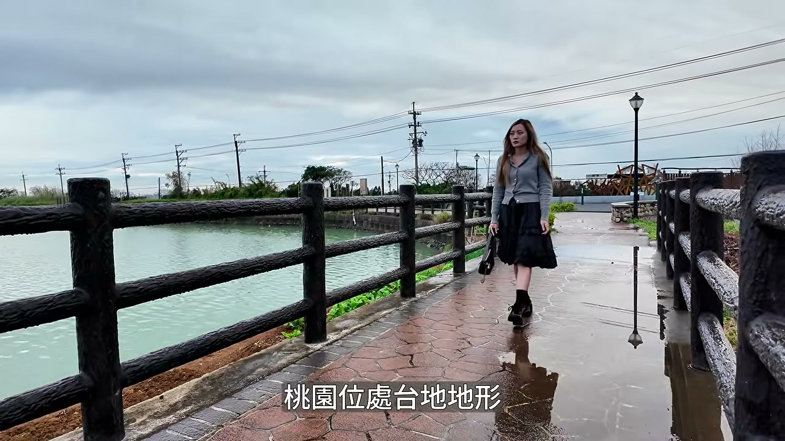

- [00:27:32] 比較像蛋黃酥的顏色
- [00:27:35] **桃園位處台地地形**
- [00:27:36] 因古石門溪沖積形成

## 19. 草漯沙丘　[00:28:23]

全台第一個沙丘地質公園，有台版撒哈拉沙漠之稱，是全台海岸線最寬廣、最完整的沙丘地景；由東北季風與南風把飄沙推積而成，北起老街溪口、南至大崛溪口，最高可達15公尺。

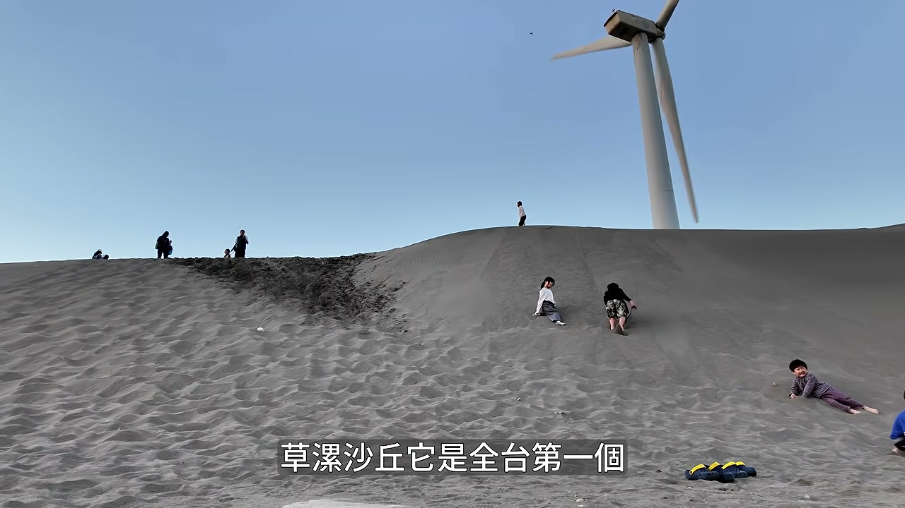

- [00:28:21] 對啊 你看頭髮都被吹成這樣子了
- [00:28:23] **草漯沙丘它是全台第一個**
- [00:28:26] 沙丘地質公園

## 20. 甘泉寺與石觀音　[00:29:54]

寺後有寬11、高18公尺的觀世音銅雕，是全台唯一三層樓高的觀音壁雕。前身福龍寺，起源於清乾隆年間約1780年；據傳農夫在溪邊拾獲酷似觀世音的石頭供奉，稱石觀音，是觀音區地名由來；後因泉水被認為能治百病，改名甘泉寺。

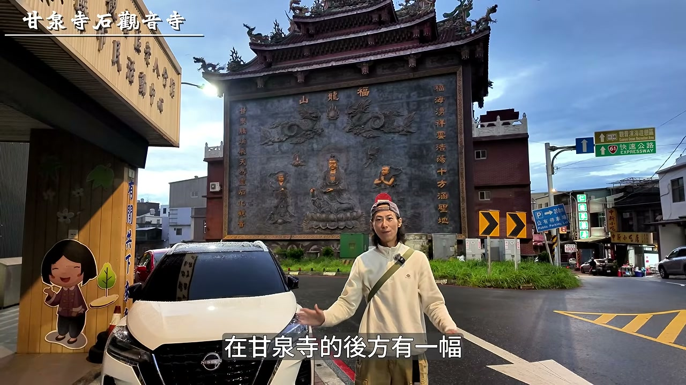

- [00:29:46] 是要滾下去嗎
- [00:29:54] **在甘泉寺的後方有一幅**
- [00:29:56] 寬11高18公尺的觀世音銅雕

## 21. 甘泉寺的三大祭典　[00:31:06]

每年三大祭典：農曆2月19日觀世音佛誕辰、4月22日石觀音顯聖日、7月17和18日中元普渡；並結合佛誕舉辦石觀音文化節。

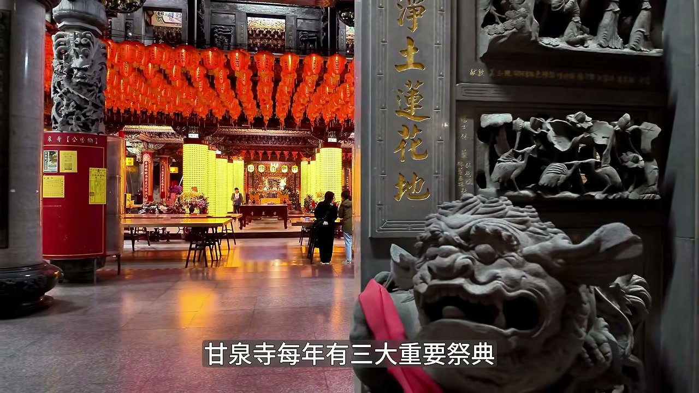

- [00:31:01] 展現儒 釋 道三教並容的宗教特色
- [00:31:06] **甘泉寺每年有三大重要祭典**
- [00:31:09] 分別是農曆2月19日的觀世音佛誕辰

## 22. 甘泉寺的自流井與甘露瓶　[00:31:51]

寺旁自流井水質清澈、流量穩定，據說能治百病；廟方提供甘露瓶讓信徒取水，告示牌說水已過濾，但建議煮沸後再飲用。

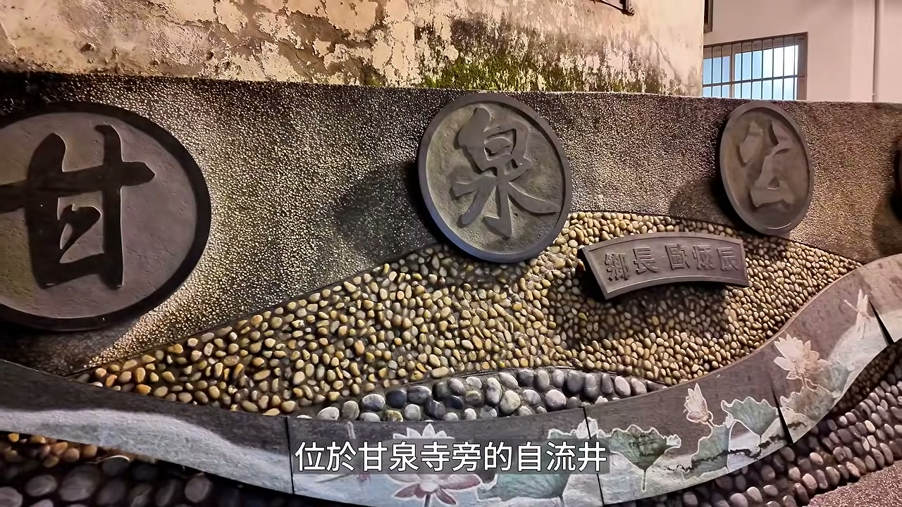

- [00:31:45] 象徵風調雨順 國泰民安
- [00:31:51] **位於甘泉寺旁的自流井**
- [00:31:53] 水質清澈 流量穩定

## 23. 安可土雞城　[00:33:02]

位於草漯沙丘附近，外觀低調像民宅，內部高朋滿座；平日只賣午餐、晚餐只有假日，強烈建議訂位。雞湯有半隻與整隻兩種選擇，鹹酥雞是招牌。

- [00:32:54] 還要誠心祈求才有好水可以喝
- [00:33:02] **位於草漯沙丘附近的這間**
- [00:33:05] 安可土雞城

## 24. 這趟觀音一日遊的結論　[00:36:15]

主持人認為觀音很適合全家大小一起玩：休閒農場多、還能看飛機，餐點份量大很適合多人分食。

- [00:36:12] 其實我覺得今天行程都還不錯
- [00:36:15] **然後其實我覺得觀音這邊**
- [00:36:17] 好像滿適合就是
