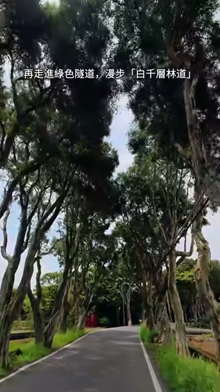
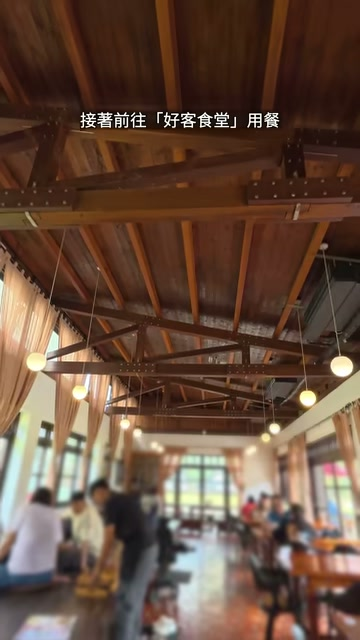
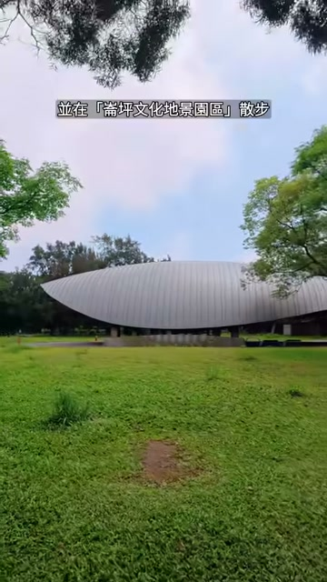
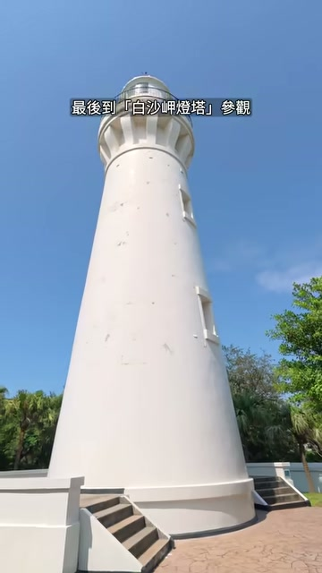

# 桃園觀音一日遊｜百合花海＋綠色隧道＋百年燈塔 #旅行 #景點 #賞花｜重點

- YouTube Video ID：uRHrog9kbvA
- 原始網址：https://youtube.com/shorts/uRHrog9kbvA?si=HV51h_uice8StG-i
- 字幕來源：上傳者提供（zh-Hant）
- 重點數量：5
- 重點怎麼挑的：由 AI（Claude）逐句讀完上傳者字幕後挑選；這支只有 9 句，是一日遊的 5 個景點行程，所以挑出 5 個景點。未經人工確認。
- 注意：重點是依字幕內容挑選，未經人工確認。

## 1. 第一站：白千層鐵炮百合花園　[00:00:05]

先到「白千層鐵炮百合花園」賞花海。

- [00:00:01] 這次來到桃園市觀音區一日遊
- [00:00:05] **先到「白千層鐵炮百合花園」賞花海**
- [00:00:08] 再走進綠色隧道，漫步「白千層林道」

## 2. 第二站：白千層林道（綠色隧道）　[00:00:08]

走進綠色隧道，漫步「白千層林道」。

- [00:00:05] 先到「白千層鐵炮百合花園」賞花海
- [00:00:08] **再走進綠色隧道，漫步「白千層林道」**
- [00:00:11] 接著前往「好客食堂」用餐

## 3. 第三站：好客食堂　[00:00:11]

前往「好客食堂」用餐。

- [00:00:08] 再走進綠色隧道，漫步「白千層林道」
- [00:00:11] **接著前往「好客食堂」用餐**
- [00:00:13] 並在「崙坪文化地景園區」散步

## 4. 第四站：崙坪文化地景園區　[00:00:13]

在「崙坪文化地景園區」散步。

- [00:00:11] 接著前往「好客食堂」用餐
- [00:00:13] **並在「崙坪文化地景園區」散步**
- [00:00:16] 最後到「白沙岬燈塔」參觀

## 5. 第五站：白沙岬燈塔　[00:00:16]

最後到「白沙岬燈塔」參觀。

- [00:00:13] 並在「崙坪文化地景園區」散步
- [00:00:16] **最後到「白沙岬燈塔」參觀**
- [00:00:19] 欲知詳情，快點連結
