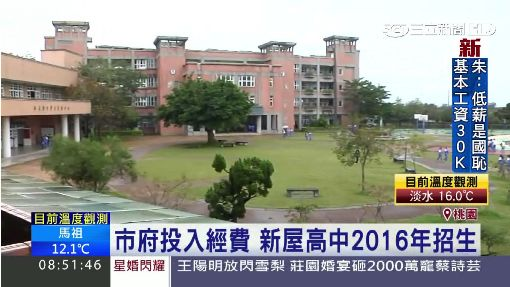
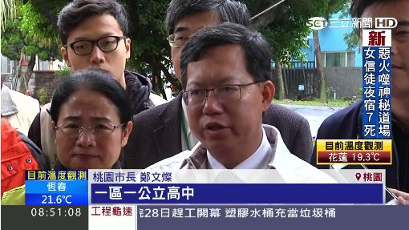
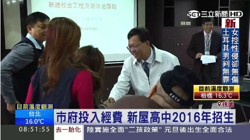

# 一區一高中！新屋國中改制高中　學生就學方便 | 政治 | 三立新聞網  SETN.COM

- ID：page001_10
- 父頁面 ID：page001
- 深度：1
- 網站：www.setn.com
- 原始網址：http://www.setn.com/E/News.aspx?NewsID=115874
- 狀態：success
- 作者：三立新聞網
- 主題：歷史文化與信仰
- 關鍵字：桃園市、地方旅遊、觀光資訊
- 擷取時間：2026-11-03T15:49:39.270345+00:00

## 清理後正文

王妃看板壓佀廣洋上　里長：掛到11月底
23:45
美期中選舉牽動股市　法人揭3套股市劇本
23:45
家門遭國產署圍鐵皮　住戶：我明明有承租
23:39
深夜地牛翻身！23:22規模4.5地震
23:30
川普接受福斯節目電訪　證實美軍空襲伊朗
23:29
伊朗高官：美伊距達成終戰協議仍遙遠
23:18
獨／中山女高學生雨中彩排　校方挨批
23:16
QS亞洲大學排名　台大排23、成大進步最多
23:12
他守4法則退休了！靠0050 20年滾出3800萬
23:11
梶浦由記來台！領5歌姬飆唱《鬼滅》神曲
23:10
台鐵驚見2包裹收件人習近平！內容物曝
23:08
林佳龍：美國的AI壯志需要台灣協力促成
22:58
支持者包船進關渡！沈伯洋車掃變「水戰」
22:51
新／期中選舉3大指數走揚 台指期一度44Ｋ
22:45
基市前議長蔡旺璉涉賄選　複訊後10萬交保
22:37
新／確定跑了！張俊傑逃亡3度偷渡成功
22:36
前央視主持人「跳機」求庇護！移民署介入
22:36
台指期急彈600點！專家：台股有好戲看了
22:30
蔣萬安寧夏夜市掃街！沈伯洋精華影片尬場
22:07
零經驗闖微短劇！他揭3天拍60集內幕
22:01
台灣彩券開獎直播中
20:31
LIVE三立+24小時直播
15:27
三立iNEWS新聞台線上直播
18:00
酷澎多元防災行動榮獲政府雙重肯定
20:00
雷艾美談紅毯保養哲學　修護保濕雙管齊下
14:00
針線緣／搭都更時事　沈世朋出演武泰吉董
14:00
應援路跑 克寧UC-ll奶粉為跑者補充行動力
12:00
接送樂齡暖心陪伴 助偏鄉長者上學去
12:00
植物性Omega-3「藻齡光」富含DHA、EPA
12:00
高雄三民區競總成立！綠營跨派系拚過半
10:00
賴清德領軍力挺！莊競程競總成立注強心針
18:00
高球長春公開賽落幕！泰名將托馬倫三連霸
18:00
台灣新藥赴日 伴膝關節退化病人走更遠
16:00
施政滿意度新高！饒慶鈴獲標竿縣市首長獎
10:00
2026 TCCF 盛大登場！跨國合製突破六成
18:15
新安東京海上產險推廣長者「駕駛體智能」
14:00
慎防新型態保單詐騙！金管會揭密話術
10:00
林月琴拋「苗栗水都」政見 打造台版金澤
10:00
中信房屋公益月熱血啟動
08:00
文策院推動文化ESG接軌國際！
20:00
流感「中風心梗風險增近10倍」醫籲做1事
12:17
日本人氣IP「LOVEEZ」主題超商超療癒
12:00
倒數
25
天
加入Google首選
請點選打勾將「三立新聞網」為首選來源，在 Google 上查看更多我們的精彩報導
看新聞換好禮
5
即將獲得2枚
0
/50
此篇Get2枚
一區一高中！新屋國中改制高中　學生就學方便
2016/01/01 18:00:00
加入Google首選
請點選打勾將「三立新聞網」為首選來源，在 Google 上查看更多我們的精彩報導
三立新聞／綜合報導
學生上課念書再平常不過，但是對桃園市新屋區的學生，如果要念公立高中，卻得花更多的通勤時間到其他行政區念書，因為桃園一共13個行政區，只剩新屋區沒有公立高中，現在市府落實一區一高中的政策，決定將新屋國中改制為新屋高中。
跳繩比體力，桃園市長鄭文燦就職一週年這天，特別來視察將改制為新屋高中的新屋國中，要讓在地人就近就能有公立高中可選擇。
鄭文燦：「主要的是我們希望一區一公立高中，那麼新屋確實沒有公立高中。」
新屋國中成立將近一甲子，但是在附近的學生如果要讀高中，卻得老遠到別的行政區就讀，舟車勞頓又浪費時間。2016年八月開始改制，新屋高中將招收第一批學生，升學管道更暢通。
鄭文燦：「新屋雖然是偏鄉，但是我們教育投資是絕對不會少，那麼今年我已經匡列了大潭電廠以及機場噪音的回饋金，從明年開始大園、觀音、新屋三所學校營養午餐免費。」
桃園市總共有13個行政區，只剩新屋區還沒設立公立高中，現在終於正案，市府投入經費資源，除了落實一區一高中的政策，也縮小城鄉差距。
➲
按個讚！更多重大新聞搶先看》》
https://www.facebook.com/setnews
【三立新聞粉絲團】
➲
即時新聞隨時掌握！點此下載【三立新聞網APP】
桃園
鄭文燦
新屋
高中
國中
公立
延伸閱讀
拿到選舉補助款怎麼花？沈伯洋答案超感人
專訪網笑翻！網酸爆蔣萬安
民調／何欣純超車了　領先江啟臣2位數
訪沈伯洋藏殺機？他揪「謝震武最難一題」
蔣萬安變陣！綠湧入電話「都講同一件事」
她認識蔣萬安認「人不壞」但表態挺沈伯洋
現正直播
<iframe title = "CH54三立新聞台直播" src="https://player.svc.litv.tv/v3/ppnif.html?s=c2V0bmNoX3dlYg==&c=setnewsrtmp&t=CH54三立新聞台直播" frameborder="0" scrolling="no" mozallowfullscreen webkitallowfullscreen allowfullscreen style="width: 100%; aspect-ratio: 16 / 9;"></iframe>
CH54三立新聞台直播
現正直播
更多
【#直播中LIVE】新台派上線 20261103
熱門新聞
更多
謝震武專訪沈伯洋13小時破百萬　超蔣萬安
沈春華當面勸蔣萬安當機立斷：你沒自信嗎
趙少康回陳水扁：酒店關門就走　含義曝光
沈伯洋遭扯說謊消費母　張雅琴一句KO網淚
蔣萬安反問辯論表現！沈春華一席話網笑了
民調／綠勝藍白！民進黨喜好度46.5%
沈春華直球問和鄭麗文同台？蔣萬安反應曝
5媒體人訪蔣沈差很大！網笑：表情是答案
曾預言柯文哲空亡！周映君：新北這人會中
網敲碗「週休三日」　陳水扁一句話給答案
熱搜新聞
更多
相關新聞
高雄三民區競總成立！綠營跨派系拚過半
1天前
王妃看板壓佀廣洋上　里長：掛到11月底
4分鐘前
林佳龍：美國的AI壯志需要台灣協力促成
51分鐘前
支持者包船進關渡！沈伯洋車掃變「水戰」
58分鐘前
基市前議長蔡旺璉涉賄選　複訊後10萬交保
1小時前
前央視主持人「跳機」求庇護！移民署介入
1小時前
新／確定跑了！張俊傑逃亡3度偷渡成功
1小時前
夢多上街問台北有何不滿？民眾狂吐槽這點
1小時前
其他人也在看

## 圖片
-  — [原始圖片來源](https://attach.setn.com/newsimages/2015/12/28/416840-XXL.jpg) 
-  — [原始圖片來源](https://attach.setn.com/newsimages/2015/12/28/416839-XXL.jpg) 
-  — [原始圖片來源](https://attach.setn.com/newsimages/2015/12/28/416838-XXL.jpg) 

## 頁面連結
- [娛樂星聞](https://star.setn.com?utm_source=setn.com&utm_medium=subweb&utm_campaign=webstar)
- [iNEWS](https://inews.setn.com?utm_source=setn.com&utm_medium=subweb&utm_campaign=webinews)
- [祝你健康](https://health.setn.com?utm_source=setn.com&utm_medium=subweb&utm_campaign=health)
- [寶島神很大](https://baodao.setn.com?utm_source=setn.com&utm_medium=subweb&utm_campaign=webbaodao)
- [富房網](https://fuhouse.setn.com?utm_source=setn.com&utm_medium=subweb&utm_campaign=webfuhouse)
- [即時](https://www.setn.com/viewall)
- [影音](https://www.setn.com/videos)
- [https://live.setn.com/](https://live.setn.com/)
- [社會](https://www.setn.com/catalog/society)
- [娛樂](https://star.setn.com/)
- [生活](https://www.setn.com/catalog/life)
- [健康](https://health.setn.com/)
- [國際](https://www.setn.com/catalog/world)
- [兩岸](https://www.setn.com/catalog/china)
- [運動](https://www.setn.com/catalog/sports)
- [財經](https://www.setn.com/catalog/money)
- [專題](https://www.setn.com/plist)
- [新奇](https://www.setn.com/catalog/odd)
- [科技](https://www.setn.com/catalog/technology)
- [旅遊](https://www.setn.com/catalog/travel)
- [汽車](https://www.setn.com/catalog/car)
- [寵物](https://www.setn.com/catalog/pet)
- [作者](https://www.setn.com/author)
- [阿立導讀](https://idata.setn.com/portal/personal?utm_source=setn.com&utm_medium=idata&utm_campaign=idata)
- [特企](https://www.setn.com/plist/53)
- [遊戲](https://esport.setn.com?utm_source=setn.com&utm_medium=esport&utm_campaign=esport)
- [專欄](https://www.setn.com/column)
- [民調](https://www.setn.com/votelist)
- [活動](https://www.setn.com/activity)
- [ESG永續](https://esg.settv.com.tw/)
- [美期中選舉牽動股市　法人揭3套股市劇本](https://www.setn.com/news/1933017)
- [家門遭國產署圍鐵皮　住戶：我明明有承租](https://www.setn.com/news/1932961)
- [深夜地牛翻身！23:22規模4.5地震](https://www.setn.com/news/1933069)
- [川普接受福斯節目電訪　證實美軍空襲伊朗](https://www.setn.com/news/1933068)
- [伊朗高官：美伊距達成終戰協議仍遙遠](https://www.setn.com/news/1932985)
- [獨／中山女高學生雨中彩排　校方挨批](https://www.setn.com/news/1932960)
- [QS亞洲大學排名　台大排23、成大進步最多](https://www.setn.com/news/1933039)
- [他守4法則退休了！靠0050 20年滾出3800萬](https://www.setn.com/news/1933064)
- [梶浦由記來台！領5歌姬飆唱《鬼滅》神曲](https://www.setn.com/news/1933065)
- [台鐵驚見2包裹收件人習近平！內容物曝](https://www.setn.com/news/1933063)
- [新／期中選舉3大指數走揚 台指期一度44Ｋ](https://www.setn.com/news/1933060)
- [台指期急彈600點！專家：台股有好戲看了](https://www.setn.com/news/1933057)
- [蔣萬安寧夏夜市掃街！沈伯洋精華影片尬場](https://www.setn.com/news/1933043)
- [零經驗闖微短劇！他揭3天拍60集內幕](https://www.setn.com/news/1932951)
- [彩券](https://acts.setn.com/event/ilottery/)
- [LIVE三立+24小時直播](https://live.setn.com/Live/358)
- [三立iNEWS新聞台線上直播](https://live.setn.com/Live/691)
- [雷艾美談紅毯保養哲學　修護保濕雙管齊下](https://www.setn.com/news/1932704)
- [針線緣／搭都更時事　沈世朋出演武泰吉董](https://www.setn.com/news/1932785)
- [接送樂齡暖心陪伴 助偏鄉長者上學去](https://www.setn.com/news/1932183)
- [賴清德領軍力挺！莊競程競總成立注強心針](https://www.setn.com/news/1931471)
- [高球長春公開賽落幕！泰名將托馬倫三連霸](https://www.setn.com/news/1931320)
- [台灣新藥赴日 伴膝關節退化病人走更遠](https://www.setn.com/news/1931460)
- [施政滿意度新高！饒慶鈴獲標竿縣市首長獎](https://www.setn.com/news/1931230)
- [2026 TCCF 盛大登場！跨國合製突破六成](https://www.setn.com/news/1930989)
- [新安東京海上產險推廣長者「駕駛體智能」](https://www.setn.com/news/1930873)
- [慎防新型態保單詐騙！金管會揭密話術](https://www.setn.com/news/1930677)
- [林月琴拋「苗栗水都」政見 打造台版金澤](https://www.setn.com/news/1930715)
- [中信房屋公益月熱血啟動](https://www.setn.com/news/1930510)
- [文策院推動文化ESG接軌國際！](https://www.setn.com/news/1930504)
- [流感「中風心梗風險增近10倍」醫籲做1事](https://www.setn.com/news/1930245)
- [日本人氣IP「LOVEEZ」主題超商超療癒](https://www.setn.com/news/1930192)
- [https://setnsocial.pse.is/9jrve3](https://setnsocial.pse.is/9jrve3)
- [https://www.setn.com/](https://www.setn.com/)
- [政治](https://www.setn.com/catalog/politics)
- [0 /50 
 此篇Get2枚](https://member.setn.com/)
- [加入Google首選](https://www.google.com/preferences/source?q=三立新聞網)
- [https://www.facebook.com/sharer/sharer.php?u=https://www.setn.com/news/115874](https://www.facebook.com/sharer/sharer.php?u=https://www.setn.com/news/115874)
- [https://line.naver.jp/R/msg/text/?%e4%b8%80%e5%8d%80%e4%b8%80%e9%ab%98%e4%b8%ad%ef%bc%81%e6%96%b0%e5%b1%8b%e5%9c%8b%e4%b8%ad%e6%94%b9%e5%88%b6%e9%ab%98%e4%b8%ad%e3%80%80%e5%ad%b8%e7%94%9f%e5%b0%b1%e5%ad%b8%e6%96%b9%e4%be%bf%0D%0Ahttps://www.setn.com/news/115874](https://line.naver.jp/R/msg/text/?%e4%b8%80%e5%8d%80%e4%b8%80%e9%ab%98%e4%b8%ad%ef%bc%81%e6%96%b0%e5%b1%8b%e5%9c%8b%e4%b8%ad%e6%94%b9%e5%88%b6%e9%ab%98%e4%b8%ad%e3%80%80%e5%ad%b8%e7%94%9f%e5%b0%b1%e5%ad%b8%e6%96%b9%e4%be%bf%0D%0Ahttps://www.setn.com/news/115874)
- [https://www.threads.net/intent/post?text=%e4%b8%80%e5%8d%80%e4%b8%80%e9%ab%98%e4%b8%ad%ef%bc%81%e6%96%b0%e5%b1%8b%e5%9c%8b%e4%b8%ad%e6%94%b9%e5%88%b6%e9%ab%98%e4%b8%ad%e3%80%80%e5%ad%b8%e7%94%9f%e5%b0%b1%e5%ad%b8%e6%96%b9%e4%be%bf&url=https://www.setn.com/news/115874](https://www.threads.net/intent/post?text=%e4%b8%80%e5%8d%80%e4%b8%80%e9%ab%98%e4%b8%ad%ef%bc%81%e6%96%b0%e5%b1%8b%e5%9c%8b%e4%b8%ad%e6%94%b9%e5%88%b6%e9%ab%98%e4%b8%ad%e3%80%80%e5%ad%b8%e7%94%9f%e5%b0%b1%e5%ad%b8%e6%96%b9%e4%be%bf&url=https://www.setn.com/news/115874)
- [【三立新聞粉絲團】](https://www.facebook.com/setnews/)
- [即時新聞隨時掌握！點此下載【三立新聞網APP】](http://goo.gl/TPdW1k)
- [桃園](https://www.setn.com/klist/1959)
- [鄭文燦](https://www.setn.com/klist/7421)
- [新屋](https://www.setn.com/klist/43960)
- [高中](https://www.setn.com/klist/8726)
- [國中](https://www.setn.com/klist/4067)
- [公立](https://www.setn.com/klist/26903)
- [拿到選舉補助款怎麼花？沈伯洋答案超感人](https://www.setn.com/news/1932510)
- [專訪網笑翻！網酸爆蔣萬安](https://www.setn.com/news/1932495)
- [民調／何欣純超車了　領先江啟臣2位數](https://www.setn.com/news/1932624)
- [訪沈伯洋藏殺機？他揪「謝震武最難一題」](https://www.setn.com/news/1932501)
- [蔣萬安變陣！綠湧入電話「都講同一件事」](https://www.setn.com/news/1932557)
- [她認識蔣萬安認「人不壞」但表態挺沈伯洋](https://www.setn.com/news/1932560)
- [熱搜](https://www.setn.com/topic)
- [高雄三民區競總成立！綠營跨派系拚過半](https://www.setn.com/news/1932138)
- [王妃看板壓佀廣洋上　里長：掛到11月底](https://www.setn.com/news/1932977)
- [林佳龍：美國的AI壯志需要台灣協力促成](https://www.setn.com/news/1933062)
- [支持者包船進關渡！沈伯洋車掃變「水戰」](https://www.setn.com/news/1933055)
- [基市前議長蔡旺璉涉賄選　複訊後10萬交保](https://www.setn.com/news/1932889)
- [前央視主持人「跳機」求庇護！移民署介入](https://www.setn.com/news/1933053)
- [新／確定跑了！張俊傑逃亡3度偷渡成功](https://www.setn.com/news/1933058)
- [夢多上街問台北有何不滿？民眾狂吐槽這點 
 1小時前](https://www.setn.com/news/1933056)
- [更多](https://live.setn.com/Live/4316)
- [熱門](https://www.setn.com/viewall/0)
- [謝震武專訪沈伯洋13小時破百萬　超蔣萬安](https://www.setn.com/news/1932632)
- [沈春華當面勸蔣萬安當機立斷：你沒自信嗎](https://www.setn.com/news/1932643)
- [趙少康回陳水扁：酒店關門就走　含義曝光](https://www.setn.com/news/1932500)
- [沈伯洋遭扯說謊消費母　張雅琴一句KO網淚](https://www.setn.com/news/1932496)
- [蔣萬安反問辯論表現！沈春華一席話網笑了](https://www.setn.com/news/1932829)

> 備註：進階解析失敗，已使用內建解析器：AttributeError: 'NoneType' object has no attribute 'get'
