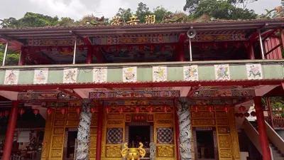
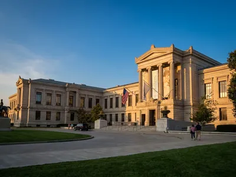

# #觀音 - 推薦內容｜方格子 vocus

- ID：page009_2
- 父頁面 ID：page009
- 深度：1
- 網站：vocus.cc
- 原始網址：https://vocus.cc/tags/%E8%A7%80%E9%9F%B3
- 狀態：success
- 發表日期：2026-11-03T12:00:36+08:00
- 主題：歷史文化與信仰、地方產業與農漁業、觀光景點與活動
- 關鍵字：地方旅遊、觀光資訊、在地資訊
- 擷取時間：2026-11-04T12:43:44.294613+00:00

## 清理後正文

觀音
含有「觀音」共 427 篇內容
全部內容
發佈日期由新至舊
阿迪的沙龍
2026/11/03
長榮女中的無頭鬼影與甕城冤魂：台南「陳守娘」大戰廣澤尊王傳奇
長榮女中的無頭鬼影與甕城冤魂：台南「陳守娘」大戰廣澤尊王傳奇
清道光年間，台灣府城（今台南市）的經廳巷一帶，住著一名溫婉賢淑的奇女子，名叫陳守娘。她出身於府城書香小戶，自幼知書達禮、刺繡女紅無一不精，成年後嫁給了同城的林壽為妻。夫妻倆感情甚篤，雖然家境不算大富大貴，日子卻也過得平靜和美。
無奈天有不
#
冤魂
#
小姑
#
母女
59號房
2026/11/01
心有安處
佛學班有一次功課，是用 AI 生成與《心經》有關的圖像。這張月下竹林裡的觀音，就是那次留下的作品。
平常讀經，眼前是一行行文字；換成畫面，又多了一種親近的方式。月光落在竹林間，觀音端坐蓮花之上，一旁攤著經卷，香煙緩緩升起。看著看著，連平日急著做這、趕著做那的心，也像被輕輕按了暫停。
含 AI 應用內容
#
心經
#
作業
#
59號房
法啟
3 天前
59號房
發文者
3 天前
bravejim的沙龍
2026/10/30
[新北旅遊]純樸小鄉的信仰中心平溪區觀音巖、見證空襲信號的平安鐘
平溪觀音巖、平安鐘兩者有何關係呢??這兩者前者是寺廟、後者是歷史見證的景點。無論你是居住在新北市平溪區老街區域當地鄉民或是來到新北市平溪區老街區域旅遊的遊客，這兩者都在新北市平溪區歷史建築區域內、是新北市平溪區老街區域旅遊的當地必遊地點。
#
平溪
#
新北市
#
廟宇
Wang CH的沙龍
2026/10/29
世界博物館旅行筆記之四: 波士頓美術館
一座美術館，竟然可以讓人如此迅速地穿越不同時代與文化。
而我只是帶著一點好奇走進去，再帶著幾幅留在記憶裡的畫走出來。
#
博物館
#
波士頓
#
美術館
一念相應一念佛
2026/10/29
仁王護國經大意 (第三十集)
《仁王護國般若波羅蜜經》為本經的完整經題，簡稱《仁王經》。鑒於現今全球的災難頻發，護國息災非常迫切，此時弘揚與學習此經最為契機，因為這部經講的內容，就是護國，怎麼護國、息災。如能共同護持推廣，解行相應，必感得諸佛護念加持，減輕災劫風險，消災免難，轉危為安。
#
仁王護國經
#
消災免難
#
護國息災
伯塵｜星塵
2026/10/29
觀音九語・照見人心：生命的修行與大圓滿
剛好昨天10/28(農曆9/19)是觀世音菩薩的出家日，

如果你與觀音菩薩有緣，也許你現在正經歷一些困惑、凡考、迷茫，或者在人生的某個轉角需要一份指引......

那麼這些話，就是菩薩提醒正在修行、整理過去、期盼未來的你的心靈指引

一、 種福與求福：從「求好運」到「做個種福的人」

很多人向菩
含 AI 應用內容
#
觀音
#
觀世音菩薩
#
成長
老臣聊心室｜聽你的心，陪你調頻
2026/10/28
拜遍名剎才明白：為雙寶做早餐的晨光裡，我看懂了觀音媽媽的「心念即淨土」
真正的安定，從來不是逃去一個無風無浪的世外桃源，而是回到生活裡，安頓好自己的七情六慾。 

午後的廟埕前，香煙繚繞得讓人幾乎睜不開眼。你手裡緊緊拿著三炷香，雙膝沉沉跪在拜墊上，胸口堵著滿滿的委屈與疲憊，眼眶泛紅，嘴唇微顫著卻只能在心底反覆呢喃：「菩薩，我到底該怎麼辦？」

好不容易求了一支籤、擲了幾
#
靜心書寫
#
靜心練習
#
修心
Yuhao Huang
7 天前
老臣聊心室 LUYILIFE
發文者
7 天前
法采創作園地
2026/10/28
文字紀錄，護法博覽會第一天
一早，陽光明媚

放眼望去，金光閃耀

舉起手機隨手一拍

景色，色彩斑斕

沿著斜坡石磚走至觀音亭

凝視著稍遠處的山景

雲霧相伴，舒卷如畫

襯托著中台禪寺

只見觀音亭旁的蓮花們

正姿態優雅的綻放著

葉片愜意的漂浮在水面

承載著菩薩足跡步步芬芳

瞥一眼時間

差不多到了該返回圓覺
#
中台禪寺
#
博覽會
#
精舍
陳昆鴻的沙龍
2026/10/24
洗完最後一個碗，妳的飯，涼了
洗完最後一個碗，妳終於坐下來。飯還在桌上，筷子是冷的。朋友問：「最近還好嗎？」妳回：「我很好。」觀世音菩薩，給累壞了的妳一個很小的動作。
含 AI 應用內容
#
觀世音菩薩
#
觀音
#
自我照顧
神秘學講堂
2026/10/22
邏各斯的宇宙話語起源
本篇深入解析希臘語邏各斯及布拉瓦茨基的三階演化理論，從未顯現的父親與半顯現的母親開始，經由第二邏各斯與第三邏各斯，揭示世界蛋、禪那佛、宇宙心智和阿賴耶等核心概念，說明「話語」如何化作宇宙現象與建築者的力量。文章亦對第一、第二、第三邏各斯的分化、含義及與印度、希臘、卡巴拉等傳統思想的對照。
#
力量
#
輻射
#
觀音
‌
‌
‌
‌
‌
‌
‌
‌
‌
‌
‌
‌
‌
‌
‌
‌
‌
‌
‌
‌
‌
‌
‌
‌
‌
‌
‌
‌
‌
‌
‌
‌
‌
‌
‌
‌
‌
‌
‌
‌
‌
‌
‌
‌
‌
‌
‌
‌
‌
‌
‌
‌
‌
‌
‌
‌
‌
‌
‌
‌
‌
‌
‌
‌
‌
‌
‌
‌
‌
‌
‌
‌
‌
‌
‌
‌
‌
‌
‌
‌
‌
‌
‌
‌
‌
‌
‌
‌
‌
‌

## 圖片
-  — [原始圖片來源](https://img.vocus.cc/jRAiiaYeZRMETAUb736FoOda9Tb5ZfPRQsVrNMXpYok/w:400/f:webp/plain/https://images.vocus.cc/ad13d758-0d04-48e7-99c2-47a007a263da.jpg) 
-  — [原始圖片來源](https://img.vocus.cc/YZiNT5VmQpohd1QqUOF8RvKg09rCu399lmH3tmJDEP0/w:400/f:webp/plain/https://images.vocus.cc/fdb775d3-8a7f-4427-9b30-d8949cc32568.jpg) 
-  — [原始圖片來源](https://img.vocus.cc/Wad80fCaoYEiyzncSSfzAYDcpXe_phFFtBPGhl1-XmE/w:400/f:webp/plain/https://images.vocus.cc/a8a3eaf9-02f4-4f5f-8203-562ae455aaff.jpg) 

## 頁面連結
- [阿迪的沙龍 2026/11/03](https://vocus.cc/salon/6882524bfd89780001465c79)
- [長榮女中的無頭鬼影與甕城冤魂：台南「陳守娘」大戰廣澤尊王傳奇](https://vocus.cc/article/6ae95c41fd897800011af504)
- [# 冤魂](https://vocus.cc/tags/%E5%86%A4%E9%AD%82)
- [# 小姑](https://vocus.cc/tags/%E5%B0%8F%E5%A7%91)
- [# 母女](https://vocus.cc/tags/%E6%AF%8D%E5%A5%B3)
- [59號房 2026/11/01](https://vocus.cc/salon/room59)
- [心有安處](https://vocus.cc/article/6ae6d444fd89780001c26421)
- [# 心經](https://vocus.cc/tags/%E5%BF%83%E7%B6%93)
- [# 作業](https://vocus.cc/tags/%E4%BD%9C%E6%A5%AD)
- [# 59號房](https://vocus.cc/tags/59%E8%99%9F%E6%88%BF)
- [https://vocus.cc/user/6965e369fd8978000180e65a](https://vocus.cc/user/6965e369fd8978000180e65a)
- [https://vocus.cc/user/6a8ae5ce1b9f0a85644b67a8](https://vocus.cc/user/6a8ae5ce1b9f0a85644b67a8)
- [bravejim的沙龍 2026/10/30](https://vocus.cc/salon/659e9511fd8978000130737d)
- [[新北旅遊]純樸小鄉的信仰中心平溪區觀音巖、見證空襲信號的平安鐘](https://vocus.cc/article/6a7711cdfd8978000163b57f)
- [# 平溪](https://vocus.cc/tags/%E5%B9%B3%E6%BA%AA)
- [# 新北市](https://vocus.cc/tags/%E6%96%B0%E5%8C%97%E5%B8%82)
- [# 廟宇](https://vocus.cc/tags/%E5%BB%9F%E5%AE%87)
- [Wang CH的沙龍 2026/10/29](https://vocus.cc/salon/695f9ed3fd89780001a2b47c)
- [世界博物館旅行筆記之四: 波士頓美術館](https://vocus.cc/article/6ae32d66fd897800012b8963)
- [# 博物館](https://vocus.cc/tags/%E5%8D%9A%E7%89%A9%E9%A4%A8)
- [# 波士頓](https://vocus.cc/tags/%E6%B3%A2%E5%A3%AB%E9%A0%93)
- [# 美術館](https://vocus.cc/tags/%E7%BE%8E%E8%A1%93%E9%A4%A8)
- [一念相應一念佛 2026/10/29](https://vocus.cc/salon/amitabha-mindful)
- [仁王護國經大意 (第三十集)](https://vocus.cc/article/6ac9bdfffd897800013c8f97)
- [# 仁王護國經](https://vocus.cc/tags/%E4%BB%81%E7%8E%8B%E8%AD%B7%E5%9C%8B%E7%B6%93)
- [# 消災免難](https://vocus.cc/tags/%E6%B6%88%E7%81%BD%E5%85%8D%E9%9B%A3)
- [# 護國息災](https://vocus.cc/tags/%E8%AD%B7%E5%9C%8B%E6%81%AF%E7%81%BD)
- [伯塵｜星塵 2026/10/29](https://vocus.cc/salon/Bochen-Stardust)
- [觀音九語・照見人心：生命的修行與大圓滿](https://vocus.cc/article/6ae29743fd897800014bcbd7)
- [# 成長](https://vocus.cc/tags/%E6%88%90%E9%95%B7)
- [老臣聊心室｜聽你的心，陪你調頻 2026/10/28](https://vocus.cc/salon/LUYILIFE)
- [拜遍名剎才明白：為雙寶做早餐的晨光裡，我看懂了觀音媽媽的「心念即淨土」](https://vocus.cc/article/6ae162a8fd89780001bb3749)
- [# 靜心書寫](https://vocus.cc/tags/%E9%9D%9C%E5%BF%83%E6%9B%B8%E5%AF%AB)
- [# 靜心練習](https://vocus.cc/tags/%E9%9D%9C%E5%BF%83%E7%B7%B4%E7%BF%92)
- [# 修心](https://vocus.cc/tags/%E4%BF%AE%E5%BF%83)
- [https://vocus.cc/user/5eab7492fd897800019cf8b3](https://vocus.cc/user/5eab7492fd897800019cf8b3)
- [https://vocus.cc/user/5a8d4c9deceaed2050e38b2d](https://vocus.cc/user/5a8d4c9deceaed2050e38b2d)
- [法采創作園地 2026/10/28](https://vocus.cc/salon/6617b35ffd897800015d3575)
- [文字紀錄，護法博覽會第一天](https://vocus.cc/article/6ae14a71fd89780001b6c766)
- [# 中台禪寺](https://vocus.cc/tags/%E4%B8%AD%E5%8F%B0%E7%A6%AA%E5%AF%BA)
- [# 博覽會](https://vocus.cc/tags/%E5%8D%9A%E8%A6%BD%E6%9C%83)
- [# 精舍](https://vocus.cc/tags/%E7%B2%BE%E8%88%8D)
- [陳昆鴻的沙龍 2026/10/24](https://vocus.cc/salon/6ab496c90908954e7247034e)
- [洗完最後一個碗，妳的飯，涼了](https://vocus.cc/article/6adb9d29fd89780001723222)
- [# 觀世音菩薩](https://vocus.cc/tags/%E8%A7%80%E4%B8%96%E9%9F%B3%E8%8F%A9%E8%96%A9)
- [# 自我照顧](https://vocus.cc/tags/%E8%87%AA%E6%88%91%E7%85%A7%E9%A1%A7)
- [神秘學講堂 2026/10/22](https://vocus.cc/salon/occultschool)
- [邏各斯的宇宙話語起源](https://vocus.cc/article/6930f51dfd89780001a9f08f)
- [# 力量](https://vocus.cc/tags/%E5%8A%9B%E9%87%8F)
- [# 輻射](https://vocus.cc/tags/%E8%BC%BB%E5%B0%84)
- [# 觀音](https://vocus.cc/tags/%E8%A7%80%E9%9F%B3)
