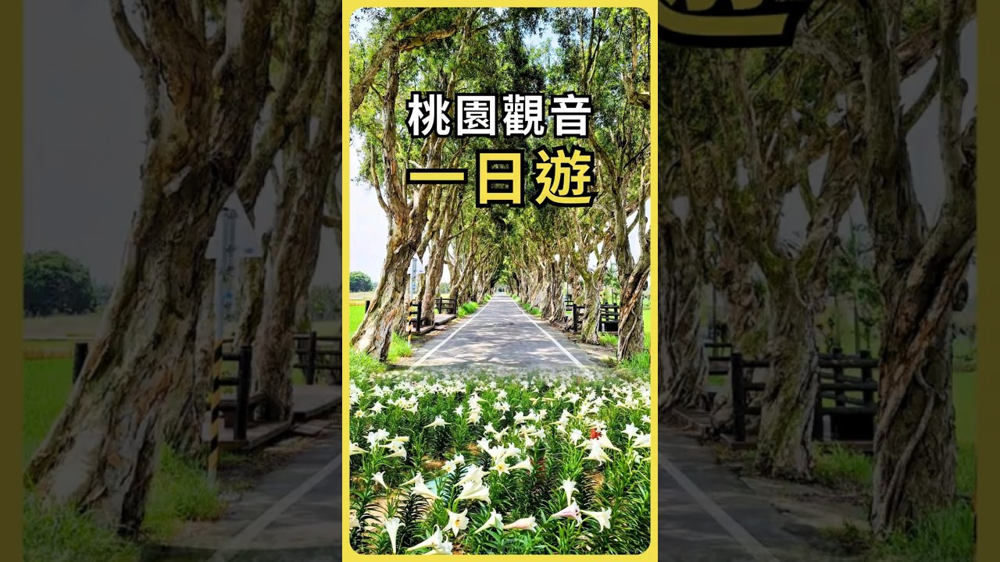

# 桃園觀音一日遊｜百合花海＋綠色隧道＋百年燈塔 #旅行 #景點 #賞花

- 文章／影片 ID：page027
- YouTube Video ID：uRHrog9kbvA
- 父頁面 ID：無（原始網址）
- 深度：0
- 頻道：雲行
- 原始網址：https://youtube.com/shorts/uRHrog9kbvA?si=HV51h_uice8StG-i
- 狀態：success
- 發布日期：未知
- 時長：00:00:23
- 代表畫面擷取狀態：missing_local_video
- 擷取備註：找不到本機影片檔。請將有權處理的影片放入 指定資料夾，並以 uRHrog9kbvA 開頭命名。
- 爬取備註：頁面未提供可讀字幕

## 影片縮圖

- 圖片來源：[原始圖片](https://i.ytimg.com/vi/uRHrog9kbvA/maxresdefault.jpg)

## 字幕與逐字稿
### YouTube 平台字幕
- 來源：YouTube
- **[00:00:00]** 我是雲
- **[00:00:01]** 這次來到桃園市觀音區一日遊
- **[00:00:05]** 先到「白千層鐵炮百合花園」賞花海
- **[00:00:08]** 再走進綠色隧道，漫步「白千層林道」
- **[00:00:11]** 接著前往「好客食堂」用餐
- **[00:00:13]** 並在「崙坪文化地景園區」散步
- **[00:00:16]** 最後到「白沙岬燈塔」參觀
- **[00:00:19]** 欲知詳情，快點連結
- **[00:00:21]** 若喜歡，按讚，訂閱

### 爬蟲流程中的 Whisper 逐字稿
- 來源：downloaded_audio
- 語言：zh
- **[00:00:00]** 嗨!我是圓,這次來到桃園市、觀音區與日遊。
- **[00:00:04]** 先到百千層鐵砲白河畫園賞花海。
- **[00:00:08]** 再走進綠色隧道,漫步百千成領導。
- **[00:00:11]** 接著前往浩克食堂用餐,並在人坪文化地景園區散步。
- **[00:00:16]** 最後到白沙甲登塔參觀,預知詳情快點連結。
- **[00:00:21]** 若喜歡、按讚、訂閱!

## 代表畫面
找不到本機影片檔。請將有權處理的影片放入 指定資料夾，並以 uRHrog9kbvA 開頭命名。
