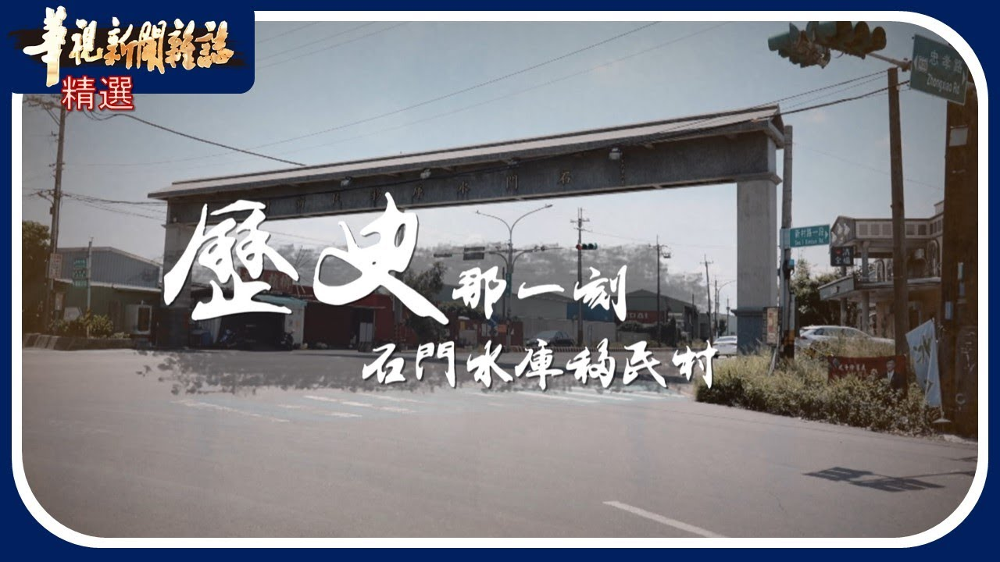

# 歷史那一刻 石門水庫遷村故事｜華視新聞雜誌｜精選

- 文章／影片 ID：page030
- YouTube Video ID：AWP_v5I0zYA
- 父頁面 ID：無（原始網址）
- 深度：0
- 頻道：華視新聞雜誌
- 原始網址：https://youtu.be/AWP_v5I0zYA?si=0RkOhrRUMGU9zJfu
- 狀態：success
- 發布日期：未知
- 時長：00:13:36
- 代表畫面擷取狀態：missing_local_video
- 擷取備註：找不到本機影片檔。請將有權處理的影片放入 指定資料夾，並以 AWP_v5I0zYA 開頭命名。
- 爬取備註：頁面未提供可讀字幕

## 影片縮圖

- 圖片來源：[原始圖片](https://i.ytimg.com/vi/AWP_v5I0zYA/maxresdefault.jpg)

## 字幕與逐字稿

### 爬蟲流程中的 Whisper 逐字稿
- 來源：downloaded_audio
- 語言：zh
- **[00:00:05]** 桃園水庫經營上午9點鐘開始洩洪。
- **[00:00:08]** 主要的推力就是在美國四十三年的時候發生一個大案。
- **[00:00:15]** 水庺就要做了,那以前的人你搬出去根本沒辦法。
- **[00:00:23]** 建築門水庇之後次貸每個人所想念的故鄉都不一樣。
- **[00:00:35]** 光復後新的水利設施不斷地興建,增加灌溉面積促進農業生產
- **[00:00:42]** 例如規模龐大的石門水庫
- **[00:00:45]** 1964年 石門的水库完工
- **[00:00:48]** 偉大工程的背後
- **[00:00:49]** 有278個家庭被迫搬遷的故事
- **[00:00:58]** 本來是民國47年搬過來了
- **[00:01:04]** 你沒有來就沒有了
- **[00:01:06]** 你也沒有錢也沒有
- **[00:01:08]** 勉強一定要來的時候
- **[00:01:10]** 那時候沒有來 你要去哪裡
- **[00:01:12]** 已經70多歲的保齡阿嬤
- **[00:01:15]** 前存當時 他只有10歲
- **[00:01:18]** 那時候都放在外面
- **[00:01:20]** 你不做 那個水都堵起來了
- **[00:01:23]** 要拿東西沒辦法拿來
- **[00:01:26]** 來這東西搬來 自己放在後面
- **[00:01:29]** 再慢慢蓋房子
- **[00:01:30]** 找事務來幫我們蓋
- **[00:01:32]** 那時候我們的木材
- **[00:01:34]** 什麼叫搬搬過來
- **[00:01:36]** 邊住 邊蓋 邊哭
- **[00:01:39]** 至今仁田用的木門
- **[00:01:41]** 這是他們僅存對老家的記憶
- **[00:01:44]** 這個老了 你看
- **[00:01:46]** 这个都是老的门
- **[00:01:49]** 那边拆过来了 你看
- **[00:01:53]** 第一批安戒居民一共29户
- **[00:01:56]** 毛连阿嬷一家是其中之一
- **[00:01:59]** 他们率先从桃园大气的山边
- **[00:02:02]** 来到冠英海边的草榻移民新村
- **[00:02:05]** 我们那里是算大湾坪第四林
- **[00:02:09]** 我们那裡才几户 八户而已
- **[00:02:12]** 三户搬过来
- **[00:02:14]** 来看一看就
- **[00:02:15]** 它有载我们来这里看
- **[00:02:17]** 你還是要來就是五個人八分地
- **[00:02:21]** 六個人一甲地
- **[00:02:23]** 抽籤 你抽你的房子在哪
- **[00:02:26]** 他的1號 5號房子
- **[00:02:27]** 也是抽籠 有地也是抽
- **[00:02:30]** 都自己種了
- **[00:02:31]** 種的才有長風
- **[00:02:34]** 沒有那個都是沙
- **[00:02:37]** 60多年過去
- **[00:02:38]** 他們對早年的生活記憶
- **[00:02:40]** 已經模糊
- **[00:02:41]** 現在圍繞村莊
- **[00:02:43]** 還有偶能遮蔭的西蘇樹林
- **[00:02:46]** 全都是移民 親手煮起的家園
- **[00:02:49]** 這個也是跟我們一起來的
- **[00:02:51]** 是有蓋這個給他看
- **[00:02:53]** 你才有那個九千塊
- **[00:02:55]** 還要蓋到這樣給他蓋
- **[00:02:56]** 一定最起碼要蓓這個兩張
- **[00:02:59]** 搬遷補助款不足
- **[00:03:01]** 蓋房子的錢
- **[00:03:02]** 從哪裡來
- **[00:03:04]** 凡事都得自己想辦法
- **[00:03:06]** 哪有公平九千元
- **[00:03:08]** 蓋那個房子
- **[00:03:09]** 沒有生偶會
- **[00:03:10]** 都沒有都靠自己
- **[00:03:11]** 全都是這個
- **[00:03:12]** 這個都是沙
- **[00:03:14]** 這海邊都是沿著
- **[00:03:18]** 動不起來啊
- **[00:03:23]** 加上海邊的田地嚴分高
- **[00:03:26]** 重務出高經濟價值的作物
- **[00:03:29]** 收入有限
- **[00:03:30]** 維持生計都有困難
- **[00:03:33]** 半遷當時
- **[00:03:34]** 阿嬤的年紀還很小
- **[00:03:36]** 千村的歷史
- **[00:03:37]** 我們只能從更年長的居民描述
- **[00:03:40]** 來拼湊全貌
- **[00:03:48]** 年過八十的唐阿公
- **[00:03:50]** 在1958年千村當時
- **[00:03:52]** 沒有獲得土地補償
- **[00:03:54]** 加上老家的田地
- **[00:03:56]** 在水庫蓄水之後
- **[00:03:58]** 連同家屋一併淹沒
- **[00:04:00]** 在生活無以為期的情況之下
- **[00:04:03]** 1969年他們舉家搬遷
- **[00:04:06]** 到草榻移民新村
- **[00:04:09]** 我16、17歲的時候
- **[00:04:11]** 我是去開會
- **[00:04:13]** 登記起來
- **[00:04:13]** 他說明國46年
- **[00:04:17]** 6月30號他就開會
- **[00:04:20]** 他就有所謂
- **[00:04:22]** 我們這個企業一直在開工
- **[00:04:25]** 國立6月30號
- **[00:04:27]** 沒有開復口的
- **[00:04:29]** 你就沒有權利佩服力
- **[00:04:32]** 在唐家移民二代
- **[00:04:33]** 湯崧琳的帶領下
- **[00:04:35]** 我們重回她在石門水庫的老家
- **[00:04:38]** 一趟大約50公里的路程
- **[00:04:40]** 不長不短
- **[00:04:42]** 卻切割了兩個世代
- **[00:04:44]** 對故鄉的記憶
- **[00:04:47]** 這些年來
- **[00:04:48]** 在石门水库的枯水期
- **[00:04:50]** 唐崧玲都會帶著村中長輩
- **[00:04:53]** 重新踏上被外界稱為
- **[00:04:55]** 夢幻大草原的新甘坪
- **[00:04:58]** 也是他們的老家
- **[00:04:59]** 日夜思念的故土
- **[00:05:02]** 像今天水位
- **[00:05:03]** 水負水位240億米就看不到
- **[00:05:05]** 要到234米才有辦法
- **[00:05:07]** 232米的時候
- **[00:05:09]** 大概前面左半部
- **[00:05:10]** 它左邊地是比較高
- **[00:05:12]** 就是越來越低
- **[00:05:15]** 到了最後那個更低
- **[00:05:16]** 要到225米才看得到
- **[00:05:18]** 那以前那個整台就是一個新甘坪
- **[00:05:21]** 那一個台階地形
- **[00:05:22]** 然後房子都靠在
- **[00:05:24]** 做蓋的那個靠近山腰下面
- **[00:05:26]** 那前面就是一些農地
- **[00:05:28]** 後面可能還會有一些茶園的竹園
- **[00:05:33]** 1964年石門水庫完工之後
- **[00:05:35]** 上游的集水區範圍高達1024公頃
- **[00:05:40]** 所有飆高250公尺以下的區域
- **[00:05:43]** 包含 新舊甘平
- **[00:05:45]** 大西坪
- **[00:05:47]** 阿牧坪等等
- **[00:05:48]** 都成為水下世界
- **[00:05:50]** 總計影響 2870人
- **[00:05:54]** 根據石門水庫建設制的記錄
- **[00:05:56]** 整個淹沒區共有 416戶
- **[00:06:00]** 但是扣除掉其他因素
- **[00:06:03]** 最後只剩下 278戶
- **[00:06:05]** 分成 5 匹
- **[00:06:06]** 先後遺亡草榻新村
- **[00:06:08]** 樹林和夏樹林新村
- **[00:06:11]** 大潭新村以及大輪尾
- **[00:06:14]** 大園鎮谷頭 許磋港
- **[00:06:16]** 還有82戶太雅族
- **[00:06:18]** 經過協商
- **[00:06:19]** 以往最靠近的大溪中莊
- **[00:06:23]** 有四種不同的房屋形態
- **[00:06:26]** 然後他們所建設出來的村子
- **[00:06:27]** 基本上包括醫療
- **[00:06:29]** 警察 單位等等
- **[00:06:31]** 其實都有配置
- **[00:06:33]** 整個就是一個村落的一個形態
- **[00:06:39]** 水庫浩大工程的開發
- **[00:06:41]** 大幅改變山川地貌
- **[00:06:44]** 成全經濟和安全的背後
- **[00:06:46]** 是來自居民離鄉的犧牲
- **[00:06:49]** 在桃園地區的部分
- **[00:06:51]** 因為它是一個所謂太地
- **[00:06:53]** 農民他們在耕種的時候
- **[00:06:54]** 其實是很缺水的
- **[00:06:56]** 其實真正主要的推力
- **[00:06:58]** 就是在美國43年的時候
- **[00:07:00]** 發生了一個大漢
- **[00:07:01]** 那他們就地方的官民
- **[00:07:03]** 就組成了
- **[00:07:04]** 一個石門水庫的出境委員會
- **[00:07:07]** 興建之初
- **[00:07:08]** 石門雪庫成為東亞第一大壩
- **[00:07:11]** 卻在啟用前一年
- **[00:07:12]** 面臨巨大考驗
- **[00:07:15]** 1963年9月
- **[00:07:16]** 強台格勒里來襲
- **[00:07:18]** 石門水庫水衛機身
- **[00:07:20]** 啟動首次洩洪
- **[00:07:23]** 颱風它發生在9月11號
- **[00:07:27]** 我們說石門的911事件
- **[00:07:30]** 那一次的話
- **[00:07:31]** 其實很快的21個小時之內
- **[00:07:35]** 它就已經升了快30公尺
- **[00:07:37]** 逼近到8點
- **[00:07:38]** 當時水上來的時候
- **[00:07:39]** 它就只能把門打開
- **[00:07:41]** 因為它的水是持續在往上升
- **[00:07:44]** 吐司壩就是不能讓它硬頂
- **[00:07:46]** 只要硬移頂這個吐士壩
- **[00:07:47]** 就會毀掉
- **[00:07:49]** 石門水庫挺過潰堤危機
- **[00:07:51]** 卻意外引發下游中樁新村的水患
- **[00:07:55]** 這裡的居民才剛安頓
- **[00:07:57]** 就給二度遷徙到大坦新村
- **[00:08:00]** 彷彿在石門寫庫興建之後
- **[00:08:02]** 移民們就此開啟世代流浪的宿命
- **[00:08:09]** 那個還在開發
- **[00:08:12]** 那個田都在西邊
- **[00:08:14]** 我記得老人家一個一個石頭
- **[00:08:17]** 一個一個班做田梗
- **[00:08:20]** 還沒種到稻子
- **[00:08:22]** 颱風就來了
- **[00:08:23]** 就沒有了
- **[00:08:24]** 我記得我爸爸把我拉拉
- **[00:08:27]** 幫小朋友
- **[00:08:29]** 媽 還有過一個小河有沒有
- **[00:08:33]** 我把他拉拉
- **[00:08:34]** 背著我往上爬
- **[00:08:37]** 他們躲在那邊下去看的時候
- **[00:08:38]** 看到說
- **[00:08:39]** 家裡幾乎都進到一半的
- **[00:08:41]** 就是石頭摻雜
- **[00:08:42]** 你殺
- **[00:08:43]** 經歷了這麼多次以後
- **[00:08:45]** 就很像政府又安排說
- **[00:08:47]** 怎麼是會安排選到觀音
- **[00:08:51]** 蘇秀娟和表哥王正德
- **[00:08:54]** 是泰雅族卡拉社的後裔
- **[00:08:56]** 因為石門水庫的興建和風災影響
- **[00:08:59]** 他們印象中的童年
- **[00:09:01]** 總是在老家夫行鄉
- **[00:09:03]** 和大壇新村反覆遷移
- **[00:09:06]** 把那邊沒辦法生活
- **[00:09:09]** 什麼都沒有辦法種植
- **[00:09:11]** 我讀書就這樣
- **[00:09:12]** 一年級 二年級
- **[00:09:14]** 三年級 是到最後生這邊畢業
- **[00:09:20]** 隸屬大壹廳
- **[00:09:21]** 和中油天然氣三階站的土地
- **[00:09:24]** 設置了鐵門阻擋
- **[00:09:27]** 這裡是蘇秀娟 童年的家
- **[00:09:29]** 大潭新村的路口
- **[00:09:31]** 十多年來
- **[00:09:32]** 互相早已改變了它遠久的樣貌
- **[00:09:36]** 遷移的命運尚未告終
- **[00:09:38]** 1970年代
- **[00:09:39]** 桃園濱海開發工業區
- **[00:09:45]** 由於這家化工廠過去
- **[00:09:46]** 曾排放含高量個沸水
- **[00:09:49]** 嚴重污染了附近的農田
- **[00:09:52]** 和附近的居民造成爆米
- **[00:09:54]** 成為隔隔米
- **[00:09:56]** 居名離換痛痛病
- **[00:09:58]** 我記得有一次高雲爆炸
- **[00:10:00]** 它鍋爐爆点
- **[00:10:01]** 鍋顱爆炖的時候
- **[00:10:02]** 我們的部落裡面的窗戶
- **[00:10:06]** 都被震破
- **[00:10:07]** 當時這群卡拉社後代
- **[00:10:09]** 雖然發起抗議
- **[00:10:11]** 但淨土卻無法復原
- **[00:10:13]** 那時候是還沒有隔烏冉的時候
- **[00:10:15]** 我們大家都在那邊洗衣服
- **[00:10:17]** 換了隔壁冉之後
- **[00:10:19]** 那個水就髒了
- **[00:10:22]** 真的要找一些自己的記憶
- **[00:10:25]** 找不到了
- **[00:10:27]** 1990年前後
- **[00:10:28]** 居民三度搬遷到大溪
- **[00:10:30]** 平鎮一帶
- **[00:10:32]** 各自落腳再難重聚
- **[00:10:34]** 之後為了設立工廠和大壇店場
- **[00:10:37]** 觀音沿海的大批移民新村土地
- **[00:10:40]** 再次被徵收
- **[00:10:42]** 家鄉樣貌一夕改變
- **[00:10:44]** 再也回不到過去
- **[00:10:49]** 隔著水塘的小路旁邊
- **[00:10:51]** 一整排的鐵皮屋
- **[00:10:53]** 隱身在大溪這個小社區的角落
- **[00:10:56]** 這裡是部分卡拉社居民
- **[00:10:58]** 租地搭建而成的聚會所
- **[00:11:01]** 也是他們口中的下部落
- **[00:11:04]** 這是我們唯一現在唯
- **[00:11:05]** 可以來聊天的地方
- **[00:11:07]** 如果是說故鄉的話
- **[00:11:08]** 我當然是大台新村
- **[00:11:10]** 因為我的所有的記憶都在那邊
- **[00:11:12]** 雖然苦
- **[00:11:13]** 可是大家都會互相幫忙
- **[00:11:16]** 那我們那種感覺
- **[00:11:17]** 是現在感覺不到了
- **[00:11:19]** 移民新村人口逐年減少
- **[00:11:22]** 但仍有居民盼望留住這片
- **[00:11:24]** 極富歷史意義的人文地極
- **[00:11:27]** 不管你去哪個移民新村
- **[00:11:28]** 都會經過這個城門
- **[00:11:30]** 這個排樓
- **[00:11:32]** 1962年設置的
- **[00:11:34]** 石門水庫移名新村排樑
- **[00:11:36]** 是時代的象徵
- **[00:11:38]** 而當年官方配置的草榻衛生室
- **[00:11:41]** 居明也積極爭取整修
- **[00:11:43]** 成為未來活化的空間
- **[00:11:49]** 我不是有版本
- **[00:11:50]** 總不能是每次都去看
- **[00:11:52]** 蘇聯國外的復興工而已
- **[00:11:53]** 連結炒大衛生室弄好之後
- **[00:11:56]** 有一個亮點
- **[00:11:57]** 那包括整個炒大的沙丘
- **[00:11:59]** 就整個一條龍式的方式
- **[00:12:01]** 我就有一個很明確的那個景觀地帶
- **[00:12:05]** 對這群移民新春二代來說
- **[00:12:07]** 他們承載著上一輩
- **[00:12:08]** 艱辛打拚的生活記憶
- **[00:12:11]** 更盼望能夠傳承
- **[00:12:13]** 先鳴平手之足的歷史
- **[00:12:15]** 每個人對自己出身的地方
- **[00:12:17]** 當然會有感情
- **[00:12:19]** 誰不就要做了
- **[00:12:20]** 那以前的 你搬出去根本沒辦法
- **[00:12:24]** 面臨產業和自然環境的打擊
- **[00:12:27]** 他們不得不延續
- **[00:12:29]** 已在重建家園的命運
- **[00:12:31]** 見石門水庫之後
- **[00:12:32]** 經歷了多少代
- **[00:12:33]** 那個時候我的阿公爺爺在
- **[00:12:36]** 我爸爸再經過我
- **[00:12:38]** 經過我的孩子
- **[00:12:39]** 世代
- **[00:12:40]** 每個人所想念的故鄉都不一樣
- **[00:12:43]** 我們如果說
- **[00:12:44]** 還能夠在一起的話
- **[00:12:46]** 那是最好
- **[00:12:52]** 數十年光景過去
- **[00:12:54]** 石門水庫依然是陶淑地區 農工業 重要水源
- **[00:12:59]** 居民們歷經速度半遷
- **[00:13:02]** 家究竟在何處
- **[00:13:05]** 最創產業一線生機
- **[00:13:07]** 移民後代人不放棄
- **[00:13:09]** 各自努力重建記憶中的故鄉
- **[00:13:30]** 要留言和我們討論
- **[00:13:32]** 請繼續支持華視新聞雜誌喔

## 代表畫面
找不到本機影片檔。請將有權處理的影片放入 指定資料夾，並以 AWP_v5I0zYA 開頭命名。
