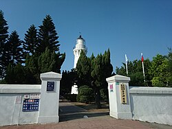

# 觀音區 - 維基百科，自由的百科全書

- 網站：zh.wikipedia.org
- 原始網址：https://zh.wikipedia.org/zh-tw/%E8%A7%80%E9%9F%B3%E5%8D%80
- 狀態：success
- 主題：自然景觀與生態、歷史文化與信仰、地方產業與農漁業
- 關鍵字：觀音區、桃園市、草漯沙丘、藻礁、白沙岬燈塔
- 擷取時間：2026-10-29T13:54:02.764197+00:00

## 清理後正文

座標
：
25°2′10.70″N
121°4′54.10″E
 / 
25.0363056°N 121.0816944°E
 /
25.0363056; 121.0816944
維基百科，自由的百科全書
25°2′10.70″N
121°4′54.10″E
 / 
25.0363056°N 121.0816944°E
 /
25.0363056; 121.0816944
觀音區
Guanyin District
舊稱：石觀音
區
白沙岬燈塔
觀音區位置圖
坐標：
25°02′N
121°06′E
 / 
25.03°N 121.1°E
 /
25.03; 121.1
國家
中華民國
上級區劃
桃園市
下級區劃
24
里
402
鄰
• 區長
劉草典
面積
• 總計
87.9807平方公里（33.9695平方英里）
海拔
44公尺（144英尺）
人口
（2026年7月）（32,515戶）
• 總計
78,137人（桃園市的第11位）
•
密度
888人/平方公里（2,300人/平方英里）
時區
國家標準時間
（
UTC+08:00
）
郵遞區號
328
戶政資料代碼
68000120
毗鄰
大園區
、
新屋區
、
中壢區
網站
www
.guanyin
.tycg
.gov
.tw
觀音區－
台灣語言
寫法及拼音
注音
ㄍㄨㄢ- ㄧㄣ- ㄑㄩ-
漢語拼音
Guān yīn qū
通用拼音
Guan yin cyu
威妥瑪拼音
Kuan yin ch'ü
台語白話字
Koan-im Khu
台語羅馬字
Kuan-im Khu
客語白話字
Kôn-yîm Khî
客羅
海陸腔
：gonˋ rhimˋ kiˋ
四縣腔
：gonˊ imˊ ki^
饒平腔
：guanˇ rhimˇ kiˇ
觀音區
，舊稱「石觀音」
[
1
]
，前身「觀音鄉」，位於
臺灣
桃園市
西部沿海。東臨
大園區
、
中壢區
，南邊與
新屋區
相臨，西濱
臺灣海峽
。區內人口約7.8萬人
[
2
]
，人口主要分布於觀音市區、草漯及新坡三大聚落中，居民大多屬
客家族群
。當地原為農業鄉鎮，1970年代以後隨著臺灣工業的蓬勃發展而設立工業區，境內有
觀音工業區
和新創的
桃園科技工業園區
。觀音區也盛產
蓮花
，每年夏天會舉辦蓮花季。
歷史
[
編輯
]
觀音區舊稱「石觀音」
[
1
]
，係於1860年一名
竹北二堡
石牌嶺庄
（今屬新屋區）的農民往返耕作途中，在當地的小溪中撿到一顆酷似
觀音佛
的天然石，供奉瞻拜，故名。直至1920年設庄時，石觀音改稱「觀音」
[
3
]
: 51
。
日治時期
，1895年，觀音屬
臺北縣
新竹支廳，一部份隸屬
桃澗堡
，一部份則隸屬竹北二堡。1896年3月，全臺設3縣1廳，觀音隸屬臺北縣
[
4
]
: 308
。1901年11月改為20廳，屬
桃園廳
[
4
]
: 309
。1920年改訂地方制度，廢廳置州，全臺灣設5州2廳3市，
觀音庄
隸屬
新竹州
中壢郡
[
4
]
: 310
。
二戰後
1946年，隸屬
新竹縣
中壢區觀音鄉
[
4
]
: 312
。1950年，桃園立縣，與新竹縣分治，觀音鄉改隸
桃園縣
[
4
]
: 313
。之後境內村數歷經兩次變更
[
註 1
]
[
4
]
: 314
，至2014年1月1起，觀音鄉共轄24個村；12月25日因應桃園縣改制為直轄市，觀音鄉改制為「觀音區」
[
1
]
。
地理
[
編輯
]
地形
[
編輯
]
觀音區屬於
桃園沖積扇
的一部分。
水文
[
編輯
]
河川：富林溪、大堀溪、觀音溪、新屋溪。
灌溉系統：
桃園大圳
（
大漢溪
）。
人口
[
編輯
]
歷史人口
年份
人口
±%
1946
27,040
—
1951
29,951
+10.8%
1956
33,454
+11.7%
1961
38,317
+14.5%
1966
44,283
+15.6%
1971
47,698
+7.7%
1976
47,408
−0.6%
1981
45,758
−3.5%
1986
44,069
−3.7%
1991
43,911
−0.4%
1996
49,808
+13.4%
2001
54,227
+8.9%
2006
58,901
+8.6%
2011
61,676
+4.7%
2016
65,555
+6.3%
2021
69,995
+6.8%
來源：
謝公倉 1986
，第128頁
內政部統計月報-各鄉鎮市區人口數
.
內政部
.
[
2019-12-19
]
. （
原始內容
存檔於2020-11-10）.
根據桃園市政府觀音區戶政事務所統計，2025年底觀音區戶數約3.2萬戶，人口約7.8萬人，區內人口最多與最少的里分別是草新里與新興里，2025年底兩里人口分別為8,599人與909人
[
2
]
。2025年底，觀音區人口中0至14歲人口佔比約有12.54%，15至64歲人口佔比約有72.01%，65歲以上人口則佔比約有15.45%，是桃園市青壯年人口佔比最高的行政區
[
5
]
。
查看
原始資料
。
政治
[
編輯
]
歷任首長
[
編輯
]
鄉長
[
編輯
]
任次
姓名
備註
1
古萬桂
2
黃阿壁
3
廖德景
4
5
許金燦
6
7
廖運清
8
黃金春
民主進步黨
9
10
李文貴
11
12
郭榮宗
民主進步黨
13
當選立委
13
張永輝
民主進步黨
14
解職
14
黃茂實
補選
15
16
歐炳辰
民主進步黨
區長（指派）
[
編輯
]
任次
姓名
備註
1
洪清淵
2
林國甯
3
劉草典
現任
區政組織
[
編輯
]
觀音區公所是
桃園市政府
在觀音區的派出機關，在中華民國政府架構中為市政府綜理區政的執行機關，上級業務監督機關為桃園市政府。
區長
由
市長
任命，其任期為無任期保障。在區長及主任秘書之下，設有5課4室等9個內部單位
[
6
]
。觀音區為
桃園市議會
第十二選區，在市議會的63席市議員中，觀音區共選出2席區域市議員（不含平地原住民與山地原住民議員）
[
7
]
。
行政區
[
編輯
]
沿革
[
編輯
]
現今觀音區行政範圍的確立，來自於1920年，日本將臺灣十二廳改為五州二廳，設觀音庄屬新竹州中壢郡。觀音庄轄茄苳坑、大潭、觀音、三座屋、坑尾、坡寮、白沙屯、樹林仔、新坡、上大堀、下青埔、草漯、塔子腳、崙坪、下大堀、苦苓腳等16個大字。1945年，改為「觀音鄉」，屬新竹縣中壢區。1950年，調整行政區域並裁撤區署，觀音鄉改隸新成立的桃園縣
[
8
]
: 84
。2014年12月25日，桃園縣改制為直轄市，觀音鄉改制為市轄區「觀音區」，隸屬桃園市
[
1
]
。
觀音區共轄24里，其行政區域分布情形為
[
9
]
[
10
]
：
次分區
里名
觀音區
觀音里
廣興里
白玉里
武威里
保生里
坑尾里
三和里
新興里
大潭里
草漯區
草漯里
富林里
樹林里
保障里
塔腳里
草新里
新坡區
新坡里
大同里
崙坪里
廣福里
上大里
藍埔里
富源里
金湖里
大堀里
次分區
[
編輯
]
觀音區的次分區
觀音次分區
指大堀溪以南，坑尾以西地帶，包括觀音、白沙屯、大潭、茄苳坑、三座屋、坑尾地段及坡寮一部分。早年移墾較其他二區有成就故莊役場設於觀音次分區。但日治時代後，交通改道，發展變緩
[
11
]
: 48
。
草漯次分區
位於觀音區東北角，指大堀溪以東地帶；範圍最小，是觀音區開發最早的地區。草漯素來與大園區有深厚感情，因其居民大多同為
台灣閩南人
，而觀音區則以
台灣客家人
為主，位於草漯村內，供奉主神為
媽祖
的
草漯保障宮
更是香火鼎盛，已有兩百多年的歷史，是當地居民信仰中心，而且廟內建築格局奇特，參拜時不需爬高爬低，僅需要一炷香就能拜眾神，因此，
草漯保障宮
有「通天香」的美名。而現今草漯里由於農地重劃，釋出150公頃的建地，成為
桃園航空城
被徵收戶的標的，房價已大幅攀升
[
12
]
。
新坡次分區
包括新坡、上下大堀、苦練腳、下青埔、崙坪及坡寮一部分。發展迅速是在日治時代以後，尤其大正十三年（1924年）
桃園大圳
完成後，農村的繁榮，使其與觀音次分區立於分庭抗禮之地位；觀音次分區雖為行政中心，但全區的農會和郵局卻在新坡。公路交通發達後，新坡以接近中壢，地當中壢往觀音中途，且為南北往新屋、大園道路交會點，市況繁榮超過觀音。此次分區因毗鄰中壢，富源里部份區域被劃入
中壢都會區都市計畫區
。
文化
[
編輯
]
藝文活動
[
編輯
]
桃園蓮花季
宗教信仰
[
編輯
]
觀音甘泉寺
，供奉
觀世音菩薩
，香火鼎盛，十分靈驗。
草漯保障宮
，位於草漯里，主神供奉
媽姐
，香火十分鼎盛。
觀音復興宮
：位於臺灣桃園市觀音區觀音工業區的
開漳聖王
廟，前身為大溪區的
阿姆坪復興宮
。
石橋應天宮
，主神供奉
關聖帝君
。
協天宮
，主神供奉
關聖帝君
，在地的居民稱關平爺公廟。
理教石橋復興宮
，主神供奉
開漳聖王
。
觀音永興宮
，主神供奉
天上聖母
。
正大宮
，主神供奉
五年千歲十二王爺
。
溥濟宮
，主神供奉
保生大帝
，俗稱保生廟。
慈母宮
，主神供奉
驪山老母
、
王母娘娘
、
地母娘娘
、
觀音菩薩
、
九天玄女
。
語言
[
編輯
]
觀音的本土語言以
臺灣客家語
海陸腔
及
臺灣閩南語
偏漳腔
為主。
富源
，
臺灣閩南語
、
臺灣客家語
。
白玉
，
臺灣閩南語
、
臺灣客家語
。
大潭
，
臺灣閩南語
、
臺灣客家語
。
草漯
，
臺灣閩南語
。
崙坪
，
臺灣閩南語
。
上大
，
臺灣閩南語
。
新坡
，
臺灣閩南語
。
教育
[
編輯
]
大潭發電廠
坐落於觀音區，桃園市政府以發電廠回饋金實施國中、國小學生免費營養午餐
[
13
]
。
大專院校
[
編輯
]
觀音區現有為
國立臺灣海洋大學
（桃園觀音校區）一校，於2018年11月1日揭牌
[
14
]
。
公立高級中學
[
編輯
]
桃園市立觀音高級中等學校
一校，並附設國中部。
國民中學
[
編輯
]
桃園市立觀音國民中學
桃園市立草漯國民中學
國民小學
[
編輯
]
桃園市觀音區觀音國民小學
桃園市觀音區上大國民小學
桃園市觀音區大潭國民小學
桃園市觀音區育仁國民小學
桃園市觀音區保生國民小學
桃園市觀音區草漯國民小學
桃園市觀音區崙坪國民小學
桃園市觀音區新坡國民小學
桃園市觀音區富林國民小學
桃園市觀音區樹林國民小學
交通
[
編輯
]
省道
[
編輯
]
台15線
：西濱公路
台61線
：西濱快速公路
33
草漯
草漯交流道
38
桃科
桃科交流道
42
觀音
觀音交流道
台66線
：東西向快速公路（觀音－大溪線）
0
觀音
觀音交流道
5
觀音一
觀音一交流道
市道
[
編輯
]
市道112號
市道115號
公車
[
編輯
]
桃園客運
觀音站
L512愛心福利專車長庚B線（觀音、高鐵桃園站到長庚）
L513愛心福利專車長庚C線（白玉、藍埔到高鐵桃園站）
L515愛心福利專車長庚D線
（埔頂、觀音工業區、草漯到高鐵桃園站）
L516免費公車草漯線
L516A免費公車草漯線延駛高鐵桃園站
L516B免費公車草漯線延駛觀音高中
L517免費公車新坡線
L517免費公車新坡線延駛蘭亭集序社區
5032中壢-新屋-石橋-觀音
5033中壢-新屋-保生-觀音
5039中壢-觀崁（先進觀音、永安）
5039中壢-崁觀（先進新屋、永安）
5040桃園-大園-草漯-觀音
5040A桃園-大園-草漯-觀音（繞駛大園國中）
5040B桃園-大園-草漯-觀音（繞駛開南大學）
5041中壢-觀音工業區-白玉-觀音
5042中壢-新坡-觀音
5043中壢-草漯-樹林新村-觀音工業區
5043A中壢-草漯-樹林新村-觀音工業區（延駛回觀音）
輕便軌道
[
編輯
]
觀音區曾有輕便軌道的舖設，目前均已拆除，而當年的輕便軌道是由中壢軌道公司經營，共有二條路線分別如下
[
11
]
: 224
：
中壢－觀音：1918年營運，1953年廢除
新坡－草漯：1918年營運，1935年廢除
自行車租賃系統
[
編輯
]
桃園市公共自行車租賃系統
至2020年7月，在觀音區設有4站：
觀音高中
觀音國小
觀音中興停車場
觀音區棒壘球場
旅遊
[
編輯
]
觀音區每年夏天會舉辦
蓮花
季，2017年經行政院農業委員會公告劃定「觀音蓮花園休閒農業區」，配合觀音區蓮花產業、蓮花農場、休閒農場及古厝等農村景點進行整體規劃及行銷
[
15
]
。
景點
[
編輯
]
草漯沙丘地質公園
觀音海水浴場
觀音藻礁
白沙岬燈塔
：1901年啟用（全臺第二高的燈塔）
觀音鉤漕陂生態園區（桃園大圳第8-2號池）：位於崙坪里
觀音蓮花池
：位於市中心東側，是清領時期農民為灌溉而開挖的埤塘
觀音蓮花園休閒農業區
林家古厝休閒農場
吳厝楊家莊
蓮荷園農場
青林農場
向陽農場
漢聲廣播電台
光華之聲觀音分台：光華之聲在觀音區設有一分台
7-Eleven
千塘門市
白玉里
的
三合院
觀音里
的
林投
相關條目
[
編輯
]
觀音庄
桃園市立法委員第二選舉區
注釋
[
編輯
]
^
1952年，三和村分出「新興村」，大堀村分出「大同村」。2014年，草漯村分出「草新村」。
參考資料
[
編輯
]
引用來源
^
1.0
1.1
1.2
1.3
觀音區介紹-本所沿革
. 桃園市政府-觀音區公所.
[
2023-01-22
]
. （原始內容
存檔
於2023-05-31）
（中文（臺灣））
.
^
2.0
2.1
人口統計資料
. 桃園市觀音區戶政事務所.
[
2020-05-12
]
. （原始內容
存檔
於2020-10-20）.
^
謝公倉等編纂. 第一篇·土地. 《觀音鄉志》. 桃園縣: 觀音鄉公所. 1986
（中文（臺灣））
.
^
4.0
4.1
4.2
4.3
4.4
4.5
謝公倉等編纂. 第九篇·大事記. 《觀音鄉志》. 桃園縣: 觀音鄉公所. 1986
（中文（臺灣））
.
^
內政部戶政司.
人口統計資料
. 中華民國 內政部戶政司 全球資訊網.
[
2025-01-15
]
. （原始內容
存檔
於2021-03-19）
（中文（臺灣））
.
^
觀音區介紹-本所組織介紹-組織架構圖
. 桃園市政府觀音區公所.
[
2021-09-26
]
. （
原始內容
存檔於2022-07-09）
（中文（臺灣））
.
^
議員介紹-本屆議員-第十二選區 觀音區
. 桃園市議會.
[
2021-09-26
]
. （
原始內容
存檔於2022-06-29）
（中文（臺灣））
.
^
謝公倉等編纂. 第三篇·政事. 《觀音鄉志》. 桃園縣: 觀音鄉公所. 1986
（中文（臺灣））
.
^
城鄉發展局-認識城鄉-都市計畫科-都市計畫相關資訊-桃園縣13鄉鎮都市計畫行政區域明細表
. 桃園縣政府城鄉發展局.
[
2011-10-17
]
. （原始內容
存檔
於2014-01-03）
（中文（臺灣））
.
^
各派出所簡介
. 桃園縣政府警察局大園分局.
[
2011-10-17
]
. （原始內容
存檔
於2010-02-26）
（中文（臺灣））
.
^
11.0
11.1
謝公倉等編纂. 《觀音鄉志》. 桃園縣: 桃園縣觀音鄉公所. 1986-02
（中文（臺灣））
.
^
桃園炒房新樂土　草漯將成為青埔第二？
.
[
2015-01-26
]
. （原始內容
存檔
於2017-12-01）.
^
一區一高中！新屋國中改制高中　學生就學方便
.
[
2017-04-13
]
. （原始內容
存檔
於2017-04-13）.
^
海大觀音校區揭牌帶動地方發展
.
[
2018-11-02
]
. （原始內容
存檔
於2020-08-09）.
^
（桃園）591頃觀音蓮花園 劃定休閒農業區
.
[
2017-01-05
]
. （原始內容
存檔
於2020-08-09）.
書籍
謝公倉等編纂. 《觀音鄉志》. 桃園縣: 觀音鄉公所. 1986
（中文（臺灣））
.
施添福等編纂. 第三章·觀音鄉. 《臺灣地名辭書》. 卷十五·桃園縣（上）. 南投縣: 國史館臺灣文獻館. 2009.
ISBN
978-986-01-8864-6
（中文（臺灣））
.
外部連結
[
編輯
]
觀音區公所
（
頁面存檔備份
，存於
網際網路檔案館
）
觀音區公所的Facebook專頁
YouTube上的
觀音小編
頻道
取自「
https://zh.wikipedia.org/w/index.php?title=觀音區&oldid=95104651
」
分類
：
桃園市行政區劃
臺灣客家文化重點發展區
觀音區
曾為臺灣縣轄鄉的區
隱藏分類：
使用WikiMiniAtlas小工具的頁面
含有非數字formatnum參數的頁面
使用圖表擴展的頁面
維基數據存在坐標數據的頁面
含有英語的條目
含有注音符號的條目
含有明確引用中文的條目
含有客家話的條目
使用人口模板的頁面
使用的姊妹項目連結帶有隱藏維基數據的頁面
包含MusicBrainz area標識符的維基百科條目
有地圖的頁面

## 圖片
-  — [原始圖片來源](https://zh.wikipedia.org/static/images/mobile/copyright/wikipedia-wordmark-zh.svg) 
-  — [原始圖片來源](https://zh.wikipedia.org/static/images/mobile/copyright/wikipedia-tagline-zh.svg) 
-  — [原始圖片來源](https://thumb.wikimedia.org/wikipedia/commons/thumb/4/41/%E7%99%BD%E6%B2%99%E5%B2%AC%E7%87%88%E5%A1%94%E5%85%A5%E5%8F%A3.jpg/250px-%E7%99%BD%E6%B2%99%E5%B2%AC%E7%87%88%E5%A1%94%E5%85%A5%E5%8F%A3.jpg?utm_source=zh.wikipedia.org&utm_campaign=parser&utm_content=thumbnail) 

## 頁面連結
- [分類索引](https://zh.wikipedia.org/wiki/Wikipedia:%E5%88%86%E7%B1%BB%E7%B4%A2%E5%BC%95)
- [特色內容](https://zh.wikipedia.org/wiki/Portal:%E7%89%B9%E8%89%B2%E5%85%A7%E5%AE%B9)
- [新聞動態](https://zh.wikipedia.org/wiki/Portal:%E6%96%B0%E8%81%9E%E5%8B%95%E6%85%8B)
- [隨機條目](https://zh.wikipedia.org/wiki/Special:Random)
- [聯絡我們](https://zh.wikipedia.org/wiki/Wikipedia:%E8%81%94%E7%BB%9C%E6%88%91%E4%BB%AC)
- [說明](https://zh.wikipedia.org/wiki/Help:%E9%A6%96%E9%A1%B5)
- [維基社群](https://zh.wikipedia.org/wiki/Wikipedia:%E7%A4%BE%E7%BE%A4%E9%A6%96%E9%A1%B5)
- [編輯入門](https://zh.wikipedia.org/wiki/Help:%E5%85%A5%E9%97%A8)
- [互助客棧](https://zh.wikipedia.org/wiki/Wikipedia:%E4%BA%92%E5%8A%A9%E5%AE%A2%E6%A0%88)
- [IRC即時聊天](https://zh.wikipedia.org/wiki/Wikipedia:IRC%E8%81%8A%E5%A4%A9%E9%A2%91%E9%81%93)
- [近期變更](https://zh.wikipedia.org/wiki/Special:RecentChanges)
- [特殊頁面](https://zh.wikipedia.org/wiki/Special:SpecialPages)
- [首頁](https://zh.wikipedia.org/wiki/Wikipedia:%E9%A6%96%E9%A1%B5)
- [搜尋](https://zh.wikipedia.org/wiki/Special:Search)
- [資助維基百科](https://donate.wikimedia.org/?wmf_source=donate&wmf_medium=sidebar&wmf_campaign=zh.wikipedia.org&uselang=zh)
- [建立帳號](https://zh.wikipedia.org/w/index.php?title=Special:CreateAccount&returnto=%E8%A7%80%E9%9F%B3%E5%8D%80&returntoquery=variant%3Dzh-tw)
- [登入](https://zh.wikipedia.org/w/index.php?title=Special:UserLogin&returnto=%E8%A7%80%E9%9F%B3%E5%8D%80&returntoquery=variant%3Dzh-tw)
- [Deutsch](https://de.wikipedia.org/wiki/Guanyin_(Taoyuan))
- [English](https://en.wikipedia.org/wiki/Guanyin_District)
- [Français](https://fr.wikipedia.org/wiki/District_de_Guanyin)
- [客家語 / Hak-kâ-ngî](https://hak.wikipedia.org/wiki/K%C3%B4n-y%C3%AEm-kh%C3%AE)
- [Italiano](https://it.wikipedia.org/wiki/Distretto_di_Guanyin)
- [日本語](https://ja.wikipedia.org/wiki/%E8%A6%B3%E9%9F%B3%E5%8C%BA)
- [한국어](https://ko.wikipedia.org/wiki/%EA%B4%80%EC%9D%B8%EA%B5%AC)
- [Lietuvių](https://lt.wikipedia.org/wiki/Guanjinas)
- [اردو](https://ur.wikipedia.org/wiki/%DA%AF%D9%88%D8%A2%D9%86%DB%8C%D8%A6%D9%86_%D8%B6%D9%84%D8%B9)
- [Tiếng Việt](https://vi.wikipedia.org/wiki/Quan_%C3%82m,_%C4%90%C3%A0o_Vi%C3%AAn)
- [閩南語 / Bân-lâm-gí](https://zh-min-nan.wikipedia.org/wiki/Koan-im-khu)
- [粵語](https://zh-yue.wikipedia.org/wiki/%E8%A7%80%E9%9F%B3%E5%8D%80)
- [討論](https://zh.wikipedia.org/wiki/Talk:%E8%A7%80%E9%9F%B3%E5%8D%80)
- [不转换](https://zh.wikipedia.org/zh/%E8%A7%80%E9%9F%B3%E5%8D%80)
- [简体](https://zh.wikipedia.org/zh-hans/%E8%A7%80%E9%9F%B3%E5%8D%80)
- [繁體](https://zh.wikipedia.org/zh-hant/%E8%A7%80%E9%9F%B3%E5%8D%80)
- [大陆简体](https://zh.wikipedia.org/zh-cn/%E8%A7%80%E9%9F%B3%E5%8D%80)
- [香港繁體](https://zh.wikipedia.org/zh-hk/%E8%A7%80%E9%9F%B3%E5%8D%80)
- [澳門繁體](https://zh.wikipedia.org/zh-mo/%E8%A7%80%E9%9F%B3%E5%8D%80)
- [大马简体](https://zh.wikipedia.org/zh-my/%E8%A7%80%E9%9F%B3%E5%8D%80)
- [新加坡简体](https://zh.wikipedia.org/zh-sg/%E8%A7%80%E9%9F%B3%E5%8D%80)
- [條目](https://zh.wikipedia.org/wiki/%E8%A7%80%E9%9F%B3%E5%8D%80)
- [編輯](https://zh.wikipedia.org/w/index.php?title=%E8%A7%80%E9%9F%B3%E5%8D%80&action=edit&variant=zh-tw)
- [檢視歷史](https://zh.wikipedia.org/w/index.php?title=%E8%A7%80%E9%9F%B3%E5%8D%80&action=history)
- [連結至此的頁面](https://zh.wikipedia.org/wiki/Special:WhatLinksHere/%E8%A7%80%E9%9F%B3%E5%8D%80)
- [相關變更](https://zh.wikipedia.org/wiki/Special:RecentChangesLinked/%E8%A7%80%E9%9F%B3%E5%8D%80)
- [上傳檔案](https://zh.wikipedia.org/wiki/Project:上传)
- [固定連結](https://zh.wikipedia.org/w/index.php?title=%E8%A7%80%E9%9F%B3%E5%8D%80&oldid=95104651)
- [頁面資訊](https://zh.wikipedia.org/w/index.php?title=%E8%A7%80%E9%9F%B3%E5%8D%80&action=info)
- [引用此頁面](https://zh.wikipedia.org/w/index.php?title=Special:CiteThisPage&page=%E8%A7%80%E9%9F%B3%E5%8D%80&id=95104651&wpFormIdentifier=titleform)
- [取得短連結](https://zh.wikipedia.org/w/index.php?title=Special:UrlShortener&url=https%3A%2F%2Fzh.wikipedia.org%2Fzh-tw%2F%25E8%25A7%2580%25E9%259F%25B3%25E5%258D%2580)
- [下載為PDF](https://zh.wikipedia.org/w/index.php?title=Special:DownloadAsPdf&page=%E8%A7%80%E9%9F%B3%E5%8D%80&action=show-download-screen)
- [編輯連結](https://www.wikidata.org/wiki/Special:EntityPage/Q712931)
- [座標](https://zh.wikipedia.org/wiki/%E5%9C%B0%E7%90%86%E5%9D%90%E6%A0%87)
- [25°2′10.70″N 121°4′54.10″E  /  25.0363056°N 121.0816944°E  / 25.0363056; 121.0816944](https://geohack.toolforge.org/geohack.php?language=zh&pagename=%E8%A7%80%E9%9F%B3%E5%8D%80&params=25_2_10.70_N_121_4_54.10_E_type:city(60000)_region:TW-TAO)
- [https://zh.wikipedia.org/wiki/File:%E7%99%BD%E6%B2%99%E5%B2%AC%E7%87%88%E5%A1%94%E5%85%A5%E5%8F%A3.jpg](https://zh.wikipedia.org/wiki/File:%E7%99%BD%E6%B2%99%E5%B2%AC%E7%87%88%E5%A1%94%E5%85%A5%E5%8F%A3.jpg)
- [https://zh.wikipedia.org/wiki/File:Guanyin_district.png](https://zh.wikipedia.org/wiki/File:Guanyin_district.png)
- [25°02′N 121°06′E  /  25.03°N 121.1°E  / 25.03; 121.1](https://geohack.toolforge.org/geohack.php?language=zh&pagename=%E8%A7%80%E9%9F%B3%E5%8D%80&params=25.03_N_121.1_E_)
- [國家](https://zh.wikipedia.org/wiki/%E4%B8%96%E7%95%8C%E6%94%BF%E5%8D%80%E7%B4%A2%E5%BC%95)
- [里](https://zh.wikipedia.org/wiki/%E6%9D%91%E9%87%8C)
- [鄰](https://zh.wikipedia.org/wiki/%E9%84%B0)
- [密度](https://zh.wikipedia.org/wiki/%E4%BA%BA%E5%8F%A3%E5%AF%86%E5%BA%A6)
- [時區](https://zh.wikipedia.org/wiki/%E6%97%B6%E5%8C%BA)
- [國家標準時間](https://zh.wikipedia.org/wiki/%E5%9C%8B%E5%AE%B6%E6%A8%99%E6%BA%96%E6%99%82%E9%96%93)
- [UTC+08:00](https://zh.wikipedia.org/wiki/UTC%2B08:00)
- [郵遞區號](https://zh.wikipedia.org/wiki/%E8%87%BA%E7%81%A3%E5%9C%B0%E5%8D%80%E9%83%B5%E9%81%9E%E5%8D%80%E8%99%9F%E4%B8%80%E8%A6%BD%E8%A1%A8)
- [戶政資料代碼](https://zh.wikipedia.org/wiki/%E6%88%B6%E5%BD%B9%E6%94%BF%E8%B3%87%E8%A8%8A%E7%B3%BB%E7%B5%B1%E8%B3%87%E6%96%99%E4%BB%A3%E7%A2%BC)
- [www .guanyin .tycg .gov .tw](https://www.guanyin.tycg.gov.tw/)
- [台灣語言](https://zh.wikipedia.org/wiki/%E8%87%BA%E7%81%A3%E8%AA%9E%E8%A8%80%E5%88%97%E8%A1%A8)
- [注音](https://zh.wikipedia.org/wiki/%E6%B3%A8%E9%9F%B3%E7%AC%A6%E8%99%9F)
- [漢語拼音](https://zh.wikipedia.org/wiki/%E6%B1%89%E8%AF%AD%E6%8B%BC%E9%9F%B3)
- [通用拼音](https://zh.wikipedia.org/wiki/%E9%80%9A%E7%94%A8%E6%8B%BC%E9%9F%B3)
- [威妥瑪拼音](https://zh.wikipedia.org/wiki/%E5%A8%81%E5%A6%A5%E7%91%AA%E6%8B%BC%E9%9F%B3)
- [台語白話字](https://zh.wikipedia.org/wiki/%E7%99%BD%E8%A9%B1%E5%AD%97)
- [台語羅馬字](https://zh.wikipedia.org/wiki/%E8%87%BA%E7%81%A3%E9%96%A9%E5%8D%97%E8%AA%9E%E7%BE%85%E9%A6%AC%E5%AD%97%E6%8B%BC%E9%9F%B3%E6%96%B9%E6%A1%88)
- [客語白話字](https://zh.wikipedia.org/wiki/%E5%AE%A2%E8%AA%9E%E7%99%BD%E8%A9%B1%E5%AD%97)
- [客羅](https://zh.wikipedia.org/wiki/%E8%87%BA%E7%81%A3%E5%AE%A2%E5%AE%B6%E8%AA%9E%E6%8B%BC%E9%9F%B3%E6%96%B9%E6%A1%88)
- [四縣腔](https://zh.wikipedia.org/wiki/%E5%9B%9B%E7%B8%A3%E8%85%94)
- [饒平腔](https://zh.wikipedia.org/wiki/%E9%A5%92%E5%B9%B3%E8%85%94)
- [臺灣](https://zh.wikipedia.org/wiki/%E8%87%BA%E7%81%A3)
- [臺灣海峽](https://zh.wikipedia.org/wiki/%E8%87%BA%E7%81%A3%E6%B5%B7%E5%B3%BD)
- [客家族群](https://zh.wikipedia.org/wiki/%E8%87%BA%E7%81%A3%E5%AE%A2%E5%AE%B6%E4%BA%BA)
- [觀音工業區](https://zh.wikipedia.org/w/index.php?title=%E8%A7%80%E9%9F%B3%E5%B7%A5%E6%A5%AD%E5%8D%80&action=edit&redlink=1)
- [桃園科技工業園區](https://zh.wikipedia.org/wiki/%E6%A1%83%E5%9C%92%E7%A7%91%E6%8A%80%E5%B7%A5%E6%A5%AD%E5%9C%92%E5%8D%80)
- [編輯](https://zh.wikipedia.org/w/index.php?title=%E8%A7%80%E9%9F%B3%E5%8D%80&action=edit&section=1)
- [竹北二堡](https://zh.wikipedia.org/wiki/%E7%AB%B9%E5%8C%97%E4%BA%8C%E5%A0%A1)
- [石牌嶺庄](https://zh.wikipedia.org/wiki/%E7%9F%B3%E7%89%8C%E5%B6%BA)
- [日治時期](https://zh.wikipedia.org/wiki/%E5%8F%B0%E7%81%A3%E6%97%A5%E6%B2%BB%E6%99%82%E6%9C%9F)
- [桃澗堡](https://zh.wikipedia.org/wiki/%E6%A1%83%E6%BE%97%E5%A0%A1)
- [二戰後](https://zh.wikipedia.org/wiki/%E8%87%BA%E7%81%A3%E6%88%B0%E5%BE%8C%E6%99%82%E6%9C%9F)
- [新竹縣](https://zh.wikipedia.org/wiki/%E6%96%B0%E7%AB%B9%E7%B8%A3_(1945%E5%B9%B4%EF%BC%8D1950%E5%B9%B4))
- [編輯](https://zh.wikipedia.org/w/index.php?title=%E8%A7%80%E9%9F%B3%E5%8D%80&action=edit&section=2)
- [編輯](https://zh.wikipedia.org/w/index.php?title=%E8%A7%80%E9%9F%B3%E5%8D%80&action=edit&section=3)
- [桃園沖積扇](https://zh.wikipedia.org/w/index.php?title=%E6%A1%83%E5%9C%92%E6%B2%96%E7%A9%8D%E6%89%87&action=edit&redlink=1)
- [編輯](https://zh.wikipedia.org/w/index.php?title=%E8%A7%80%E9%9F%B3%E5%8D%80&action=edit&section=4)
- [大漢溪](https://zh.wikipedia.org/wiki/%E5%A4%A7%E6%BC%A2%E6%BA%AA)
- [編輯](https://zh.wikipedia.org/w/index.php?title=%E8%A7%80%E9%9F%B3%E5%8D%80&action=edit&section=5)
- [內政部統計月報-各鄉鎮市區人口數](https://web.archive.org/web/20201110103641/https://www.moi.gov.tw/files/site_stuff/321/1/month/month.html)
- [內政部](https://zh.wikipedia.org/wiki/%E4%B8%AD%E8%8F%AF%E6%B0%91%E5%9C%8B%E5%85%A7%E6%94%BF%E9%83%A8)
- [原始內容](https://www.moi.gov.tw/files/site_stuff/321/1/month/month.html)
- [原始資料](https://commons.wikimedia.org/wiki/Data:Population_of_Guanyin_District,_Taoyuan.tab)
- [編輯](https://zh.wikipedia.org/w/index.php?title=%E8%A7%80%E9%9F%B3%E5%8D%80&action=edit&section=6)
- [編輯](https://zh.wikipedia.org/w/index.php?title=%E8%A7%80%E9%9F%B3%E5%8D%80&action=edit&section=7)

> 備註：進階解析失敗，已使用內建解析器：AttributeError: 'NoneType' object has no attribute 'get'
