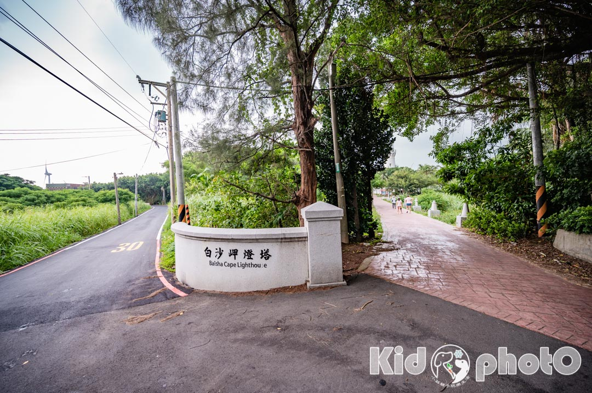
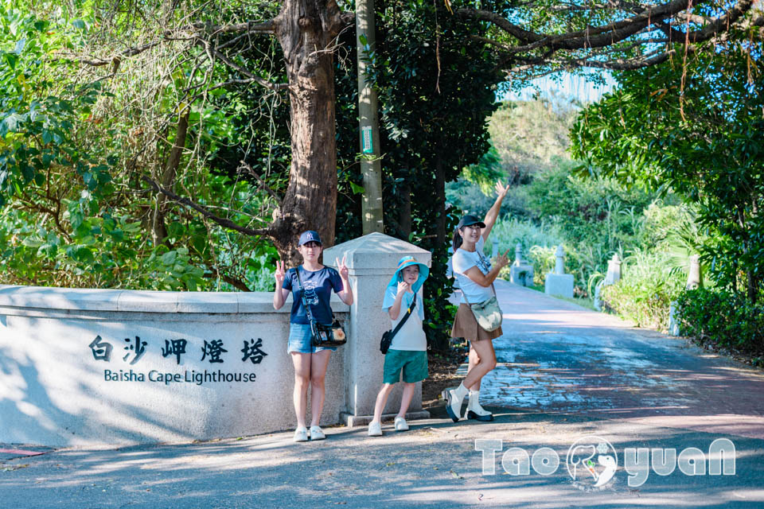

#   桃園觀音景點〡白沙岬燈塔〡百年日治時代燈塔, 希臘鐘塔熱門打卡景點, 超Q台灣縮小版燈塔

- 網站：小菲親子玩樂生活
- 原始網址：https://natsuphil.com/taoyuan/baisha-cape/
- 狀態：success
- 作者：natsuphil0222@gmail.com
- 發表日期：2026-09-27T10:52:00+08:00
- 主題：自然景觀與生態、歷史文化與信仰、觀光景點與活動
- 關鍵字：觀音區、桃園市、白沙岬燈塔
- 擷取時間：2026-10-29T13:54:06.825915+00:00

## 清理後正文

桃園觀音景點〡白沙岬燈塔〡百年日治時代燈塔, 希臘鐘塔熱門打卡景點, 超Q台灣縮小版燈塔
[email protected]
2026-09-28T17:45:20+08:00
27 9 月, 2026
|
Categories:
玩樂桃園
|
Tags:
桃園好拍好玩
,
親子濱海景點
|
日治時代就已經是熱門景點的
「
白沙岬燈塔
」
，位於「觀音海岸」是台灣國定古蹟，也是目前保存最完整的日治燈塔。其燈塔高度僅次於墾丁
「鵝鑾鼻燈塔」
約37公尺高。燈塔周圍有環行步道、觀景台、休憩涼亭等等，讓遊客除了一覽燈塔全貌之外，還可以散步、賞景，附近還有「
觀音濱海遊憩區
」可以玩水，能帶小朋友一起觀察大自然的潮間帶生態。連假或寒暑假期間，有安排桃園景點的朋友，別忘了這個有特色的順遊點喔~
白沙岬燈塔〡相關資訊
景點位置：桃園市觀音區光明路216號。
[Google導航地圖]
停車資訊：白沙岬燈塔停車場。
[Google導航地圖]
營業時間：
星期二 、三、四、五、六、日， 09：00 ~ 17：00
星期一，公休
連絡電話：(03）473-2249
台灣哪裡有燈塔
新北石門〡富貴角公園〡台灣
最北
燈塔
桃園觀音〡白沙岬燈塔〡
百年
日治燈塔
彰化芳苑 | 芳苑燈塔 | 台灣
最年輕
燈塔
新北貢寮 | 三貂角燈塔 | 國境
極東
燈塔
屏東恆春 | 鵝鑾鼻燈塔 | 台灣
最高
燈塔
台南七股｜國聖燈塔｜台灣
極西
燈塔
小菲兒童親子隨拍
白沙岬燈塔入口處〡台灣燈塔縮小版
跟著導航一路到
白沙岬燈塔
，會發現快到目的地前有一條像人行道的步道，別擔心，車輛是可以進入的，順著往裡面開，就可以看到停車場。(備註：如果假日停車場已滿位，則改停路邊白線，但步行入園時，要小心紅磚道來往的車子喔~)
從入口走進去，遠遠就能看到「白沙岬燈塔」，右手邊還有幾個台灣各處迷你的小塔燈，第一個就是白沙岬燈塔的縮小版，好Q~
漁翁島燈塔 & 花嶼燈塔（縮小版）
鵝鸞鼻燈塔
（縮小版）
位於最南端的燈塔，也是去墾丁玩水時，必遊的一個觀光景點。
三貂角燈塔
（縮小版）
位於極東的燈塔，三貂角燈塔。
富貴角燈塔
（縮小版）
位於台灣最北端的燈塔，特別的八角形狀讓人一眼就認出它。
燈塔前門口〡休息處
白沙岬燈塔看板
白沙岬燈塔入口
每座燈塔的入口都會有一塊這種
閃亮亮
的
航港局招牌
。
燈塔旁休息區
燈塔外圍有一處休息區，隔著一面牆的另外一邊是廁所。
防空洞
我在白沙岬_ _ _ _ _
IG網美必拍點，可別只顧著看燈塔，這裡的彩繪牆也是美拍的好地方，雖然牆面舊舊的有歷史痕跡，不過照片彷彿多了點故事的味道。
白沙岬燈塔
燈塔外圍除了有林蔭步道可以漫步外，還有幾處觀景台能欣賞不同面向的風景。但部分區域雜草較高擋住視野，加上非屬於制高點的地緣關係，所以景色沒有非常好看。
據說
白沙岬燈塔
是全台第二高的燈塔，燈塔最特別之處，就是台灣燈塔中唯一使用紅磚與石頭所建造，有別於其它利用水泥建構的燈塔。
我在白沙岬燈塔 [美拍吹海風]~首訪雖然是陰天，不過還是不減和家人一同出遊的好心情呢！
有時靜靜的欣賞也是一種享受
白沙岬公園〡人行拱橋
白沙岬燈塔
內部公園占地不小，很多人在裡面散步、休息，同時也看到不少單車族在此小歇片刻，想必這裡也是許多單車客喜愛的中途休憩站。不過夏季蚊子有點多，防蚊措施要做好喔！
觀景平台
仔細看圍欄上有一個一個可愛的白色小燈塔，能見度佳時，從觀景台看出去，能看到風力發電機。
白沙岬人行拱橋
連接「白沙岬燈塔」和「外圍馬路」的人行拱橋，可是桃園熱門的婚紗照拍攝點呢！首訪因為是陰天所以沒有特別感覺，再訪的大晴天就整個明白了！
希臘幸福大鐘
藍白相間的希臘大鐘，也是美拍熱門的地方，連洗手間也是維持同樣的風格。
洗手間
雞蛋花
在一旁的雞蛋花，成了美麗的點綴，剛好配上這藍白的背景，怎麼拍怎麼美。
黃小菲遊玩心得
台灣哪裡有燈塔
新北石門〡富貴角公園〡台灣
最北
燈塔
桃園觀音〡白沙岬燈塔〡
百年
日治燈塔
彰化芳苑 | 芳苑燈塔 | 台灣
最年輕
燈塔
新北貢寮 | 三貂角燈塔 | 國境
極東
燈塔
屏東恆春 | 鵝鑾鼻燈塔 | 台灣
最高
燈塔
台南七股｜國聖燈塔｜台灣
極西
燈塔
小菲兒童親子隨拍
關於〡黃小菲
愛拍照的黃小菲，喜歡用照片說故事，最愛帶著一家四口到處走走拍拍
用質感最高的畫面，細膩生動的文字，帶領你進入黃小菲的親子玩樂生活
喜歡黃小菲用心拍攝的照片或是逗趣文章內容的朋友們，記得來FB粉絲團點個讚喔
聯絡信箱：
[email protected]
店家/景點資訊
店家名稱：
白沙岬燈塔
所在地址：臺灣桃園市觀音區光明路216
營業時間：日 二 三 四 五 六 09:00-17:00
店家電話：
備註資訊：
1.留意閉園時間
2.園區林蔭步道涼爽，但也請依個人需求做好防曬、防蚊措施
Google即時導航
交通資訊
評論
5
5/5 - (1 vote)
1位網友投票評論
關於本文評論的商家、商品、景點、議題、方法，你給幾顆星呢？
歡迎一起點擊星號參與評論唷！
按讚加入粉絲團
留言
取消回覆
Comment
Save my name, email, and website in this browser for the next time I comment.

## 圖片
-  — [原始圖片來源](https://natsuphil.com/wp-content/uploads/2026/06/baisha-cape_wp.jpg) 
-  — [原始圖片來源](https://natsuphil.com/wp-content/uploads/2021/07/baisha-cape_001.jpg) 
-  — [原始圖片來源](https://natsuphil.com/wp-content/uploads/2026/09/DSC_4292.jpg) 

## 頁面連結
- [玩樂基隆](https://natsuphil.com/keelung/)
- [玩樂新北](https://natsuphil.com/new-taipei/)
- [八里玩樂懶人包](https://natsuphil.com/fun-taiwan/bali/)
- [石門玩樂懶人包](https://natsuphil.com/fun-taiwan/shimen/)
- [新北步道懶人包](https://natsuphil.com/fun-trail/new-taipei/)
- [玩樂台北](https://natsuphil.com/taipei/)
- [台北公園懶人包](https://natsuphil.com/fun-park/mrt-red/)
- [玩樂桃園](https://natsuphil.com/taoyuan/)
- [觀音玩樂懶人包](https://natsuphil.com/fun-taiwan/guanyin/)
- [玩樂新竹](https://natsuphil.com/hsinchu/)
- [玩樂苗栗](https://natsuphil.com/miaoli/)
- [玩樂台中](https://natsuphil.com/taichung/)
- [玩樂彰化](https://natsuphil.com/changhua/)
- [芳苑玩樂懶人包](https://natsuphil.com/fun-taiwan/fangyuan/)
- [玩樂南投](https://natsuphil.com/nantou/)
- [玩樂雲林](https://natsuphil.com/yunlin/)
- [玩樂嘉義](https://natsuphil.com/chiayi/)
- [玩樂台南](https://natsuphil.com/tainan/)
- [將軍玩樂懶人包](https://natsuphil.com/fun-taiwan/jiangjun/)
- [楠西玩樂懶人包](https://natsuphil.com/fun-taiwan/nanxi/)
- [玩樂高雄](https://natsuphil.com/kaohsiung/)
- [玩樂屏東](https://natsuphil.com/pingdong/)
- [玩樂宜蘭](https://natsuphil.com/yilan/)
- [玩樂花蓮](https://natsuphil.com/hualian/)
- [花蓮玩樂懶人包](https://natsuphil.com/fun-taiwan/hualien/)
- [玩樂台東](https://natsuphil.com/taitung/)
- [鄉鎮懶人包](https://natsuphil.com/tag/鄉鎮市懶人包)
- [全台懶人包](https://natsuphil.com/tag/全台灣懶人包)
- [公園懶人包](https://natsuphil.com/tag/全公園懶人包)
- [步道懶人包](https://natsuphil.com/tag/全步道懶人包)
- [在家玩什麼](https://natsuphil.com/category/kid-fun/)
- [[email protected]](https://natsuphil.com/author/natsuphil0222gmail-com/)
- [玩樂桃園](https://natsuphil.com/category/taoyuan/)
- [[Google導航地圖]](https://goo.gl/maps/ouUtDXDsMRsrQ1m88)
- [[Google導航地圖]](https://goo.gl/maps/uMnRQyNTsFRM9oUj9)
- [新北石門〡富貴角公園〡台灣 最北 燈塔](https://natsuphil.com/new-taipei/fugui-cape-park/)
- [彰化芳苑 | 芳苑燈塔 | 台灣 最年輕 燈塔](https://natsuphil.com/changhua/fangyuan-cape/)
- [新北貢寮 | 三貂角燈塔 | 國境 極東 燈塔](https://natsuphil.com/new-taipei/santiago-cape/)
- [「鵝鑾鼻燈塔」](https://natsuphil.com/pingdong/eluanbi-cape/)
- [台南七股｜國聖燈塔｜台灣 極西 燈塔](https://natsuphil.com/tainan/guosheng-cape/)
- [Google即時導航](https://www.google.com/maps/dir//%E7%99%BD%E6%B2%99%E5%B2%AC%E7%87%88%E5%A1%94+%E6%A1%83%E5%9C%92%E5%B8%82%E8%A7%80%E9%9F%B3%E5%8D%80%E5%85%89%E6%98%8E%E8%B7%AF216)
- [觀音濱海遊憩區](https://natsuphil.com/taoyuan/guanyin-sea/)
- [桃園八德景點〡楓樹腳公園〡燦爛的童年時光遊戲場, 長頸鹿高塔滑梯, 桃園旗艦型公園, P@RK園宇宙系列, 親子特色公園](https://natsuphil.com/taoyuan/maple-tree-foot-park/)
- [桃園大園景點〡華興池公園〡華興池生態埤塘公園, 多功能特色公園震撼登場, 遊戲區放電數飛機, 還有夏日戲水區, 喬寓咖啡The QiAO絕美視角, 假日開放水上活動](https://natsuphil.com/taoyuan/hauxingchi-park/)
- [桃園新屋景點〡永安漁港〡永安觀海橋360度視角, 觀海亭木棧步道賞海景, 鄰近海螺文化館, 生鮮熟食乾貨通通有, 美食街也能代客料理](https://natsuphil.com/taoyuan/yongan-harbor/)
- [桃園竹圍景點〡竹圍漁港〡竹圍海水浴場, 老饕最愛海鮮代客料理, 玩沙踏浪賞夕陽, 海洋生物特色沖沙區, 彩虹橋上美拍點](https://natsuphil.com/taoyuan/zhuwei-port/)
- [桃園蘆竹景點〡羊稠森林步道〡絕佳視野三秒看高鐵, 森林系紓壓步道, 夏季甲蟲出沒產地, 精彩好玩的甲蟲季活動, 超搶手的免費生態導覽, 2025甲蟲季開跑囉](https://natsuphil.com/taoyuan/pouchworm-trail/)
- [桃園中壢景點〡光明公園〡森林樹屋遊戲場, 探索冒險與挑戰, 暢玩四大主題樂園, 親子玩沙樂悠悠, 暑假超夯戲水區, 大朋友專屬跑酷場地](https://natsuphil.com/taoyuan/bright-park/)
- [桃園復興景點∣小烏來風景特定區∣宇內溪戲水區, 夏日限定合法開放溪流戲水區, 救生員溪邊駐守看顧, 銅板價一票三玩, 順遊天空步道與天空繩橋](https://natsuphil.com/taoyuan/xiaowulai-water/)
- [全公園懶人包](https://natsuphil.com/tag/%e5%85%a8%e5%85%ac%e5%9c%92%e6%87%b6%e4%ba%ba%e5%8c%85/)
- [全台灣懶人包](https://natsuphil.com/tag/%e5%85%a8%e5%8f%b0%e7%81%a3%e6%87%b6%e4%ba%ba%e5%8c%85/)
- [南投好拍好玩](https://natsuphil.com/tag/%e5%8d%97%e6%8a%95%e5%a5%bd%e6%8b%8d%e5%a5%bd%e7%8e%a9/)
- [台中好住好睡](https://natsuphil.com/tag/%e5%8f%b0%e4%b8%ad%e5%a5%bd%e4%bd%8f%e5%a5%bd%e7%9d%a1/)
- [台中好拍好玩](https://natsuphil.com/tag/%e5%8f%b0%e4%b8%ad%e5%a5%bd%e6%8b%8d%e5%a5%bd%e7%8e%a9/)
- [台北好拍好玩](https://natsuphil.com/tag/%e5%8f%b0%e5%8c%97%e5%a5%bd%e6%8b%8d%e5%a5%bd%e7%8e%a9/)
- [台南好住好睡](https://natsuphil.com/tag/%e5%8f%b0%e5%8d%97%e5%a5%bd%e4%bd%8f%e5%a5%bd%e7%9d%a1/)
- [台南好吃好喝](https://natsuphil.com/tag/%e5%8f%b0%e5%8d%97%e5%a5%bd%e5%90%83%e5%a5%bd%e5%96%9d/)
- [台南好拍好玩](https://natsuphil.com/tag/%e5%8f%b0%e5%8d%97%e5%a5%bd%e6%8b%8d%e5%a5%bd%e7%8e%a9/)
- [台東好拍好玩](https://natsuphil.com/tag/%e5%8f%b0%e6%9d%b1%e5%a5%bd%e6%8b%8d%e5%a5%bd%e7%8e%a9/)
- [嘉義好拍好玩](https://natsuphil.com/tag/%e5%98%89%e7%be%a9%e5%a5%bd%e6%8b%8d%e5%a5%bd%e7%8e%a9/)
- [基隆好拍好玩](https://natsuphil.com/tag/%e5%9f%ba%e9%9a%86%e5%a5%bd%e6%8b%8d%e5%a5%bd%e7%8e%a9/)
- [宜蘭好拍好玩](https://natsuphil.com/tag/%e5%ae%9c%e8%98%ad%e5%a5%bd%e6%8b%8d%e5%a5%bd%e7%8e%a9/)
- [屏東好拍好玩](https://natsuphil.com/tag/%e5%b1%8f%e6%9d%b1%e5%a5%bd%e6%8b%8d%e5%a5%bd%e7%8e%a9/)
- [彰化好吃好喝](https://natsuphil.com/tag/%e5%bd%b0%e5%8c%96%e5%a5%bd%e5%90%83%e5%a5%bd%e5%96%9d/)
- [彰化好拍好玩](https://natsuphil.com/tag/%e5%bd%b0%e5%8c%96%e5%a5%bd%e6%8b%8d%e5%a5%bd%e7%8e%a9/)
- [新北好吃好喝](https://natsuphil.com/tag/%e6%96%b0%e5%8c%97%e5%a5%bd%e5%90%83%e5%a5%bd%e5%96%9d/)
- [新北好拍好玩](https://natsuphil.com/tag/%e6%96%b0%e5%8c%97%e5%a5%bd%e6%8b%8d%e5%a5%bd%e7%8e%a9/)
- [新竹好拍好玩](https://natsuphil.com/tag/%e6%96%b0%e7%ab%b9%e5%a5%bd%e6%8b%8d%e5%a5%bd%e7%8e%a9/)
- [桃園好拍好玩](https://natsuphil.com/tag/%e6%a1%83%e5%9c%92%e5%a5%bd%e6%8b%8d%e5%a5%bd%e7%8e%a9/)
- [花蓮好住好睡](https://natsuphil.com/tag/%e8%8a%b1%e8%93%ae%e5%a5%bd%e4%bd%8f%e5%a5%bd%e7%9d%a1/)
- [花蓮好吃好喝](https://natsuphil.com/tag/%e8%8a%b1%e8%93%ae%e5%a5%bd%e5%90%83%e5%a5%bd%e5%96%9d/)
- [花蓮好拍好玩](https://natsuphil.com/tag/%e8%8a%b1%e8%93%ae%e5%a5%bd%e6%8b%8d%e5%a5%bd%e7%8e%a9/)
- [苗栗好住好睡](https://natsuphil.com/tag/%e8%8b%97%e6%a0%97%e5%a5%bd%e4%bd%8f%e5%a5%bd%e7%9d%a1/)
- [苗栗好拍好玩](https://natsuphil.com/tag/%e8%8b%97%e6%a0%97%e5%a5%bd%e6%8b%8d%e5%a5%bd%e7%8e%a9/)
- [親子主題公園](https://natsuphil.com/tag/%e8%a6%aa%e5%ad%90%e4%b8%bb%e9%a1%8c%e5%85%ac%e5%9c%92/)
- [親子休閒農場](https://natsuphil.com/tag/%e8%a6%aa%e5%ad%90%e4%bc%91%e9%96%92%e8%be%b2%e5%a0%b4/)
- [親子創意遊戲](https://natsuphil.com/tag/%e8%a6%aa%e5%ad%90%e5%89%b5%e6%84%8f%e9%81%8a%e6%88%b2/)
- [親子商品開箱](https://natsuphil.com/tag/%e8%a6%aa%e5%ad%90%e5%95%86%e5%93%81%e9%96%8b%e7%ae%b1/)
- [親子在地小吃](https://natsuphil.com/tag/%e8%a6%aa%e5%ad%90%e5%9c%a8%e5%9c%b0%e5%b0%8f%e5%90%83/)
- [親子室內樂園](https://natsuphil.com/tag/%e8%a6%aa%e5%ad%90%e5%ae%a4%e5%85%a7%e6%a8%82%e5%9c%92/)
- [親子廟宇老街](https://natsuphil.com/tag/%e8%a6%aa%e5%ad%90%e5%bb%9f%e5%ae%87%e8%80%81%e8%a1%97/)
- [親子樂園飯店](https://natsuphil.com/tag/%e8%a6%aa%e5%ad%90%e6%a8%82%e5%9c%92%e9%a3%af%e5%ba%97/)
- [親子活動展覽](https://natsuphil.com/tag/%e8%a6%aa%e5%ad%90%e6%b4%bb%e5%8b%95%e5%b1%95%e8%a6%bd/)
- [親子海水浴場](https://natsuphil.com/tag/%e8%a6%aa%e5%ad%90%e6%b5%b7%e6%b0%b4%e6%b5%b4%e5%a0%b4/)
- [親子濱海景點](https://natsuphil.com/tag/%e8%a6%aa%e5%ad%90%e6%bf%b1%e6%b5%b7%e6%99%af%e9%bb%9e/)
- [親子特色景點](https://natsuphil.com/tag/%e8%a6%aa%e5%ad%90%e7%89%b9%e8%89%b2%e6%99%af%e9%bb%9e/)
- [親子登山步道](https://natsuphil.com/tag/%e8%a6%aa%e5%ad%90%e7%99%bb%e5%b1%b1%e6%ad%a5%e9%81%93/)
- [親子美食餐廳](https://natsuphil.com/tag/%e8%a6%aa%e5%ad%90%e7%be%8e%e9%a3%9f%e9%a4%90%e5%bb%b3/)
- [親子藝術園區](https://natsuphil.com/tag/%e8%a6%aa%e5%ad%90%e8%97%9d%e8%a1%93%e5%9c%92%e5%8d%80/)
- [親子觀光工廠](https://natsuphil.com/tag/%e8%a6%aa%e5%ad%90%e8%a7%80%e5%85%89%e5%b7%a5%e5%bb%a0/)
- [親子野外露營](https://natsuphil.com/tag/%e8%a6%aa%e5%ad%90%e9%87%8e%e5%a4%96%e9%9c%b2%e7%87%9f/)
- [鄉鎮市懶人包](https://natsuphil.com/tag/%e9%84%89%e9%8e%ae%e5%b8%82%e6%87%b6%e4%ba%ba%e5%8c%85/)
- [雲林好拍好玩](https://natsuphil.com/tag/%e9%9b%b2%e6%9e%97%e5%a5%bd%e6%8b%8d%e5%a5%bd%e7%8e%a9/)
- [高雄好拍好玩](https://natsuphil.com/tag/%e9%ab%98%e9%9b%84%e5%a5%bd%e6%8b%8d%e5%a5%bd%e7%8e%a9/)
- [關於小菲](https://natsuphil.com/)
- [Theme Fusion](https://avada.theme-fusion.com)
- [WordPress](http://wordpress.org)
- [Instagram](https://www.instagram.com/natsuphilcom/)
- [小菲兒童親子隨拍](https://www.facebook.com/natsuphil/)
- [https://www.instagram.com/natsuphilblog/](https://www.instagram.com/natsuphilblog/)

> 備註：進階解析失敗，已使用內建解析器：AttributeError: 'NoneType' object has no attribute 'get'
