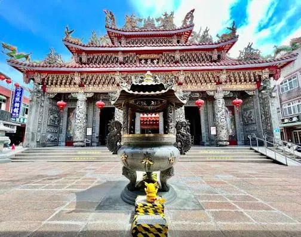
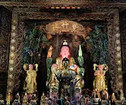
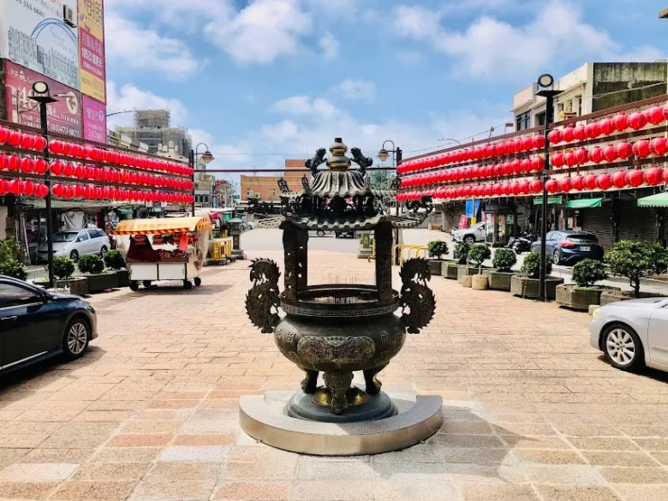

# 【桃園石觀音甘泉寺一日遊】清乾隆古剎 × 甘泉傳奇 × 三教合一的石觀音聖地｜悠遊時光

- 網站：vocus
- 原始網址：https://vocus.cc/article/695b08a8fd897800017a25c9
- 狀態：success
- 發表日期：2026-02-18T03:08:22.196Z
- 主題：歷史文化與信仰、觀光景點與活動
- 關鍵字：桃園市、甘泉寺、石觀音、歷史文化
- 擷取時間：2026-10-29T13:54:12.001123+00:00

## 清理後正文

位於桃園市龍潭、楊梅交界山區的 桃園石觀音甘泉寺，是一處結合自然奇景、宗教信仰與歷史文化的靜謐聖地。寺內最著名的「石觀音」與「甘泉水」流傳兩百多年，相傳可祈福、解厄、療癒身心，更被視為儒、釋、道三教合一的宗教建築典範。
一、甘泉寺歷史沿革與由來典故
- 清乾隆年間（約西元1780年） 創建
- 前身為「福龍寺」，因山中岩壁湧出甘甜泉水而聲名遠播
- 後因「甘泉」與「石觀音」信仰興盛，更名為「甘泉寺」
& 石觀音與甘泉傳說
- 山壁天然岩石形似觀音菩薩側影，信眾稱為「石觀音」
- 岩下湧泉終年不竭，被稱為「甘泉水」
- 相傳甘泉水曾治癒疾病、解除瘟疫，吸引各地信眾前來取水祈福
二、主祀神明與信仰特色
¥ 主祀神明
- 觀音菩薩（石觀音）
¥ 宗教特色
- 佛教：以觀音信仰為核心
- 道教：融合修行、祈福與地方信仰
- 儒家：重倫理、孝道與修身
¥ 形成罕見的「三教合一」信仰空間
三、主要保佑事項（適合拜什麼？）
- 🙏 身體健康、疾病康復
- 🙏 心靈平靜、消災解厄
- 🙏 家庭和諧、子女平安
- 🙏 事業順利、考試祈福
- 🙏 行車出入、登山平安
四、參拜流程（樓層與動線說明）
¥ 建議參拜順序
- 山門入口
→ 整理衣冠、靜心片刻
- → 合掌參拜、默念祈願
- 甘泉取水處
→ 以容器取少量，象徵祝福（勿浪費）
- 主殿觀音菩薩
→ 上香、稟報姓名、生辰、住址、願望
- 配祀神明區
→ 依序參拜，感謝庇佑
- 迴向感恩
→ 參拜結束，心存感謝
五、周邊造景與園區亮點
- 山林步道環繞，清幽寧靜
- 天然岩壁石觀音景觀
- 甘泉湧泉池（禁止戲水）
- 林蔭休憩平台，適合靜坐沉澱
- 多處自然取景點，適合攝影與慢遊
六、注意要項（參拜與旅遊禮儀）
- 穿著端莊，避免過於暴露
- 取甘泉水「少量即可」，勿商業販售
- 保持安靜，勿喧嘩奔跑
- 山區濕滑，穿防滑鞋
- 禁止破壞自然岩壁與刻字
七、重大慶典與熱鬧時節
- 觀音菩薩誕辰（農曆二月十九）
- 觀音成道日（農曆六月十九）
- 觀音出家日（農曆九月十九）
¥ 以上日期香客眾多，建議提早到訪
八、建築風格特色
- 傳統閩南式寺廟結構
- 自然岩壁融入建築，渾然天成
- 無過度雕琢，保留原始山林氣息
- 展現「依山而建、與自然共存」的宗教美學
九、交通指南
^ 自行開車
- 國道三號 → 龍潭交流道 → 指標前往石觀音甘泉寺
- 寺外設有簡易停車空間（假日較滿）
^ 大眾運輸
- 桃園／中壢火車站
→ 轉乘往龍潭公車
→ 再轉計程車或步行登山路段
十、在地美食推薦
- 龍潭客家粄條
- 客家菜包、草仔粿
- 擂茶、仙草茶
- 地瓜、花生等在地小吃
十一、周邊景點順遊建議
- 龍潭大池風景區
- 三坑老街
- 石門水庫
- 小人國主題樂園（親子行程）
「 FAQ 常見問題 」
Q：甘泉水真的可以喝嗎？
A：多數信眾取回象徵性飲用，建議少量、心誠即可。
Q：需要門票嗎？
A：不需要，屬開放式參拜空間。
Q：適合親子或長輩嗎？
A：可以，但部分步道較陡，需注意安全。
作者｜悠遊時光
石觀音甘泉寺不僅是一座廟，更像一段被山林守護的信仰記憶。當你站在岩壁前，聽泉水潺潺、合掌靜心的那一刻，會發現這裡真正療癒的，不只是甘泉，而是內心。

## 圖片
-  — [原始圖片來源](https://img.vocus.cc/kA5HPDyRJ9YFGN8vN7BstXyIwJBaMMI257GMapv1OpA/w:504/f:webp/plain/https://images.vocus.cc/4c7f1f2a-ed21-490b-bdb7-1ae8b969758e.jpg) 
-  — [原始圖片來源](https://img.vocus.cc/NYw3kPifKsJoDjqlj_yVR8mYPrgfd1XOkEVK1siNcKs/w:178/f:webp/plain/https://images.vocus.cc/8e521fc3-a944-4d23-bc5e-585633344550.jpg) 
-  — [原始圖片來源](https://img.vocus.cc/8C2TFj7epX1FDJVYXLYcgWfi_FfE5Iohpf6md6Z_Adc/w:740/f:webp/plain/https://images.vocus.cc/8749cb49-ce2b-4d89-b8d6-901c6c1f7aac.jpg) 

## 頁面連結
- [https://vocus.cc/](https://vocus.cc/)
- [玉皇上帝、玄天上帝（上帝公）](https://vocus.cc/salon/688b0b79fd897800010bfb2f/room/690c4d38cebbddbc5cbb3cf4)
- [保生大帝（大道公、神農大帝、感天大帝）](https://vocus.cc/salon/688b0b79fd897800010bfb2f/room/690c7460cebbddbc5cbbef6f)
- [天上聖母（媽祖）](https://vocus.cc/salon/688b0b79fd897800010bfb2f/room/690c501fcebbddbc5cbb3d25)
- [中壇元帥（三太子）](https://vocus.cc/salon/688b0b79fd897800010bfb2f/room/690ca6d9cebbddbc5cbc81ba)
- [五府千歲（王爺，千歲，元帥，大夫）](https://vocus.cc/salon/688b0b79fd897800010bfb2f/room/690caca6cebbddbc5cbcb34d)
- [臨水夫人（陳靖姑/夫人）](https://vocus.cc/salon/688b0b79fd897800010bfb2f/room/690cb093cebbddbc5cbcb5e0)
- [福德正神（財神）](https://vocus.cc/salon/688b0b79fd897800010bfb2f/room/690d391bcebbddbc5cbe3031)
- [濟公活佛（禪師）](https://vocus.cc/salon/688b0b79fd897800010bfb2f/room/690d423dcebbddbc5cbe31a0)
- [地藏王菩薩（城隍爺，鍾馗爺）](https://vocus.cc/salon/688b0b79fd897800010bfb2f/room/690d4cb5cebbddbc5cbe6033)
- [齊天大聖](https://vocus.cc/salon/688b0b79fd897800010bfb2f/room/690d4d74cebbddbc5cbe6036)
- [關聖帝君（關公）](https://vocus.cc/salon/688b0b79fd897800010bfb2f/room/690d4f11cebbddbc5cbe6045)
- [廣澤尊王/開彰聖王](https://vocus.cc/salon/688b0b79fd897800010bfb2f/room/690d8880cebbddbc5cbf41a8)
- [清水祖師/八卦祖師/慚愧祖師](https://vocus.cc/salon/688b0b79fd897800010bfb2f/room/690d8d04cebbddbc5cbf41c4)
- [王母娘娘（地母、娘娘）](https://vocus.cc/salon/688b0b79fd897800010bfb2f/room/690d8d90cebbddbc5cbf767a)
- [特殊廟宇（其他）](https://vocus.cc/salon/688b0b79fd897800010bfb2f/room/690dcb0acebbddbc5cc063b5)
- [九天玄女](https://vocus.cc/salon/688b0b79fd897800010bfb2f/room/690ddb10cebbddbc5cc08f58)
- [三官大帝](https://vocus.cc/salon/688b0b79fd897800010bfb2f/room/69127c5bcebbddbc5cccf859)
- [水仙尊王](https://vocus.cc/salon/688b0b79fd897800010bfb2f/room/69151f96cebbddbc5cd4da46)
- [八仙系列](https://vocus.cc/salon/688b0b79fd897800010bfb2f/room/6949e7e2d12907429fc3ff47)
- [關於](https://vocus.cc/salon/688b0b79fd897800010bfb2f/about)
- [開啟 App](https://open.vocus.cc/article/695b08a8fd897800017a25c9?utm_campaign=reading_fixed_banner)
- [https://vocus.cc/user/688b0b01fd897800010bdd48](https://vocus.cc/user/688b0b01fd897800010bdd48)
- [https://vocus.cc/article/6900948dfd89780001856dfe](https://vocus.cc/article/6900948dfd89780001856dfe)
- [一、甘泉寺歷史沿革與由來典故](https://vocus.cc/article/695b08a8fd897800017a25c9)
- [# 景點](https://vocus.cc/tags/%E6%99%AF%E9%BB%9E)
- [# 美食](https://vocus.cc/tags/%E7%BE%8E%E9%A3%9F)
- [# 信仰](https://vocus.cc/tags/%E4%BF%A1%E4%BB%B0)
- [# 文化巡禮](https://vocus.cc/tags/%E6%96%87%E5%8C%96%E5%B7%A1%E7%A6%AE)
- [# 廟宇](https://vocus.cc/tags/%E5%BB%9F%E5%AE%87)
- [# 特色](https://vocus.cc/tags/%E7%89%B9%E8%89%B2)
- [# 連假](https://vocus.cc/tags/%E9%80%A3%E5%81%87)
- [# 觀音](https://vocus.cc/tags/%E8%A7%80%E9%9F%B3)
- [# 自然](https://vocus.cc/tags/%E8%87%AA%E7%84%B6)
- [# 合一](https://vocus.cc/tags/%E5%90%88%E4%B8%80)
- [# 宗教](https://vocus.cc/tags/%E5%AE%97%E6%95%99)
- [# 龍潭](https://vocus.cc/tags/%E9%BE%8D%E6%BD%AD)
- [# 祈福](https://vocus.cc/tags/%E7%A5%88%E7%A6%8F)
- [上一篇 屏東歸來慈天宮一日遊

媽祖娘家巡禮｜歷史沿革・參拜流程・在地美食・周邊景點一次收藏](https://vocus.cc/article/6960503cfd89780001158473)
- [下一篇 白沙屯母德宮（太子廟）一日遊攻略](https://vocus.cc/article/693cb55afd89780001cd3a67)
- [悠遊時光](https://vocus.cc/salon/688b0b79fd897800010bfb2f)
- [通霄鎮慈雲寺一日遊｜媽祖海線必訪觀音古剎｜歷史沿革、參拜流程、交通美食全攻略](https://vocus.cc/article/69382030fd89780001707e86)
- [五股西雲寺一日遊：清幽古剎的百年香火之旅｜歷史、參拜流程、周邊景點、美食全攻略](https://vocus.cc/article/693a1194fd89780001eafe82)
- [員林慈天宮一日遊：觀音佛祖庇佑的心靈之旅，探索員林信仰文化與美食景點](https://vocus.cc/article/6912ea84fd89780001be35a3)
- [觀音佛祖（觀音菩薩）/如來佛祖](https://vocus.cc/salon/688b0b79fd897800010bfb2f/room/690c75b2cebbddbc5cbbf1b0)
- [# 方格新手](https://vocus.cc/tags/方格新手)
- [# 方格新手](https://vocus.cc/tags/%E6%96%B9%E6%A0%BC%E6%96%B0%E6%89%8B)
- [絕對零度的沙龍](https://vocus.cc/salon/659f20d9fd8978000173511b)
- [《一句「我以後不跟你買了」，讓我這個賣水果的想了很久》](https://vocus.cc/article/6ad45feefd89780001012d2e)
- [筱嵐的沙龍](https://vocus.cc/salon/6a0c8033fd897800014570df)
- [《恐怖心展》觀展隨筆：在別人的心魔裡，撞見自己的恐懼](https://vocus.cc/article/6ad76716fd89780001b363c2)
- [Greenland的建築旅行筆記](https://vocus.cc/salon/GREENLAND)
- [【奇蹟建築】妹島和世墨田北齋美術館](https://vocus.cc/article/6ad4a036fd897800010caa3a)
- [時光・旅行・記憶](https://vocus.cc/salon/68cc0929fd8978000150a27b)
- [🏜️202401 茨城自由行|參拜神社、飯店攻略](https://vocus.cc/article/68e0d2bcfd897800016d89c2)
- [# 茨城](https://vocus.cc/tags/%E8%8C%A8%E5%9F%8E)
- [# 市區](https://vocus.cc/tags/%E5%B8%82%E5%8D%80)
- [私房景點｜智慧之神的老家 - 全國惠比壽總本宮美保神社](https://vocus.cc/article/60058e7bfd8978000196fc75)
- [# 日本旅遊](https://vocus.cc/tags/%E6%97%A5%E6%9C%AC%E6%97%85%E9%81%8A)
- [IvyTravelChannel](https://vocus.cc/salon/ivytravelchannel)
- [【自駕出遊必備清單】一家四口旅行的後車廂減法收納｜philo 飛樂 Q12se 救車打氣多功能機實測](https://vocus.cc/article/6ab8de34fd8978000151f6ca)
- [# philo飛樂](https://vocus.cc/tags/philo%E9%A3%9B%E6%A8%82)
- [# 汽車百貨推薦](https://vocus.cc/tags/%E6%B1%BD%E8%BB%8A%E7%99%BE%E8%B2%A8%E6%8E%A8%E8%96%A6)
- [# 道路救援神器](https://vocus.cc/tags/%E9%81%93%E8%B7%AF%E6%95%91%E6%8F%B4%E7%A5%9E%E5%99%A8)
- [Sho 的路上觀察手記的沙龍](https://vocus.cc/salon/writing4U)
- [精選景點｜歷史遺跡與寺社](https://vocus.cc/article/64c65c7afd89780001873a7b)
- [# 世界遺產](https://vocus.cc/tags/%E4%B8%96%E7%95%8C%E9%81%BA%E7%94%A2)
- [# 神社](https://vocus.cc/tags/%E7%A5%9E%E7%A4%BE)
- [Celine 寫在這裡](https://vocus.cc/salon/celine0508)
- [福岡旅記∣一個人的櫻花祭，參拜博多櫛田神社](https://vocus.cc/article/680e0036fd89780001c91260)
- [# 博多祇園山笠](https://vocus.cc/tags/%E5%8D%9A%E5%A4%9A%E7%A5%87%E5%9C%92%E5%B1%B1%E7%AC%A0)
- [# 飾山笠](https://vocus.cc/tags/%E9%A3%BE%E5%B1%B1%E7%AC%A0)
- [# 山笠](https://vocus.cc/tags/%E5%B1%B1%E7%AC%A0)
- [🗳️ 晉級的公民｜選舉將近，新聞在吵什麼，你答得出來嗎？](https://vocus.cc/article/6acddba2fd897800017dd472)
- [# 公民](https://vocus.cc/tags/%E5%85%AC%E6%B0%91)
- [# 社福](https://vocus.cc/tags/%E7%A4%BE%E7%A6%8F)
- [# 晉級的公民](https://vocus.cc/tags/%E6%99%89%E7%B4%9A%E7%9A%84%E5%85%AC%E6%B0%91)
- [成長痛WDKY的沙龍](https://vocus.cc/salon/651fb2c5fd897800018f30ea)
- [明治神宮參拜須知！明治神宮景點推薦](https://vocus.cc/article/657ea996fd897800018819f0)
- [# 明治神宮](https://vocus.cc/tags/%E6%98%8E%E6%B2%BB%E7%A5%9E%E5%AE%AE)
- [# 明治神宮時間](https://vocus.cc/tags/%E6%98%8E%E6%B2%BB%E7%A5%9E%E5%AE%AE%E6%99%82%E9%96%93)
- [# 明治神宮景點](https://vocus.cc/tags/%E6%98%8E%E6%B2%BB%E7%A5%9E%E5%AE%AE%E6%99%AF%E9%BB%9E)
- [嘿！嘻瑞的沙龍](https://vocus.cc/salon/siri)
- [孩子的「變形金剛」打氣神隊友！philo 飛樂 Q12se 救車打氣多功能機，讓日常保養變成最棒的親子時光](https://vocus.cc/article/6a71f8d2fd897800012d2de1)
- [# 變形金剛](https://vocus.cc/tags/%E8%AE%8A%E5%BD%A2%E9%87%91%E5%89%9B)
- [# 道路救援](https://vocus.cc/tags/%E9%81%93%E8%B7%AF%E6%95%91%E6%8F%B4)
- [# 親子](https://vocus.cc/tags/%E8%A6%AA%E5%AD%90)
- [イジョ的沙龍](https://vocus.cc/salon/676c1910fd89780001b16a79)
- [大阪景點|箕面一日遊:勝尾寺](https://vocus.cc/article/676c1912fd89780001b16a9d)
- [# 一日遊](https://vocus.cc/tags/%E4%B8%80%E6%97%A5%E9%81%8A)
- [# 參拜](https://vocus.cc/tags/%E5%8F%83%E6%8B%9C)
- [方格子 vocus 官方沙龍](https://vocus.cc/salon/vocus_official)
- [【不斷更新】主題活動懶人包：今天想寫什麼？找到你的賽道，讓創作被看見！](https://vocus.cc/article/6972ffbffd8978000150ec36)
- [# vocus](https://vocus.cc/tags/vocus)
- [# 分享](https://vocus.cc/tags/%E5%88%86%E4%BA%AB)
- [# 創作](https://vocus.cc/tags/%E5%89%B5%E4%BD%9C)
- [跟著大衛玩日文](https://vocus.cc/salon/687497a3fd89780001aca605)
- [🍜 日本餐廳點餐必學日語｜讓你在居酒屋、拉麵店都能自在點餐](https://vocus.cc/article/68a54f11fd89780001d84620)
- [# 日本](https://vocus.cc/tags/%E6%97%A5%E6%9C%AC)
- [# 年輕人](https://vocus.cc/tags/%E5%B9%B4%E8%BC%95%E4%BA%BA)
