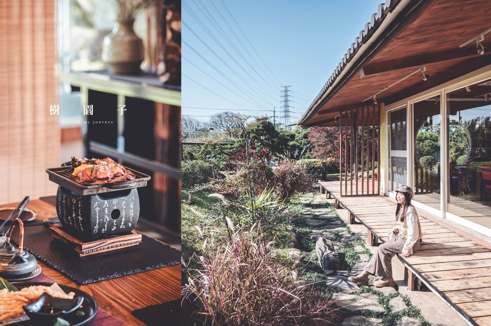
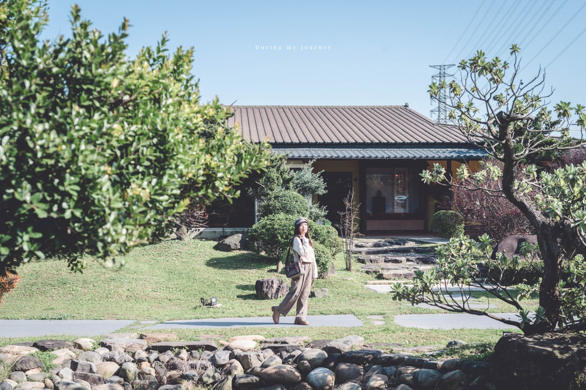
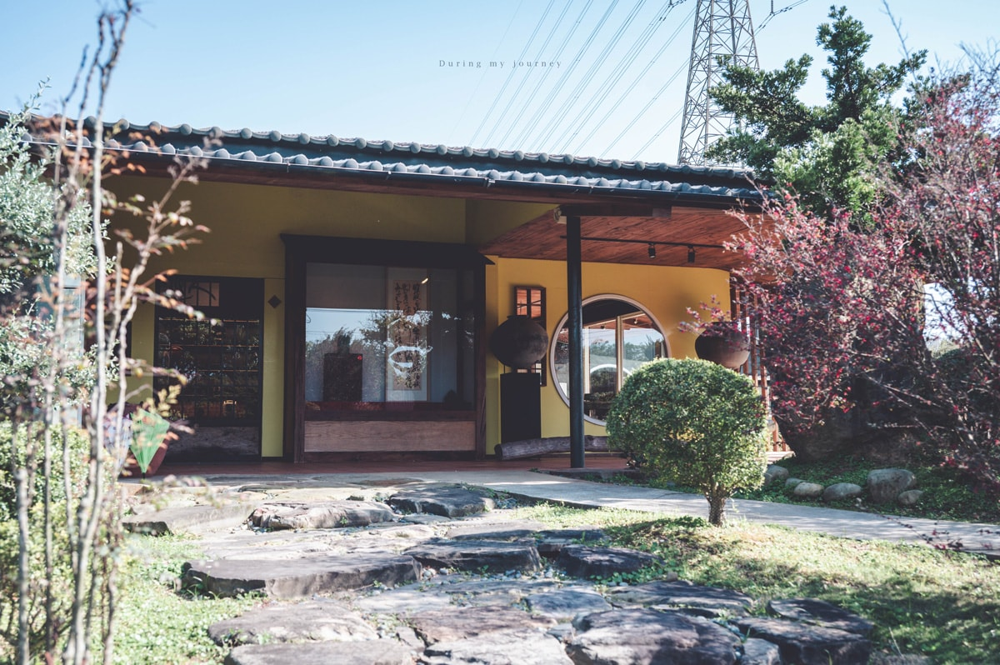

# 《桃園觀音》樹園子 遠離塵囂的日式禪風景觀餐廳、以無菜單料理感受四季饗宴 – 我的旅圖中 during my journey

- 網站：我的旅圖中 during my journey
- 原始網址：https://duringmyjourney.com/treegarden/
- 狀態：success
- 發表日期：2025-04-04T20:32:47+08:00
- 主題：地方產業與農漁業、觀光景點與活動
- 關鍵字：觀音區、桃園市、地方旅遊
- 擷取時間：2026-10-29T13:54:18.116035+00:00

## 清理後正文

2.1K
桃園觀音，這座平日裡少有人駐足的小鎮，藏著一處宛如世外桃源的日式景觀餐廳，推開大門，彷彿踏入了另一個時空，柔軟的塌塌米鋪展腳下，溫潤的草香與米香輕輕包圍，大片玻璃窗映照著綠意盎然的庭園，在這裡的每一刻，都能感受到大自然的溫柔療癒。
樹園子主打無菜單懷石料理，將當季最鮮美的食材化作一道道精緻的佳餚，凝聚了職人的用心與自然的純粹，不論是白天陽光溫柔的庭園饗宴，或是夜晚燈光搖曳的靜謐時刻，都讓人彷彿置身京都的私房料亭，在寧靜的氛圍中細細品味四季更迭的美好。
目錄
桃園觀音日式庭園景觀餐廳｜樹園子
樹園子室內環境介紹
無菜單料理收費價格
樹園子無菜單料理介紹
開胃前菜
手工湯豆腐
水耕生菜沙拉
酥炸天婦羅
土瓶蒸牛蒡湯
朴葉燒牛肉
烤豬肋排
檸檬氣泡飲
星鰻拌飯
鹽烤青衣
蓮花雞湯
飯後甜點、水果
桃園觀音日式庭園景觀餐廳｜樹園子
桃園觀音的鄉間小路中，有一間低調的庭園景觀餐廳藏於其中，日式平房靜靜佇立，庭院綠意盎然，石階與草木錯落，一旁還有瀑布流水的造景，乍看之下彷彿來到了日本。
庭園的一草一木打理得井然有序，看得出主理人對於環境維護的用心，這裡也像是世外桃源般，讓每位特地前來用餐的客人都享受到遠離塵囂的氛圍。
樹園子室內環境介紹
踏入餐廳，首先映入眼簾的是各式花瓶、陶瓷器皿與古董老件，錯落有致地擺放在空間中，宛如一座小型展示館，靜靜迎接每位來訪的客人。
脫下鞋子，輕踏上榻榻米，柔軟的質感讓人不自覺地放慢了步調，室內皆以溫潤的日式禪風為設計，營造出恬靜文雅的質感，空間內擺放著主理人從世界各地蒐集來的懷舊家具與古董，每一件物品都承載著歲月的故事。
用餐空間巧妙運用低調的竹簾作為區隔，不影響開闊感的同時，也讓每一桌客人都保有自己的靜謐，朱紅色的座椅在簡約素雅的氛圍中增添了一抹溫潤沉穩的色彩，低調卻恰到好處。
那天是個萬里無雲的晴天，大片落地窗引入滿滿的綠意，被陽光曬得發亮的樹影在地面輕輕搖曳，在這裡用餐，有著說不出口的好心情。
我特別喜歡圓型的窗戶，可以直接眺望庭院的景觀，不論是在室內或是室外拍照都非常好看！是來樹園子必推的打卡點。
如果運氣好，有機會遇到來樹園子跟客人撒嬌的橘貓，會在玻璃窗旁賣萌，超級可愛！
無菜單料理收費價格
樹園子主要供應日式無菜單懷石料理，採預約制，每人收費為$1380+10%服務費。
一共有十道當季的精緻料理，從前菜、主餐、湯品到飯後甜點都相當豐富，在這裡不單只是用餐，更是能讓人享受優雅環境以及緩慢步調的時光。
樹園子無菜單料理介紹
開胃前菜
由左到右是佃煮牛蒡、磯煮鮑魚、水云醋，皆以細膩手法呈現日式料理的精髓。
佃煮牛蒡口感清脆、帶有微微甘甜的餘韻，磯煮鮑魚則以醬汁與昆布熬煮入味、口感柔韌且富有層次，水云醋則是以海藻細絲佐以蘋果醋，大多都是清新酸甜的滋味，相當開胃。
手工湯豆腐
這道料理融合了草蝦、鮭魚卵、魚子醬、澎湖海菜，入口便能感受到豆腐的細緻與滑嫩，搭配鮭魚卵與魚子醬的鹹香，每一口都充滿鮮美的海味，湯底的部分則使用了澎湖海菜，讓整體風味更顯清爽。
水耕生菜沙拉
與當地小農合作的生菜生拉，有舞菇、蓮藕片、小黃瓜、番茄、水煮蛋等等，並淋上和風柚子醬，整體來說非常清爽健康，不過其中的罐頭水蜜桃稍微突兀一點。
酥炸天婦羅
我很喜歡吃天婦羅，每次去日式料理店二話不說一定會點來嚐嚐，樹園子呈現的是高級版的天婦羅，剛上桌，香酥的氣息便撲鼻而來，瞬間勾起食慾。
這道天婦羅包含酥炸軟殼蟹、牛蒡、金針菇與糯米椒，層次豐富，其中最讓我驚艷的是酥炸軟殼蟹，外皮金黃香脆，蟹肉仍保有彈性與鮮甜，搭配甘甜醇厚的醬汁更是加分。
土瓶蒸牛蒡湯
吃完炸物來點清爽土瓶蒸，超級對味！湯頭雖然清澈卻富有層次感，一入口便充滿牛蒡的特殊香氣、以及蔬菜熬煮的鮮甜滋味，我個人非常喜歡！
朴葉燒牛肉
朴葉燒在器具的選擇上很有儀式感，不論視覺或味覺都一次到位，牛肉是使用美國牛小排，上面鋪了一點金桔醬，嚐起來多了一股酸甜氣息，相當特別！一旁還有舞菇、櫛瓜、栗子、南瓜等等，上面的食材雖然已經熟了，還是會透過加熱讓朴葉的香氣融入在食材之中，烤的同時會聞到陣陣香味，整個很誘人！
烤豬肋排
如果像我一樣不吃牛肉的話，需提前告知服務人員，主餐的部分就會更換成烤豬肋排，這道餐點偏向西式，並用刀叉來享用，與朴葉燒形成東西方的有趣反差感。
豬肋排經過細火烘烤後，鎖住了肉質的鮮甜與油脂的醇厚，伴隨著獨特的辛香氣，嚐起來屬於軟嫩扎實的口感，推薦淋上和風芥子醬讓味道更加鮮明且富有層次。
檸檬氣泡飲
餐間會上一杯檸檬氣泡飲舒緩大魚大肉的油膩感，在這炎熱的天氣很消暑啊。
星鰻拌飯
我個人特別偏愛這道星鰻拌飯，星鰻柔嫩細緻，醬燒的甘甜同時滲透米飯，帶來迷人又濃郁的鹹香，搭配微辛爽口的紅薑，可以平衡油脂的豐厚感，而玉子燒的蛋香與微甜，讓整體風味更加和諧，吃完有種意猶未盡的感覺呢。
鹽烤青衣
鹽烤青衣魚肉質細嫩多汁，帶著屬於海味的鮮香，昆布鹽的點綴讓鮮味更顯層次，入口時能感受到魚肉本身的自然甘甜，底下的毛豆泥質地細滑，帶著清新的豆香，與魚肉相互襯托，增添溫潤口感。
一旁的稻穗米香是可以食用的，米香來自店家親手收割與日曬，非常的用心，最後，以小番茄的微酸點綴，讓整道料理留下清爽的尾韻。
蓮花雞湯
觀音向來以盛產蓮花聞名，沒想到蓮花也能成為餐桌上的主角，當服務人員輕輕將香水蓮花放入鍋中，花瓣在熱湯中緩緩綻放，宛如一幅詩意盎然的畫面，讓人忍不住屏息欣賞。
這道湯品以蓮藕片、蕈菇、紅棗、枸杞、山藥等豐富食材熬煮而成，每一勺撈起來都是滿滿的精華，湯頭甘醇鮮甜、入口溫潤，感覺非常的營養健康，我們捨不得浪費每一口湯，努力的將雞湯清空，最後真的好飽啊！
飯後甜點、水果
飯後甜點是濃郁紮實的手工布朗尼，帶有淡淡可可苦韻，甜而不膩，搭配草莓、西瓜、哈密瓜等，為味蕾帶來清新的轉換，最後配上一杯無糖黑豆茶，可以用來平衡甜點和水果，為這頓精緻饗宴畫下完美句點。
在靜謐的日式庭院中，樹園子不只是用餐的地方，更是一場身心的沉浸體驗，從精緻的無菜單料理，到柔軟的塌塌米座席、窗外映照的綠意，每個細節都流露出店家的用心與細心。
這裡沒有喧囂，只有值得細細品味的時光，每一道料理都是與大自然對話的橋樑，讓人放慢步調，專注於眼前的美好，若你嚮往一場融合味覺、視覺與靜謐氛圍的饗宴，這間隱身於觀音的日式景觀餐廳，會是一個值得放入口袋名單的地方。
《謝謝樹園子邀請》
Info.
地址: 桃園市觀音區新華路一段1076-1號
預約電話: (03) 487 – 0220
營業時間: 週一至週日 11:30 – 14:30 / 17:30 – 20:30
停車資訊: 可將汽車停放在餐廳附設的專屬停車場。
–
樹園子 ｜
Facebook粉絲團
追蹤我的旅圖中
Follow us!
桃園日式料理
桃園無菜單料理
桃園特色餐廳
桃園餐廳
觀音高級餐廳
0 comments
0
安妮卡Ainycka
過去曾是一位平面視覺設計師，旅行、老宅、咖啡廳中毒者，對攝影有完美主義與堅持。
previous post
《台中西區》冰火山 隱藏於老宅裡的奇幻秘境咖啡廳、有如在逛一場異世界的展覽
next post
《桃園中壢》47二次方咖啡花園 隱身中壢郊區的祕密花園咖啡廳、享受鄉村風情的午後時光

## 圖片
-  — [原始圖片來源](https://duringmyjourney.com/wp-content/uploads/2025/04/treegarden-01.jpg) 
-  — [原始圖片來源](https://duringmyjourney.com/wp-content/uploads/2025/04/DSC_2119.jpg) 
-  — [原始圖片來源](https://duringmyjourney.com/wp-content/uploads/2025/04/DSC_2099.jpg) 

## 頁面連結
- [桃園 Taoyuan](https://duringmyjourney.com/category/227722/%e6%a1%83%e5%9c%92-taoyuan/)
- [https://duringmyjourney.com/wp-content/uploads/2025/04/treegarden-01.jpg](https://duringmyjourney.com/wp-content/uploads/2025/04/treegarden-01.jpg)
- [Facebook粉絲團](https://www.facebook.com/p/%E6%A8%B9%E5%9C%92%E5%AD%90-100077283797094/?locale=zh_TW)
- [桃園日式料理](https://duringmyjourney.com/tag/%e6%a1%83%e5%9c%92%e6%97%a5%e5%bc%8f%e6%96%99%e7%90%86/)
- [桃園無菜單料理](https://duringmyjourney.com/tag/%e6%a1%83%e5%9c%92%e7%84%a1%e8%8f%9c%e5%96%ae%e6%96%99%e7%90%86/)
- [桃園特色餐廳](https://duringmyjourney.com/tag/%e6%a1%83%e5%9c%92%e7%89%b9%e8%89%b2%e9%a4%90%e5%bb%b3/)
- [桃園餐廳](https://duringmyjourney.com/tag/%e6%a1%83%e5%9c%92%e9%a4%90%e5%bb%b3/)
- [觀音高級餐廳](https://duringmyjourney.com/tag/%e8%a7%80%e9%9f%b3%e9%ab%98%e7%b4%9a%e9%a4%90%e5%bb%b3/)
- [Facebook](https://www.facebook.com/sharer/sharer.php?u=https://duringmyjourney.com/treegarden/)
- [安妮卡Ainycka](https://duringmyjourney.com/author/ainycka0815/)
- [https://duringmyjourney.com](https://duringmyjourney.com)
- [《台中西區》冰火山 隱藏於老宅裡的奇幻秘境咖啡廳、有如在逛一場異世界的展覽](https://duringmyjourney.com/the-ice-palace/)
- [《桃園中壢》47二次方咖啡花園 隱身中壢郊區的祕密花園咖啡廳、享受鄉村風情的午後時光](https://duringmyjourney.com/47cafe/)
- [《新北汐止》金龍湖步道 隱藏於城市中最大的碧綠湖泊、繚繞湖光山色的私房景點](https://duringmyjourney.com/jinlong/)
- [《新北石門》白日夢Tea & Café 在遙遠的國小裡發呆做白日夢、配著療癒大海和悠閒下午茶](https://duringmyjourney.com/tea-cafe/)
- [《台北・新北》川端橋 雙北河畔近百年的復古老橋、永和與古亭的入夜約會新景點](https://duringmyjourney.com/kawabata-bridge/)
- [《宜蘭員山》小院子咖啡畫廊 置身花園裡的歐式庭園咖啡廳、結合畫廊的藝術秘境空間](https://duringmyjourney.com/littlecofeyard/)
- [https://duringmyjourney.com/northern-taiwan/](https://duringmyjourney.com/northern-taiwan/)
- [《台北30間以上景觀餐廳咖啡廳推薦》尋一個綠意森林、湛藍海邊、燦爛夜景的美食午茶時刻](https://duringmyjourney.com/taipei-restaurant/)
- [https://duringmyjourney.com/cama-coffee-roasters/](https://duringmyjourney.com/cama-coffee-roasters/)
- [PenciDesign](https://1.envato.market/YYJ4P)
- [https://duringmyjourney.com/treegarden/](https://duringmyjourney.com/treegarden/)
- [https://duringmyjourney.com/](https://duringmyjourney.com/)
- [https://www.facebook.com/duringmyjourney/](https://www.facebook.com/duringmyjourney/)
- [https://www.instagram.com/duringmyjourney/](https://www.instagram.com/duringmyjourney/)
- [https://duringmyjourney.com/cdn-cgi/l/email-protection](https://duringmyjourney.com/cdn-cgi/l/email-protection)
- [關於我 About me](https://duringmyjourney.com/during-my-journey/)
- [旅遊誌 Travelogue](https://duringmyjourney.com/category/227728/)
- [台灣懶人包-Taiwan](https://duringmyjourney.com/category/227728/5532242/)
- [東部懶人包-Eastern-Taiwan](https://duringmyjourney.com/category/227728/5568086/)
- [北部懶人包-Northern-Taiwan](https://duringmyjourney.com/category/227728/5518961/)
- [南部懶人包-Southern-Taiwan](https://duringmyjourney.com/category/227728/6920471/)
- [台北市-TaipeiCity](https://duringmyjourney.com/category/227728/5518988/)
- [彰化-Changhua](https://duringmyjourney.com/category/227728/5567171/)
- [南投–Nantou](https://duringmyjourney.com/category/227728/6921566/)
- [雲林-Yunlin](https://duringmyjourney.com/category/227728/5528738/)
- [美食誌 Foodie dairy](https://duringmyjourney.com/category/227722/)
- [北部懶人包–Northern-Taiwan](https://duringmyjourney.com/category/227722/5549732/)
- [中部懶人包-Central-Taiwan](https://duringmyjourney.com/category/227728/5557829/)
- [基隆-Keelung](https://duringmyjourney.com/category/227722/5518967/)
- [新北市-New-Taipei-City](https://duringmyjourney.com/category/227728/5518982/)
- [台北市-Taipei-City](https://duringmyjourney.com/category/227722/5519285/)
- [桃園-Taoyuan](https://duringmyjourney.com/category/227728/5518985/)
- [新竹-Hsinchu](https://duringmyjourney.com/category/227722/5518958/)
- [苗栗-Miaoli](https://duringmyjourney.com/category/227722/5558057/)
- [試吃-Tasting](https://duringmyjourney.com/category/227722/5374361/)
- [住宿旅誌 Accommodation](https://duringmyjourney.com/category/274604/)
- [宜蘭-Yilan](https://duringmyjourney.com/category/227728/5536628/)
- [台東-Taitung](https://duringmyjourney.com/category/274604/5088754/)
- [台中-Taichung](https://duringmyjourney.com/category/274604/6903290/)
- [南投–Nantou](https://duringmyjourney.com/category/274604/6931115/)
- [嘉義-Chiayi](https://duringmyjourney.com/category/274604/6941821/)
- [台南-Tainan](https://duringmyjourney.com/category/227728/6921020/)
- [屏東-Pingtung](https://duringmyjourney.com/category/274604/6936914/)
- [國外旅遊日誌 Foreign Travelogue](https://duringmyjourney.com/category/270137/)
- [日本-Japan](https://duringmyjourney.com/category/270137/5518973/)
- [香港-HongKong](https://duringmyjourney.com/category/270137/6909272/)
- [北美洲-Northern-America](https://duringmyjourney.com/category/270137/5088802/)
- [生活 Lifestyle](https://duringmyjourney.com/category/6919010/)
- [攝影 Photography](https://duringmyjourney.com/category/282913/)
- [攝影教學-Photography](https://duringmyjourney.com/category/282913/6952761/)
- [金城事務所](https://iseeu.tw/migration/)

> 備註：進階解析失敗，已使用內建解析器：AttributeError: 'NoneType' object has no attribute 'get'
