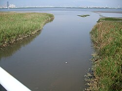
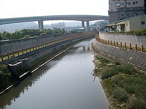

# 觀音坑溪 - 維基百科，自由的百科全書

- 網站：zh.wikipedia.org
- 原始網址：https://zh.wikipedia.org/wiki/%E8%A7%80%E9%9F%B3%E5%9D%91%E6%BA%AA
- 狀態：success
- 主題：自然景觀與生態
- 關鍵字：觀音坑溪、地方旅遊、觀光資訊
- 擷取時間：2026-10-29T13:54:18.896890+00:00

## 清理後正文

維基百科，自由的百科全書
觀音坑溪
過觀音坑溪橋入淡水河，對岸右邊是社子，左邊是關渡
流域
水系
淡水河
源頭
• 位置
觀音山
南側（凌雲禪寺附近）
• 海拔
372公尺（1,220英尺）
河口
獅子頭
流域面積
9.2平方公里（3.6平方英里）
位置
新北市
五股區
本貌
長度
6.2公里（3.9英里）
觀音坑溪橋上看上游，遠方為
台64線
高架。
觀音坑溪
(或以中下游地名另稱北勢坑溪)，位於
台灣
北部，是
淡水河
的一條支流，河長6.2公里，流域面積9.2平方公里，分佈於
新北市
五股區
。其源頭位於
觀音山
南側的凌雲禪寺附近，標高372公尺
[
1
]
，向東南流入
台北盆地
後，轉向東注入淡水河。
觀音坑溪原本注入淡水河的另一支流
塭子川
[
2
]
，後因拓寬淡水河道工程而炸毀
獅子頭
隘口，即變成現況之各自注入淡水河。
導演
齊柏林
在所執導的《
看見台灣
》紀綠片中，拍攝到觀音坑溪遭上游染整廠排放的廢水汙染，河面呈暗紅色。
橋梁
[
編輯
]
觀音坑溪橋:
八里左岸自行車道
跨過觀音坑溪。
相關條目
[
編輯
]
淡水河
塭子川
參考資料
[
編輯
]
維基共享資源
上的相關多媒體資源：
觀音坑溪
^
李錫堤等，
林口台地及其鄰接海岸地形變遷與地貌復原可行性探討
（
頁面存檔備份
，存於
網際網路檔案館
）
^
楊萬全，臺北盆地零公尺地區的問題，台灣水文論文集，2000年5月，第114頁
取自「
https://zh.wikipedia.org/w/index.php?title=觀音坑溪&oldid=85606836
」
分類
：
淡水河水系
新北市河流
隱藏分類：
維基共享資源分類連結使用了維基數據上的匹配項
有地圖的頁面

## 圖片
-  — [原始圖片來源](https://zh.wikipedia.org/static/images/mobile/copyright/wikipedia-wordmark-zh.svg) 
-  — [原始圖片來源](https://zh.wikipedia.org/static/images/mobile/copyright/wikipedia-tagline-zh.svg) 
-  — [原始圖片來源](https://thumb.wikimedia.org/wikipedia/commons/thumb/2/23/%E8%A7%80%E9%9F%B3%E5%9D%91%E6%BA%AA%E5%85%A5%E6%B7%A1%E6%B0%B4%E6%B2%B3.JPG/250px-%E8%A7%80%E9%9F%B3%E5%9D%91%E6%BA%AA%E5%85%A5%E6%B7%A1%E6%B0%B4%E6%B2%B3.JPG?utm_source=zh.wikipedia.org&utm_campaign=parser&utm_content=thumbnail) 
-  — [原始圖片來源](https://thumb.wikimedia.org/wikipedia/commons/thumb/8/8c/%E8%A7%80%E9%9F%B3%E5%9D%91%E6%BA%AA.JPG/250px-%E8%A7%80%E9%9F%B3%E5%9D%91%E6%BA%AA.JPG?utm_source=zh.wikipedia.org&utm_campaign=parser&utm_content=thumbnail) 
-  — [原始圖片來源](https://zh.wikipedia.org/static/images/footer/wikimedia.svg) 

## 頁面連結
- [分類索引](https://zh.wikipedia.org/wiki/Wikipedia:%E5%88%86%E7%B1%BB%E7%B4%A2%E5%BC%95)
- [特色內容](https://zh.wikipedia.org/wiki/Portal:%E7%89%B9%E8%89%B2%E5%85%A7%E5%AE%B9)
- [新聞動態](https://zh.wikipedia.org/wiki/Portal:%E6%96%B0%E8%81%9E%E5%8B%95%E6%85%8B)
- [隨機條目](https://zh.wikipedia.org/wiki/Special:Random)
- [聯絡我們](https://zh.wikipedia.org/wiki/Wikipedia:%E8%81%94%E7%BB%9C%E6%88%91%E4%BB%AC)
- [說明](https://zh.wikipedia.org/wiki/Help:%E9%A6%96%E9%A1%B5)
- [維基社群](https://zh.wikipedia.org/wiki/Wikipedia:%E7%A4%BE%E7%BE%A4%E9%A6%96%E9%A1%B5)
- [編輯入門](https://zh.wikipedia.org/wiki/Help:%E5%85%A5%E9%97%A8)
- [互助客棧](https://zh.wikipedia.org/wiki/Wikipedia:%E4%BA%92%E5%8A%A9%E5%AE%A2%E6%A0%88)
- [IRC即時聊天](https://zh.wikipedia.org/wiki/Wikipedia:IRC%E8%81%8A%E5%A4%A9%E9%A2%91%E9%81%93)
- [近期變更](https://zh.wikipedia.org/wiki/Special:RecentChanges)
- [特殊頁面](https://zh.wikipedia.org/wiki/Special:SpecialPages)
- [首頁](https://zh.wikipedia.org/wiki/Wikipedia:%E9%A6%96%E9%A1%B5)
- [搜尋](https://zh.wikipedia.org/wiki/Special:Search)
- [資助維基百科](https://donate.wikimedia.org/?wmf_source=donate&wmf_medium=sidebar&wmf_campaign=zh.wikipedia.org&uselang=zh)
- [建立帳號](https://zh.wikipedia.org/w/index.php?title=Special:CreateAccount&returnto=%E8%A7%80%E9%9F%B3%E5%9D%91%E6%BA%AA)
- [登入](https://zh.wikipedia.org/w/index.php?title=Special:UserLogin&returnto=%E8%A7%80%E9%9F%B3%E5%9D%91%E6%BA%AA)
- [Cebuano](https://ceb.wikipedia.org/wiki/Guanyinkeng_Xi_(suba_sa_Republika_sa_Tsina,_Taipei))
- [討論](https://zh.wikipedia.org/wiki/Talk:%E8%A7%80%E9%9F%B3%E5%9D%91%E6%BA%AA)
- [不转换](https://zh.wikipedia.org/zh/%E8%A7%80%E9%9F%B3%E5%9D%91%E6%BA%AA)
- [简体](https://zh.wikipedia.org/zh-hans/%E8%A7%80%E9%9F%B3%E5%9D%91%E6%BA%AA)
- [繁體](https://zh.wikipedia.org/zh-hant/%E8%A7%80%E9%9F%B3%E5%9D%91%E6%BA%AA)
- [大陆简体](https://zh.wikipedia.org/zh-cn/%E8%A7%80%E9%9F%B3%E5%9D%91%E6%BA%AA)
- [香港繁體](https://zh.wikipedia.org/zh-hk/%E8%A7%80%E9%9F%B3%E5%9D%91%E6%BA%AA)
- [澳門繁體](https://zh.wikipedia.org/zh-mo/%E8%A7%80%E9%9F%B3%E5%9D%91%E6%BA%AA)
- [大马简体](https://zh.wikipedia.org/zh-my/%E8%A7%80%E9%9F%B3%E5%9D%91%E6%BA%AA)
- [新加坡简体](https://zh.wikipedia.org/zh-sg/%E8%A7%80%E9%9F%B3%E5%9D%91%E6%BA%AA)
- [臺灣正體](https://zh.wikipedia.org/zh-tw/%E8%A7%80%E9%9F%B3%E5%9D%91%E6%BA%AA)
- [編輯](https://zh.wikipedia.org/w/index.php?title=%E8%A7%80%E9%9F%B3%E5%9D%91%E6%BA%AA&action=edit)
- [檢視歷史](https://zh.wikipedia.org/w/index.php?title=%E8%A7%80%E9%9F%B3%E5%9D%91%E6%BA%AA&action=history)
- [連結至此的頁面](https://zh.wikipedia.org/wiki/Special:WhatLinksHere/%E8%A7%80%E9%9F%B3%E5%9D%91%E6%BA%AA)
- [相關變更](https://zh.wikipedia.org/wiki/Special:RecentChangesLinked/%E8%A7%80%E9%9F%B3%E5%9D%91%E6%BA%AA)
- [上傳檔案](https://zh.wikipedia.org/wiki/Project:上传)
- [固定連結](https://zh.wikipedia.org/w/index.php?title=%E8%A7%80%E9%9F%B3%E5%9D%91%E6%BA%AA&oldid=85606836)
- [頁面資訊](https://zh.wikipedia.org/w/index.php?title=%E8%A7%80%E9%9F%B3%E5%9D%91%E6%BA%AA&action=info)
- [引用此頁面](https://zh.wikipedia.org/w/index.php?title=Special:CiteThisPage&page=%E8%A7%80%E9%9F%B3%E5%9D%91%E6%BA%AA&id=85606836&wpFormIdentifier=titleform)
- [取得短連結](https://zh.wikipedia.org/w/index.php?title=Special:UrlShortener&url=https%3A%2F%2Fzh.wikipedia.org%2Fwiki%2F%25E8%25A7%2580%25E9%259F%25B3%25E5%259D%2591%25E6%25BA%25AA)
- [下載為PDF](https://zh.wikipedia.org/w/index.php?title=Special:DownloadAsPdf&page=%E8%A7%80%E9%9F%B3%E5%9D%91%E6%BA%AA&action=show-download-screen)
- [編輯連結](https://www.wikidata.org/wiki/Special:EntityPage/Q16929341)
- [https://zh.wikipedia.org/wiki/File:%E8%A7%80%E9%9F%B3%E5%9D%91%E6%BA%AA%E5%85%A5%E6%B7%A1%E6%B0%B4%E6%B2%B3.JPG](https://zh.wikipedia.org/wiki/File:%E8%A7%80%E9%9F%B3%E5%9D%91%E6%BA%AA%E5%85%A5%E6%B7%A1%E6%B0%B4%E6%B2%B3.JPG)
- [水系](https://zh.wikipedia.org/wiki/%E6%B5%81%E5%9F%9F)
- [https://zh.wikipedia.org/wiki/File:%E8%A7%80%E9%9F%B3%E5%9D%91%E6%BA%AA.JPG](https://zh.wikipedia.org/wiki/File:%E8%A7%80%E9%9F%B3%E5%9D%91%E6%BA%AA.JPG)
- [台64線](https://zh.wikipedia.org/wiki/%E5%8F%B064%E7%B7%9A)
- [台灣](https://zh.wikipedia.org/wiki/%E5%8F%B0%E7%81%A3)
- [新北市](https://zh.wikipedia.org/wiki/%E6%96%B0%E5%8C%97%E5%B8%82)
- [五股區](https://zh.wikipedia.org/wiki/%E4%BA%94%E8%82%A1%E5%8D%80)
- [觀音山](https://zh.wikipedia.org/wiki/%E8%A7%80%E9%9F%B3%E5%B1%B1_(%E6%96%B0%E5%8C%97%E5%B8%82))
- [台北盆地](https://zh.wikipedia.org/wiki/%E5%8F%B0%E5%8C%97%E7%9B%86%E5%9C%B0)
- [獅子頭](https://zh.wikipedia.org/wiki/%E7%8B%AE%E5%AD%90%E5%A4%B4)
- [齊柏林](https://zh.wikipedia.org/wiki/%E9%BD%8A%E6%9F%8F%E6%9E%97)
- [看見台灣](https://zh.wikipedia.org/wiki/%E7%9C%8B%E8%A6%8B%E5%8F%B0%E7%81%A3)
- [編輯](https://zh.wikipedia.org/w/index.php?title=%E8%A7%80%E9%9F%B3%E5%9D%91%E6%BA%AA&action=edit&section=1)
- [八里左岸自行車道](https://zh.wikipedia.org/wiki/%E6%96%B0%E5%8C%97%E5%B8%82%E8%87%AA%E8%A1%8C%E8%BB%8A%E9%81%93)
- [https://zh.wikipedia.org/wiki/File:%E8%A7%80%E9%9F%B3%E5%9D%91%E6%BA%AA%E6%A9%8B%E3%80%82%E5%85%AB%E9%87%8C%E5%B7%A6%E5%B2%B8%E8%87%AA%E8%A1%8C%E8%BB%8A%E9%81%93%E3%80%82_-_panoramio.jpg](https://zh.wikipedia.org/wiki/File:%E8%A7%80%E9%9F%B3%E5%9D%91%E6%BA%AA%E6%A9%8B%E3%80%82%E5%85%AB%E9%87%8C%E5%B7%A6%E5%B2%B8%E8%87%AA%E8%A1%8C%E8%BB%8A%E9%81%93%E3%80%82_-_panoramio.jpg)
- [編輯](https://zh.wikipedia.org/w/index.php?title=%E8%A7%80%E9%9F%B3%E5%9D%91%E6%BA%AA&action=edit&section=2)
- [編輯](https://zh.wikipedia.org/w/index.php?title=%E8%A7%80%E9%9F%B3%E5%9D%91%E6%BA%AA&action=edit&section=3)
- [https://zh.wikipedia.org/wiki/File:Commons-logo.svg](https://zh.wikipedia.org/wiki/File:Commons-logo.svg)
- [維基共享資源](https://zh.wikipedia.org/wiki/%E7%BB%B4%E5%9F%BA%E5%85%B1%E4%BA%AB%E8%B5%84%E6%BA%90)
- [維基共享資源](https://commons.wikimedia.org/wiki/Category:Guanyinkeng_River)
- [林口台地及其鄰接海岸地形變遷與地貌復原可行性探討](http://140.115.123.30/LINKOU/CH02/CH02X.htm)
- [頁面存檔備份](https://web.archive.org/web/20200917143016/http://140.115.123.30/LINKOU/CH02/CH02X.htm)
- [網際網路檔案館](https://zh.wikipedia.org/wiki/%E4%BA%92%E8%81%94%E7%BD%91%E6%A1%A3%E6%A1%88%E9%A6%86)
- [閱](https://zh.wikipedia.org/wiki/Template:%E6%B7%A1%E6%B0%B4%E6%B2%B3)
- [論](https://zh.wikipedia.org/wiki/Template_talk:%E6%B7%A1%E6%B0%B4%E6%B2%B3)
- [編](https://zh.wikipedia.org/wiki/Special:EditPage/Template:%E6%B7%A1%E6%B0%B4%E6%B2%B3)
- [淡水河](https://zh.wikipedia.org/wiki/%E6%B7%A1%E6%B0%B4%E6%B2%B3)
- [橋梁](https://zh.wikipedia.org/wiki/Template:%E6%B7%A1%E6%B0%B4%E6%B2%B3%E6%B5%81%E5%9F%9F%E6%A9%8B%E6%A8%91)
- [https://zh.wikipedia.org/wiki/File:Symbol_template_class.svg](https://zh.wikipedia.org/wiki/File:Symbol_template_class.svg)
- [水利設施](https://zh.wikipedia.org/wiki/Template:%E6%B7%A1%E6%B0%B4%E6%B2%B3%E6%B5%81%E5%9F%9F%E6%B0%B4%E5%88%A9%E8%A8%AD%E6%96%BD)
- [噶瑪蘭坑溪](https://zh.wikipedia.org/wiki/%E5%99%B6%E7%91%AA%E8%98%AD%E5%9D%91%E6%BA%AA)
- [米粉寮溪](https://zh.wikipedia.org/wiki/%E7%B1%B3%E7%B2%89%E5%AF%AE%E6%BA%AA)
- [西門溝](https://zh.wikipedia.org/w/index.php?title=%E8%A5%BF%E9%96%80%E6%BA%9D&action=edit&redlink=1)
- [庄子内溪](https://zh.wikipedia.org/wiki/%E5%BA%84%E5%AD%90%E5%86%85%E6%BA%AA)
- [鼻頭溪](https://zh.wikipedia.org/wiki/%E9%BC%BB%E9%A0%AD%E6%BA%AA)
- [黃高溪](https://zh.wikipedia.org/wiki/%E9%BB%83%E9%AB%98%E6%BA%AA)
- [竿蓁林溪](https://zh.wikipedia.org/wiki/%E7%AB%BF%E8%93%81%E6%9E%97%E6%BA%AA)
- [八勢溪](https://zh.wikipedia.org/wiki/%E5%85%AB%E5%8B%A2%E6%BA%AA)
- [高厝溪](https://zh.wikipedia.org/wiki/%E9%AB%98%E5%8E%9D%E6%BA%AA)
- [烏山頭溝](https://zh.wikipedia.org/wiki/%E7%83%8F%E5%B1%B1%E9%A0%AD%E6%BA%9D)
- [樹梅坑溪](https://zh.wikipedia.org/wiki/%E6%A8%B9%E6%A2%85%E5%9D%91%E6%BA%AA)
- [龍形溪](https://zh.wikipedia.org/wiki/%E9%BE%8D%E5%BD%A2%E6%BA%AA)
- [艋舺溪](https://zh.wikipedia.org/wiki/%E8%89%8B%E8%88%BA%E6%BA%AA)
- [中港河](https://zh.wikipedia.org/wiki/%E4%B8%AD%E6%B8%AF%E6%B2%B3)
- [洲子尾溝](https://zh.wikipedia.org/wiki/%E6%B4%B2%E5%AD%90%E5%B0%BE%E6%BA%9D)
- [溪美大排](https://zh.wikipedia.org/wiki/%E6%BA%AA%E7%BE%8E%E5%A4%A7%E6%8E%92)
- [基隆河](https://zh.wikipedia.org/wiki/%E5%9F%BA%E9%9A%86%E6%B2%B3)
- [磺港溪](https://zh.wikipedia.org/wiki/%E7%A3%BA%E6%B8%AF%E6%BA%AA)
- [內溝溪](https://zh.wikipedia.org/wiki/%E5%85%A7%E6%BA%9D%E6%BA%AA)
- [草濫溪](https://zh.wikipedia.org/wiki/%E8%8D%89%E6%BF%AB%E6%BA%AA_(%E6%96%B0%E5%8C%97%E5%B8%82))
- [下寮溪](https://zh.wikipedia.org/wiki/%E4%B8%8B%E5%AF%AE%E6%BA%AA)
- [北峰溪](https://zh.wikipedia.org/wiki/%E5%8C%97%E5%B3%B0%E6%BA%AA)
- [叭嗹溪](https://zh.wikipedia.org/wiki/%E5%8F%AD%E5%97%B9%E6%BA%AA)
- [北港溪](https://zh.wikipedia.org/wiki/%E5%8C%97%E6%B8%AF%E6%BA%AA_(%E6%96%B0%E5%8C%97%E5%B8%82))
- [康誥坑溪](https://zh.wikipedia.org/wiki/%E5%BA%B7%E8%AA%A5%E5%9D%91%E6%BA%AA)
- [智慧溪](https://zh.wikipedia.org/wiki/%E6%99%BA%E6%85%A7%E6%BA%AA)
- [禮門溪](https://zh.wikipedia.org/wiki/%E7%A6%AE%E9%96%80%E6%BA%AA)
- [茄苳溪](https://zh.wikipedia.org/wiki/%E8%8C%84%E8%8B%B3%E6%BA%AA_(%E6%96%B0%E5%8C%97%E5%B8%82))
- [鄉長溪](https://zh.wikipedia.org/wiki/%E9%84%89%E9%95%B7%E6%BA%AA)
- [保長坑溪](https://zh.wikipedia.org/wiki/%E4%BF%9D%E9%95%B7%E5%9D%91%E6%BA%AA)
- [鹿寮溪](https://zh.wikipedia.org/w/index.php?title=%E9%B9%BF%E5%AF%AE%E6%BA%AA_(%E5%9F%BA%E9%9A%86%E5%B8%82)&action=edit&redlink=1)

> 備註：進階解析失敗，已使用內建解析器：AttributeError: 'NoneType' object has no attribute 'get'
