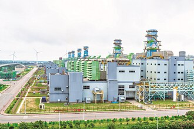
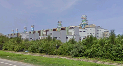
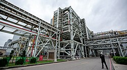

# 大潭發電廠 - 維基百科，自由的百科全書

- 網站：zh.wikipedia.org
- 原始網址：https://zh.wikipedia.org/wiki/%E5%A4%A7%E6%BD%AD%E7%99%BC%E9%9B%BB%E5%BB%A0
- 狀態：success
- 主題：自然景觀與生態、地方產業與農漁業
- 關鍵字：觀音區、桃園市、大潭發電廠
- 擷取時間：2026-10-29T13:54:26.120195+00:00

## 清理後正文

座標
：
25°1′34″N
121°2′50″E
 / 
25.02611°N 121.04722°E
 /
25.02611; 121.04722
坐標：參數： "type=" 應為 "type:"
維基百科，自由的百科全書
大潭發電廠
國家／地區
中華民國
（
臺灣
）
位置
桃園市
觀音區
電廠路1號
坐標
25°1′34″N
121°2′50″E
 / 
25.02611°N 121.04722°E
 /
25.02611; 121.04722
坐標：參數： "type=" 應為 "type:"
現況
商轉中
啟用時間
2005年
持有單位
台灣電力公司
操作單位
台灣電力公司
火力發電廠
主要燃料
液化天然氣
類型
燃氣複循環發電
複循環
Stage I：3部氣渦輪機+1部汽輪機
Stage II：2部氣渦輪機+1部汽輪機
冷卻來源
海水
水力發電廠遙控中心
總裝置容量
7,540.2MW
發電概況
計劃建設機組
4部
裝置容量
7,540.2MW
年發電量
132.74億度
[
1
]
網站
大潭發電廠簡介
（本資訊框數據截至2013年）
遠望大潭發電廠
大潭發電廠
，是
台灣
最大的
天然氣
電廠，同時是世界第四大燃氣發電廠，隸屬
台灣電力公司
，位於
台灣
桃園市
觀音區
大潭里，佔地約102公頃，廠區有
台61線
（西濱快速公路）及
台66線
穿越，東側為
台15線
，南臨
新屋溪
。機組分為Stage I、Stage II、緊急燃油及主要燃氣系統。
沿革
[
編輯
]
大潭發電廠
大潭發電廠最初為台灣電力公司為配合國家長期經濟發展及電力負載逐年增長之需求，以及解決
臺灣北部
地區長期缺電，導致南電北送的常態狀況，因此選定於
桃園市
觀音區
大潭濱海工業區內設置一座天然氣複循環發電廠，稱為大潭發電廠。
2001年，大潭複循環發電計畫開始動工，由台電核能火力工程處旗下的北部施工處進駐施工。
[
2
]
2006年6月20日，大潭複循環一號機完工開始商轉。
[
2
]
2008年11月19日，大潭複循環六號機完工商轉，大潭發電計畫告一段落。
[
2
]
2017年6月，政府因應臺灣可能發生缺電之危機，推動大潭緊急發電計畫，向美國
奇異
（GE）採購兩部容量各300MW的單循環的汽渦輪發電機組，空運來臺後安裝於大潭複循環6號機左(南)側之空地。
[
3
]
同時間，台灣電力公司也開始推動大潭擴建計畫，預計利用大潭發電廠南側的空地新增四部天然氣複循環發電機組，共增加3,168MW之發電量，而稍早推動的大潭緊急發電計畫中，兩部單循環汽渦輪發電機組，也改稱為大潭7-1與7-2號機，以作為接下來安裝熱回收爐與汽輪發電機後，成為大潭複循環7號機。
[
4
]
2017年8月15日，發生
815全臺大停電
，肇因於
台灣中油
施工不慎，誤關天然氣供氣管線的關斷閥，導致大潭複循環1至6號機組因無燃料可燒全部跳脫，發電量瞬間缺少4,384MW，全臺各地傳出停電狀況，事件爆發後，政府進行究責與檢討，時任經濟部長
李世光
於該次事件後請辭獲准。
[
5
]
[
6
]
[
7
]
設備
[
編輯
]
廠內
複循環
機組，由
三菱重工
製造
氣渦輪
發電機組，第一級渦輪葉片溫度在1400℃以上，產生熱燃氣加熱鍋爐推動
汽輪機
發電機組，複循環發電優點為電力調度反應快速，熱效率接近60%，碳排放量低於燃煤與燃油發電，僅高於
核能發電
，缺點為每度電燃氣成本約
新台幣
3元，高於核能與燃煤發電。
複循環
機組及風力發電機組的總裝機容量為4,418.7MW，為
台灣北部
地區最大單一電廠，次於
台中發電廠
居台灣第二位
[
8
]
。預計自2018年起，陸續完成四部機組的擴建後，總發電量將達7,400MW，成為全台發電量最大的電廠
[
9
]
，新機組則採用美國
奇異公司
製造之7HA.02燃氣渦輪機，淨效率64%，可在30分鐘內從冷機啟動到滿載發電，同時增強使用燃料的靈活性，可容納各種氣體燃料（頁岩氣、高乙烷、氫氣）和液體燃料（柴油、原油）
[
10
]
。
大潭發電廠為全台電唯一具有電力系統崩潰，機組自動卸載House Load以及
全黑快速啟動
功能的
火力發電廠
。
發電機組
[
編輯
]
Stage I
氣渦輪發電機類型
熱回收爐類型
汽輪發電機類型
機組數量
（汽渦輪機+汽輪機）
發電燃料
裝置容量（MW）
商轉日期
狀態
1-1
日本
三菱重工
製M501F型氣渦輪發電機
[
11
]
1-2
日本
三菱重工
製M501F型氣渦輪發電機
[
11
]
1-3
日本
三菱重工
製M501F型氣渦輪發電機
[
11
]
日本
三菱重工
製立式排熱回收自然循環三壓熱回收爐
ST-1
日本
三菱重工
製汽輪發電機
3部氣渦輪機
1部汽輪機
天然氣
742.7MW
2006年8月27日
商轉中
2-1
日本
三菱重工
製M501F型氣渦輪發電機
[
11
]
2-2
日本
三菱重工
製M501F型氣渦輪發電機
[
11
]
2-3
日本
三菱重工
製M501F型氣渦輪發電機
[
11
]
日本
三菱重工
製立式排熱回收自然循環三壓熱回收爐
ST-2
日本
三菱重工
製汽輪發電機
3部氣渦輪機
1部汽輪機
天然氣
742.7MW
2006年12月26日
商轉中
Stage II
氣渦輪發電機類型
熱回收爐類型
汽輪發電機類型
機組數量
（氣渦輪機+汽輪機）
發電燃料
裝置容量（MW）
商轉日期
狀態
3-1
日本
三菱重工
製M501G型氣渦輪發電機
[
11
]
3-2
日本
三菱重工
製M501G型氣渦輪發電機
[
11
]
日本
三菱重工
製立式排熱回收自然循環三壓熱回收爐
ST-3
日本
三菱重工
製汽輪發電機
2部氣渦輪機
1部汽輪機
天然氣
724.7MW
2007年11月12日
商轉中
4-1
日本
三菱重工
製M501G型氣渦輪發電機
[
11
]
4-2
日本
三菱重工
製M501G型氣渦輪發電機
[
11
]
日本
三菱重工
製立式排熱回收自然循環三壓熱回收爐
ST-4
日本
三菱重工
製汽輪發電機
2部氣渦輪機
1部汽輪機
天然氣
724.7MW
2007年11月12日
商轉中
5-1
日本
三菱重工
製M501G型氣渦輪發電機
[
11
]
5-2
日本
三菱重工
製M501G型氣渦輪發電機
[
11
]
日本
三菱重工
製立式排熱回收自然循環三壓熱回收爐
ST-5
日本
三菱重工
製汽輪發電機
2部氣渦輪機
1部汽輪機
天然氣
724.7MW
2008年7月3日
商轉中
6-1
日本
三菱重工
製M501G型氣渦輪發電機
[
11
]
6-2
日本
三菱重工
製M501G型氣渦輪發電機
[
11
]
日本
三菱重工
製立式排熱回收自然循環三壓熱回收爐
ST-6
日本
三菱重工
製汽輪發電機
2部氣渦輪機
1部汽輪機
天然氣
724.7MW
2009年1月14日
商轉中
大潭複循環增建機組
氣渦輪發電機類型
熱回收爐類型
汽輪發電機類型
機組數量
（氣渦輪機+汽輪機）
發電燃料
裝置容量（MW）
商轉日期
狀態
7-1
美國
奇異
公司製7HA.02型氣渦輪發電機
[
12
]
7-2
美國
奇異
公司製7HA.02型氣渦輪發電機
[
12
]
ST-7
日本
三菱重工
製汽輪發電機
2部氣渦輪機
1部汽輪機
天然氣
913MW
更新施工中
8-1
美國
奇異
公司製7HA.02型氣渦輪發電機
8-2
美國
奇異
公司製7HA.02型氣渦輪發電機
[
13
]
ST-8
美國
奇異公司
製汽輪發電機
2部氣渦輪機
1部汽輪機
天然氣
1,123.6MW
2024年7月31日
商轉中
9-1
美國
奇異
公司製7HA.02型氣渦輪發電機
9-2
美國
奇異
公司製7HA.02型氣渦輪發電機
[
13
]
ST-9
美國
奇異公司
製汽輪發電機
2部氣渦輪機
1部汽輪機
天然氣
1,123.6MW
2025年7月23日
商轉中
回饋金
[
編輯
]
觀音區、
新屋區
因受到大潭發電廠影響，桃園市政府以發電廠回饋金實施國中國小學生免費營養午餐，教職員健康雖同受影響，但仍自費使用營養午餐
[
14
]
。
工安意外
[
編輯
]
2021年12月15日，電廠委外包商
丸紅
的工程師與同事因西側大門未關閉而前往查看，關門時大門推引不慎導致脫軌倒塌並壓住工程師
[
15
]
，其被拉出後送往
桃園醫院
新屋分院急救後再轉往桃園醫院，最終因頭顱破裂且
內出血
嚴重，於次日不治逝世。
[
16
]
參見
[
編輯
]
臺灣發電廠列表
觀塘液化天然氣接收站
（三接）
參考文獻
[
編輯
]
^
大潭發電廠簡介
.
台灣電力公司
.
[
2013-12-06
]
. （原始內容
存檔
於2013-12-11）
（中文（臺灣））
.
^
2.0
2.1
2.2
大潭發電廠
(PDF)
. 台電月刊. 2009-07
[
2013-12-06
]
. （
原始內容
(PDF)
存檔於2013-12-11）
（中文（臺灣））
.
^
許麗珍.
潭緊急發電機組　巨無霸級運輸機空運來台
. 台北: 蘋果日報. 2017年6月8日
[
2017-08-16
]
. （原始內容
存檔
於2017-08-16）
（中文（臺灣））
.
^
106 年長期電源開發方案(10605 案)
(PDF)
. 台灣電力公司. 2017-05-
[
2017-09-14
]
. （原始內容
存檔
(PDF)
於2017-09-14）.
請檢查
|date=
中的日期值 (
幫助
)
^
陳雅芃.
【全台大跳電】經濟部長李世光請辭獲准
. 蘋果日報. 2017-08-15
[
2017-08-16
]
. （
原始內容
存檔於2017-08-16）.
^
誤關發電機台灣大停電　部長及相關單位道歉
. 馬來西亞東方日報. 2017-08-15
[
2017-08-16
]
. （
原始內容
存檔於2017-08-15）
（中文）
.
^
簡榮豐.
中油疏失致全台大跳電 中油董事長：負完全責任
. 自由時報. 2017-08-15
[
2017-08-16
]
. （
原始內容
存檔於2017-08-16）.
^
台灣電力公司，台灣電力發展現況--火力發電
^
高嘉和、謝武雄.
核一核二除役 3電廠擬擴建供電
. 自由時報. 2012-02-06
[
2013-02-28
]
. （
原始內容
存檔於2013-05-01）.
^
為台灣帶來快速、靈活又安全的電力
. GE VERNOVA. （原始內容
存檔
於2024-11-10）.
^
11.00
11.01
11.02
11.03
11.04
11.05
11.06
11.07
11.08
11.09
11.10
11.11
11.12
11.13
三菱重工.
台湾大潭発電所Stage-I で2号系列の商業運転を開始
. 2007-07
[
2017-09-23
]
. （
原始內容
存檔於2017-09-23）.
^
12.0
12.1
GE Power.
HA Fleet Status
.
[
2017-11-25
]
. （原始內容
存檔
於2017-12-01）.
^
13.0
13.1
電力專案・基礎建設部
. 台灣丸紅股份有限公司.
[
2023-01-05
]
. （原始內容
存檔
於2017-12-01）.
^
一區一高中！新屋國中改制高中　學生就學方便
. 三立新聞網. 2016-01-01
[
2017-04-13
]
. （原始內容
存檔
於2017-04-13）.
^
張君豪.
大潭電廠工安意外！缺電趕工「鐵門脫軌」壓死包商工人
. 桃園: ETtoday新聞雲. 2021-12-16
[
2021-12-18
]
. （原始內容
存檔
於2021-12-18）
（中文（繁體））
.
^
葉臻. 方沛清 , 編.
大潭電廠大門倒塌壓死工程師 檢警釐清事故原因
. 桃園: 中央通訊社. 2021-12-16
[
2021-12-18
]
. （原始內容
存檔
於2021-12-18）
（中文（繁體））
.
外部連結
[
編輯
]
（繁體中文）
台灣電力股份有限公司 - 大潭發電廠簡介
（
頁面存檔備份
，存於
網際網路檔案館
）
桃園市政府-產業園區聯合服務中心-大潭電廠簡介
（
頁面存檔備份
，存於
網際網路檔案館
）
取自「
https://zh.wikipedia.org/w/index.php?title=大潭發電廠&oldid=94099281
」
分類
：
使用電廠信息框的火力發電站
2005年台灣建立
2005年完工基礎設施
臺灣電力公司火力發電廠
臺灣桃園大潭發電廠
桃園市發電廠
觀音區
隱藏分類：
使用WikiMiniAtlas小工具的頁面
坐標標籤格式錯誤的頁面
引文格式1錯誤：日期
使用Infobox mapframe但維基數據缺少形狀連結的頁面
維基數據存在坐標數據的頁面
使用未知Infobox power station參數的頁面
有地圖的頁面

## 圖片
-  — [原始圖片來源](https://zh.wikipedia.org/static/images/mobile/copyright/wikipedia-wordmark-zh.svg) 
-  — [原始圖片來源](https://zh.wikipedia.org/static/images/mobile/copyright/wikipedia-tagline-zh.svg) 
-  — [原始圖片來源](https://thumb.wikimedia.org/wikipedia/commons/thumb/8/85/Tatan_Power_Plant_20190606.jpg/330px-Tatan_Power_Plant_20190606.jpg?utm_source=zh.wikipedia.org&utm_campaign=parser&utm_content=thumbnail) 
-  — [原始圖片來源](https://thumb.wikimedia.org/wikipedia/commons/thumb/6/66/%E5%A4%A7%E6%BD%AD%E7%99%BC%E9%9B%BB%E5%BB%A0.png/250px-%E5%A4%A7%E6%BD%AD%E7%99%BC%E9%9B%BB%E5%BB%A0.png?utm_source=zh.wikipedia.org&utm_campaign=parser&utm_content=thumbnail) 
-  — [原始圖片來源](https://thumb.wikimedia.org/wikipedia/commons/thumb/9/9a/2021.11.25_%E5%A4%A7%E6%BD%AD%E9%9B%BB%E5%BB%A002.jpg/250px-2021.11.25_%E5%A4%A7%E6%BD%AD%E9%9B%BB%E5%BB%A002.jpg?utm_source=zh.wikipedia.org&utm_campaign=parser&utm_content=thumbnail) 
-  — [原始圖片來源](https://zh.wikipedia.org/static/images/footer/wikimedia.svg) 
-  — [原始圖片來源](https://zh.wikipedia.org/w/resources/assets/mediawiki_compact.svg) 

## 頁面連結
- [分類索引](https://zh.wikipedia.org/wiki/Wikipedia:%E5%88%86%E7%B1%BB%E7%B4%A2%E5%BC%95)
- [特色內容](https://zh.wikipedia.org/wiki/Portal:%E7%89%B9%E8%89%B2%E5%85%A7%E5%AE%B9)
- [新聞動態](https://zh.wikipedia.org/wiki/Portal:%E6%96%B0%E8%81%9E%E5%8B%95%E6%85%8B)
- [隨機條目](https://zh.wikipedia.org/wiki/Special:Random)
- [聯絡我們](https://zh.wikipedia.org/wiki/Wikipedia:%E8%81%94%E7%BB%9C%E6%88%91%E4%BB%AC)
- [說明](https://zh.wikipedia.org/wiki/Help:%E9%A6%96%E9%A1%B5)
- [維基社群](https://zh.wikipedia.org/wiki/Wikipedia:%E7%A4%BE%E7%BE%A4%E9%A6%96%E9%A1%B5)
- [編輯入門](https://zh.wikipedia.org/wiki/Help:%E5%85%A5%E9%97%A8)
- [互助客棧](https://zh.wikipedia.org/wiki/Wikipedia:%E4%BA%92%E5%8A%A9%E5%AE%A2%E6%A0%88)
- [IRC即時聊天](https://zh.wikipedia.org/wiki/Wikipedia:IRC%E8%81%8A%E5%A4%A9%E9%A2%91%E9%81%93)
- [近期變更](https://zh.wikipedia.org/wiki/Special:RecentChanges)
- [特殊頁面](https://zh.wikipedia.org/wiki/Special:SpecialPages)
- [首頁](https://zh.wikipedia.org/wiki/Wikipedia:%E9%A6%96%E9%A1%B5)
- [搜尋](https://zh.wikipedia.org/wiki/Special:Search)
- [資助維基百科](https://donate.wikimedia.org/?wmf_source=donate&wmf_medium=sidebar&wmf_campaign=zh.wikipedia.org&uselang=zh)
- [建立帳號](https://zh.wikipedia.org/w/index.php?title=Special:CreateAccount&returnto=%E5%A4%A7%E6%BD%AD%E7%99%BC%E9%9B%BB%E5%BB%A0)
- [登入](https://zh.wikipedia.org/w/index.php?title=Special:UserLogin&returnto=%E5%A4%A7%E6%BD%AD%E7%99%BC%E9%9B%BB%E5%BB%A0)
- [Deutsch](https://de.wikipedia.org/wiki/Kraftwerk_Datan)
- [English](https://en.wikipedia.org/wiki/Tatan_Power_Plant)
- [فارسی](https://fa.wikipedia.org/wiki/%D9%86%DB%8C%D8%B1%D9%88%DA%AF%D8%A7%D9%87_%D8%AA%D8%A7%D8%AA%D8%A7%D9%86)
- [Français](https://fr.wikipedia.org/wiki/Centrale_de_Tatan)
- [日本語](https://ja.wikipedia.org/wiki/%E5%A4%A7%E6%BD%AD%E7%99%BA%E9%9B%BB%E6%89%80)
- [Norsk bokmål](https://no.wikipedia.org/wiki/Tatan_gasskraftverk)
- [討論](https://zh.wikipedia.org/wiki/Talk:%E5%A4%A7%E6%BD%AD%E7%99%BC%E9%9B%BB%E5%BB%A0)
- [不转换](https://zh.wikipedia.org/zh/%E5%A4%A7%E6%BD%AD%E7%99%BC%E9%9B%BB%E5%BB%A0)
- [简体](https://zh.wikipedia.org/zh-hans/%E5%A4%A7%E6%BD%AD%E7%99%BC%E9%9B%BB%E5%BB%A0)
- [繁體](https://zh.wikipedia.org/zh-hant/%E5%A4%A7%E6%BD%AD%E7%99%BC%E9%9B%BB%E5%BB%A0)
- [大陆简体](https://zh.wikipedia.org/zh-cn/%E5%A4%A7%E6%BD%AD%E7%99%BC%E9%9B%BB%E5%BB%A0)
- [香港繁體](https://zh.wikipedia.org/zh-hk/%E5%A4%A7%E6%BD%AD%E7%99%BC%E9%9B%BB%E5%BB%A0)
- [澳門繁體](https://zh.wikipedia.org/zh-mo/%E5%A4%A7%E6%BD%AD%E7%99%BC%E9%9B%BB%E5%BB%A0)
- [大马简体](https://zh.wikipedia.org/zh-my/%E5%A4%A7%E6%BD%AD%E7%99%BC%E9%9B%BB%E5%BB%A0)
- [新加坡简体](https://zh.wikipedia.org/zh-sg/%E5%A4%A7%E6%BD%AD%E7%99%BC%E9%9B%BB%E5%BB%A0)
- [臺灣正體](https://zh.wikipedia.org/zh-tw/%E5%A4%A7%E6%BD%AD%E7%99%BC%E9%9B%BB%E5%BB%A0)
- [編輯](https://zh.wikipedia.org/w/index.php?title=%E5%A4%A7%E6%BD%AD%E7%99%BC%E9%9B%BB%E5%BB%A0&action=edit)
- [檢視歷史](https://zh.wikipedia.org/w/index.php?title=%E5%A4%A7%E6%BD%AD%E7%99%BC%E9%9B%BB%E5%BB%A0&action=history)
- [連結至此的頁面](https://zh.wikipedia.org/wiki/Special:WhatLinksHere/%E5%A4%A7%E6%BD%AD%E7%99%BC%E9%9B%BB%E5%BB%A0)
- [相關變更](https://zh.wikipedia.org/wiki/Special:RecentChangesLinked/%E5%A4%A7%E6%BD%AD%E7%99%BC%E9%9B%BB%E5%BB%A0)
- [上傳檔案](https://zh.wikipedia.org/wiki/Project:上传)
- [固定連結](https://zh.wikipedia.org/w/index.php?title=%E5%A4%A7%E6%BD%AD%E7%99%BC%E9%9B%BB%E5%BB%A0&oldid=94099281)
- [頁面資訊](https://zh.wikipedia.org/w/index.php?title=%E5%A4%A7%E6%BD%AD%E7%99%BC%E9%9B%BB%E5%BB%A0&action=info)
- [引用此頁面](https://zh.wikipedia.org/w/index.php?title=Special:CiteThisPage&page=%E5%A4%A7%E6%BD%AD%E7%99%BC%E9%9B%BB%E5%BB%A0&id=94099281&wpFormIdentifier=titleform)
- [取得短連結](https://zh.wikipedia.org/w/index.php?title=Special:UrlShortener&url=https%3A%2F%2Fzh.wikipedia.org%2Fwiki%2F%25E5%25A4%25A7%25E6%25BD%25AD%25E7%2599%25BC%25E9%259B%25BB%25E5%25BB%25A0)
- [下載為PDF](https://zh.wikipedia.org/w/index.php?title=Special:DownloadAsPdf&page=%E5%A4%A7%E6%BD%AD%E7%99%BC%E9%9B%BB%E5%BB%A0&action=show-download-screen)
- [維基共享資源](https://commons.wikimedia.org/wiki/Category:Tatan_Power_Plant)
- [編輯連結](https://www.wikidata.org/wiki/Special:EntityPage/Q6832032)
- [座標](https://zh.wikipedia.org/wiki/%E5%9C%B0%E7%90%86%E5%9D%90%E6%A0%87)
- [https://zh.wikipedia.org/wiki/File:Tatan_Power_Plant_20190606.jpg](https://zh.wikipedia.org/wiki/File:Tatan_Power_Plant_20190606.jpg)
- [中華民國](https://zh.wikipedia.org/wiki/%E4%B8%AD%E8%8F%AF%E6%B0%91%E5%9C%8B)
- [臺灣](https://zh.wikipedia.org/wiki/%E8%87%BA%E7%81%A3)
- [25°1′34″N 121°2′50″E  /  25.02611°N 121.04722°E  / 25.02611; 121.04722](https://geohack.toolforge.org/geohack.php?language=zh&pagename=%E5%A4%A7%E6%BD%AD%E7%99%BC%E9%9B%BB%E5%BB%A0&params=25_1_34_N_121_2_50_E_)
- [液化天然氣](https://zh.wikipedia.org/wiki/%E6%B6%B2%E5%8C%96%E5%A4%A9%E7%84%B6%E6%B0%94)
- [複循環](https://zh.wikipedia.org/wiki/%E8%81%94%E5%90%88%E5%BE%AA%E7%8E%AF)
- [大潭發電廠簡介](https://www.taipower.com.tw/2289/2558/2387/10647/)
- [https://zh.wikipedia.org/wiki/File:%E5%A4%A7%E6%BD%AD%E7%99%BC%E9%9B%BB%E5%BB%A0.png](https://zh.wikipedia.org/wiki/File:%E5%A4%A7%E6%BD%AD%E7%99%BC%E9%9B%BB%E5%BB%A0.png)
- [天然氣](https://zh.wikipedia.org/wiki/%E5%A4%A9%E7%84%B6%E6%B0%A3)
- [台灣](https://zh.wikipedia.org/wiki/%E5%8F%B0%E7%81%A3)
- [台61線](https://zh.wikipedia.org/wiki/%E5%8F%B061%E7%B7%9A)
- [台66線](https://zh.wikipedia.org/wiki/%E5%8F%B066%E7%B7%9A)
- [台15線](https://zh.wikipedia.org/wiki/%E5%8F%B015%E7%B7%9A)
- [新屋溪](https://zh.wikipedia.org/wiki/%E6%96%B0%E5%B1%8B%E6%BA%AA)
- [編輯](https://zh.wikipedia.org/w/index.php?title=%E5%A4%A7%E6%BD%AD%E7%99%BC%E9%9B%BB%E5%BB%A0&action=edit&section=1)
- [https://zh.wikipedia.org/wiki/File:2021.11.25_%E5%A4%A7%E6%BD%AD%E9%9B%BB%E5%BB%A002.jpg](https://zh.wikipedia.org/wiki/File:2021.11.25_%E5%A4%A7%E6%BD%AD%E9%9B%BB%E5%BB%A002.jpg)
- [臺灣北部](https://zh.wikipedia.org/wiki/%E8%87%BA%E7%81%A3%E5%8C%97%E9%83%A8)
- [桃園市](https://zh.wikipedia.org/wiki/%E6%A1%83%E5%9C%92%E5%B8%82)
- [觀音區](https://zh.wikipedia.org/wiki/%E8%A7%80%E9%9F%B3%E5%8D%80)
- [815全臺大停電](https://zh.wikipedia.org/wiki/815%E5%85%A8%E8%87%BA%E5%A4%A7%E5%81%9C%E9%9B%BB)
- [台灣中油](https://zh.wikipedia.org/wiki/%E5%8F%B0%E7%81%A3%E4%B8%AD%E6%B2%B9)
- [李世光](https://zh.wikipedia.org/wiki/%E6%9D%8E%E4%B8%96%E5%85%89)
- [編輯](https://zh.wikipedia.org/w/index.php?title=%E5%A4%A7%E6%BD%AD%E7%99%BC%E9%9B%BB%E5%BB%A0&action=edit&section=2)
- [氣渦輪](https://zh.wikipedia.org/wiki/%E7%87%83%E6%B0%A3%E6%B8%A6%E8%BC%AA%E7%99%BC%E5%8B%95%E6%A9%9F)
- [汽輪機](https://zh.wikipedia.org/wiki/%E8%92%B8%E6%B1%BD%E6%B8%A6%E8%BC%AA%E7%99%BC%E5%8B%95%E6%A9%9F)
- [核能發電](https://zh.wikipedia.org/wiki/%E6%A0%B8%E8%83%BD%E7%99%BC%E9%9B%BB)
- [新台幣](https://zh.wikipedia.org/wiki/%E6%96%B0%E5%8F%B0%E5%B9%A3)
- [複循環](https://zh.wikipedia.org/wiki/%E8%A4%87%E5%BE%AA%E7%92%B0)
- [台灣北部](https://zh.wikipedia.org/wiki/%E5%8F%B0%E7%81%A3%E5%8C%97%E9%83%A8)
- [奇異公司](https://zh.wikipedia.org/wiki/%E5%A5%87%E7%95%B0%E5%85%AC%E5%8F%B8)
- [全黑快速啟動](https://zh.wikipedia.org/w/index.php?title=%E5%85%A8%E9%BB%91%E5%BF%AB%E9%80%9F%E5%95%9F%E5%8B%95&action=edit&redlink=1)
- [類型](https://zh.wikipedia.org/wiki/%E7%81%AB%E5%8A%9B%E7%99%BC%E9%9B%BB%E5%BB%A0)
- [編輯](https://zh.wikipedia.org/w/index.php?title=%E5%A4%A7%E6%BD%AD%E7%99%BC%E9%9B%BB%E5%BB%A0&action=edit&section=3)
- [奇異](https://zh.wikipedia.org/wiki/%E9%80%9A%E7%94%A8%E7%94%B5%E6%B0%94)
- [日本](https://zh.wikipedia.org/wiki/%E6%97%A5%E6%9C%AC)
- [三菱重工](https://zh.wikipedia.org/wiki/%E4%B8%89%E8%8F%B1%E9%87%8D%E5%B7%A5)
- [美國](https://zh.wikipedia.org/wiki/%E7%BE%8E%E5%9B%BD)
- [奇異](https://zh.wikipedia.org/wiki/%E9%80%9A%E7%94%A8%E9%9B%BB%E6%B0%A3)
- [編輯](https://zh.wikipedia.org/w/index.php?title=%E5%A4%A7%E6%BD%AD%E7%99%BC%E9%9B%BB%E5%BB%A0&action=edit&section=4)
- [新屋區](https://zh.wikipedia.org/wiki/%E6%96%B0%E5%B1%8B%E5%8D%80)
- [編輯](https://zh.wikipedia.org/w/index.php?title=%E5%A4%A7%E6%BD%AD%E7%99%BC%E9%9B%BB%E5%BB%A0&action=edit&section=5)
- [丸紅](https://zh.wikipedia.org/wiki/%E4%B8%B8%E7%B4%85)
- [桃園醫院](https://zh.wikipedia.org/wiki/%E8%A1%9B%E7%A6%8F%E9%83%A8%E6%A1%83%E5%9C%92%E9%86%AB%E9%99%A2)
- [內出血](https://zh.wikipedia.org/wiki/%E5%85%A7%E5%87%BA%E8%A1%80)
- [編輯](https://zh.wikipedia.org/w/index.php?title=%E5%A4%A7%E6%BD%AD%E7%99%BC%E9%9B%BB%E5%BB%A0&action=edit&section=6)
- [觀塘液化天然氣接收站](https://zh.wikipedia.org/wiki/%E8%A7%80%E5%A1%98%E6%B6%B2%E5%8C%96%E5%A4%A9%E7%84%B6%E6%B0%A3%E6%8E%A5%E6%94%B6%E7%AB%99)
- [編輯](https://zh.wikipedia.org/w/index.php?title=%E5%A4%A7%E6%BD%AD%E7%99%BC%E9%9B%BB%E5%BB%A0&action=edit&section=7)
- [大潭發電廠簡介](http://dept.taipower.com.tw/detail4-1-4.htm)
- [存檔](https://web.archive.org/web/20131211001331/http://dept.taipower.com.tw/detail4-1-4.htm)
- [大潭發電廠](https://web.archive.org/web/20131211002145/http://info.taipower.com.tw/TaipowerWeb//upload/files/29/TP559_coverstory.pdf)
- [原始內容](http://info.taipower.com.tw/TaipowerWeb//upload/files/29/TP559_coverstory.pdf)
- [潭緊急發電機組　巨無霸級運輸機空運來台](http://www.appledaily.com.tw/realtimenews/article/new/20170608/1135950/)
- [存檔](https://web.archive.org/web/20170816105018/http://www.appledaily.com.tw/realtimenews/article/new/20170608/1135950/)
- [106 年長期電源開發方案(10605 案)](http://www.taipower.com.tw/content/new_info/images/c40/106%E5%B9%B4%E9%95%B7%E6%9C%9F%E9%9B%BB%E6%BA%90%E9%96%8B%E7%99%BC%E6%96%B9%E6%A1%8810605%E6%A1%88.pdf)

> 備註：進階解析失敗，已使用內建解析器：AttributeError: 'NoneType' object has no attribute 'get'
