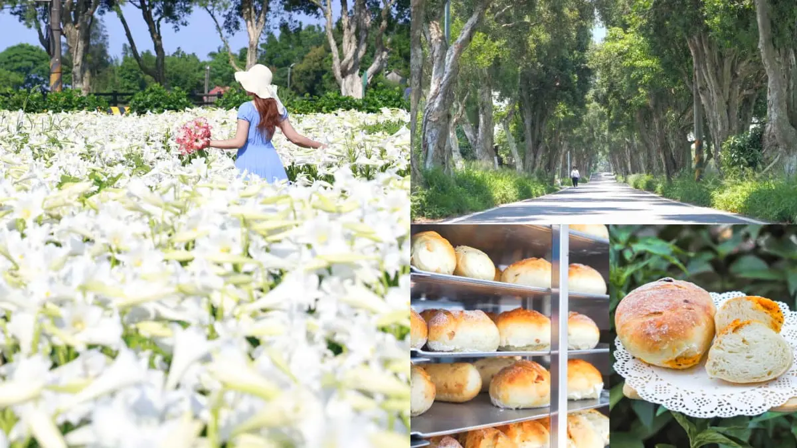
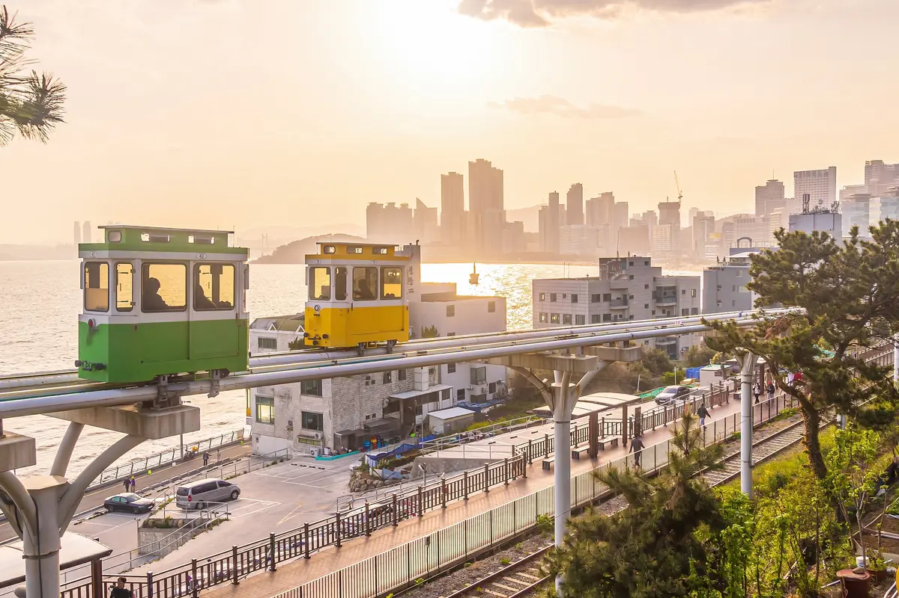

# 超過２萬朵「純白百合花海」50元拍爆！順遊日系樹林隧道、超低調麵包工廠 | 食尚玩家

- 網站：食尚玩家
- 原始網址：https://supertaste.tvbs.com.tw/travel/348994
- 狀態：success
- 作者：食尚玩家
- 發表日期：2024-05-02T11:00:00+08:00
- 主題：觀光景點與活動
- 關鍵字：觀音區、桃園市、地方旅遊
- 擷取時間：2026-10-29T13:54:27.935972+00:00

## 清理後正文

桃園賞花景點再＋１！小編發現這處「隱藏版百合花園」，最近開滿了多達２萬朵以上的鐵炮百合花，純白花海放眼望去壯觀又療癒，而且每人50元就可以入園參觀、仙氣美照拍到飽，花況更是一年比一年還要漂亮呢！看完花還能順遊附近的日系雜誌封面「綠意隧道」，再造訪有提供免費試吃麵包＋咖啡的「麵包工廠」來個下午茶，完美的１日遊行程這樣玩就對了！下載食尚APP，天天免費抽大獎！
50元拍到飽！桃園百合祕境
桃園賞花景點「白千層鐵砲百合花園」，位於白千層綠色隧道入口旁的三合院中，先前4/25起已開放民眾入園賞花，每人須酌收50元清潔費。據說花園的由來，是園主為了追思母親，便在自家庭院前辛勤耕耘、種下了一整片鐵砲百合花，每朵花都飽含了對母親的思念。每年百合都會在母親節前夕逐漸盛開，而本週剛好迎來花況最美的時候！
看更多：錯過等明年！全台唯一「康乃馨花田」破千坪100元拍爆，母親節快帶媽媽賞花
逾２萬朵純白花海美翻
鐵砲百合花的別名是「麝香百合」，外型極似樂器嗩吶。今年種植了超過２萬朵鐵炮百合，形成一片純白無瑕又帶有陣陣獨特香氣的花海，漫步其中怎麼拍都好看，放眼望去超壯觀！園區各個角落還有黃牛裝置，以及獨角獸、熊熊氣球可以打卡呢。如果喜歡百合，也可購買百合盆栽帶回家，１盆100元。園主表示，花期預計會持續至母親節前，不過天氣也多少會影響花況，大家快快把握時間、帶媽媽來賞花啦！
白千層鐵砲百合花園
電話：0937-813-599
更多資訊
順遊鄰近２處吃玩景點
01. 白千層綠色隧道 日系雜誌封面感美照
賞完美美的百合後別急著離開！記得順遊花園旁的祕境「白千層綠色隧道」。筆直的綠色隧道全長2.8公里，因兩旁種滿了超過700棵白千層樹而聞名，據說這些樹是在日治時期引入台灣的，樹齡可是阿公阿嬤的等級了呢！陽光透過林間縫隙灑下，站在隧道中央、用正面角度拍出去，就可以拍出日系文青雜誌封面的那種唯美感，難怪早在多年前就意外暴紅！
白千層綠色隧道
地址：桃園市觀音區福山路二段51-1號
02. 全村的希望麵包工廠 免費試吃麵包、咖啡
去隧道拍完美照，別忘了去附近的「全村的希望麵包工廠」，是去年低調開幕的麵包工廠，散步走路４分鐘就能到。店內販售多款手工製作的歐式麵包、吐司，價位約落在80～180元內，口味很多元，最近還開始賣起了手工披薩呢。老闆除了大方提供免費試吃麵包，讓民眾可以嘗試喜歡的口味再購買，就連咖啡也是免費招待，麵包＋咖啡完全是最佳的下午茶組合。
全村的希望麵包工廠
電話：0932-211-122
更多資訊

## 圖片
-  — [原始圖片來源](https://supertaste-images.tvbs.com.tw/api/v1/legacy/img/program/upload/2024/05/02/20240502105051-13bbd4d4.jpg?w=1200&q=75) 
-  — [原始圖片來源](https://supertaste-images.tvbs.com.tw/api/v1/images/01a1592ffb7a73eb98100c10b620ed61.jpg?w=1200&q=75) 
-  — [原始圖片來源](https://supertaste-images.tvbs.com.tw/api/v1/images/01a0f83b1a3370d3bd6b71d627fcc7b8.jpg?w=1200&q=75) 

## 頁面連結
- [基隆市](https://supertaste.tvbs.com.tw/taiwan/city/keelung-city)
- [台北市](https://supertaste.tvbs.com.tw/taiwan/city/taipei-city)
- [新北市](https://supertaste.tvbs.com.tw/taiwan/city/new-taipei-city)
- [新竹市](https://supertaste.tvbs.com.tw/taiwan/city/hsinchu-city)
- [新竹縣](https://supertaste.tvbs.com.tw/taiwan/city/hsinchu-county)
- [宜蘭縣](https://supertaste.tvbs.com.tw/taiwan/city/yilan-county)
- [苗栗縣](https://supertaste.tvbs.com.tw/taiwan/city/miaoli-county)
- [台中市](https://supertaste.tvbs.com.tw/taiwan/city/taichung-city)
- [彰化縣](https://supertaste.tvbs.com.tw/taiwan/city/changhua-county)
- [南投縣](https://supertaste.tvbs.com.tw/taiwan/city/nantou-county)
- [雲林縣](https://supertaste.tvbs.com.tw/taiwan/city/yunlin-county)
- [嘉義市](https://supertaste.tvbs.com.tw/taiwan/city/chiayi-city)
- [嘉義縣](https://supertaste.tvbs.com.tw/taiwan/city/chiayi-county)
- [台南市](https://supertaste.tvbs.com.tw/taiwan/city/tainan-city)
- [高雄市](https://supertaste.tvbs.com.tw/taiwan/city/kaohsiung-city)
- [屏東縣](https://supertaste.tvbs.com.tw/taiwan/city/pingtung-county)
- [花蓮縣](https://supertaste.tvbs.com.tw/taiwan/city/hualien-county)
- [台東縣](https://supertaste.tvbs.com.tw/taiwan/city/taitung-county)
- [澎湖縣](https://supertaste.tvbs.com.tw/taiwan/city/penghu-county)
- [金門縣](https://supertaste.tvbs.com.tw/taiwan/city/kinmen-county)
- [連江縣](https://supertaste.tvbs.com.tw/taiwan/city/lienchiang-county)
- [城市玩家](https://supertaste.tvbs.com.tw/taiwan/city)
- [節目](https://supertaste.tvbs.com.tw/review)
- [熱門](https://supertaste.tvbs.com.tw/hot)
- [台北市](https://supertaste.tvbs.com.tw/category/food/taipei-city)
- [新北市](https://supertaste.tvbs.com.tw/category/food/new-taipei-city)
- [桃園市](https://supertaste.tvbs.com.tw/category/food/taoyuan-city)
- [台中市](https://supertaste.tvbs.com.tw/category/food/taichung-city)
- [台南市](https://supertaste.tvbs.com.tw/category/food/tainan-city)
- [高雄市](https://supertaste.tvbs.com.tw/category/food/kaohsiung-city)
- [火鍋](https://supertaste.tvbs.com.tw/category/food/all/hot-pot)
- [燒肉](https://supertaste.tvbs.com.tw/category/food/all/bbq)
- [吃到飽](https://supertaste.tvbs.com.tw/category/food/all/all-you-can-eat)
- [牛排](https://supertaste.tvbs.com.tw/category/food/all/steak)
- [鐵板燒](https://supertaste.tvbs.com.tw/category/food/all/teppanyaki)
- [夜市小吃](https://supertaste.tvbs.com.tw/category/food/all/street-food)
- [美食](https://supertaste.tvbs.com.tw/category/food)
- [超商](https://supertaste.tvbs.com.tw/category/food/all/convenience-store)
- [賣場](https://supertaste.tvbs.com.tw/category/food/all/chain-store)
- [懶人包](https://supertaste.tvbs.com.tw/pack)
- [親子](https://supertaste.tvbs.com.tw/kids)
- [生活](https://supertaste.tvbs.com.tw/accessories)
- [日韓](https://supertaste.tvbs.com.tw/asia)
- [達人](https://supertaste.tvbs.com.tw/player)
- [店家](https://supertaste.tvbs.com.tw/infocard)
- [永續旅遊](https://supertaste.tvbs.com.tw/esg)
- [專題策展](https://supertaste.tvbs.com.tw/topic)
- [https://supertaste.tvbs.com.tw/](https://supertaste.tvbs.com.tw/)
- [旅行](https://supertaste.tvbs.com.tw/travel)
- [桃園市](https://supertaste.tvbs.com.tw/taiwan/city/taoyuan-city)
- [在 Google 更常看到食尚玩家](https://www.google.com/preferences/source?q=supertaste.tvbs.com.tw)
- [下載食尚APP，天天免費抽大獎！](https://tvbs.to/9l873p)
- [優惠券](https://supertaste.tvbs.com.tw/offers)
- [玩日韓每人折千元 品冠旅遊 連鎖門市 去領券](https://supertaste.tvbs.com.tw/offers/14432)
- [長島冰茶買一送一 冰茶專賣店Iced Tea Shop 連鎖門市 去領券](https://supertaste.tvbs.com.tw/offers/14366)
- [1 白千層鐵砲百合花園｜景點位置、費用](https://supertaste.tvbs.com.tw/travel/348994)
- [錯過等明年！全台唯一「康乃馨花田」破千坪100元拍爆，母親節快帶媽媽賞花](https://supertaste.tvbs.com.tw/travel/348915?from=readmore_article_348994)
- [yijiun_lee](https://www.instagram.com/yijiun_lee/)
- [https://www.google.com/maps/search/?api=1&query=%E6%A1%83%E5%9C%92%E5%B8%82%E8%A7%80%E9%9F%B3%E5%8D%80%E5%BB%A3%E9%9D%92%E8%B7%AF672%E5%B7%B750%E8%99%9F](https://www.google.com/maps/search/?api=1&query=%E6%A1%83%E5%9C%92%E5%B8%82%E8%A7%80%E9%9F%B3%E5%8D%80%E5%BB%A3%E9%9D%92%E8%B7%AF672%E5%B7%B750%E8%99%9F)
- [更多資訊](https://supertaste.tvbs.com.tw/infocard/25263)
- [蔣妮i拍](https://jiangnilife.com/post-404735980/)
- [蔣妮の冰斗人生](https://jiangnilife.com/%e5%85%a8%e6%96%b0%e7%9a%84%e5%b8%8c%e6%9c%9b%e9%ba%b5%e5%8c%85%e5%b7%a5%e5%bb%a0-%e7%99%bd%e5%8d%83%e5%b1%a4%e7%b6%a0%e8%89%b2%e9%9a%a7%e9%81%93-%e8%a7%80%e9%9f%b3%e7%be%8e%e9%a3%9f-%e5%af%b5/)
- [https://www.google.com/maps/search/?api=1&query=%E6%A1%83%E5%9C%92%E5%B8%82%E8%A7%80%E9%9F%B3%E5%8D%80%E7%A6%8F%E6%96%B0%E8%B7%AF646%E8%99%9F](https://www.google.com/maps/search/?api=1&query=%E6%A1%83%E5%9C%92%E5%B8%82%E8%A7%80%E9%9F%B3%E5%8D%80%E7%A6%8F%E6%96%B0%E8%B7%AF646%E8%99%9F)
- [更多資訊](https://supertaste.tvbs.com.tw/infocard/26943)
- [＃ 桃園景點](https://supertaste.tvbs.com.tw/search?q=%E6%A1%83%E5%9C%92%E6%99%AF%E9%BB%9E)
- [＃ 賞花](https://supertaste.tvbs.com.tw/search?q=%E8%B3%9E%E8%8A%B1)
- [＃ 百合](https://supertaste.tvbs.com.tw/search?q=%E7%99%BE%E5%90%88)
- [＃ 隧道](https://supertaste.tvbs.com.tw/search?q=%E9%9A%A7%E9%81%93)
- [＃ 麵包](https://supertaste.tvbs.com.tw/search?q=%E9%BA%B5%E5%8C%85)
- [TVBS《食尚玩家》記者 陳怡璇](https://supertaste.tvbs.com.tw/author/yihsuanchen)
- [https://www.facebook.com/supertastesupertaste](https://www.facebook.com/supertastesupertaste)
- [https://www.instagram.com/supertastesupertaste](https://www.instagram.com/supertastesupertaste)
- [https://apps.apple.com/app/apple-store/id1508974479?pt=216163&ct=web_navigation&mt=8](https://apps.apple.com/app/apple-store/id1508974479?pt=216163&ct=web_navigation&mt=8)
- [https://play.google.com/store/apps/details?id=com.tvbs.news.food.topnews.bestfood.restaurant.news.supertaste.news.ratings.news&referrer=utm_source=web_navigation&utm_medium=androidbutton&utm_term=download&utm_content=androidbutton&utm_campaign=web_navigation](https://play.google.com/store/apps/details?id=com.tvbs.news.food.topnews.bestfood.restaurant.news.supertaste.news.ratings.news&referrer=utm_source=web_navigation&utm_medium=androidbutton&utm_term=download&utm_content=androidbutton&utm_campaign=web_navigation)
- [關於食尚玩家](https://supertaste.tvbs.com.tw/about-us)
- [公司介紹](https://www.tvbs.com.tw/ours/company)
- [人才招募](https://www.tvbs.com.tw/careers/)
- [企業動態](https://www.tvbs.com.tw/ours/company/news/latest)
- [優惠券店家招募](https://forms.gle/WGip9ig7vBcUEPUJ9)
- [創作者招募](https://supertaste.tvbs.com.tw/hot/359206)
- [節目表](https://schedule.tvbs.com.tw/)
- [版權宣告](https://www.tvbs.com.tw/policies/copyright)
- [業務服務](https://www.tvbs.com.tw/ours/advertise)
- [隱私權政策](https://member.tvbs.com.tw/index/privacy_policy?back_url=https://www.tvbs.com.tw/&site=Tvbs)
- [網站使用協定](https://www.tvbs.com.tw/policies/terms)
- [數位廣告與贊助政策](https://supertaste.tvbs.com.tw/about-us/advertising-policy)
- [節目版權銷售](https://www.tvbs.com.tw/copyright)
- [公開招標](https://www.tvbs.com.tw/tender)
- [官方聲明](https://www.tvbs.com.tw/ours/company/announcement)
- [星藝象娛樂](https://starvision.tvbs.com.tw/home)
- [https://www.facebook.com/supertastesupertaste/](https://www.facebook.com/supertastesupertaste/)
- [https://www.youtube.com/channel/UC00wMIWR48SYidE6jmpL7Qg](https://www.youtube.com/channel/UC00wMIWR48SYidE6jmpL7Qg)
- [https://line.me/R/ti/p/@supertaste](https://line.me/R/ti/p/@supertaste)
- [https://www.instagram.com/supertastesupertaste/](https://www.instagram.com/supertastesupertaste/)
- [TVBS 官網](https://www.tvbs.com.tw)
- [TVBS 新聞網](https://news.tvbs.com.tw)
- [＃ 千葉火鍋](https://supertaste.tvbs.com.tw/search?q=%E5%8D%83%E8%91%89%E7%81%AB%E9%8D%8B)
- [＃ 自助吧](https://supertaste.tvbs.com.tw/search?q=%E8%87%AA%E5%8A%A9%E5%90%A7)
- [＃ 吃到飽](https://supertaste.tvbs.com.tw/search?q=%E5%90%83%E5%88%B0%E9%A3%BD)
- [＃ 物調券](https://supertaste.tvbs.com.tw/search?q=%E7%89%A9%E8%AA%BF%E5%88%B8)
