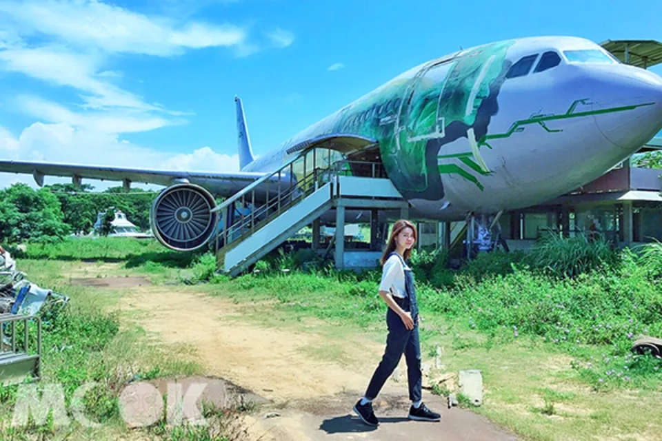

# 巨大飛機當背景！廢墟變身熱門打卡點

- 網站：Yahoo News
- 原始網址：https://tw.news.yahoo.com/%E5%B7%A8%E5%A4%A7%E9%A3%9B%E6%A9%9F%E7%95%B6%E8%83%8C%E6%99%AF-%E5%BB%A2%E5%A2%9F%E8%AE%8A%E8%BA%AB%E7%86%B1%E9%96%80%E6%89%93%E5%8D%A1%E9%BB%9E-083000098.html?guccounter=1&guce_referrer=aHR0cHM6Ly93d3cuZ29vZ2xlLmNvbS8&guce_referrer_sig=AQAAAMue1ozVAbpfw6hSS2pCbhjuzTu6me6bcpMl0s-LHtA2GRA3aRWmhljRIGs7l4-uM64T6h_nSE6aMW7_PKYyXpGeJGmvAgVTj2YBaEVL9EHUdHeBk4EA-goYi6KfIkr7LtpgkElmfQasy8weFUaMOL5LXX1ef3DVxE-pHWTtv9b_
- 狀態：success
- 主題：自然景觀與生態、地方產業與農漁業、觀光景點與活動
- 關鍵字：觀音區、桃園市、白沙岬燈塔、蓮花季
- 擷取時間：2026-10-29T13:54:28.820866+00:00

## 清理後正文

文／MOOK景點家編輯部整理報導
2015年桃園觀音區曾要興建一座飛機景觀餐廳，還特別運來已報廢的真實飛機降落在餐廳外，不過因該建築屬違建，違反了土地使用管制規定，被強制拆除。不過飛機仍留在原地，因此吸引許多網友前往打卡拍照。
觀音飛機 (圖片提供／yuga1211)
原本要在觀音區打造的金湖景觀餐廳，從早期將真實飛機運來，到餐廳建築的施工，都引起當地人的重視，當時希望讓機場餐廳與蓮花季相呼應，帶起觀音區的觀光產業，後來因違建而拆除，令許多人感到不捨。
廣告
因違建而被拆除的金湖景觀餐廳外，有真實的飛機可拍照 (圖片提供／yuga1211)
不過當時的飛機依舊留在原地，日後吸引許多網友前往打卡拍照，想近距離地跟真實飛機合照，反而成為另類的景點。
飛機吸引許多網友前往打卡拍照 (圖片提供／fly_travel120205040610)
網友可以近距離接觸飛機 (圖片提供／fly_travel120205040610)
除了到觀音區跟飛機拍照外，還可以趁著蓮花季前往各大蓮園，體驗坐在大王蓮花上的樂趣。另外也能順遊其他景點，包括向陽農場、龍貓公車站、白沙岬燈塔等，可以安排一日遊行程。
2018桃園蓮花季開跑 (圖／桃園市政府)
佔地18,000坪的向陽農場，為北台灣最大的向日葵主題農場，每年5至10月是向日葵的花季，一株株比人還高的花，形成大片的金黃花海，景色十分壯觀，園區免費入園。另外還有窯烤區、戶外教學、DIY樂趣、紀念品、主題餐廳等。
向陽農場向日葵盛開 (圖／向陽農場)
觀音區龍貓公車站，位在和美幼稚園外牆，據說是幼稚園園長喜愛龍貓卡通，因此打造了龍貓公車站的場景，吸引了許多大小朋友們遊客前來駐足停留，園方更貼心的在一旁提供了雨傘道具，讓每個來拍照的遊客都能很快融入。
位於桃園觀音的龍貓公車 (圖片提供／林亦倫)
白沙岬燈塔位於觀音海岸，塔高約37公尺，僅次於墾丁鵝鑾鼻燈塔，是台灣唯一使用紅磚與石頭建造而成的，不同於台灣其他使用水泥構成的燈塔。燈塔旁的環形步道有湛藍結合純白的鐘塔，有地中海的浪漫景色。
白沙岬燈塔 (圖片提供／tiffany.1103)
【Info】
觀音飛機
地址：桃園市觀音區號中山路一段1115號
巨大飛機超吸睛！曼谷文創新指標好拍又好逛
》
https://www.mook.com.tw/article.php?op=articleinfo&articleid=16960
其他人也在看
獨家／剛新婚得知被騙！ 井雲蓉坐門口大哭 夫竟報警
EBC東森新聞 ・ 2 小時前
・
13
則留言
名醫不忍了！部立醫院離職轉戰奇美 驚見「月薪5萬」氣炸宣告：賦閒在家
眼科醫師王志盟今日爆料，原本已告知病人，下個月將從部立新營醫院轉戰柳營奇美醫院眼科，沒想到奇美醫院近日提供的薪資待遇，竟是資深主治醫師每月5萬元，滿一年後則改為零底薪，收入視看診病人數而定，讓他氣炸拒絕這個「侮辱價」月薪，寧願賦閒在家。貼文曝光後，引發網友熱議，紛紛表示：「把醫師當業務員了？比房仲還慘」、「月薪5萬？菜鳥醫師都比這個高。」
中時新聞網 ・ 4 小時前
・
28
則留言
長達13年來起床就腰痛！他裝監視器竟「意外得知謎樣真相」　全網驚呼：挺讓人羨慕的
日本1名網友多年來有腰痛問題，懷疑自己是不是因為睡姿問題導致，因此進一步在房間裡裝監視器，想了解自己睡姿是不是出問題，卻沒想到意外拍到讓人哭笑不得的畫面，多年來的腰痛問題真相瞬間曝光。
鏡週刊Mirror Media ・ 11 小時前
・
8
則留言
大媽搭亞航亂換位被拒　大鬧情勒「是不是中國人」！害全員下機再安檢
一對中國籍夫婦於本月25日，在馬來西亞吉隆坡乘搭亞洲航空（AirAsia）航班時，大媽並未按照航空公司規定加價換位，但她一上機就亂坐，遭到空服員勸導。不過大媽不滿被拒絕換位，開始在機上亂鬧，同行的親友還火上加油情勒大喊：「是不是中國人啊？」結果機長決定讓全機乘客下機，並按照規定再進行一次安檢程序。
鏡報 ・ 6 小時前
・
28
則留言
長髮妹坐博愛座吞雲吐霧…不自然抽搐！網見這一幕感嘆：活成這樣真難過
台鐵一輛區間車行經桃園時，一名穿著黑色的細肩帶連身短裙的長髮女子坐在車廂內博愛座吸食電子煙，她肩帶還滑落，起身行走時，還相當不穩，姿態跟樣貌極度不尋常，疑似吸毒，後續同車乘客通報列車長處置。畫面被PO網引發熱議，不少人感嘆「真可憐」、「漂漂亮亮的怎麼把自己過成這個樣子」、「女孩把自己活成這樣，覺得難過」、「有人過去了，也通報列車長了」。
三立新聞網 setn.com ・ 1 天前
・
52
則留言
日職》軟銀勇奪日本一隔天 冠軍成員遭釋出
日本職棒福岡軟銀鷹28日晚間4連勝奪取「日本一」頭銜，就在奪冠後隔天29日上午，28歲外野手緒方理貢接到來自球團辦公室電話，被告知遭到戰力外。
TSNA ・ 4 小時前
・
發表留言
綜藝大哥胡瓜差48歲新寵曝光　胡小禎開酸：機會都被搶走了
Emma過去曾參與戲劇《整形過後》演出，談到實境節目與戲劇的差異，她表示：「我覺得不太一樣，實境節目反應要比較快，我還沒精準拿捏，沒有覺得哪個特別好，哪個比較適合？」她坦言並不排斥進入演藝圈，也曾和媽媽胡小禎交換意見。胡小禎透露，女兒目前還沒有百分之百確定方...
CTWANT ・ 5 小時前
・
發表留言
楊繡惠擁7間房！昔被銀行經理誇「很有錢」　鬆口：現在就可以退休
【緯來新聞網】資深藝人楊繡惠闖蕩演藝圈多年，累積雄厚資產，早就不愁吃穿，過去曾砸9000萬在新北三重
緯來新聞網 ・ 4 小時前
・
發表留言
家族旅遊被大姑亂入！婆婆逼換房提「超扯要求」喊：都是一家人...媳婦霸氣回嗆
家族旅遊竟演變成家庭革命！一名人妻分享，自己早已訂好旅遊住宿，沒想到大姑一家四口臨時決定加入，不僅看上原本預訂、附有溜滑梯的親子房，婆婆還要求她讓出房間，甚至提議免收大姑一家的房費，讓她氣得直呼「顛覆三觀」，最後決定取消原本的家族旅遊計畫。貼文曝光後，引發網友熱議。
鏡報 ・ 5 小時前
・
7
則留言
廣告女王批蔣抄襲翻車！喊停戰反遭炎上 莊淑芬道歉了
近日網路出現1張「萬安除三害」海報，「廣告女王」台灣奧美共同創辦人莊淑芬批「城市首長，為了選舉大剌剌抄襲電影海報。」蔣競辦今提告是惡意負面的假文宣後，莊淑芬則發文改口並「請大家停戰」，但網友仍相當不滿。對此，莊淑芬稍早在臉書道歉，表示「無論海報來自何方製作，本人在發言之前，理當再求證，或詢問相關單位，對此深感抱歉。」
中時新聞網 ・ 3 小時前
・
44
則留言
河口湖命案 李碩彬聞愛妻死訊竟回一句 外交部人員毛骨悚然
空勤總隊長之女井雲蓉赴日旅遊，在河口湖遭同樣是台籍女子的楊閔涵殺害，震撼台日。更令人震驚的是，原先以為是金錢糾紛衍生的命案，調查後竟發現是死者丈夫李碩彬買兇殺人，意圖詐取鉅額保險金。據了解，當外交部人員通知李碩彬妻子死訊時，李碩彬掛電話前脫口一句話，讓外交部人員與事後偵訊的警方毛骨悚然。
中時新聞網 ・ 1 天前
・
27
則留言
她好像被我誤殺了！河口湖女殺手退房前急call導遊　自稱喝酒又服藥「記憶斷片」
日本河口湖命案引發台日社會譁然，涉嫌殺害38歲女子的嫌犯楊閔涵，事發後曾致電導遊，焦急說出「井小姐不知道怎麼了，好像被我誤殺了」。楊女供稱自己喝酒又服藥，記憶恍惚，但檢警追查，發現她疑似受井女丈夫唆使殺人，目的是為鉅額的保險金，案情撲朔迷離。
鏡報 ・ 1 天前
・
32
則留言
Q3獲利大減6成！「這晶圓代工」爆量跌停　外資大砍近13萬張收回151億元
[FTNN新聞網]記者陳献朋／綜合報導台股加權指數今（29）日來到46368.33點，下跌667.25點，跌幅1.42%，成交量達7904億元。根據證交所資料，外資賣超688.15億元...
FTNN新聞網 ・ 1 小時前
・
發表留言
大體老師骨頭寫「死了還被玩」！醫學生遭罵爆　網怒：不怕遭報應嗎
中國一所學校的醫學院爆出爭議，一名學生竟在醫學院的人體骨骼標本上，寫下「死了骨頭還被我玩」等語。畫面曝光後，不少網友痛批學生沒有道德，不尊重大體老師。
鏡報 ・ 3 小時前
・
3
則留言
喊話沈伯洋找「這人」助攻！黃暐瀚揭3關鍵：複製勝選結果
2026台北市長選戰倒數不到一個月，民進黨候選人沈伯洋與現任市長蔣萬安民調進入拉鋸戰。資深媒體人黃暐瀚表示，沈伯洋接下來得掌握3件事，其中一件是尋求前總統蔡英文的全力協助，因為蔡英文是民進黨唯一在北市得票過半的政治人物，沈伯洋得像蔡英文，才能複製過半勝選的結果。黃暐瀚：沈伯洋要勝選得做3件事黃暐瀚今（29）日在臉書指出，台北市的選舉，藍綠已經跑進了最後的「上......
風傳媒 ・ 2 小時前
・
4
則留言
捉姦變追星！全城動起來幫正宮「抓猴」　搶看絕美小三本尊
中國河南南陽近日發生一起事件，一對男女被正宮捉姦在車，但原本單純的捉姦，最後演變成「全城追星」，大家一邊幫正宮捉姦，另一方面都想搶看絕美小三。
鏡報 ・ 1 天前
・
3
則留言
還有「9人座」廂型乘用車！Toyota 全新「滑門廂型車」登場！新車約410萬日圓起，也提供柴油車型的 Proace 西班牙規格究竟如何？
Toyota 西班牙公司發表2027年式 Proace，包含商用廂型車與最多9人座的 Proace Verso。動力包括1.5升及2.2升柴油引擎和純電系統，這次精簡等級配置並增添配備，售價從22,869歐元起。
車訊網 ・ 1 天前
・
發表留言
金泰希要當姑姑了！42歲演員弟結婚7年報喜　證實「高球女王」妻懷孕6個月…寶寶胎名曝光
恭喜！金泰希要當姑姑了！金泰希的42歲演員弟弟李莞，今（28日）透過經紀公司Story J Company向韓媒《Xports News》證實：「李莞的妻子李寶美已懷孕，預計明年2月生產！」
鏡報 ・ 1 天前
・
發表留言
川普也輸了 幾個盟友都敗選
[Newtalk新聞] 以色列國會大選投票的結果，現任總理納坦雅胡（Benjamin Nathanyahu）敗象已露。美國總統川普（Donald Trump）的威信也遭到打擊。 週日，兩個親川普的右翼民粹主義者遭遇雙重打擊：巴西拒絕了波索納洛（Bolsonaro）家族的復出，塞爾維亞則推翻了強人領導的執政黨。 從大局來看，巴西阻止了川普讓一位親密盟友執掌拉丁美洲最大經濟體，終結了該地區保守派連續七次獲勝的局面。在歐洲，塞爾維亞和匈牙利也推翻了與川普關係密切、多年來一直主導各自國家的領導人。 另一場至關重要的選舉則於昨（27）日舉行，屆時川普的盟友、以色列總理納坦雅胡面臨一場政治生死之戰。 在選舉前夕，納坦雅胡大肆宣揚川普的支持以及他與這位美國總統的「友誼」。但隨著全球右翼勢力的崛起，反對派力量在本週末證明，他們仍然擁有強大的力量。 在巴西，左翼的總統盧拉（Luiz Inácio Lula da Silva）擊敗了前總統波索納羅（Jair Bolsonaro）之子弗拉維（Flávio Bolsonaro）的挑戰。 被廣泛視為其父民粹主義運動繼承人的小波索納羅拒絕承認敗選，並要求宣布選舉結
Newtalk新聞 ・ 1 天前
・
12
則留言
張惠妹罕見動怒「大吼沒有下次」！金曲歌手1事瞞她1年多　揭妹神私下真面目
天后張惠妹私下對旗下歌手相當照顧，沒想到也有嚴厲的一面！曾以BOXING樂團出道、奪下金曲獎最佳新人獎的葛西瓦，今（29日）出席暌違4年推出的新專輯《這是一本給大人的故事書》導聽會，透露阿妹得知他曾為了兒子生病四處求醫，卻遲遲沒有向她透露實情，氣得當場大吼：「沒有下次了！」此外，他也透露近期聽說阿妹正在籌備新專輯，意外帶來天后的動向。
鏡報 ・ 6 小時前
・
2
則留言

## 圖片
-  — [原始圖片來源](https://s.yimg.com/cv/apiv2/twnews/article-bts/google-prefered-source-illustration.svg) 
-  — [原始圖片來源](https://s.yimg.com/lo/mysterio/api/d8a3aea4f67e832987016df27b4a34b1cf235c0dc9cb88b47b947236189103dc/lightyear_networkapi/resizefill_w960%3Bquality_80%3Bformat_webp/http%3A%2F%2Fmedia.zenfs.com%2Fzh-Hant-TW%2Fhomerun%2Fmook__193%2Feb63f4bbe98583d6daeaee445e6bf82a) 
-  — [原始圖片來源](https://s.yimg.com/lo/mysterio/api/0691443a828305ed6b9ca4421873dee3fa5cc500e2e313db194364e44d607daf/lightyear_networkapi/resizefill_w960%3Bquality_80%3Bformat_webp/http%3A%2F%2Fmedia.zenfs.com%2Fzh-Hant-TW%2Fhomerun%2Fmook__193%2F7d7f30d66d83e5fe21b69b6df402c3a2) 

## 頁面連結
- [首頁](https://tw.yahoo.com)
- [股市](https://tw.stock.yahoo.com/)
- [運動](https://tw.sports.yahoo.com/)
- [TV](https://tw.tv.yahoo.com/)
- [汽機車](https://autos.yahoo.com.tw/)
- [購物中心](https://tw.buy.yahoo.com/)
- [拍賣](https://tw.bid.yahoo.com/)
- [App 下載](https://promo.campaign.yahoo.com.tw/yahoo-allapp/)
- [登入](https://login.yahoo.com/?.lang=zh-Hant-TW&.done=&.src=news&.intl=tw)
- [https://mail.yahoo.com/?.intl=tw&.lang=zh-Hant-TW](https://mail.yahoo.com/?.intl=tw&.lang=zh-Hant-TW)
- [新聞](https://tw.news.yahoo.com)
- [Yahoo畫重點](https://tw.news.yahoo.com/topic/explains/)
- [熱門新聞](https://tw.news.yahoo.com/most-popular/)
- [氣象](https://weather.yahoo.com/zh-hant-tw/)
- [民調](https://tw.news.yahoo.com/poll/)
- [合作媒體](https://tw.news.yahoo.com/provider/)
- [即時](https://tw.news.yahoo.com/archive/)
- [娛樂即時](https://tw.news.yahoo.com/entertainment/archive/)
- [國際即時](https://tw.news.yahoo.com/world/archive/)
- [政治即時](https://tw.news.yahoo.com/politics/archive/)
- [社會即時](https://tw.news.yahoo.com/society/archive/)
- [財經即時](https://tw.news.yahoo.com/finance/archive/)
- [生活即時](https://tw.news.yahoo.com/lifestyle/archive/)
- [運動即時](https://tw.news.yahoo.com/sports/archive/)
- [科技即時](https://tw.news.yahoo.com/technology/archive/)
- [健康即時](https://tw.news.yahoo.com/health/archive/)
- [縣市長候選人號次一次看](https://tw.news.yahoo.com/2026%E4%B9%9D%E5%90%88%E4%B8%80%E9%81%B8%E8%88%89%E8%99%9F%E6%AC%A1900%E6%8A%BD%E7%B1%A4-22%E7%B8%A3%E5%B8%82%E9%95%B7%E5%80%99%E9%81%B8%E4%BA%BA%E8%99%9F%E6%AC%A1%E4%B8%80%E6%AC%A1%E7%9C%8B%E3%80%90%E4%B8%8D%E6%96%B7%E6%9B%B4%E6%96%B0%E3%80%91-000041792.html)
- [最新選舉新聞](https://tw.news.yahoo.com/topic/2026election)
- [娛樂影劇](https://tw.news.yahoo.com/entertainment/)
- [2026金鐘獎](https://tw.news.yahoo.com/topic/goldenbell)
- [2026演唱會指南](https://tw.news.yahoo.com/topic/concert-tour)
- [Yahoo特派](https://tw.news.yahoo.com/yahoo-reporter/)
- [日韓新聞](https://tw.news.yahoo.com/jp-kr/)
- [院線電影](https://tw.news.yahoo.com/movieintheaters/)
- [追劇情報](https://tw.news.yahoo.com/ottdrama/)
- [啦啦隊女孩](https://tw.news.yahoo.com/topic/cheerleaders/)
- [星座運勢](https://tw.news.yahoo.com/horoscope/)
- [國際](https://tw.news.yahoo.com/world/)
- [中港澳](https://tw.news.yahoo.com/china/)
- [亞澳](https://tw.news.yahoo.com/asia-australia/)
- [美洲](https://tw.news.yahoo.com/america/)
- [歐非](https://tw.news.yahoo.com/euro-africa/)
- [德國之聲](https://tw.news.yahoo.com/www_dw_com_641--%E6%89%80%E6%9C%89%E9%A1%9E%E5%88%A5/archive/)
- [BBC中文](https://tw.news.yahoo.com/topic/bbc?ncid=yahooproperties_bbcnewstw_cst1vwpbdly/)
- [政治](https://tw.news.yahoo.com/politics/)
- [2026選舉](https://tw.news.yahoo.com/topic/2026election/)
- [Yahoo論壇](https://tw.news.yahoo.com/topic/blog)
- [立法院直播](https://tw.news.yahoo.com/topic/legislature-live/)
- [社會地方](https://tw.news.yahoo.com/society/)
- [全民打詐](https://tw.news.yahoo.com/topic/combat-fraud/)
- [全台即時水情](https://tw.news.yahoo.com/topic/reservoir)
- [全台即時用電](https://tw.news.yahoo.com/topic/power)
- [永續愛地球](https://tw.news.yahoo.com/topic/sustainability)
- [大台北](https://tw.news.yahoo.com/taipei/)
- [北台灣](https://tw.news.yahoo.com/north-taiwan/)
- [中部離島](https://tw.news.yahoo.com/mid-taiwan/)
- [南台灣](https://tw.news.yahoo.com/south-taiwan/)
- [東台灣](https://tw.news.yahoo.com/east-taiwan/)
- [財經](https://tw.news.yahoo.com/finance/)
- [財經特派](https://tw.stock.yahoo.com/reporter)
- [Yahoo財經大人物](https://tw.news.yahoo.com/topic/CEO-interview)
- [股市匯市](https://tw.news.yahoo.com/stock/)
- [房地產](https://tw.news.yahoo.com/real-estate/)
- [好宅報報](https://tw.news.yahoo.com/topic/estate-knowhow/)
- [產業動態](https://tw.news.yahoo.com/industry/)
- [理財就業](https://tw.news.yahoo.com/money-career/)
- [|期貨停看聽|](https://tw.news.yahoo.com/topic/futures)
- [|基金聰明挑|](https://tw.news.yahoo.com/topic/franklin2025)
- [|外送使用變化|](https://tw.news.yahoo.com/%E5%A4%96%E9%80%81%E5%B0%88%E6%B3%95%E4%B8%8A%E8%B7%AF3%E5%80%8B%E6%9C%88-4%E6%88%90%E7%94%A8%E6%88%B6%E5%B7%B2%E6%B8%9B%E5%B0%91%E4%BD%BF%E7%94%A8%E6%88%96%E5%81%9C%E7%94%A8-%E8%BF%917%E6%88%90%E6%98%8E%E7%A2%BA%E8%A1%A8%E6%85%8B%E8%80%85%E7%9B%BC%E9%87%8D%E6%96%B0%E6%AA%A2%E8%A6%96%E7%96%8A%E5%96%AE%E8%A8%88%E9%85%AC%E8%A6%8F%E5%AE%9A-092503812.html)
- [|退休理財準備|](https://tw.news.yahoo.com/%E9%80%80%E4%BC%91%E7%94%9F%E6%B4%BB%E6%AF%8F%E6%9C%885%E8%90%AC%E6%89%8D%E5%A4%A0%EF%BC%9F-4%E8%90%AC%E4%BA%BA%E6%8F%AD%E9%9C%B2%E3%80%8C%E7%90%86%E6%83%B3%E7%94%9F%E6%B4%BB%E3%80%8D%E8%88%87%E3%80%8C%E9%80%80%E4%BC%91%E6%BA%96%E5%82%99%E3%80%8D%E8%90%BD%E5%B7%AE-022808412.html)
- [|科技大廠新協議|](https://tw.news.yahoo.com/%E7%BE%8E%E5%85%89%E5%8F%B0%E4%B8%AD%E5%8B%9E%E8%B3%87%E9%81%94%E6%88%90%E5%85%B1%E8%AD%98%EF%BC%81%E5%8F%B0%E7%81%A3%E5%BE%85%E9%81%87%E7%A6%8F%E5%88%A9%E5%90%8C%E6%AD%A5%E5%8D%87%E7%B4%9A%EF%BC%8C%E5%93%A1%E5%B7%A5%E7%B8%BD%E8%96%AA%E9%85%AC%E8%A9%A6%E7%AE%97%E6%9C%80%E9%AB%98%E5%A2%9E%E8%87%B335%E5%80%8D-100847784.html)
- [|安心好險是這樣|](https://tw.news.yahoo.com/%E8%B7%AF%E6%B3%81%E7%99%BE%E7%99%BE%E7%A8%AE-%EF%BC%8C%E9%81%B8%E9%AB%98%E9%85%8D%E5%82%99%E8%BB%8A%E9%82%84%E4%B8%8D%E5%A4%A0%EF%BC%8C%E4%BF%9D%E5%B0%8D%E8%BB%8A%E9%9A%AA%E6%89%8D%E6%98%AF%E8%A1%8C%E8%BB%8A%E6%9C%80%E5%BC%B7%E7%9B%BE%E7%89%8C%EF%BC%81-053042380.html)
- [運動](https://tw.news.yahoo.com/sports/)
- [亞運報導](https://tw.news.yahoo.com/topic/ag2026/)
- [棒球新聞](https://tw.news.yahoo.com/baseball/)
- [籃球新聞](https://tw.news.yahoo.com/basketball/)
- [高爾夫新聞](https://tw.news.yahoo.com/golf/)
- [網球新聞](https://tw.news.yahoo.com/tennis/)
- [NBA](https://tw.sports.yahoo.com/nba/)
- [MLB](https://tw.sports.yahoo.com/mlb/)
- [中華職棒](https://tw.sports.yahoo.com/cpbl/)
- [大谷翔平專輯](https://tw.news.yahoo.com/topic/shohei_otani/)
- [Yahoo好棒棒](https://tw.news.yahoo.com/topic/cpbl_authority/)
- [｜運彩這樣玩｜](https://tw.news.yahoo.com/topic/sportslottery)
- [玩樂](https://tw.news.yahoo.com/fun/)
- [熱門景點](https://tw.news.yahoo.com/tourist-spots/)
- [熱門美食](https://tw.news.yahoo.com/food/)
- [日韓旅遊](https://tw.news.yahoo.com/travel-abroad/)
- [賞花步道](https://tw.news.yahoo.com/outdoors/)
- [懶人包](https://tw.news.yahoo.com/travel-package/)
- [旅遊達人](https://tw.news.yahoo.com/travel-blogger/)
- [網友投稿遊記](https://tw.news.yahoo.com/yahoo__216--%E6%89%80%E6%9C%89%E9%A1%9E%E5%88%A5/archive)
- [遊記投稿](https://feature.yahoo.com.tw/upload/news)
- [旅平險試算](https://yahoo.ebo.tmnewa.com.tw/tmnewa/portal/index?caltype=travel&utm_source=yahoo&utm_medium=yahoo-referral-travel&utm_campaign=yahoo-referral-travel&utm_term=&utm_content=5Ed)
- [夯好物](https://tw.news.yahoo.com/topic/buybest)
- [|訊息快遞|](https://tw.news.yahoo.com/pr-news/)
- [|日本話題飯店|](https://tw.news.yahoo.com/%E4%BD%8F%E9%80%B2%E6%97%A5%E6%9C%AC%E6%9C%80%E8%AE%93%E4%BA%BA%E5%BF%83%E5%8B%95%E7%9A%84%E9%A2%A8%E6%99%AF%EF%BC%81%E6%93%81%E6%8A%B1%E8%B6%85%E5%A4%A2%E5%B9%BB%E3%80%8C%E5%AE%AE%E5%8F%A4%E8%97%8D%E3%80%8D%E3%80%81%E6%B3%A1%E6%B9%AF%E7%9C%8B%E7%BE%8A%E8%B9%84%E5%B1%B1%E3%80%81%E5%9D%90%E6%93%81%E6%9D%B1%E4%BA%AC%E7%81%A3%E7%84%A1%E6%95%B5%E6%B5%B7%E6%99%AF28%E9%96%93%E8%A9%B1%E9%A1%8C%E9%A3%AF%E5%BA%97%E4%B8%80%E6%AC%A1%E6%94%B6%E8%97%8F-051701090.html)
- [品味](https://tw.news.yahoo.com/style/)
- [流行精品](https://tw.news.yahoo.com/fashion-luxury/)
- [保養彩妝](https://tw.news.yahoo.com/style-beauty/)

> 備註：進階解析失敗，已使用內建解析器：AttributeError: 'NoneType' object has no attribute 'get'
