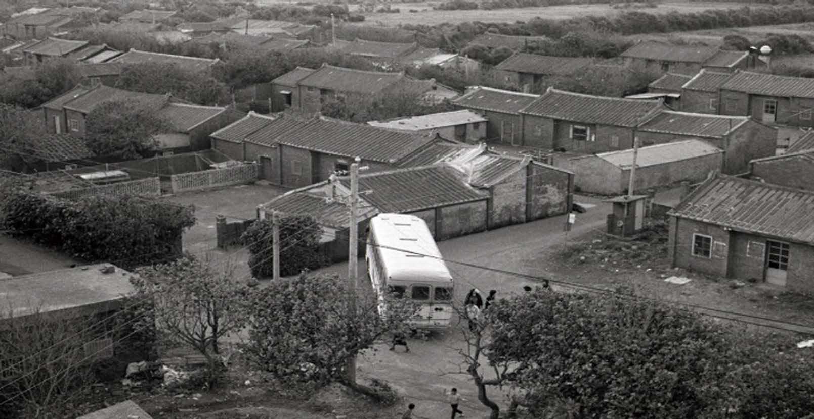
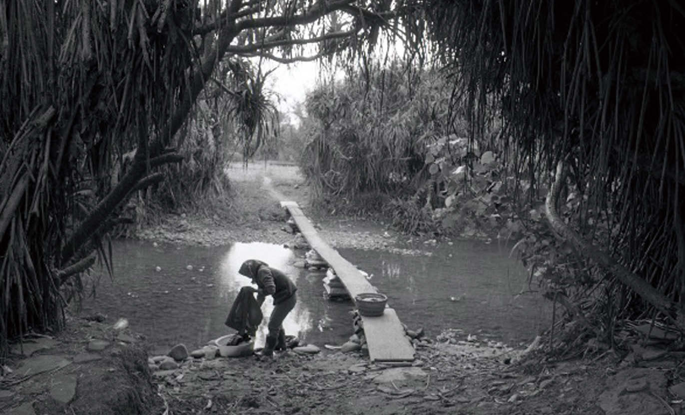
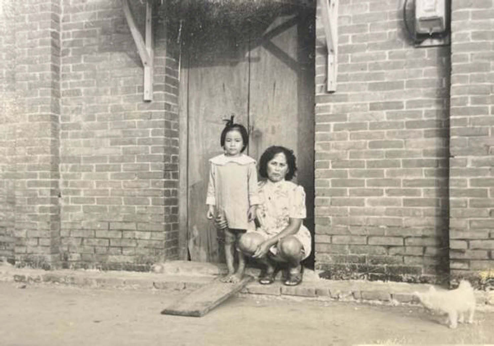

# 原住民族文獻

- 網站：ihc.cip.gov.tw
- 原始網址：https://ihc.cip.gov.tw/EJournal/EJournalCat/737
- 狀態：success
- 主題：歷史文化與信仰、觀光景點與活動
- 關鍵字：桃園市、歷史文化、地方旅遊
- 擷取時間：2026-10-29T13:54:37.250958+00:00

## 清理後正文

:::
Yukeh Batu, betunux balay!──石門水庫顛沛世紀中的泰雅奇女子 老照片講古 第59期 2024/06
李慧慧
桃園市原住民族行政局教育文化科科長
Betunux balay是泰雅族語讚賞女性「聰明又有智慧」的詞彙。傳統上，泰雅族是父系群社會，家族以父系血親為中心、父系繼嗣為原則（衛惠林 1963：21）。生活中依循的祖訓、規範（gaga），分工係以男主外、女主內為常態。當日常生活中的衝突，透過對話、匯合民意，協調解決方案，影響政府決策的公共領域，傳統上擁有話語權、言說通常都是男人的事，女性就算身處公眾之中，也必須保持沈默（利格拉樂．阿𡠄 2006；賴淑娟 2006； Beard 2019[2017]: 25）。因此，女性角色在泰雅族部落社會定位與要求為：扮演被動、溫柔和依賴的人格特質與行為模式，對於勤奮持家，又能使家庭關係和諧的女性，會以泰雅族語betunux balay來肯定。
筆者碩論以石門水庫淹沒區泰雅族移民為研究對象時，訪談對象以男性為主，他們參與水庫遷移政策的公共事務，也了解族人生活的難題（李慧慧 2007）。但，受訪的男性提及Yukeh Batu這位女子，並以betunux balay形容，並以嘉許的口吻說，她是kneril balay（意為：真正的女人）。主要是她在遷移離散的弱勢處境中，發揮關鍵力量，帶領族人解決難題，發出正義之聲，並讓族人看見希望，成為泰雅族女性在公共領域實踐的典範。
1963年石門水庫完成興建，泰雅族人經過二次集體遷移。最初第一次遷至桃園大溪中庄移民新村，但不到四個月時間，葛樂禮颱風催毀新村，於是有了第二次遷移，1965年遷至近海的桃園觀音大潭新村（圖1）。海邊生活困苦，遠不如山上原鄉，後來生活稍有改善，卻又無奈再面臨了土地遭遇鎘污染的慘酷事實，被迫第三次遷徙，但這次不再是集居一地，而是各自散處不同地方。
圖1 石門水庫淹沒區泰雅族移民於1965年集居之「大潭移民新村」（圖片來源：Yukeh Batu提供）
當年無論是共同對外爭取遷住權益，或內部事務協調，男性在公共事務佔有舉足輕重的角色。他們不太願意提起往事，因水庫遷移是心中抹不去的傷痛，每說一次，就痛一次，種種遷移經驗與記憶不堪回首，聽著耆老娓娓道來的傷痛聲中，筆者也曾感性地哭了幾回。族人近海生活困苦20多年間，望洋興嘆、一籌莫展時，激起了Yukeh Batu的堅毅與柔韌。
當時所居的大潭新村是海水倒灌區開墾出來的海埔新生地，缺乏工作機會，謀生不易，女性的日常是操持家務及照顧孩童（圖2、3、4）。新村內的基督長老教會是族人信仰中心，1968年臺灣世界展望會實地勘察，發現泰雅族人生活困苦，於是在大潭新村設置「臺灣世界展望會大潭兒童計劃區辦事處」，Yukeh Batu擔任輔導員（圖5、6、7）。辦事處每個月提供孩童500元日用品，解家庭學童就學的燃眉之急，減輕家長負擔（康培德 2009：110-111）。由於Yukeh Batu的先生於觀音鄉公所擔任里事幹事，在族人遇到困境時，與夫婿一同主動協助及聯結社會資源，協助族人的生活。
圖2 大潭移民新村泰雅族婦女於林投樹下洗衣（圖片來源：Yukeh Batu提供）
圖3 大潭移民新村泰雅族婦女照顧孩子為其日常（圖片來源：Yukeh Batu提供）
圖4 大潭移民新村泰雅族婦女與族人可愛的幼兒合影（圖片來源：Yukeh Batu提供）
圖5 Yukeh Batu擔任臺灣世界展望會大潭兒童計劃區辦事處輔導員（圖片來源：Yukeh Batu提供）
圖6 Yukeh Batu於大潭新村長老教會說明展望會之資源（圖片來源：Yukeh Batu提供）
圖7 大潭新村長老教會為泰雅族人信仰中心（圖片來源：Yukeh Batu提供，1970）
為了改善經濟生活，Yukeh Batu提議女性從事臨時工，於是商請附近閩客族群提供插秧、鋤草、收割等幫農工作（圖8）。又在1969年，有來自彰化的王姓商人，Yukeh Batu透過這位商人成功爭取教導婦女在沙地上種「蔥」和「蘆筍」。1970年，接受觀音鄉農會輔導養豬，增加女性工作機會，收入雖微薄，但讓困苦的生活出現轉機（李慧慧 2007：68）。然而，安穩居住大潭20幾年後，1988年又面對鎘污染的挑戰，無法居住，散處各地。Yukeh Batu深感族人分散都市之後，需有管道凝聚散處族人的向心力。由於原住民女性富有好歌喉，又愛好音樂，於是在2005年集結在都會區的女性移民，成立「桃園縣原住民婦女音樂協會」，藉由合唱練習的機會，凝聚認同並讓不同世代的族人認識泰雅族文化，Yukeh Batu擔任第一屆理事長（圖11）。
圖8 泰雅族婦女至附近閩客族群幫農貼補家用（圖片來源：Yukeh Batu提供，1970）
圖11 Yukeh Batu於2005年成立「桃園縣原住民婦音樂協會」凝聚散處之婦女並參與都會區各類活動展演。（圖片來源：Yukeh Batu提供，2005）
Yukeh Batu用心組成合唱團，邀請專業老師指導，她們精湛的展演獲外界肯定，經常受邀參與活動及喜宴。顯現了隨著社會大環境女權意識的覺醒，產生女性自覺團體，女性也能站在舞台找回自信與尊嚴，讓不同世代族人能從傳統樂舞，了解泰雅族文化精髓。至今該協會仍持續運作，並成為石門水庫移民聯繫的重要臺。音樂協會是較為柔性的組織，當族人離散在都市的大環境中，協會有其對外意義，亦即能強調我族與他族差異，且是易被欣賞與接納的一種積極方式；同時，又提升了女性的文化素養與人際網絡。Yukeh Batu帶給族人力量與信心的聲音，讓族人倍感溫暖並充滿盼望，有助於穩固處在困頓中的移民家庭。
石門水庫移民社群面對國家重大公共政策未被擊垮，Yukeh Batu積極在困境中爭取生存機會，帶領族人改善生活。因此，在公共領域被認同、被肯定，開始代表女性，有了對外發言權，例如復興鄉歷史文化館2013年的「石門水庫原鄉敘事」常設展、桃園市政府2016年拍攝的〈失根的部落：卡拉社部落的泰雅族人遷徙史〉影片及2022年出版《流動的社群：卡拉社群族裔生命故事》專書，她都是水庫移民故事關鍵的敘事者。她展現了女性溫和柔韌的生命力與智慧，受族人推崇，也因身體力行成了典範，並影響家人（圖9、10）。她的長子是桃園市前市議員，媳婦及長孫是現任桃園市議員，一家都在公共領域為族人發聲，爭取權益，受到族人肯定。
圖9 Yukeh Batu大潭新村時期全家福照（圖片來源：Yukeh Batu提供）
圖10 中間紅衣為Yukeh Batu，後方左為曾任市議員之長子蘇志強，後方中間為其媳婦現任市議員王仙蓮、後方右邊為孫現任市議員蘇偉恩。（圖片來源：蘇偉恩提供，2023）
傳統女性生活在父權制度束縛下，不利於表達自己想法，又難以發聲，從田野印證此一普遍狀況。不過，女性也不是只能嘆息、人微言輕與無力改變。Yukeh Batu雖是平民百姓，但她說的話有人跟從、有人聽進，她引領了時代往前走，以不同方式、不同的行動在公共領域挺身爭取族人權益，讓族人生存困境被外界看見，因而被重視，她的努力改變了族人生活景況，也讓人看見女性對部落的貢獻，女性重新被認識，所以族人用betunux balay來稱讚她，實至名歸。
女性能超越父權文化的限制，筆者認為一是因教育的力量，二是應情境所需。首先，Yukeh Batu是同一世代中少有機會能讀到高中，女力透過教育提升；再者，時勢造英雄，族人面對國家政策興建水庫的不利生存處境，Yukeh Batu找出有利族人的生存之路，成為群內重要的意見領袖。換個角度看，傳統文化對於女性的期待，在事實情境需要時，仍可被超越、修正，以及適應改變，這代表傳統文化自身其實也有一定的調適彈性。
2023年11月26日，Yukeh Batu參與原住民族委員會辦理之「2023南島民族女性意見領袖論壇」，分享了她的生命經驗（圖12）。隨風飄憶，她於2024年2月安詳的離世。在她78年的人生旅途，引領族人在困苦中勇敢往前邁進，讓身邊的人看見生存盼望，也透過音樂療癒族人無奈傷痛的心，並讓婦女朋友透過音樂緊緊相繫，彼此打氣勉勵、互相提攜，將希望與快樂帶回生活，以族語betunux balay稱，她當之無愧！以她生前提供的照片為文，共同追憶這位泰雅族奇女子的風範。
圖12 Yukeh Batu參與2023年11月26日原住民族委員會辦理「2023南島民族女性意見領袖論壇」，與同樣來自桃園市復興區之女性合影。（圖片來源：李慧慧提供）
引用書目
利格拉樂．阿𡠄
2006 〈從根著到流動─泰雅婦女生產與再生產活動之轉化〉。刊於《舞動民族教育精靈─臺灣原住民族教育論叢第六輯家庭與婦女教育》。林志興編，頁89-124。臺北：行政院原住民族委員會。
李慧慧
2007 《社群經驗與文化變遷─石門水庫淹沒區泰雅人移民史》。國立政治大學民族學系碩士論文。
桃園市政府
2016 〈失根的部落：卡拉社部落的泰雅族人遷徙史〉。https://www.youtube.com/watch? v=8VPruzgDR_c，2024年4月5日上線。
康培德
2009 《泰雅族msbtunux的美麗與哀愁：頭角與奎輝部落Kbuta世系群家族史》。南投：國史館臺灣文獻館。
賴淑娟
2006 〈從根著到流動─泰雅婦女生產與再生產活動之轉化〉。刊於《舞動民族教育精靈─臺灣原住民族教育論叢第六輯家庭與婦女教育》。林志興編，頁125-160。臺北：行政院原住民族委員會。
衛惠林
1963 〈泰雅族的父系世系與雙系共作組織〉。《台灣文獻》14(3)：20-27。
稽景芬、呂紹凡、Yawi Yukex
2022 《流動的社群：卡拉社群族裔生命故事》。桃園：桃園市政府原住民族行政局。
Beard, Mary
2019[2017] 《女力告白：最危險的力量與被噤聲的歷史》（Women ＆ Power: A Manifesto）。陳信宏譯。新北：聯經。

## 圖片
-  — [原始圖片來源](https://ihc.cip.gov.tw/ihcfile/EJournals/59/Content/P75_0001.jpg) 
-  — [原始圖片來源](https://ihc.cip.gov.tw/ihcfile/EJournals/59/Content/P75_0002.jpg) 
-  — [原始圖片來源](https://ihc.cip.gov.tw/ihcfile/EJournals/59/Content/P75_0003.jpg) 

## 頁面連結
- [客服諮詢](https://ihc.cip.gov.tw/Service)
- [關於原住民族文獻會](https://ihc.cip.gov.tw/Aboutus/Index)
- [原住民族文獻會設置要點](https://ihc.cip.gov.tw/Aboutus/Rules)
- [委員介紹](https://ihc.cip.gov.tw/Aboutus/Committee)
- [歷次會議記錄](https://ihc.cip.gov.tw/Aboutus/Minutes)
- [網站訊息](https://ihc.cip.gov.tw/News/Index)
- [徵稿訊息](https://ihc.cip.gov.tw/News/Call4Paper)
- [本會出版品列表](https://ihc.cip.gov.tw/Publication/Index)
- [與國史館共同出版品介紹](https://ihc.cip.gov.tw/Publication/WithDrnh)
- [出版品查詢](https://ihc.cip.gov.tw/Publication/Search)
- [本期內容](https://ihc.cip.gov.tw/EJournal/Index)
- [訂閱電子報](https://ihc.cip.gov.tw/EJournal/EPaper)
- [徵稿說明](https://ihc.cip.gov.tw/EJournal/Call4PaperNote)
- [期刊查詢](https://ihc.cip.gov.tw/EJournal/Search)
- [相關連結](https://ihc.cip.gov.tw/Link)
- [https://ihc.cip.gov.tw/](https://ihc.cip.gov.tw/)
- [歷史期刊](https://ihc.cip.gov.tw/EJournal/EJournals)
- [回期刊列表](https://ihc.cip.gov.tw/EJournal/EJournalDetail/59)
- [網站導覽](https://ihc.cip.gov.tw/SiteMap)
- [跳到主要內容](https://ihc.cip.gov.tw/EJournal/EJournalCat/737)
- [隱私權保護政策](https://ihc.cip.gov.tw/Privacy)
- [網站安全政策](https://ihc.cip.gov.tw/Policy)
- [本會地圖](https://ihc.cip.gov.tw/Map)
