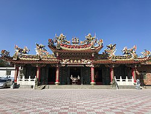
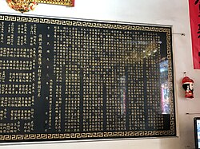

# 觀音復興宮 - 維基百科，自由的百科全書

- 網站：zh.wikipedia.org
- 原始網址：https://zh.wikipedia.org/wiki/%E8%A7%80%E9%9F%B3%E5%BE%A9%E8%88%88%E5%AE%AE
- 狀態：success
- 主題：歷史文化與信仰、地方產業與農漁業、觀光景點與活動
- 關鍵字：觀音區、桃園市、地方旅遊
- 擷取時間：2026-10-29T13:54:43.104008+00:00

## 清理後正文

座標
：
25°03′38″N
121°07′42″E
 / 
25.060515°N 121.128434°E
 /
25.060515; 121.128434
維基百科，自由的百科全書
25°03′38″N
121°07′42″E
 / 
25.060515°N 121.128434°E
 /
25.060515; 121.128434
觀音復興宮
基本資訊
位置
臺灣
桃園市
觀音區
樹林新村
宗教
台灣民間信仰
主神
開漳聖王
建立時間
1959年
地圖
觀音復興宮
，是位於
臺灣
桃園市
觀音區
觀音工業區的
開漳聖王
廟，前身為
大溪區
的阿姆坪復興宮，因興建
石門水庫
而搬遷。
前身
[
編輯
]
光緒十六年四月（1890年），墾民林勝源出資招募民眾進山開墾
大嵙崁
水流東（三民）、八結（百吉）、湳仔溝、新柑坪、舊柑坪、阿姆坪、竹頭角（長興）等地區，該年秋建立阿姆坪南雅宮，同年十月落成，香火來自
大溪仁和宮
。次年（1891年）五月二十八日，與原住民發生衝突，廟身被焚。1909年初，大嵙崁學務委員呂鷹揚、江健臣、呂建邦、黃丙南、王式璋、黃玉麟各出資本合力開墾阿姆坪四十餘甲地，並倡議原址
桃園廳
海山堡
南雅庄鴨母坪重建廟宇。1912年，眾人出資出力復建，同年秋完竣，乃改宮名為「復興宮」。但1914年農曆七月十五日，差點再毀於原住民之手，此後每年七月十四日進行普渡。
[
1
]
阿姆坪復興宮的信仰圈曾有阿姆坪、八結、湳仔溝、新柑坪、舊柑坪、竹頭角、大溪坪、水流東、分水崙、十三份與
復興區
角板山
等地區
[
1
]
。在石門水庫興建之前，阿姆坪當地居民便會迎媽祖，於開漳聖王聖誕當日遶境
[
2
]
。
今狀
[
編輯
]
沿革寫1959年建立，1961年竣工。
石門水庫興建期間，地方人士便決議將宮廟隨居民遷移至觀音鄉樹林村，1961年將神像迎至樹林新村，為當地的信仰與社交活動中心
[
3
]
。除觀音復興宮得到開漳聖王神像外，
百吉復興宮
分配到廟門板、角板山福興宮、三民東興宮分別擁有香爐神器等
[
4
]
。觀音復興宮廟祝陳耀雄表示，以前要去進香，最少要三台遊覽車，現在剩一台
[
3
]
。
至於
阿姆坪土地公廟
舊廟留在原地
[
5
]
。
從阿姆坪遷來的廖金田回憶，樹林新村當時是一片沙地及防風林，收入不佳生活不好過，後來政府向村民徵地蓋工業區，卻帶來環境汙染，身體不健康，此廟供奉的開漳聖王是他生命重要的寄託
[
3
]
。在2018年報導時，因觀音工業區空氣汙染，宮廟周邊區域年輕人口外移嚴重，觀音復興宮已不復當年之榮景，造成維持宮廟運作經費拙困，因此僅能在有限的經費與人力之下，勉強維持廟務的運作
[
1
]
。
參考
[
編輯
]
^
1.0
1.1
1.2
陳大鵬.
桃竹苗開漳聖王廟在復興宮聯誼
. 《桃園社區報》. 2018-04-30
[
2019-12-02
]
. （原始內容
存檔
於2025-04-05）
（中文（臺灣））
.
^
張弘昌.
媽祖水上遶境靈驗發爐 石門水庫春雨綿綿水位回升
. 《聯合報》. 2019-03-09
[
2019-12-02
]
. （原始內容
存檔
於2025-04-05）
（中文（臺灣））
.
^
3.0
3.1
3.2
何柏均、林奐成、陳偉周、陳鼎仁、吳宜靜.
【癌症村3】被政府騙兩次！遷村又被工廠包圍　石門水庫移民血淚史
. 《蘋果日報》. 2019-07-05
[
2019-12-02
]
（中文（臺灣））
.
^
徐乃義.
觀音鄉復興宮主神「開彰聖王」請出整修
. 《大紀元時報》. 2013-09-08
[
2019-12-02
]
. （原始內容
存檔
於2025-04-25）
（中文（臺灣））
.
^
楊宗灝.
1廟2神同祀 復源宮添傳奇
. 《中國時報》. 2015-03-01
[
2019-02-02
]
. （原始內容
存檔
於2019-11-09）
（中文（臺灣））
.
維基共享資源
上的相關多媒體資源：
觀音復興宮
取自「
https://zh.wikipedia.org/w/index.php?title=觀音復興宮&oldid=93611298
」
分類
：
桃園市開漳聖王廟
觀音區
1959年台灣建立
1959年完工的宗教建築物
隱藏分類：
使用WikiMiniAtlas小工具的頁面
維基數據存在坐標數據的頁面
使用Infobox mapframe但維基數據缺少形狀連結的頁面
Infobox religious building使用未知宗教參數的頁面
維基共享資源分類連結使用了維基數據上的匹配項
有地圖的頁面

## 圖片
-  — [原始圖片來源](https://zh.wikipedia.org/static/images/mobile/copyright/wikipedia-wordmark-zh.svg) 
-  — [原始圖片來源](https://zh.wikipedia.org/static/images/mobile/copyright/wikipedia-tagline-zh.svg) 
-  — [原始圖片來源](https://thumb.wikimedia.org/wikipedia/commons/thumb/e/ed/%E8%A7%80%E9%9F%B3%E5%BE%A9%E8%88%88%E5%AE%AE.jpg/250px-%E8%A7%80%E9%9F%B3%E5%BE%A9%E8%88%88%E5%AE%AE.jpg?utm_source=zh.wikipedia.org&utm_campaign=parser&utm_content=thumbnail) 
-  — [原始圖片來源](https://thumb.wikimedia.org/wikipedia/commons/thumb/1/1e/%E8%A7%80%E9%9F%B3%E5%BE%A9%E8%88%88%E5%AE%AE%E6%B2%BF%E9%9D%A9.jpg/250px-%E8%A7%80%E9%9F%B3%E5%BE%A9%E8%88%88%E5%AE%AE%E6%B2%BF%E9%9D%A9.jpg?utm_source=zh.wikipedia.org&utm_campaign=parser&utm_content=thumbnail) 
-  — [原始圖片來源](https://zh.wikipedia.org/static/images/footer/wikimedia.svg) 
-  — [原始圖片來源](https://zh.wikipedia.org/w/resources/assets/mediawiki_compact.svg) 

## 頁面連結
- [分類索引](https://zh.wikipedia.org/wiki/Wikipedia:%E5%88%86%E7%B1%BB%E7%B4%A2%E5%BC%95)
- [特色內容](https://zh.wikipedia.org/wiki/Portal:%E7%89%B9%E8%89%B2%E5%85%A7%E5%AE%B9)
- [新聞動態](https://zh.wikipedia.org/wiki/Portal:%E6%96%B0%E8%81%9E%E5%8B%95%E6%85%8B)
- [隨機條目](https://zh.wikipedia.org/wiki/Special:Random)
- [聯絡我們](https://zh.wikipedia.org/wiki/Wikipedia:%E8%81%94%E7%BB%9C%E6%88%91%E4%BB%AC)
- [說明](https://zh.wikipedia.org/wiki/Help:%E9%A6%96%E9%A1%B5)
- [維基社群](https://zh.wikipedia.org/wiki/Wikipedia:%E7%A4%BE%E7%BE%A4%E9%A6%96%E9%A1%B5)
- [編輯入門](https://zh.wikipedia.org/wiki/Help:%E5%85%A5%E9%97%A8)
- [互助客棧](https://zh.wikipedia.org/wiki/Wikipedia:%E4%BA%92%E5%8A%A9%E5%AE%A2%E6%A0%88)
- [IRC即時聊天](https://zh.wikipedia.org/wiki/Wikipedia:IRC%E8%81%8A%E5%A4%A9%E9%A2%91%E9%81%93)
- [近期變更](https://zh.wikipedia.org/wiki/Special:RecentChanges)
- [特殊頁面](https://zh.wikipedia.org/wiki/Special:SpecialPages)
- [首頁](https://zh.wikipedia.org/wiki/Wikipedia:%E9%A6%96%E9%A1%B5)
- [搜尋](https://zh.wikipedia.org/wiki/Special:Search)
- [資助維基百科](https://donate.wikimedia.org/?wmf_source=donate&wmf_medium=sidebar&wmf_campaign=zh.wikipedia.org&uselang=zh)
- [建立帳號](https://zh.wikipedia.org/w/index.php?title=Special:CreateAccount&returnto=%E8%A7%80%E9%9F%B3%E5%BE%A9%E8%88%88%E5%AE%AE)
- [登入](https://zh.wikipedia.org/w/index.php?title=Special:UserLogin&returnto=%E8%A7%80%E9%9F%B3%E5%BE%A9%E8%88%88%E5%AE%AE)
- [討論](https://zh.wikipedia.org/wiki/Talk:%E8%A7%80%E9%9F%B3%E5%BE%A9%E8%88%88%E5%AE%AE)
- [不转换](https://zh.wikipedia.org/zh/%E8%A7%80%E9%9F%B3%E5%BE%A9%E8%88%88%E5%AE%AE)
- [简体](https://zh.wikipedia.org/zh-hans/%E8%A7%80%E9%9F%B3%E5%BE%A9%E8%88%88%E5%AE%AE)
- [繁體](https://zh.wikipedia.org/zh-hant/%E8%A7%80%E9%9F%B3%E5%BE%A9%E8%88%88%E5%AE%AE)
- [大陆简体](https://zh.wikipedia.org/zh-cn/%E8%A7%80%E9%9F%B3%E5%BE%A9%E8%88%88%E5%AE%AE)
- [香港繁體](https://zh.wikipedia.org/zh-hk/%E8%A7%80%E9%9F%B3%E5%BE%A9%E8%88%88%E5%AE%AE)
- [澳門繁體](https://zh.wikipedia.org/zh-mo/%E8%A7%80%E9%9F%B3%E5%BE%A9%E8%88%88%E5%AE%AE)
- [大马简体](https://zh.wikipedia.org/zh-my/%E8%A7%80%E9%9F%B3%E5%BE%A9%E8%88%88%E5%AE%AE)
- [新加坡简体](https://zh.wikipedia.org/zh-sg/%E8%A7%80%E9%9F%B3%E5%BE%A9%E8%88%88%E5%AE%AE)
- [臺灣正體](https://zh.wikipedia.org/zh-tw/%E8%A7%80%E9%9F%B3%E5%BE%A9%E8%88%88%E5%AE%AE)
- [編輯](https://zh.wikipedia.org/w/index.php?title=%E8%A7%80%E9%9F%B3%E5%BE%A9%E8%88%88%E5%AE%AE&action=edit)
- [檢視歷史](https://zh.wikipedia.org/w/index.php?title=%E8%A7%80%E9%9F%B3%E5%BE%A9%E8%88%88%E5%AE%AE&action=history)
- [連結至此的頁面](https://zh.wikipedia.org/wiki/Special:WhatLinksHere/%E8%A7%80%E9%9F%B3%E5%BE%A9%E8%88%88%E5%AE%AE)
- [相關變更](https://zh.wikipedia.org/wiki/Special:RecentChangesLinked/%E8%A7%80%E9%9F%B3%E5%BE%A9%E8%88%88%E5%AE%AE)
- [上傳檔案](https://zh.wikipedia.org/wiki/Project:上传)
- [固定連結](https://zh.wikipedia.org/w/index.php?title=%E8%A7%80%E9%9F%B3%E5%BE%A9%E8%88%88%E5%AE%AE&oldid=93611298)
- [頁面資訊](https://zh.wikipedia.org/w/index.php?title=%E8%A7%80%E9%9F%B3%E5%BE%A9%E8%88%88%E5%AE%AE&action=info)
- [引用此頁面](https://zh.wikipedia.org/w/index.php?title=Special:CiteThisPage&page=%E8%A7%80%E9%9F%B3%E5%BE%A9%E8%88%88%E5%AE%AE&id=93611298&wpFormIdentifier=titleform)
- [取得短連結](https://zh.wikipedia.org/w/index.php?title=Special:UrlShortener&url=https%3A%2F%2Fzh.wikipedia.org%2Fwiki%2F%25E8%25A7%2580%25E9%259F%25B3%25E5%25BE%25A9%25E8%2588%2588%25E5%25AE%25AE)
- [下載為PDF](https://zh.wikipedia.org/w/index.php?title=Special:DownloadAsPdf&page=%E8%A7%80%E9%9F%B3%E5%BE%A9%E8%88%88%E5%AE%AE&action=show-download-screen)
- [新增連結](https://www.wikidata.org/wiki/Special:EntityPage/Q77024196)
- [座標](https://zh.wikipedia.org/wiki/%E5%9C%B0%E7%90%86%E5%9D%90%E6%A0%87)
- [25°03′38″N 121°07′42″E  /  25.060515°N 121.128434°E  / 25.060515; 121.128434](https://geohack.toolforge.org/geohack.php?language=zh&pagename=%E8%A7%80%E9%9F%B3%E5%BE%A9%E8%88%88%E5%AE%AE&params=25.060515_N_121.128434_E_)
- [https://zh.wikipedia.org/wiki/File:%E8%A7%80%E9%9F%B3%E5%BE%A9%E8%88%88%E5%AE%AE.jpg](https://zh.wikipedia.org/wiki/File:%E8%A7%80%E9%9F%B3%E5%BE%A9%E8%88%88%E5%AE%AE.jpg)
- [台灣民間信仰](https://zh.wikipedia.org/wiki/%E5%8F%B0%E7%81%A3%E6%B0%91%E9%96%93%E4%BF%A1%E4%BB%B0)
- [臺灣](https://zh.wikipedia.org/wiki/%E8%87%BA%E7%81%A3)
- [桃園市](https://zh.wikipedia.org/wiki/%E6%A1%83%E5%9C%92%E5%B8%82)
- [觀音區](https://zh.wikipedia.org/wiki/%E8%A7%80%E9%9F%B3%E5%8D%80)
- [開漳聖王](https://zh.wikipedia.org/wiki/%E9%96%8B%E6%BC%B3%E8%81%96%E7%8E%8B)
- [大溪區](https://zh.wikipedia.org/wiki/%E5%A4%A7%E6%BA%AA%E5%8D%80)
- [石門水庫](https://zh.wikipedia.org/wiki/%E7%9F%B3%E9%96%80%E6%B0%B4%E5%BA%AB_(%E8%87%BA%E7%81%A3))
- [編輯](https://zh.wikipedia.org/w/index.php?title=%E8%A7%80%E9%9F%B3%E5%BE%A9%E8%88%88%E5%AE%AE&action=edit&section=1)
- [大嵙崁](https://zh.wikipedia.org/wiki/%E5%A4%A7%E5%B5%99%E5%B4%81)
- [大溪仁和宮](https://zh.wikipedia.org/wiki/%E5%A4%A7%E6%BA%AA%E4%BB%81%E5%92%8C%E5%AE%AE)
- [桃園廳](https://zh.wikipedia.org/wiki/%E6%A1%83%E5%9C%92%E5%BB%B3)
- [海山堡](https://zh.wikipedia.org/wiki/%E6%B5%B7%E5%B1%B1%E5%A0%A1)
- [復興區](https://zh.wikipedia.org/wiki/%E5%BE%A9%E8%88%88%E5%8D%80_(%E8%87%BA%E7%81%A3))
- [角板山](https://zh.wikipedia.org/wiki/%E8%A7%92%E6%9D%BF%E5%B1%B1)
- [編輯](https://zh.wikipedia.org/w/index.php?title=%E8%A7%80%E9%9F%B3%E5%BE%A9%E8%88%88%E5%AE%AE&action=edit&section=2)
- [https://zh.wikipedia.org/wiki/File:%E8%A7%80%E9%9F%B3%E5%BE%A9%E8%88%88%E5%AE%AE%E6%B2%BF%E9%9D%A9.jpg](https://zh.wikipedia.org/wiki/File:%E8%A7%80%E9%9F%B3%E5%BE%A9%E8%88%88%E5%AE%AE%E6%B2%BF%E9%9D%A9.jpg)
- [百吉復興宮](https://zh.wikipedia.org/wiki/%E7%99%BE%E5%90%89%E5%BE%A9%E8%88%88%E5%AE%AE)
- [阿姆坪土地公廟](https://zh.wikipedia.org/wiki/%E5%BE%A9%E6%BA%90%E5%AE%AE_(%E9%98%BF%E5%A7%86%E5%9D%AA))
- [編輯](https://zh.wikipedia.org/w/index.php?title=%E8%A7%80%E9%9F%B3%E5%BE%A9%E8%88%88%E5%AE%AE&action=edit&section=3)
- [桃竹苗開漳聖王廟在復興宮聯誼](http://www.cpfcnews.tw/index.php/taoyuan/20948-2018-04-30-09-38-35)
- [存檔](https://web.archive.org/web/20250405184228/https://www.cpfcnews.tw/index.php/taoyuan/20948-2018-04-30-09-38-35)
- [媽祖水上遶境靈驗發爐 石門水庫春雨綿綿水位回升](https://udn.com/news/story/7324/3687687)
- [存檔](https://web.archive.org/web/20250405184058/https://udn.com/news/story/7324/3687687)
- [【癌症村3】被政府騙兩次！遷村又被工廠包圍　石門水庫移民血淚史](https://webcache.googleusercontent.com/search?q=cache:jLESLhxhiscJ:https://tw.appledaily.com/new/realtime/20190705/1594548/+&cd=1&hl=zh-TW&ct=clnk&gl=tw)
- [觀音鄉復興宮主神「開彰聖王」請出整修](http://www.epochtimes.com/b5/13/9/8/n3959447.htm)
- [存檔](https://web.archive.org/web/20250425091708/https://www.epochtimes.com/b5/13/9/8/n3959447.htm)
- [1廟2神同祀 復源宮添傳奇](http://www.chinatimes.com/newspapers/20150301000387-260107)
- [存檔](https://web.archive.org/web/20191109034426/https://www.chinatimes.com/newspapers/20150301000387-260107)
- [https://zh.wikipedia.org/wiki/File:Portal-puzzle.svg](https://zh.wikipedia.org/wiki/File:Portal-puzzle.svg)
- [桃園主題](https://zh.wikipedia.org/wiki/Portal:%E6%A1%83%E5%9C%92)
- [https://zh.wikipedia.org/wiki/File:Taijitu_red_gradient.svg](https://zh.wikipedia.org/wiki/File:Taijitu_red_gradient.svg)
- [道教主題](https://zh.wikipedia.org/wiki/Portal:%E9%81%93%E6%95%99)
- [https://zh.wikipedia.org/wiki/File:Commons-logo.svg](https://zh.wikipedia.org/wiki/File:Commons-logo.svg)
- [維基共享資源](https://zh.wikipedia.org/wiki/%E7%BB%B4%E5%9F%BA%E5%85%B1%E4%BA%AB%E8%B5%84%E6%BA%90)
- [維基共享資源](https://commons.wikimedia.org/wiki/Category:Guanyin_Fuxing_Temple)
- [https://zh.wikipedia.org/w/index.php?title=觀音復興宮&oldid=93611298](https://zh.wikipedia.org/w/index.php?title=觀音復興宮&oldid=93611298)
- [分類](https://zh.wikipedia.org/wiki/Special:Categories)
- [桃園市開漳聖王廟](https://zh.wikipedia.org/wiki/Category:%E6%A1%83%E5%9C%92%E5%B8%82%E9%96%8B%E6%BC%B3%E8%81%96%E7%8E%8B%E5%BB%9F)
- [觀音區](https://zh.wikipedia.org/wiki/Category:%E8%A7%80%E9%9F%B3%E5%8D%80)
- [1959年台灣建立](https://zh.wikipedia.org/wiki/Category:1959%E5%B9%B4%E5%8F%B0%E7%81%A3%E5%BB%BA%E7%AB%8B)
- [1959年完工的宗教建築物](https://zh.wikipedia.org/wiki/Category:1959%E5%B9%B4%E5%AE%8C%E5%B7%A5%E7%9A%84%E5%AE%97%E6%95%99%E5%BB%BA%E7%AF%89%E7%89%A9)
- [使用WikiMiniAtlas小工具的頁面](https://zh.wikipedia.org/wiki/Category:%E4%BD%BF%E7%94%A8WikiMiniAtlas%E5%B0%8F%E5%B7%A5%E5%85%B7%E7%9A%84%E9%A1%B5%E9%9D%A2)
- [維基數據存在坐標數據的頁面](https://zh.wikipedia.org/wiki/Category:%E7%BB%B4%E5%9F%BA%E6%95%B0%E6%8D%AE%E5%AD%98%E5%9C%A8%E5%9D%90%E6%A0%87%E6%95%B0%E6%8D%AE%E7%9A%84%E9%A1%B5%E9%9D%A2)
- [使用Infobox mapframe但維基數據缺少形狀連結的頁面](https://zh.wikipedia.org/wiki/Category:%E4%BD%BF%E7%94%A8Infobox_mapframe%E4%BD%86%E7%BB%B4%E5%9F%BA%E6%95%B0%E6%8D%AE%E7%BC%BA%E5%B0%91%E5%BD%A2%E7%8A%B6%E9%93%BE%E6%8E%A5%E7%9A%84%E9%A1%B5%E9%9D%A2)
- [Infobox religious building使用未知宗教參數的頁面](https://zh.wikipedia.org/wiki/Category:Infobox_religious_building%E4%BD%BF%E7%94%A8%E6%9C%AA%E7%9F%A5%E5%AE%97%E6%95%99%E5%8F%82%E6%95%B0%E7%9A%84%E9%A1%B5%E9%9D%A2)
- [維基共享資源分類連結使用了維基數據上的匹配項](https://zh.wikipedia.org/wiki/Category:%E7%BB%B4%E5%9F%BA%E5%85%B1%E4%BA%AB%E8%B5%84%E6%BA%90%E5%88%86%E7%B1%BB%E9%93%BE%E6%8E%A5%E4%BD%BF%E7%94%A8%E4%BA%86%E7%BB%B4%E5%9F%BA%E6%95%B0%E6%8D%AE%E4%B8%8A%E7%9A%84%E5%8C%B9%E9%85%8D%E9%A1%B9)
- [有地圖的頁面](https://zh.wikipedia.org/wiki/Category:%E6%9C%89%E5%9C%B0%E5%9B%BE%E7%9A%84%E9%A1%B5%E9%9D%A2)
- [創用CC 署名-相同方式分享 4.0協議](https://zh.wikipedia.org/wiki/Wikipedia:CC_BY-SA_4.0%E5%8D%8F%E8%AE%AE%E6%96%87%E6%9C%AC)
- [使用條款](https://foundation.wikimedia.org/wiki/Special:MyLanguage/Policy:Terms_of_Use)
- [維基媒體基金會](https://wikimediafoundation.org)
- [非營利慈善機構](https://donate.wikimedia.org/wiki/Special:MyLanguage/Tax_deductibility)
- [隱私權政策](https://foundation.wikimedia.org/wiki/Special:MyLanguage/Policy:Privacy_policy)
- [關於維基百科](https://zh.wikipedia.org/wiki/Wikipedia:%E5%85%B3%E4%BA%8E)
- [免責聲明](https://zh.wikipedia.org/wiki/Wikipedia:%E5%85%8D%E8%B4%A3%E5%A3%B0%E6%98%8E)
- [法律與安全事項聯絡方式](https://foundation.wikimedia.org/wiki/Special:MyLanguage/Legal:Wikimedia_Foundation_Legal_and_Safety_Contact_Information)
- [行為準則](https://foundation.wikimedia.org/wiki/Special:MyLanguage/Policy:Universal_Code_of_Conduct)
- [開發人員](https://developer.wikimedia.org)
- [統計](https://stats.wikimedia.org/)
- [Cookie聲明](https://foundation.wikimedia.org/wiki/Special:MyLanguage/Policy:Cookie_statement)

> 備註：進階解析失敗，已使用內建解析器：AttributeError: 'NoneType' object has no attribute 'get'
