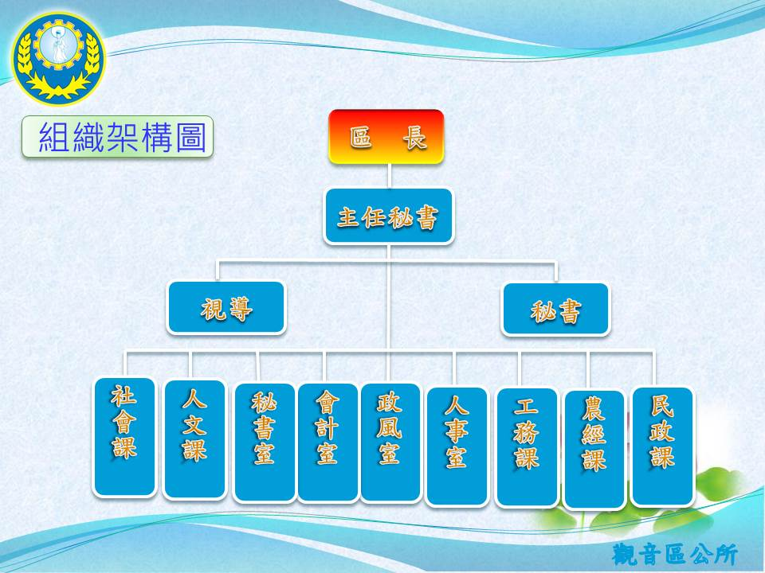

# 組織架構圖

- 網站：組織架構圖
- 原始網址：https://web.archive.org/web/20220709075846/https://www.guanyin.tycg.gov.tw/home.jsp?id=66&parentpath=0,11,62
- 狀態：success
- 作者：觀音區公所
- 發表日期：2014-09-18 15:22:24.0
- 主題：地方知識
- 關鍵字：觀音區、桃園市、地方旅遊
- 擷取時間：2026-10-29T13:54:46.742630+00:00

## 清理後正文

桃園市政府-觀音區公所-組織架構圖
:::
回首頁
|
網站導覽
|
市政信箱
|
常見問答
|
桃園市政府
cx
請輸入關鍵字
市民卡
|
:::
目前位置:
觀音區介紹
本所組織介紹
組織架構圖
字級：
大
中
小
詳細內容：
觀音區公所組織編制依序為區長、主任秘書、機要秘書、民政課、社會課、農經課、工務課、秘書室、會計室、人事室、政風室、人文課，民政課包含租佃委員會、調解委員會，工務課包含都市計劃委員會。
此為觀音區公所組織架構圖，想瞭解各課室所承辦的業務，以及其施政的重點計劃，可直接點選課室服務內容。
最後更新日期：105-03-08
瀏覽人次：6242 人

## 圖片
-  — [原始圖片來源](https://web.archive.org/web/20220709075846im_/https://www.tycg.gov.tw/uploaddowndoc?file=organization/201603081421430.jpg&filedisplay=%E7%B5%84%E7%B9%94%E5%9C%96.jpg&flag=pic) 

## 頁面連結
- [網站導覽](https://web.archive.org/web/20220709075846/https:/www.guanyin.tycg.gov.tw/main.jsp?prg=ap/sitemap.jsp&maintitle=sitemap)
- [市政信箱](https://web.archive.org/web/20220709075846/https://taotalk.tycg.gov.tw/interface/Petition?channel=G_DEPC_380020000A)
- [桃園市政府](https://web.archive.org/web/20220709075846/https://www.tycg.gov.tw/)
- [市民卡](https://web.archive.org/web/20220709075846/https://card.tycg.gov.tw/ap/index.aspx)
- [進階搜尋](https://web.archive.org/web/20220709075846/https://www.google.com.tw/advanced_search?hl=zh-TW&as_sitesearch=https://www.guanyin.tycg.gov.tw/)
- [行政區域](https://web.archive.org/web/20220709075846/https:/www.guanyin.tycg.gov.tw/home.jsp?id=101&parentpath=0,11,60)
- [觀音意象](https://web.archive.org/web/20220709075846/https:/www.guanyin.tycg.gov.tw/home.jsp?id=102&parentpath=0,11,60)
- [賞蓮地圖](https://web.archive.org/web/20220709075846/https:/www.guanyin.tycg.gov.tw/home.jsp?id=64&parentpath=0,11,61)
- [遊憩資訊](https://web.archive.org/web/20220709075846/https:/www.guanyin.tycg.gov.tw/home.jsp?id=137&parentpath=0,11,61)
- [地方特產](https://web.archive.org/web/20220709075846/https:/www.guanyin.tycg.gov.tw/home.jsp?id=138&parentpath=0,11,61)
- [主管介紹](https://web.archive.org/web/20220709075846/https:/www.guanyin.tycg.gov.tw/home.jsp?id=65&parentpath=0,11,62)
- [業務職掌](https://web.archive.org/web/20220709075846/https:/www.guanyin.tycg.gov.tw/home.jsp?id=67&parentpath=0,11,62)
- [辦公室配置圖](https://web.archive.org/web/20220709075846/https:/www.guanyin.tycg.gov.tw/home.jsp?id=103&parentpath=0,11,62)
- [中央法規](https://web.archive.org/web/20220709075846/http://law.moj.gov.tw/)
- [本市自治法規](https://web.archive.org/web/20220709075846/http://law.tycg.gov.tw/)
- [觀音區法規專區](https://web.archive.org/web/20220709075846/https:/www.guanyin.tycg.gov.tw/home.jsp?id=131&parentpath=0,13,73)
- [觀音區繼續適用法規](https://web.archive.org/web/20220709075846/https:/www.guanyin.tycg.gov.tw/home.jsp?id=139&parentpath=0,13,73)
- [民眾常用檔案下載](https://web.archive.org/web/20220709075846/https:/www.guanyin.tycg.gov.tw/home.jsp?id=79&parentpath=0,13,78)
- [公務檔案下載](https://web.archive.org/web/20220709075846/https:/www.guanyin.tycg.gov.tw/home.jsp?id=80&parentpath=0,13,78)
- [災害潛勢及防災地圖](https://web.archive.org/web/20220709075846/https:/www.guanyin.tycg.gov.tw/home.jsp?id=142&parentpath=0,13,140)
- [緊急通報聯繫窗口](https://web.archive.org/web/20220709075846/https:/www.guanyin.tycg.gov.tw/home.jsp?id=143&parentpath=0,13,140)
- [避難收容處所資訊](https://web.archive.org/web/20220709075846/https:/www.guanyin.tycg.gov.tw/home.jsp?id=144&parentpath=0,13,140)
- [防災宣導](https://web.archive.org/web/20220709075846/https:/www.guanyin.tycg.gov.tw/home.jsp?id=145&parentpath=0,13,140)
- [收容物資整備資訊](https://web.archive.org/web/20220709075846/https:/www.guanyin.tycg.gov.tw/home.jsp?id=10209&parentpath=0,13,140)
- [演習訓練及應變成果](https://web.archive.org/web/20220709075846/https:/www.guanyin.tycg.gov.tw/home.jsp?id=10210&parentpath=0,13,140)
- [災防相關網站連結](https://web.archive.org/web/20220709075846/https:/www.guanyin.tycg.gov.tw/home.jsp?id=10211&parentpath=0,13,140)
- [文件下載專區](https://web.archive.org/web/20220709075846/https:/www.guanyin.tycg.gov.tw/home.jsp?id=10212&parentpath=0,13,140)
- [檢舉管道](https://web.archive.org/web/20220709075846/https:/www.guanyin.tycg.gov.tw/home.jsp?id=10157&parentpath=0,13,10156)
- [維護業務](https://web.archive.org/web/20220709075846/https:/www.guanyin.tycg.gov.tw/home.jsp?id=10158&parentpath=0,13,10156)
- [防貪業務](https://web.archive.org/web/20220709075846/https:/www.guanyin.tycg.gov.tw/home.jsp?id=10159&parentpath=0,13,10156)
- [廉政法規](https://web.archive.org/web/20220709075846/https:/www.guanyin.tycg.gov.tw/home.jsp?id=10160&parentpath=0,13,10156)
- [請託關說登錄查察業務](https://web.archive.org/web/20220709075846/https:/www.guanyin.tycg.gov.tw/home.jsp?id=10161&parentpath=0,13,10156)
- [影音宣導](https://web.archive.org/web/20220709075846/https:/www.guanyin.tycg.gov.tw/home.jsp?id=10162&parentpath=0,13,10156)
- [公職人員利益衝突迴避身分揭露專區](https://web.archive.org/web/20220709075846/https:/www.guanyin.tycg.gov.tw/home.jsp?id=10207&parentpath=0,13,10156)
- [檔案應用申請](https://web.archive.org/web/20220709075846/https:/www.guanyin.tycg.gov.tw/home.jsp?id=10165&parentpath=0,13,10164)
- [相關連結](https://web.archive.org/web/20220709075846/https:/www.guanyin.tycg.gov.tw/home.jsp?id=10166&parentpath=0,13,10164)
- [最新消息](https://web.archive.org/web/20220709075846/https:/www.guanyin.tycg.gov.tw/home.jsp?id=10169&parentpath=0,13,10168)
- [關於我們](https://web.archive.org/web/20220709075846/https:/www.guanyin.tycg.gov.tw/home.jsp?id=10170&parentpath=0,13,10168)
- [安全社區組織架構](https://web.archive.org/web/20220709075846/https:/www.guanyin.tycg.gov.tw/home.jsp?id=10171&parentpath=0,13,10168,10170)
- [安全社區夥伴](https://web.archive.org/web/20220709075846/https:/www.guanyin.tycg.gov.tw/home.jsp?id=10172&parentpath=0,13,10168,10170)
- [友站連結](https://web.archive.org/web/20220709075846/https:/www.guanyin.tycg.gov.tw/home.jsp?id=10173&parentpath=0,13,10168,10170)
- [推動項目](https://web.archive.org/web/20220709075846/https:/www.guanyin.tycg.gov.tw/home.jsp?id=10174&parentpath=0,13,10168)
- [居家安全](https://web.archive.org/web/20220709075846/https:/www.guanyin.tycg.gov.tw/home.jsp?id=10175&parentpath=0,13,10168,10174)
- [學校安全](https://web.archive.org/web/20220709075846/https:/www.guanyin.tycg.gov.tw/home.jsp?id=10176&parentpath=0,13,10168,10174)
- [道路安全](https://web.archive.org/web/20220709075846/https:/www.guanyin.tycg.gov.tw/home.jsp?id=10177&parentpath=0,13,10168,10174)
- [水域安全](https://web.archive.org/web/20220709075846/https:/www.guanyin.tycg.gov.tw/home.jsp?id=10178&parentpath=0,13,10168,10174)
- [農事安全](https://web.archive.org/web/20220709075846/https:/www.guanyin.tycg.gov.tw/home.jsp?id=10179&parentpath=0,13,10168,10174)
- [海報文宣](https://web.archive.org/web/20220709075846/https:/www.guanyin.tycg.gov.tw/home.jsp?id=10180&parentpath=0,13,10168)
- [會議及活動花絮](https://web.archive.org/web/20220709075846/https:/www.guanyin.tycg.gov.tw/home.jsp?id=10181&parentpath=0,13,10168)
- [活動影片](https://web.archive.org/web/20220709075846/https:/www.guanyin.tycg.gov.tw/home.jsp?id=10182&parentpath=0,13,10168,10181)
- [活動照片](https://web.archive.org/web/20220709075846/https:/www.guanyin.tycg.gov.tw/home.jsp?id=10183&parentpath=0,13,10168,10181)
- [促(電)協金執行成果](https://web.archive.org/web/20220709075846/https:/www.guanyin.tycg.gov.tw/home.jsp?id=10215&parentpath=0,13,10214)
- [單位預算](https://web.archive.org/web/20220709075846/https:/www.guanyin.tycg.gov.tw/home.jsp?id=10191&parentpath=0,15,10190)
- [單位決算](https://web.archive.org/web/20220709075846/https:/www.guanyin.tycg.gov.tw/home.jsp?id=10192&parentpath=0,15,10190)
- [會計月報](https://web.archive.org/web/20220709075846/https:/www.guanyin.tycg.gov.tw/home.jsp?id=10193&parentpath=0,15,10190)
- [補(捐)助民間團體](https://web.archive.org/web/20220709075846/https:/www.guanyin.tycg.gov.tw/home.jsp?id=10194&parentpath=0,15,10190)
- [統計業務](https://web.archive.org/web/20220709075846/https:/www.guanyin.tycg.gov.tw/home.jsp?id=10195&parentpath=0,15,10190)
- [會計檔案下載](https://web.archive.org/web/20220709075846/https:/www.guanyin.tycg.gov.tw/home.jsp?id=10196&parentpath=0,15,10190)
- [辦理政策及業務宣導之執行情形表](https://web.archive.org/web/20220709075846/https:/www.guanyin.tycg.gov.tw/home.jsp?id=10217&parentpath=0,15,10190)
- [https://web.archive.org/web/20220709075846/https:/www.guanyin.tycg.gov.tw/index.jsp](https://web.archive.org/web/20220709075846/https:/www.guanyin.tycg.gov.tw/index.jsp)
- [組織架構圖](https://web.archive.org/web/20220709075846/https:/www.guanyin.tycg.gov.tw/home.jsp?id=66&parentpath=0,11,62)
- [https://web.archive.org/web/20220709075846/https://webopenapi.tycg.gov.tw/index.jsp?websitedn=ou=guanyin,ou=ap_root,o=tycg,c=tw&id=66&parentpath=0,11,62](https://web.archive.org/web/20220709075846/https://webopenapi.tycg.gov.tw/index.jsp?websitedn=ou=guanyin,ou=ap_root,o=tycg,c=tw&id=66&parentpath=0,11,62)
- [https://web.archive.org/web/20220709075846/http://www.facebook.com/sharer.php?u=https://www.guanyin.tycg.gov.tw/home.jsp?id%3D66%26parentpath%3D0%2C11%2C62](https://web.archive.org/web/20220709075846/http://www.facebook.com/sharer.php?u=https://www.guanyin.tycg.gov.tw/home.jsp?id%3D66%26parentpath%3D0%2C11%2C62)
- [https://web.archive.org/web/20220709075846/http://www.plurk.com/?qualifier=shares&status=https://www.guanyin.tycg.gov.tw/home.jsp?id%3D66%26parentpath%3D0%2C11%2C62 ()](https://web.archive.org/web/20220709075846/http://www.plurk.com/?qualifier=shares&status=https://www.guanyin.tycg.gov.tw/home.jsp?id%3D66%26parentpath%3D0%2C11%2C62 ())
- [https://web.archive.org/web/20220709075846/http://twitthat.com/go?url=https://www.guanyin.tycg.gov.tw/home.jsp?id%3D66%26parentpath%3D0%2C11%2C62&title=](https://web.archive.org/web/20220709075846/http://twitthat.com/go?url=https://www.guanyin.tycg.gov.tw/home.jsp?id%3D66%26parentpath%3D0%2C11%2C62&title=)
- [跳到主要內容區塊](https://web.archive.org/web/20220709075846/https://www.guanyin.tycg.gov.tw/home.jsp?id=66&parentpath=0,11,62)
- [觀音區介紹](https://web.archive.org/web/20220709075846/https:/www.guanyin.tycg.gov.tw/home.jsp?id=11&parentpath=0)
- [認識本區](https://web.archive.org/web/20220709075846/https:/www.guanyin.tycg.gov.tw/home.jsp?id=60&parentpath=0,11)
- [觀光旅遊資訊](https://web.archive.org/web/20220709075846/https:/www.guanyin.tycg.gov.tw/home.jsp?id=61&parentpath=0,11)
- [本所組織介紹](https://web.archive.org/web/20220709075846/https:/www.guanyin.tycg.gov.tw/home.jsp?id=62&parentpath=0,11)
- [本所沿革](https://web.archive.org/web/20220709075846/https:/www.guanyin.tycg.gov.tw/home.jsp?id=68&parentpath=0,11)
- [未來展望](https://web.archive.org/web/20220709075846/https:/www.guanyin.tycg.gov.tw/home.jsp?id=104&parentpath=0,11)
- [最新消息](https://web.archive.org/web/20220709075846/https:/www.guanyin.tycg.gov.tw/home.jsp?id=12&parentpath=0)
- [最新消息](https://web.archive.org/web/20220709075846/https:/www.guanyin.tycg.gov.tw/home.jsp?id=69&parentpath=0,12)
- [熱門活動](https://web.archive.org/web/20220709075846/https:/www.guanyin.tycg.gov.tw/home.jsp?id=70&parentpath=0,12)
- [活動相簿](https://web.archive.org/web/20220709075846/https:/www.guanyin.tycg.gov.tw/home.jsp?id=71&parentpath=0,12)
- [RSS訂閱](https://web.archive.org/web/20220709075846/https:/www.guanyin.tycg.gov.tw/main.jsp?prg=ap/rss.jsp&maintitle=RSS)
- [重大政策](https://web.archive.org/web/20220709075846/https://www.tycg.gov.tw/ch/home.jsp?id=10496&parentpath=0,10406)
- [生活便民資訊](https://web.archive.org/web/20220709075846/https:/www.guanyin.tycg.gov.tw/home.jsp?id=13&parentpath=0)
- [各類申辦](https://web.archive.org/web/20220709075846/https:/www.guanyin.tycg.gov.tw/home.jsp?id=135&parentpath=0,13&mcustomize=online.jsp&qunit=380620000A)
- [法規資料](https://web.archive.org/web/20220709075846/https:/www.guanyin.tycg.gov.tw/home.jsp?id=73&parentpath=0,13)
- [常見問答](https://web.archive.org/web/20220709075846/https:/www.guanyin.tycg.gov.tw/home.jsp?id=77&parentpath=0,13)
- [下載專區](https://web.archive.org/web/20220709075846/https:/www.guanyin.tycg.gov.tw/home.jsp?id=78&parentpath=0,13)
- [生活資訊](https://web.archive.org/web/20220709075846/https:/www.guanyin.tycg.gov.tw/home.jsp?id=100&parentpath=0,13)
- [福利補助](https://web.archive.org/web/20220709075846/https://welfarecloud.tycg.gov.tw/)
- [防災專區](https://web.archive.org/web/20220709075846/https:/www.guanyin.tycg.gov.tw/home.jsp?id=140&parentpath=0,13)
- [廉政服務專區](https://web.archive.org/web/20220709075846/https:/www.guanyin.tycg.gov.tw/home.jsp?id=10156&parentpath=0,13)
- [性別主流化專區](https://web.archive.org/web/20220709075846/https:/www.guanyin.tycg.gov.tw/home.jsp?id=10163&parentpath=0,13)
- [檔案應用](https://web.archive.org/web/20220709075846/https:/www.guanyin.tycg.gov.tw/home.jsp?id=10164&parentpath=0,13)
- [安全社區推動中心](https://web.archive.org/web/20220709075846/https:/www.guanyin.tycg.gov.tw/home.jsp?id=10168&parentpath=0,13)
- [重大計畫進度查詢](https://web.archive.org/web/20220709075846/https://reiso.tycg.gov.tw/)
- [退休照護](https://web.archive.org/web/20220709075846/https:/www.guanyin.tycg.gov.tw/home.jsp?id=10187&parentpath=0,13)
- [社會福利相關政令宣導](https://web.archive.org/web/20220709075846/https:/www.guanyin.tycg.gov.tw/home.jsp?id=10189&parentpath=0,13)
- [兒童權利公約CRC專區](https://web.archive.org/web/20220709075846/https:/www.guanyin.tycg.gov.tw/home.jsp?id=10202&parentpath=0,13)
- [兒童及少年發展帳戶專區](https://web.archive.org/web/20220709075846/https:/www.guanyin.tycg.gov.tw/home.jsp?id=10203&parentpath=0,13)
- [特殊境遇家庭專區](https://web.archive.org/web/20220709075846/https:/www.guanyin.tycg.gov.tw/home.jsp?id=10204&parentpath=0,13)
- [強化社會安全網專區](https://web.archive.org/web/20220709075846/https:/www.guanyin.tycg.gov.tw/home.jsp?id=10205&parentpath=0,13)
- [電(促)協金執行成果](https://web.archive.org/web/20220709075846/https:/www.guanyin.tycg.gov.tw/home.jsp?id=10214&parentpath=0,13)
- [機關通訊錄](https://web.archive.org/web/20220709075846/https:/www.guanyin.tycg.gov.tw/home.jsp?id=14&parentpath=0)
- [聯絡資訊](https://web.archive.org/web/20220709075846/https:/www.guanyin.tycg.gov.tw/home.jsp?id=136&parentpath=0,14)

> 備註：進階解析失敗，已使用內建解析器：AttributeError: 'NoneType' object has no attribute 'get'
