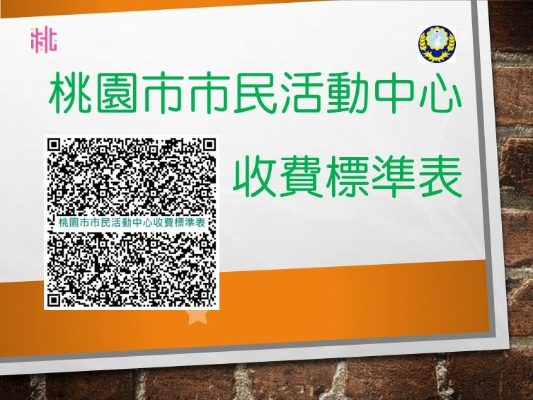

# 桃園市觀音區公所

- 網站：桃園市觀音區公所
- 原始網址：http://www.guanyin.tycg.gov.tw//
- 狀態：success
- 主題：地方產業與農漁業、觀光景點與活動
- 關鍵字：觀音區、桃園市、地方旅遊
- 擷取時間：2026-10-29T13:54:52.640834+00:00

## 清理後正文

:::
新竹區監理所提醒您：115年公路使用養護安全管理費自7月1日至7月31日開徵，請依期限繳納。
「公路法第二十七條修正案」業經立法院三讀通過，將「汽車燃料使用費」變更為「公路使用養護安全管理費」，請未來收到繳費單的車主朋友別驚慌，敬請安心繳費。
觀音區公所～歡迎您
熱門申辦
查編與農業經營不可分離土地作業申請書及要點
「114學年度促進電力發展營運協助金 獎學金」
育有未滿二歲兒童育兒津貼
身心障礙者生活補助費
低收及中低收入戶調查申辦說明
公寓大廈管理組織報備證明
更多
115-10-28
市政府就業職訓服務處中壢就業中心訂於115年11月11日（三）9時30分至12時30分辦理現場徵才活動，請廣為宣傳案。
115-10-27
桃園市觀音區第四屆里長候選人抽籤結果
115-10-27
農業部公告桃園市為辦理115年薔琵颱風農業天然災害現金救助及低利貸款地區
115-10-27
國防部115年「國防知性之旅－營區開放，誠摯邀請您一起參與
115-10-21
最高檢察署製作之「2026反賄選愛臺灣公益宣導影片-出遊篇-中選會版.mp4」
115-10-20
國防部115年全民國防教育「網際網路有獎徵答活動」海報修正
更多最新消息
市政信箱
路燈故障
公園、綠地及路樹養護
公園設施損壞
路樹傾倒
更多市政信箱
生活資訊
觀音區-115 年度高級中等以上學校學生獎助學金
幸福巴士路線圖
114年員工協助方案(EAP)
觀音區公所跨機關服務櫃檯
觀音區重病住院、喪葬補助
更多生活資訊
更多小廣告

## 圖片
-  — [原始圖片來源](https://ws.tycg.gov.tw/001/Upload/78/relpic/12794/1573354/91c29f32-1946-4f93-a88d-4e672579ade5.jpg) 
-  — [原始圖片來源](https://ws.tycg.gov.tw/001/Upload/78/relpic/12794/1270912/212a4dbd-852d-4906-a52f-e83c599d1b7b.jpg) 
-  — [原始圖片來源](https://ws.tycg.gov.tw/001/Upload/78/relpic/12795/871432/f1fcaab6-19e0-46d2-b347-2b5b3c62846f.jpg) 

## 頁面連結
- [回首頁](https://www.guanyin.tycg.gov.tw/Default.aspx)
- [網站導覽](https://www.guanyin.tycg.gov.tw/SiteMap.aspx)
- [桃園市政府](https://www.tycg.gov.tw)
- [English](https://eng.tycg.gov.tw/?ccms_cs=1)
- [Facebook](https://www.facebook.com/share.php)
- [Plurk](https://www.plurk.com/)
- [Twitter](https://twitter.com/intent/tweet)
- [Line](https://line.naver.jp/R/msg/text/)
- [進階搜尋](https://www.google.com.tw/advanced_search?hl=zh-Hant-tw&as_sitesearch=https://www.guanyin.tycg.gov.tw)
- [住院補助](https://www.guanyin.tycg.gov.tw/Advanced_Search.aspx?q=住院補助)
- [市民卡](https://www.guanyin.tycg.gov.tw/Advanced_Search.aspx?q=市民卡)
- [新竹區監理所提醒您：115年公路使用養護安全管理費自7月1日至7月31日開徵，請依期限繳納。](https://www.thb.gov.tw/cl.aspx?n=110)
- [「公路法第二十七條修正案」業經立法院三讀通過，將「汽車燃料使用費」變更為「公路使用養護安全管理費」，請未來收到繳費單的車主朋友別驚慌，敬請安心繳費。](https://ws.tycg.gov.tw/Download.ashx?u=LzAwMS9VcGxvYWQvNzgvcmVsZmlsZS8xMzMyMi8xNjE0MTE2L2M4YjM5NmM1LTcxZmYtNDQ3Mi1iZTc0LTQzZTk5NjRjMmJiYy5wZGY%3d&n=44CM5rG96LuK54eD5paZ5L2%2f55So6LK744CN5pu05ZCN54K644CM5YWs6Lev5L2%2f55So6aSK6K235a6J5YWo566h55CG6LK744CNLnBkZg%3d%3d)
- [https://www.guanyin.tycg.gov.tw/Common/GetVisitcount.ashx?n=8946&s=1573354&ur=61DCF69F39128326F77B59CCBDEF13DCAE7C4FC4DD482F13194A379646AD62515CB32A2F610F7EA935AC9DA199AB1A1D94E170EA29BD1CB38C4C5B34A53E2CD6BE1AF4DF4F5967CD](https://www.guanyin.tycg.gov.tw/Common/GetVisitcount.ashx?n=8946&s=1573354&ur=61DCF69F39128326F77B59CCBDEF13DCAE7C4FC4DD482F13194A379646AD62515CB32A2F610F7EA935AC9DA199AB1A1D94E170EA29BD1CB38C4C5B34A53E2CD6BE1AF4DF4F5967CD)
- [https://ws.tycg.gov.tw/Download.ashx?u=LzAwMS9VcGxvYWQvNzgvcmVsZmlsZS8xMTYzNC8xMjcwOTA3LzBlOWQ3ZjQ5LTNmYTktNGE5Mi04NDVhLTMyMTk0ZGJkY2M5Zi5wZGY%3d&n=5qGD5ZyS5biC5biC5rCR5rS75YuV5Lit5b%2bD5pS26LK75Z%2b65rqW6KGoLnBkZg%3d%3d&icon=.pdf](https://ws.tycg.gov.tw/Download.ashx?u=LzAwMS9VcGxvYWQvNzgvcmVsZmlsZS8xMTYzNC8xMjcwOTA3LzBlOWQ3ZjQ5LTNmYTktNGE5Mi04NDVhLTMyMTk0ZGJkY2M5Zi5wZGY%3d&n=5qGD5ZyS5biC5biC5rCR5rS75YuV5Lit5b%2bD5pS26LK75Z%2b65rqW6KGoLnBkZg%3d%3d&icon=.pdf)
- [https://www.youtube.com/watch?v=apHWEw_g-98](https://www.youtube.com/watch?v=apHWEw_g-98)
- [https://www.cdc.gov.tw/?aspxerrorpath=/diseaseinfo.aspx](https://www.cdc.gov.tw/?aspxerrorpath=/diseaseinfo.aspx)
- [查編與農業經營不可分離土地作業申請書及要點](https://www.guanyin.tycg.gov.tw/Common/GetVisitcount.ashx?n=9026&s=885830&ur=61DCF69F39128326F77B59CCBDEF13DCAE7C4FC4DD482F13194A379646AD625103621F8114C0DAFD9A02AE64977BC8C070EA1B469EE4FD450A19A3B192599766)
- [「114學年度促進電力發展營運協助金 獎學金」](https://ws.tycg.gov.tw/Download.ashx?u=LzAwMS9VcGxvYWQvNzgvcmVsZmlsZS8xMjg0NS8xNjEyMjcwLzg5ZjA3NTdhLTczMDctNDc2Mi1iNDZlLWIwNmFkMjBiNjViZi5wZGY%3d&n=44CMMTE05a245bm05bqm5L%2bD6YCy6Zu75Yqb55m85bGV54ef6YGL5Y2U5Yqp6YeRLnBkZg%3d%3d)
- [育有未滿二歲兒童育兒津貼](https://twbaby.sfaa.gov.tw/home/main)
- [身心障礙者生活補助費](https://e-services.tycg.gov.tw/TycgOnline/tycgOnline.action)
- [公寓大廈管理組織報備證明](https://e-services.tycg.gov.tw/TycgOnline/tycgOnline.action?func=description&aid=AP03030000001218)
- [115-10-28 市政府就業職訓服務處中壢就業中心訂於115年11月11日（三）9時30分至12時30分辦理現場徵才活動，請廣為宣傳案。](https://www.guanyin.tycg.gov.tw/News_Content.aspx?n=5607&s=1930578)
- [115-10-27 桃園市觀音區第四屆里長候選人抽籤結果](https://www.guanyin.tycg.gov.tw/News_Content.aspx?n=5607&s=1928162)
- [115-10-27 農業部公告桃園市為辦理115年薔琵颱風農業天然災害現金救助及低利貸款地區](https://www.guanyin.tycg.gov.tw/News_Content.aspx?n=5607&s=1927782)
- [115-10-27 國防部115年「國防知性之旅－營區開放，誠摯邀請您一起參與](https://www.guanyin.tycg.gov.tw/News_Content.aspx?n=5607&s=1927740)
- [115-10-21 最高檢察署製作之「2026反賄選愛臺灣公益宣導影片-出遊篇-中選會版.mp4」](https://www.guanyin.tycg.gov.tw/News_Content.aspx?n=5607&s=1914027)
- [115-10-20 國防部115年全民國防教育「網際網路有獎徵答活動」海報修正](https://www.guanyin.tycg.gov.tw/News_Content.aspx?n=5607&s=1911531)
- [路燈故障](https://taotalk.tycg.gov.tw/interface/Petition?channel=H_DEPC_380620000A&sc_Id=SC024)
- [公園、綠地及路樹養護](https://taotalk.tycg.gov.tw/interface/Petition?channel=H_DEPC_380620000A&sc_Id=SC028)
- [公園設施損壞](https://taotalk.tycg.gov.tw/interface/Petition?channel=H_DEPC_380620000A&sc_Id=SC026)
- [路樹傾倒](https://taotalk.tycg.gov.tw/interface/Petition?channel=H_DEPC_380620000A&sc_Id=SC027)
- [更多市政信箱](https://www.guanyin.tycg.gov.tw/News_Link.aspx?n=8945&sms=12793)
- [觀音區-115 年度高級中等以上學校學生獎助學金](https://www.guanyin.tycg.gov.tw/News_Content.aspx?n=6901&s=1573033)
- [幸福巴士路線圖](https://www.guanyin.tycg.gov.tw/News_Content.aspx?n=6901&s=1408079)
- [114年員工協助方案(EAP)](https://www.guanyin.tycg.gov.tw/News_Content.aspx?n=6901&s=1564588)
- [觀音區公所跨機關服務櫃檯](https://www.guanyin.tycg.gov.tw/News_Content.aspx?n=6901&s=759051)
- [觀音區重病住院、喪葬補助](https://www.guanyin.tycg.gov.tw/News_Content.aspx?n=6901&s=759047)
- [https://www.guanyin.tycg.gov.tw/Common/GetVisitcount.ashx?n=8947&s=871432&ur=F2CA057EEA38D537684C68055ABED80B](https://www.guanyin.tycg.gov.tw/Common/GetVisitcount.ashx?n=8947&s=871432&ur=F2CA057EEA38D537684C68055ABED80B)
- [https://www.guanyin.tycg.gov.tw/Common/GetVisitcount.ashx?n=8947&s=871433&ur=78DC7AADDE93D78F8428DCA99DCAC28742D4F4F0F8F0DE137BC63939F14A92C5](https://www.guanyin.tycg.gov.tw/Common/GetVisitcount.ashx?n=8947&s=871433&ur=78DC7AADDE93D78F8428DCA99DCAC28742D4F4F0F8F0DE137BC63939F14A92C5)
- [https://www.guanyin.tycg.gov.tw/Common/GetVisitcount.ashx?n=8947&s=871437&ur=92B3AC70D1435E8ACA42D222821EC661C9F09A99B96102E7A9490A8F1912324B0659290B0062FAB8](https://www.guanyin.tycg.gov.tw/Common/GetVisitcount.ashx?n=8947&s=871437&ur=92B3AC70D1435E8ACA42D222821EC661C9F09A99B96102E7A9490A8F1912324B0659290B0062FAB8)
- [https://www.ris.gov.tw/military-militaryInvestigation/app/conscriptSurvey/toMain](https://www.ris.gov.tw/military-militaryInvestigation/app/conscriptSurvey/toMain)
- [https://funeral.tycg.gov.tw/infosite](https://funeral.tycg.gov.tw/infosite)
- [https://www.oge.tycg.gov.tw/](https://www.oge.tycg.gov.tw/)
- [https://www.facebook.com/guanyinOffice](https://www.facebook.com/guanyinOffice)
- [https://www.nhi.gov.tw/](https://www.nhi.gov.tw/)
- [https://med.nhi.gov.tw/ihke0000/IHKE0100S01.aspx](https://med.nhi.gov.tw/ihke0000/IHKE0100S01.aspx)
- [https://tyoem.tycg.gov.tw/](https://tyoem.tycg.gov.tw/)
- [更多小廣告](https://www.guanyin.tycg.gov.tw/News_Link.aspx?n=9025&sms=12844)
- [觀音區介紹](https://www.guanyin.tycg.gov.tw/cl.aspx?n=6871)
- [認識本區](https://www.guanyin.tycg.gov.tw/cl.aspx?n=6872)
- [觀光旅遊資訊](https://www.guanyin.tycg.gov.tw/cl.aspx?n=6875)
- [本所組織介紹](https://www.guanyin.tycg.gov.tw/cl.aspx?n=6879)
- [本所沿革](https://www.guanyin.tycg.gov.tw/cp.aspx?n=6884)
- [未來展望](https://www.guanyin.tycg.gov.tw/cp.aspx?n=6885)
- [訊息公告](https://www.guanyin.tycg.gov.tw/cl.aspx?n=5606)
- [最新消息](https://www.guanyin.tycg.gov.tw/News.aspx?n=5607&sms=10729)
- [活動相簿](https://www.guanyin.tycg.gov.tw/News_Photo.aspx?n=6887&sms=11629)
- [RSS訂閱](https://www.guanyin.tycg.gov.tw/cp.aspx?n=6888)
- [錄取公告](https://www.guanyin.tycg.gov.tw/News.aspx?n=20131&sms=19434)
- [徵才資訊](https://www.guanyin.tycg.gov.tw/News.aspx?n=6958&sms=11676)
- [生活便民資訊](https://www.guanyin.tycg.gov.tw/cl.aspx?n=6890)
- [各類申辦](https://www.guanyin.tycg.gov.tw/ENews.aspx?n=6891&sms=11630)
- [法規資料](https://www.guanyin.tycg.gov.tw/cl.aspx?n=6892)
- [常見問答](https://www.guanyin.tycg.gov.tw/News.aspx?n=6897&sms=11633)
- [下載專區](https://www.guanyin.tycg.gov.tw/cl.aspx?n=6898)
- [生活資訊](https://www.guanyin.tycg.gov.tw/News.aspx?n=6901&sms=11636)
- [福利補助](https://swimspublic.tycg.gov.tw/)
- [防災專區](https://www.guanyin.tycg.gov.tw/cl.aspx?n=6903)
- [廉政服務專區](https://www.guanyin.tycg.gov.tw/cl.aspx?n=6912)
- [性別主流化專區](https://www.guanyin.tycg.gov.tw/News.aspx?n=6920&sms=11651)
- [檔案應用](https://www.guanyin.tycg.gov.tw/cl.aspx?n=6921)
- [安全社區推動中心](https://www.guanyin.tycg.gov.tw/cl.aspx?n=6924)
- [重大計畫進度查詢](https://reiso.tycg.gov.tw/)
- [兒童權利公約CRC專區](https://www.guanyin.tycg.gov.tw/cl.aspx?n=24541)
- [社會福利相關政令宣導](https://www.guanyin.tycg.gov.tw/News.aspx?n=6942&sms=11667)
- [兒童及少年發展帳戶專區](https://www.guanyin.tycg.gov.tw/News.aspx?n=6944&sms=11669)
- [強化社會安全網專區](https://www.guanyin.tycg.gov.tw/News.aspx?n=6946&sms=11671)
- [台電促協金公告](https://www.guanyin.tycg.gov.tw/cl.aspx?n=6947)
- [陳情案件統計表](https://www.guanyin.tycg.gov.tw/News.aspx?n=21150&sms=19627)
- [統計表專區](https://www.guanyin.tycg.gov.tw/News.aspx?n=21153&sms=20287)
- [員工專區](https://www.guanyin.tycg.gov.tw/cl.aspx?n=23716)
- [桃園市免費低劑量肺癌篩檢](https://www.guanyin.tycg.gov.tw/cl.aspx?n=24105)
- [機關通訊錄](https://www.guanyin.tycg.gov.tw/cl.aspx?n=6949)
- [聯絡資訊](https://www.guanyin.tycg.gov.tw/cp.aspx?n=6950)
- [市政信箱](https://taotalk.tycg.gov.tw/interface/Petition?channel=H_DEPC_380620000A)
- [相關資料](https://www.guanyin.tycg.gov.tw/cl.aspx?n=6953)
- [資訊公開](https://www.guanyin.tycg.gov.tw/cp.aspx?n=6954)
- [個人資料保護專區](https://www.guanyin.tycg.gov.tw/News.aspx?n=6955&sms=11673)
- [影音專區](https://www.guanyin.tycg.gov.tw/News_Video.aspx?n=6956&sms=11674)
- [招標公告](https://www.guanyin.tycg.gov.tw/News.aspx?n=6957&sms=11675)
- [相關連結](https://www.guanyin.tycg.gov.tw/News_Link.aspx?n=6959&sms=11677)
- [遊說資訊專區](https://www.guanyin.tycg.gov.tw/News.aspx?n=6960&sms=11678)
- [出版品](https://www.guanyin.tycg.gov.tw/News.aspx?n=6961&sms=11679)
- [會計資料專區](https://www.guanyin.tycg.gov.tw/cl.aspx?n=6962)
- [勞工專區](https://www.guanyin.tycg.gov.tw/News.aspx?n=6970&sms=11687)
- [重大政策](https://www.guanyin.tycg.gov.tw/cl.aspx?n=24027)
- [隱私權政策](https://www.tycg.gov.tw/cp.aspx?n=5845&s=1312&ccms_cs=1&state=1C5D152DDF4F3ED0)
- [政府網站資料開放宣告](https://www.tycg.gov.tw/cp.aspx?n=5847&s=1314&ccms_cs=1&state=1C5D152DDF4F3ED0)
- [網站安全政策](https://www.tycg.gov.tw/cp.aspx?n=5846&s=1313&ccms_cs=1&state=1C5D152DDF4F3ED0)

> 備註：進階解析失敗，已使用內建解析器：AttributeError: 'NoneType' object has no attribute 'get'
