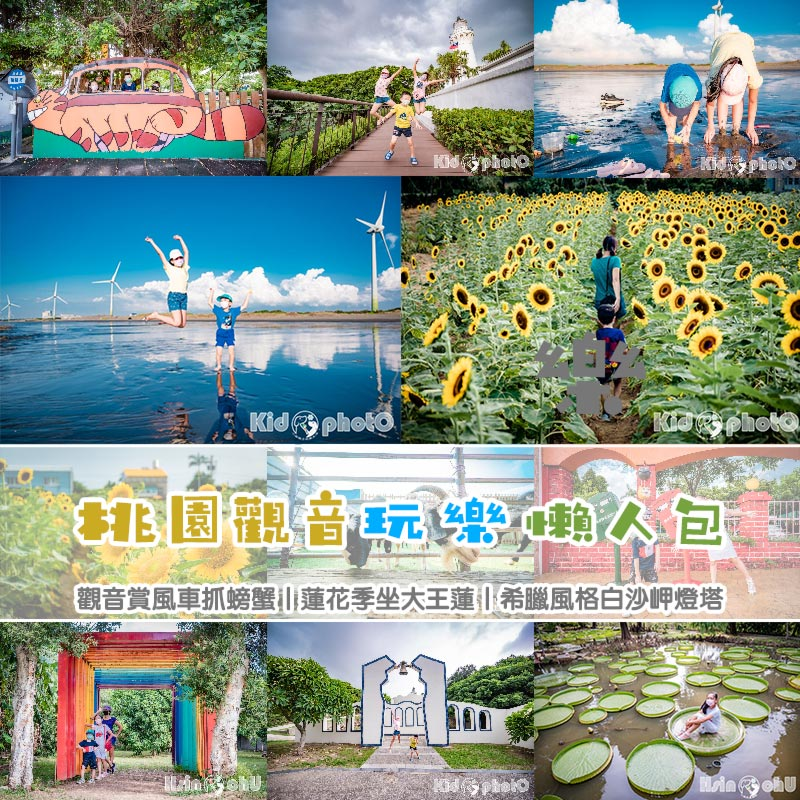
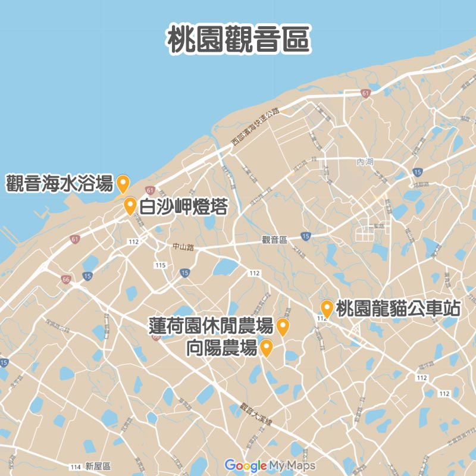
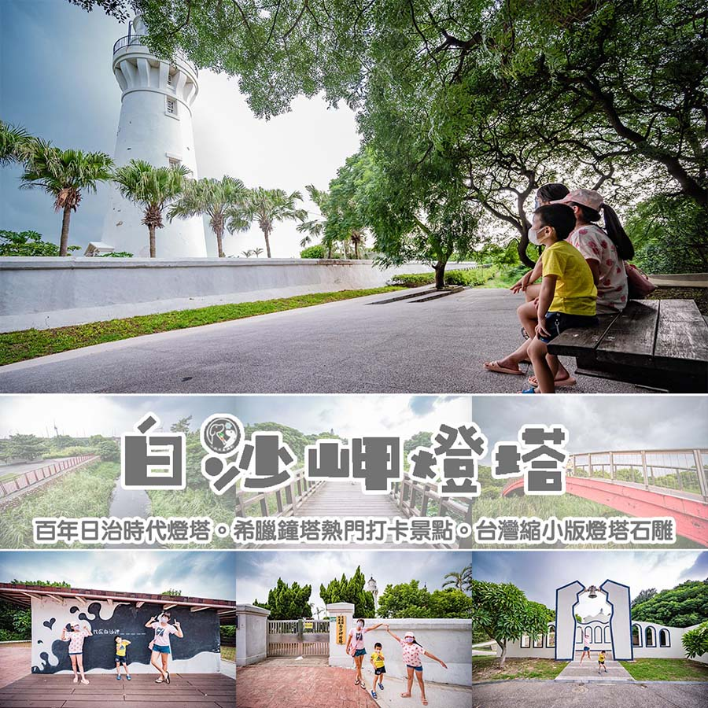

#   桃園觀音玩樂懶人包〡觀音賞風車抓螃蟹, 蓮花季坐大王蓮, 希臘風格白沙岬燈塔, 觀音旅遊地圖

- 網站：小菲親子玩樂生活
- 原始網址：https://natsuphil.com/fun-taiwan/guanyin/
- 狀態：success
- 作者：natsuphil0222@gmail.com
- 發表日期：2025-09-26T08:39:52+08:00
- 主題：自然景觀與生態、地方產業與農漁業、觀光景點與活動
- 關鍵字：觀音區、桃園市、草漯沙丘、藻礁、白沙岬燈塔
- 擷取時間：2026-10-29T13:54:59.191740+00:00

## 清理後正文

桃園觀音玩樂懶人包〡觀音賞風車抓螃蟹, 蓮花季坐大王蓮, 希臘風格白沙岬燈塔, 觀音旅遊地圖
[email protected]
2025-12-07T22:29:27+08:00
26 9 月, 2025
|
Categories:
景點懶人包
|
Tags:
桃園好拍好玩
,
鄉鎮市懶人包
|
平常很少來桃園觀音的黃小菲，最近玩了幾個景點之後，發現觀音原來也可以這麼好玩，有海邊、有燈塔、還有超大的農場，所有的景點都非常適合親子一起來玩。想來桃園玩找不到景點的人，不如來安排個觀音一日遊吧。
桃園觀音〡地圖導覽
白沙岬燈塔〡百年日治時代燈塔
觀音濱海遊憩區〡風車搭配唯美夕陽
龍貓公車站〡重回宮崎駿動畫場景
蓮荷園休閒農場〡體驗六師弟大王蓮輕功水上漂
向陽農場〡萬坪向日葵主場農場
觀新藻礁〡探索潮間帶生態奧秘
水之丘公園〡會甩尾的溜滑梯
草漯沙丘展示館〡互動體驗設施
桃園市觀音區景點
白沙岬燈塔〡百年日治時代燈塔
日治時代就已經是熱門景點的「白沙岬燈塔」，它位於「觀音海岸」是台灣國定古蹟，也是目前保存最完整的日治燈塔。其燈塔高度僅次於墾丁「鵝鑾鼻燈塔」約37公尺高。燈塔周圍有環行步道、觀景台、休憩涼亭等…，讓遊客除了一覽燈塔全貌之外，還可以散步、賞景，附近還有「觀音海水浴場」，可以玩水、也可以帶小朋友一起觀察大自然的潮間帶生態。假日來西部海岸時，別忘了這個親子同遊的好去處。
詳細文章：
https://natsuphil.com/taoyuan/baisha-cape/
景點位置：桃園市觀音區光明路216號。
[Google導航地圖]
觀音濱海遊憩區〡風車搭配唯美夕陽
位在桃園觀音的「觀音濱海遊憩區」，是由原先的「觀音海水浴場」轉型而成。這裡一望無際的大海、寬廣遼闊的沙灘，加上一排排白色的風車，配搭起來形成一幅美麗的畫。日落時分陽光斜照時，形成一面鏡面沙灘，宛如天空之鏡，將風車、白雲、藍天的倒影，印照在上面，真的超美。平坦的沙灘、超長的海岸線，也讓小朋友們可以安全、方便的觀察小蟹、小魚。是一個超適合親子同遊戲水、觀察潮間帶的好地方。
詳細文章：
https://natsuphil.com/hualian/beibin-park/
景點位置：桃園市觀音區台61線周邊。
[Google導航地圖]
龍貓公車站〡重回宮崎駿動畫場景
相信宮崎駿動畫「龍貓」大家一定都有看過，其中有一幕經典中的經典就是「大龍貓拿著雨傘在公車站牌等龍貓公車」，而這樣的畫面就出現在桃園觀音的一座幼兒園的牆面，也吸引了許多遊客前來拍照，除了逼真的龍貓公車站之外，幼兒園的外圍都是可愛的招牌和裝飾，就連上課的地方也繽紛到讓人驚艷，黃小菲心想「還真想讓孩子們在這裡念書呢」。
詳細文章：
https://natsuphil.com/hualian/lichuan-fish/
景點位置：桃園市觀音區中山路二段239號。
[Google導航地圖]
蓮荷園休閒農場〡體驗六師弟大王蓮輕功水上漂
桃園觀音鄉是蓮花的故鄉，而蓮荷園以「你坐蓮，我渡人」的宗旨，打造一座占地2公頃的休閒農場，裡面有大片的蓮花池、稻草博物館、五行八卦迷宮等… 景點，還有些戶外造景提供你拍照。最熱門的就是大王蓮水上漂，只要付銅板價就能像「少林足球」裡的六師弟一樣，平穩的坐在上面、躺在上面、就算金雞獨立也沒問題。其中焢窯、稻草手作也是熱門的親子活動，還有還有，特別是夏季來臨時，來碗特有的健康養身的南瓜蓮子冰，讓人更加的清涼無比。
詳細文章：
https://natsuphil.com/hualian/lichuan-fish/
景點位置：桃園市觀音區金華路690號。
[Google導航地圖]
向陽農場〡萬坪向日葵主場農場
每年五月到十月正是向日葵的花季（依天氣狀況，花況不盡相同），說到賞向日葵的景點，大多數北部人第一個聯想到的都是桃園觀音「向陽農場」，它也是目前北台灣最大的向日葵主題農場，雖沒有到花海等級，但品種很多，可以一次收集起來。除了可以欣賞到不同種類的向日葵之外，也可以在千坪向日葵花海中美拍，園內也提供相當多的活動、設施，像是餵山羊、射箭場、漆彈場、大型烤肉、採集蔬果等…，還有小朋友最愛的小火車塔乘。這麼多項的活動、體驗，讓向陽農場就像是座戶外的大型遊樂園，趕緊跟著黃小菲一同進入這夏末必賞的向日葵花海吧。
詳細文章：
https://natsuphil.com/hualian/lichuan-fish/
農場位置：桃園市觀音區藍埔里11鄰52號。
[Google導航地圖]
觀新藻礁生態區〡探索潮間帶生態奧秘
全臺灣最大區域的藻礁區，就在桃園
觀音
和
新屋
沿岸，除了大自然賦予的天然地景，豐富、多元的生物也是觀新藻礁特別的地方，據說在這裡的生物密度是高美濕地的5倍、香山濕地的8倍喔！
詳細文章：
https://natsuphil.com/taoyuan/guanxin-sea/
景點位置：
觀新藻礁生態區：涵蓋桃園市觀音區保生村、桃園市新屋區永興村及永安村，並分為核心區、緩衝區與永續利用區。
[Google導航地圖]
藻礁生態環境教室：桃園市新屋區東興路二段1800巷160號。〔
Google導航地圖
〕
水之丘公園〡會甩尾的溜滑梯
外觀不是很討喜的飼料桶溜滑梯沒想到這麼好玩，而且連大人都可以溜！「水之丘公園」裡也有洗手間，大小朋友都可以玩更久了，若夏季前往，也要記得適時補充水分和做好防曬喔~(2025公園旁出現麥當勞，更方便了。)
詳細文章：
https://natsuphil.com/taoyuan/water-mound-park/
景點位置：桃園市觀音區台15線402號。
[Google導航地圖]
或 Google map 搜尋 [水之丘公園]
草漯沙丘展示館〡玩中學學中玩
草漯沙丘觀音展示館就在桃園觀音濱海遊憩區的旁邊而已，有剛好來抓蟹踏水或賞夕陽的朋友們也可以進去參觀看看喔~除了一小區的互動體驗，另外還有一間視聽室，教室裡有開冷氣非常涼，座位也不少，在此區休息一下也蠻不錯的。
詳細文章：
https://natsuphil.com/taoyuan/caota-dune-indoor/
景點位置：桃園市觀音區中興路469號。
[Google導航地圖]
或 Google map 搜尋 [草漯沙丘地景展示館]
關於〡黃小菲
愛拍照的黃小菲，喜歡用照片說故事，最愛帶著一家四口到處走走拍拍
用質感最高的畫面，細膩生動的文字，帶領你進入黃小菲的親子玩樂生活
喜歡黃小菲用心拍攝的照片或是逗趣文章內容的朋友們，記得來FB粉絲團點個讚喔
聯絡信箱：
[email protected]
小菲兒童親子隨拍
評論
3
3/5 - (2 votes)
2位網友投票評論
關於本文評論的商家、商品、景點、議題、方法，你給幾顆星呢？
歡迎一起點擊星號參與評論唷！
按讚加入粉絲團
留言
取消回覆
Comment
Save my name, email, and website in this browser for the next time I comment.

## 圖片
-  — [原始圖片來源](https://natsuphil.com/wp-content/uploads/2021/10/guanyin_F1.jpg) 
-  — [原始圖片來源](https://natsuphil.com/wp-content/uploads/2021/10/LoFi-Land_F1.jpg) 
-  — [原始圖片來源](https://natsuphil.com/wp-content/uploads/2021/07/baisha-cape_F1-1.jpg) 

## 頁面連結
- [玩樂基隆](https://natsuphil.com/keelung/)
- [玩樂新北](https://natsuphil.com/new-taipei/)
- [八里玩樂懶人包](https://natsuphil.com/fun-taiwan/bali/)
- [石門玩樂懶人包](https://natsuphil.com/fun-taiwan/shimen/)
- [新北步道懶人包](https://natsuphil.com/fun-trail/new-taipei/)
- [玩樂台北](https://natsuphil.com/taipei/)
- [台北公園懶人包](https://natsuphil.com/fun-park/mrt-red/)
- [玩樂桃園](https://natsuphil.com/taoyuan/)
- [玩樂新竹](https://natsuphil.com/hsinchu/)
- [玩樂苗栗](https://natsuphil.com/miaoli/)
- [玩樂台中](https://natsuphil.com/taichung/)
- [玩樂彰化](https://natsuphil.com/changhua/)
- [芳苑玩樂懶人包](https://natsuphil.com/fun-taiwan/fangyuan/)
- [玩樂南投](https://natsuphil.com/nantou/)
- [玩樂雲林](https://natsuphil.com/yunlin/)
- [玩樂嘉義](https://natsuphil.com/chiayi/)
- [玩樂台南](https://natsuphil.com/tainan/)
- [將軍玩樂懶人包](https://natsuphil.com/fun-taiwan/jiangjun/)
- [楠西玩樂懶人包](https://natsuphil.com/fun-taiwan/nanxi/)
- [玩樂高雄](https://natsuphil.com/kaohsiung/)
- [玩樂屏東](https://natsuphil.com/pingdong/)
- [玩樂宜蘭](https://natsuphil.com/yilan/)
- [玩樂花蓮](https://natsuphil.com/hualian/)
- [花蓮玩樂懶人包](https://natsuphil.com/fun-taiwan/hualien/)
- [玩樂台東](https://natsuphil.com/taitung/)
- [鄉鎮懶人包](https://natsuphil.com/tag/鄉鎮市懶人包)
- [全台懶人包](https://natsuphil.com/tag/全台灣懶人包)
- [公園懶人包](https://natsuphil.com/tag/全公園懶人包)
- [步道懶人包](https://natsuphil.com/tag/全步道懶人包)
- [在家玩什麼](https://natsuphil.com/category/kid-fun/)
- [[email protected]](https://natsuphil.com/author/natsuphil0222gmail-com/)
- [景點懶人包](https://natsuphil.com/category/fun-taiwan/)
- [白沙岬燈塔〡百年日治時代燈塔](https://natsuphil.com/taoyuan/guanyin/)
- [[Google導航地圖]](https://goo.gl/maps/ouUtDXDsMRsrQ1m88)
- [https://natsuphil.com/taoyuan/baisha-cape/](https://natsuphil.com/taoyuan/baisha-cape/)
- [[Google導航地圖]](https://goo.gl/maps/435JEidF9mqPMnYP7)
- [https://natsuphil.com/hualian/beibin-park/](https://natsuphil.com/taoyuan/guanyin-sea/)
- [[Google導航地圖]](https://goo.gl/maps/oAwbkC8Gi8KAam3TA)
- [https://natsuphil.com/hualian/lichuan-fish/](https://natsuphil.com/taoyuan/totoro-bus/)
- [[Google導航地圖]](https://goo.gl/maps/YHsYYj1ZUDxSF8Kr9)
- [https://natsuphil.com/hualian/lichuan-fish/](https://natsuphil.com/taoyuan/lotus-farm/)
- [[Google導航地圖]](https://goo.gl/maps/zePxL446VkwSEHxw6)
- [https://natsuphil.com/hualian/lichuan-fish/](https://natsuphil.com/taoyuan/sun-green/)
- [[Google導航地圖]](https://goo.gl/maps/vBFVfEr4ZWCXG89a7)
- [Google導航地圖](https://www.google.com/maps/place/%E8%97%BB%E7%A4%81%E7%94%9F%E6%85%8B%E7%92%B0%E5%A2%83%E6%95%99%E5%AE%A4/@25.0162862,121.0341994,17z/data=!3m1!4b1!4m6!3m5!1s0x34682fceca2f1329:0x3d0744cd00924e1e!8m2!3d25.0162862!4d121.0367743!16s%2Fg%2F11j4w3gcm8!5m1!1e1?entry=ttu&g_ep=EgoyMDI1MDQyMy4wIKXMDSoJLDEwMjExNDU1SAFQAw%3D%3D)
- [https://natsuphil.com/taoyuan/guanxin-sea/](https://natsuphil.com/taoyuan/guanxin-sea/)
- [[Google導航地圖]](https://goo.gl/maps/Ca53e5vcGRatg866A)
- [https://natsuphil.com/taoyuan/water-mound-park/](https://natsuphil.com/taoyuan/water-mound-park/)
- [[Google導航地圖]](https://goo.gl/maps/qfiH3zi4FUvXgpsL6)
- [https://natsuphil.com/taoyuan/caota-dune-indoor/](https://natsuphil.com/taoyuan/caota-dune-indoor/)
- [台61線濱海懶人包〡西濱公路沿海景點, 海邊親子戲水, 潮間帶濕地觀察, 在地觀光漁港, 沿海景觀燈塔](https://natsuphil.com/fun-taiwan/61-line-north/)
- [新北步道懶人包〡十條以上精選登山步道, 挑戰步道順便欣賞山海美景, 親子假日休閒好去處](https://natsuphil.com/fun-taiwan/new-taipei/)
- [全台灣燈塔懶人包〡全台灣從北到南最極端燈塔, 全台灣最高的燈塔最年輕的燈塔](https://natsuphil.com/fun-taiwan/cape/)
- [高雄玩樂懶人包〡海洋首都魅力無窮, 人文古蹟包羅萬象, 暢玩特色親子公園, 攜手探索著名景點, 沉浸式體驗的感動](https://natsuphil.com/fun-taiwan/kaohsiung/)
- [新北瑞芳懶人包〡東北角山海一線天美景, 南雅天然地質奇岩, 搭採煤礦車深度體驗, 絕美山中咖啡廳喝下午茶, 深澳鐵道光雕自行車](https://natsuphil.com/fun-taiwan/ruifang/)
- [彰化市區玩樂懶人包〡八卦山風景區一次玩, 全台唯一扇形車庫, 造型主題遊戲場](https://natsuphil.com/fun-taiwan/changhua/)
- [新北鶯歌玩樂懶人包〡陶瓷藝術滿城鄉, 玩陶賞陶樂悠悠, 藝術展館陶冶性情, 特色公園放電趣, 持續更新中](https://natsuphil.com/fun-taiwan/yingge-town/)
- [南臺灣特色公園懶人包〡 親子特色公園大集合, 比造型外還要尬好玩度, 在地特色一目了然, 南部公園趴趴GO](https://natsuphil.com/fun-taiwan/south-taiwan-park/)
- [全公園懶人包](https://natsuphil.com/tag/%e5%85%a8%e5%85%ac%e5%9c%92%e6%87%b6%e4%ba%ba%e5%8c%85/)
- [全台灣懶人包](https://natsuphil.com/tag/%e5%85%a8%e5%8f%b0%e7%81%a3%e6%87%b6%e4%ba%ba%e5%8c%85/)
- [南投好拍好玩](https://natsuphil.com/tag/%e5%8d%97%e6%8a%95%e5%a5%bd%e6%8b%8d%e5%a5%bd%e7%8e%a9/)
- [台中好住好睡](https://natsuphil.com/tag/%e5%8f%b0%e4%b8%ad%e5%a5%bd%e4%bd%8f%e5%a5%bd%e7%9d%a1/)
- [台中好拍好玩](https://natsuphil.com/tag/%e5%8f%b0%e4%b8%ad%e5%a5%bd%e6%8b%8d%e5%a5%bd%e7%8e%a9/)
- [台北好拍好玩](https://natsuphil.com/tag/%e5%8f%b0%e5%8c%97%e5%a5%bd%e6%8b%8d%e5%a5%bd%e7%8e%a9/)
- [台南好住好睡](https://natsuphil.com/tag/%e5%8f%b0%e5%8d%97%e5%a5%bd%e4%bd%8f%e5%a5%bd%e7%9d%a1/)
- [台南好吃好喝](https://natsuphil.com/tag/%e5%8f%b0%e5%8d%97%e5%a5%bd%e5%90%83%e5%a5%bd%e5%96%9d/)
- [台南好拍好玩](https://natsuphil.com/tag/%e5%8f%b0%e5%8d%97%e5%a5%bd%e6%8b%8d%e5%a5%bd%e7%8e%a9/)
- [台東好拍好玩](https://natsuphil.com/tag/%e5%8f%b0%e6%9d%b1%e5%a5%bd%e6%8b%8d%e5%a5%bd%e7%8e%a9/)
- [嘉義好拍好玩](https://natsuphil.com/tag/%e5%98%89%e7%be%a9%e5%a5%bd%e6%8b%8d%e5%a5%bd%e7%8e%a9/)
- [基隆好拍好玩](https://natsuphil.com/tag/%e5%9f%ba%e9%9a%86%e5%a5%bd%e6%8b%8d%e5%a5%bd%e7%8e%a9/)
- [宜蘭好拍好玩](https://natsuphil.com/tag/%e5%ae%9c%e8%98%ad%e5%a5%bd%e6%8b%8d%e5%a5%bd%e7%8e%a9/)
- [屏東好拍好玩](https://natsuphil.com/tag/%e5%b1%8f%e6%9d%b1%e5%a5%bd%e6%8b%8d%e5%a5%bd%e7%8e%a9/)
- [彰化好吃好喝](https://natsuphil.com/tag/%e5%bd%b0%e5%8c%96%e5%a5%bd%e5%90%83%e5%a5%bd%e5%96%9d/)
- [彰化好拍好玩](https://natsuphil.com/tag/%e5%bd%b0%e5%8c%96%e5%a5%bd%e6%8b%8d%e5%a5%bd%e7%8e%a9/)
- [新北好吃好喝](https://natsuphil.com/tag/%e6%96%b0%e5%8c%97%e5%a5%bd%e5%90%83%e5%a5%bd%e5%96%9d/)
- [新北好拍好玩](https://natsuphil.com/tag/%e6%96%b0%e5%8c%97%e5%a5%bd%e6%8b%8d%e5%a5%bd%e7%8e%a9/)
- [新竹好拍好玩](https://natsuphil.com/tag/%e6%96%b0%e7%ab%b9%e5%a5%bd%e6%8b%8d%e5%a5%bd%e7%8e%a9/)
- [桃園好拍好玩](https://natsuphil.com/tag/%e6%a1%83%e5%9c%92%e5%a5%bd%e6%8b%8d%e5%a5%bd%e7%8e%a9/)
- [花蓮好住好睡](https://natsuphil.com/tag/%e8%8a%b1%e8%93%ae%e5%a5%bd%e4%bd%8f%e5%a5%bd%e7%9d%a1/)
- [花蓮好吃好喝](https://natsuphil.com/tag/%e8%8a%b1%e8%93%ae%e5%a5%bd%e5%90%83%e5%a5%bd%e5%96%9d/)
- [花蓮好拍好玩](https://natsuphil.com/tag/%e8%8a%b1%e8%93%ae%e5%a5%bd%e6%8b%8d%e5%a5%bd%e7%8e%a9/)
- [苗栗好住好睡](https://natsuphil.com/tag/%e8%8b%97%e6%a0%97%e5%a5%bd%e4%bd%8f%e5%a5%bd%e7%9d%a1/)
- [苗栗好拍好玩](https://natsuphil.com/tag/%e8%8b%97%e6%a0%97%e5%a5%bd%e6%8b%8d%e5%a5%bd%e7%8e%a9/)
- [親子主題公園](https://natsuphil.com/tag/%e8%a6%aa%e5%ad%90%e4%b8%bb%e9%a1%8c%e5%85%ac%e5%9c%92/)
- [親子休閒農場](https://natsuphil.com/tag/%e8%a6%aa%e5%ad%90%e4%bc%91%e9%96%92%e8%be%b2%e5%a0%b4/)
- [親子創意遊戲](https://natsuphil.com/tag/%e8%a6%aa%e5%ad%90%e5%89%b5%e6%84%8f%e9%81%8a%e6%88%b2/)
- [親子商品開箱](https://natsuphil.com/tag/%e8%a6%aa%e5%ad%90%e5%95%86%e5%93%81%e9%96%8b%e7%ae%b1/)
- [親子在地小吃](https://natsuphil.com/tag/%e8%a6%aa%e5%ad%90%e5%9c%a8%e5%9c%b0%e5%b0%8f%e5%90%83/)
- [親子室內樂園](https://natsuphil.com/tag/%e8%a6%aa%e5%ad%90%e5%ae%a4%e5%85%a7%e6%a8%82%e5%9c%92/)
- [親子廟宇老街](https://natsuphil.com/tag/%e8%a6%aa%e5%ad%90%e5%bb%9f%e5%ae%87%e8%80%81%e8%a1%97/)
- [親子樂園飯店](https://natsuphil.com/tag/%e8%a6%aa%e5%ad%90%e6%a8%82%e5%9c%92%e9%a3%af%e5%ba%97/)
- [親子活動展覽](https://natsuphil.com/tag/%e8%a6%aa%e5%ad%90%e6%b4%bb%e5%8b%95%e5%b1%95%e8%a6%bd/)
- [親子海水浴場](https://natsuphil.com/tag/%e8%a6%aa%e5%ad%90%e6%b5%b7%e6%b0%b4%e6%b5%b4%e5%a0%b4/)
- [親子濱海景點](https://natsuphil.com/tag/%e8%a6%aa%e5%ad%90%e6%bf%b1%e6%b5%b7%e6%99%af%e9%bb%9e/)
- [親子特色景點](https://natsuphil.com/tag/%e8%a6%aa%e5%ad%90%e7%89%b9%e8%89%b2%e6%99%af%e9%bb%9e/)
- [親子登山步道](https://natsuphil.com/tag/%e8%a6%aa%e5%ad%90%e7%99%bb%e5%b1%b1%e6%ad%a5%e9%81%93/)
- [親子美食餐廳](https://natsuphil.com/tag/%e8%a6%aa%e5%ad%90%e7%be%8e%e9%a3%9f%e9%a4%90%e5%bb%b3/)
- [親子藝術園區](https://natsuphil.com/tag/%e8%a6%aa%e5%ad%90%e8%97%9d%e8%a1%93%e5%9c%92%e5%8d%80/)
- [親子觀光工廠](https://natsuphil.com/tag/%e8%a6%aa%e5%ad%90%e8%a7%80%e5%85%89%e5%b7%a5%e5%bb%a0/)
- [親子野外露營](https://natsuphil.com/tag/%e8%a6%aa%e5%ad%90%e9%87%8e%e5%a4%96%e9%9c%b2%e7%87%9f/)

> 備註：進階解析失敗，已使用內建解析器：AttributeError: 'NoneType' object has no attribute 'get'
