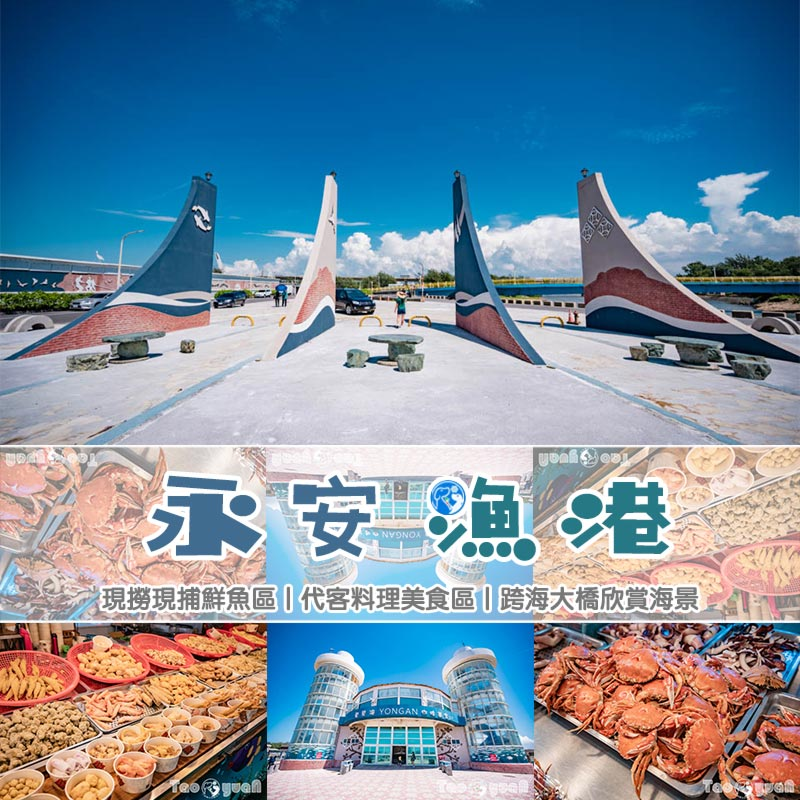
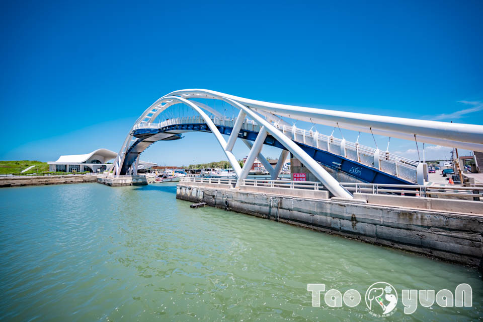
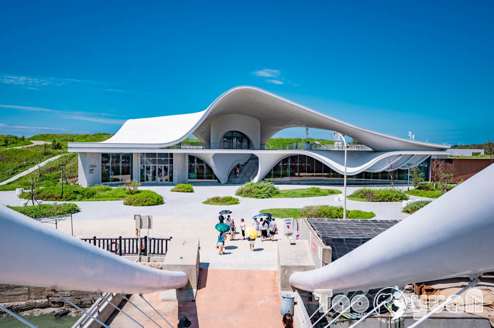
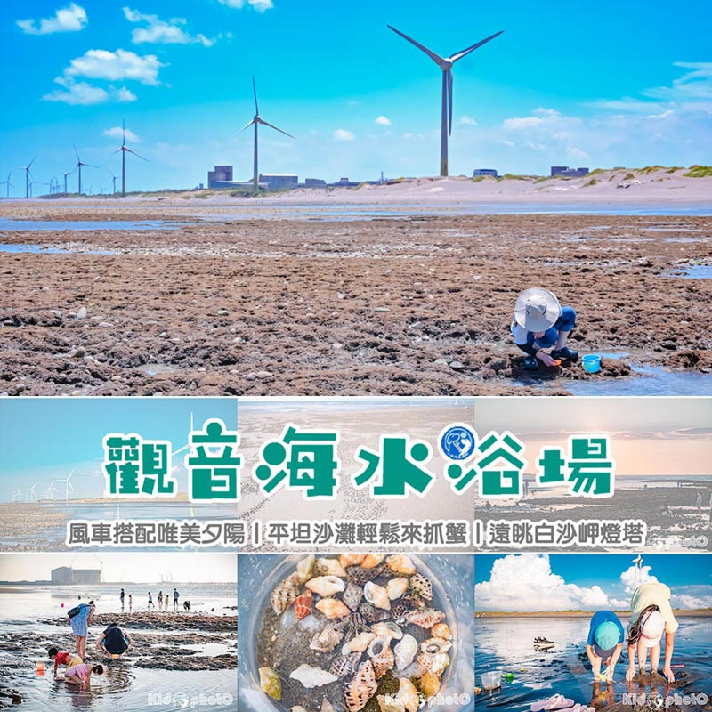
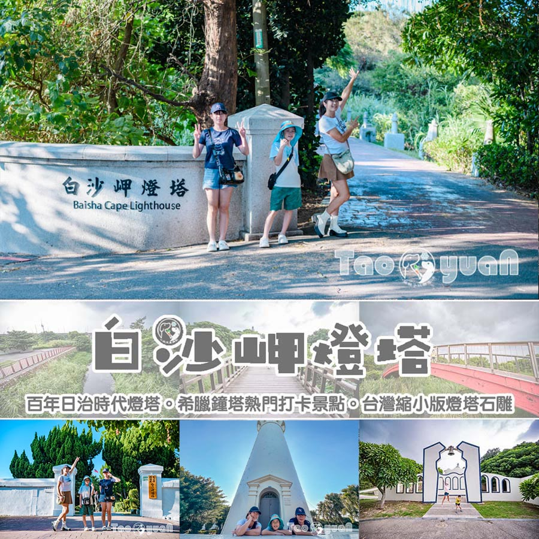

#   桃園新屋景點〡永安漁港〡永安觀海橋360度視角, 觀海亭木棧步道賞海景, 鄰近海螺文化館, 生鮮熟食乾貨通通有, 美食街也能代客料理

- 網站：小菲親子玩樂生活
- 原始網址：https://natsuphil.com/taoyuan/yongan-harbor/
- 狀態：success
- 作者：natsuphil0222@gmail.com
- 發表日期：2026-08-29T13:28:21+08:00
- 主題：自然景觀與生態、歷史文化與信仰、地方產業與農漁業
- 關鍵字：觀音區、桃園市、草漯沙丘、藻礁、白沙岬燈塔
- 擷取時間：2026-10-29T13:55:01.829716+00:00

## 清理後正文

桃園新屋景點〡永安漁港〡永安觀海橋360度視角, 觀海亭木棧步道賞海景, 鄰近海螺文化館, 生鮮熟食乾貨通通有, 美食街也能代客料理
[email protected]
2026-08-31T10:46:46+08:00
29 8 月, 2026
|
Categories:
玩樂桃園
|
Tags:
桃園好拍好玩
,
親子濱海景點
|
桃園新屋〡永安漁港
越來越多漁港擺脫傳統的五味雜陳、髒亂濕黏的環境，轉型為乾淨舒適、結合周邊景點，或和漁港做連結規劃相關活動，逐漸朝休閒漁港在轉型。
「永安漁港」
原本就已是許多遊客假日會特別前往的景點，加上美感十足的
永安海螺文化館
浪漫落成，讓
「永安漁港」
越來越熱鬧了。
永安漁港〡相關資訊
景點位置：桃園市新屋區中山西路三段1165號。
[Google導航地圖]
或 Google map 搜尋 [永安漁港]
停車資訊：永安漁港停車場。
[Google導航地圖]
營業時間：
星期二 、三、四、五、六、日， 08：00 ~ 18：00
星期一，公休
各店家(熟食、乾貨、漁獲) 營業時間略有不同
連絡電話：03-486-1952
票價資訊：免費入場
公共設施：[有] 公共廁
所〡[有] 販賣區〡[有] 休憩區
官方連結：
[官方網站]
桃園還有哪裡好玩
桃園市景點
桃園觀音區懶人包
白沙岬燈塔
觀新藻礁生態區
蓮荷園休閒農場
草漯沙丘觀音展示館
羊稠森林步道
大有梯田生態公園
竹圍漁港
水之丘主題公園
桃園立市兒童美術館
大溪老街
溪海休閒農業園區
大嵙崁親水園區
威大宮
許厝港濕地
永安海螺文化館
永安漁港
全台懶人包系列
全台灣燈塔懶人包
台61線濱海懶人包
北部室內樂園懶人包
北部海邊戲水懶人包
小菲兒童親子隨拍
永安觀海橋〡海景一覽無遺
若只是到
「永安漁港」
美食區吃好料的朋友，可以將車子停在美食大樓旁的大型停車場，若是想連同周邊的景點一併收藏，如
永安海螺文化館
的朋友，除了美食大樓旁的大型停車場外，海螺文化館旁也有另一區停車場，只要走過
永安觀海橋
就能到永安漁港美食大樓囉！
特別外觀的流線型建築就是
永安海螺文化館
，在深度認識客家漁村文化的同時，也能於館內體驗有趣的互動遊戲，最重要的還可以在唯美的建築下美拍一輪。
永安觀海橋
漫步在永安觀海橋不大會熱，溫柔的風有時還帶點叛逆，調皮的吹掉旅人的帽子，所以在觀海橋上，有戴帽子的朋友要特別將繩子繫妥或將帽子抓緊。
橋身或地面的
魚兒圖案
為觀海橋增添些許活潑的童趣感，也像
領頭魚
的角色帶領大家往返永安漁港漁港與海螺文化館。
走在永安觀海橋上不自覺想放慢腳步，除了涼風帶來的舒適感，還有海景釋放的吸引力。
橋上360度遼闊的視野可以看到永安漁港的停車場，也能清楚的看見海螺文化館後方像迷宮般的步道。
美食區〡生鮮熟食通通有
多數遊客會將車子停在美食區這一端，除了停車場較大，離生鮮熟食區也比較近，還能就近到
觀海亭
吹風賞景。
像兩座燈塔串聯的大樓就是美食區，細分3大區，包括尚青的
「鮮魚區」
、老饕最愛的
「熟食區」
，以及可以帶回家烹調加味或解嘴饞的
「乾貨區」
，約90間攤商進駐，每月的週一為公休日(若有變動依漁港美食區公告為主)。美食區每2年一約，換約期間也會同時進行內部整修，所以如果像黃小菲久久才造訪一次的遊客，可能每次去都有不一樣的新店家、不同的新發現唷~
一進大門的左右兩側有洗手間，往裡面走首先看到的第一區即是「
熟食區
」，遠遠的還沒靠近，此起彼落的招呼聲伴隨而來，老闆和員工熟練的介紹與推薦自家的特色餐點。美食口味因人而異，這邊就不多做介紹。不過特別要提的就是部分店家有
代客料理
，可以將在生鮮區買的新鮮魚貨請老闆烹調成自己喜歡的口味。
漁港少不了的海鮮酥炸類，撲鼻而來的香噴噴味道，尚未開動就已經猛吞口水了。不過隨著物價上漲，現在已看不到物超所值的甜甜價。
戶外用餐區〡生鮮乾貨區
美食區裡還有細分為
生鮮區
、
乾貨區
與前面提到的
熟食區
，一目了然。如果不喜歡室內用餐的朋友也可以外帶到戶外用餐區，或帶到觀海亭邊吃邊賞景也不錯，不過切記垃圾都要隨身帶走並丟棄在垃圾桶內，環境維護需要大家一起努力唷~
台灣著名的漁港都有一項共同的優勢，就是可以在當地
購買新鮮魚貨
回家烹調，也能在美食街品嘗
尚青
的
海鮮料理
！
乾貨品項也是琳瑯滿目，櫻花蝦、魷魚乾、透抽干和各式魚鬆等休閒食品擺滿桌，任君挑選。
「永安漁港」
美食街的地板沒有濕黏感，同樣舒適又整潔的漁港美食區還有：台中清水的
梧棲漁港
、彰化的
王功漁港
，
以及台南的
將軍漁港
。讓大家看到漁港也能規劃到不濕黏，或充滿五味雜陳的特殊氣味，可以是整潔有秩序的風貌呈現。
觀海亭〡漁港意象
觀海亭
不少台灣的漁港都會與海空步道、景觀大橋，或觀海涼亭連結，讓漁港除了提供魚貨、美食外，同時還能有觀海、賞景等休閒遊憩的功能。永安漁港的觀海亭有分遮陽涼亭區和臨海步道搖滾區，不管在哪一區都能輕鬆看到
螃蟹
的蹤影。
臨海步道搖滾區
相較涼亭遮陽休憩區，黃小菲更愛在搖滾區接受風與陽光的洗禮。
永安漁港意象
滿滿漁港意象的地景就在咖啡廳與停車場間，簡單的線條與排列卻有著濃濃的在地情。僅僅三種顏色的交錯搭配，既不單調又能凸顯特色。
安心的守護
黃小菲走在永安觀海橋上就有注意到出海口的一座雕像，不過因為只看得到背面，在好奇心的驅使下決定前往找答案，就近一看原來是莊嚴的南無觀世音菩薩聖像，底座還有「妙法蓮華經觀世音菩薩普門品」。面向出海口的菩薩像，在永安漁港猶如一種安心的存在、無形的守護。
小菲玩樂心得
桃園還有哪裡好玩
桃園市景點
桃園觀音區懶人包
白沙岬燈塔
觀新藻礁生態區
蓮荷園休閒農場
草漯沙丘觀音展示館
羊稠森林步道
大有梯田生態公園
竹圍漁港
水之丘主題公園
桃園立市兒童美術館
大溪老街
溪海休閒農業園區
大嵙崁親水園區
威天宮
許厝港濕地
永安海螺文化館
永安漁港
龍潭運動公園
華興池公園
光明公園
平鎮運動公園
四維兒童公園
陽明運動公園
桃園南崁溪第一河濱公園
利百代彩筆文創館
雄獅文具想像力製造所
風禾公園
巧虎夢想新樂園
大古山登山步道公園
乙未保台紀念公園
向陽農場
全台懶人包系列
全台灣燈塔懶人包
台61線濱海懶人包
北部室內樂園懶人包
北部海邊戲水懶人包
關於〡黃小菲
愛拍照的黃小菲，喜歡用照片說故事，最喜歡帶著一家四口到處走走拍拍
呈現最真實的畫面，用細膩生動的文字，帶領你進入黃小菲的親子玩樂生活
喜歡黃小菲用心拍攝的照片或是逗趣文章內容的朋友們，記得來FB粉絲團點個讚
聯絡信箱：
[email protected]
小菲兒童親子隨拍
店家/景點資訊
店家名稱：
永安漁港
所在地址：327臺灣桃園市新屋區中山西路三段1165號
營業時間：日 二 三 四 五 六 00:00-24:00
店家電話：
Google即時導航
交通資訊
評論
5
5/5 - (1 vote)
1位網友投票評論
關於本文評論的商家、商品、景點、議題、方法，你給幾顆星呢？
歡迎一起點擊星號參與評論唷！
按讚加入粉絲團
留言
取消回覆
Comment
Save my name, email, and website in this browser for the next time I comment.

## 圖片
-  — [原始圖片來源](https://natsuphil.com/wp-content/uploads/2023/09/Yongan-fishing-port_F1.jpg) 
-  — [原始圖片來源](https://natsuphil.com/wp-content/uploads/2023/09/Yongan-fishing-port-001.jpg) 
-  — [原始圖片來源](https://natsuphil.com/wp-content/uploads/2023/09/Yongan-fishing-port-001-1.jpg) 
-  — [原始圖片來源](https://natsuphil.com/wp-content/uploads/2024/07/guanyin-sea_F1.jpg) 
-  — [原始圖片來源](https://natsuphil.com/wp-content/uploads/2026/06/baisha-cape_wp.jpg) 

## 頁面連結
- [玩樂基隆](https://natsuphil.com/keelung/)
- [玩樂新北](https://natsuphil.com/new-taipei/)
- [八里玩樂懶人包](https://natsuphil.com/fun-taiwan/bali/)
- [石門玩樂懶人包](https://natsuphil.com/fun-taiwan/shimen/)
- [新北步道懶人包](https://natsuphil.com/fun-trail/new-taipei/)
- [玩樂台北](https://natsuphil.com/taipei/)
- [台北公園懶人包](https://natsuphil.com/fun-park/mrt-red/)
- [玩樂新竹](https://natsuphil.com/hsinchu/)
- [玩樂苗栗](https://natsuphil.com/miaoli/)
- [玩樂台中](https://natsuphil.com/taichung/)
- [玩樂彰化](https://natsuphil.com/changhua/)
- [芳苑玩樂懶人包](https://natsuphil.com/fun-taiwan/fangyuan/)
- [玩樂南投](https://natsuphil.com/nantou/)
- [玩樂雲林](https://natsuphil.com/yunlin/)
- [玩樂嘉義](https://natsuphil.com/chiayi/)
- [玩樂台南](https://natsuphil.com/tainan/)
- [將軍玩樂懶人包](https://natsuphil.com/fun-taiwan/jiangjun/)
- [楠西玩樂懶人包](https://natsuphil.com/fun-taiwan/nanxi/)
- [玩樂高雄](https://natsuphil.com/kaohsiung/)
- [玩樂屏東](https://natsuphil.com/pingdong/)
- [玩樂宜蘭](https://natsuphil.com/yilan/)
- [玩樂花蓮](https://natsuphil.com/hualian/)
- [花蓮玩樂懶人包](https://natsuphil.com/fun-taiwan/hualien/)
- [玩樂台東](https://natsuphil.com/taitung/)
- [鄉鎮懶人包](https://natsuphil.com/tag/鄉鎮市懶人包)
- [全台懶人包](https://natsuphil.com/tag/全台灣懶人包)
- [公園懶人包](https://natsuphil.com/tag/全公園懶人包)
- [步道懶人包](https://natsuphil.com/tag/全步道懶人包)
- [在家玩什麼](https://natsuphil.com/category/kid-fun/)
- [[email protected]](https://natsuphil.com/author/natsuphil0222gmail-com/)
- [玩樂桃園](https://natsuphil.com/category/taoyuan/)
- [[Google導航地圖]](https://goo.gl/maps/bvPvPack5a1Wyqvi9)
- [[Google導航地圖]](https://goo.gl/maps/SH2HcdAsN5rfSfB5A)
- [[官方網站]](https://travel.tycg.gov.tw/zh-tw/travel/attraction/314)
- [將軍漁港](https://natsuphil.com/tainan/jiangjun-port/)
- [王功漁港](https://natsuphil.com/changhua/wanggong-port/)
- [採蚵半日遊體驗](https://natsuphil.com/changhua/wanggong-oyster/)
- [梧棲漁港](https://natsuphil.com/taichung/wuqi-port/)
- [玩樂桃園](https://natsuphil.com/taoyuan/)
- [觀音玩樂懶人包](https://natsuphil.com/fun-taiwan/guanyin/)
- [觀新藻礁生態區](https://natsuphil.com/taoyuan/guanxin-sea/)
- [草漯沙丘觀音展示館](https://natsuphil.com/taoyuan/caota-dune-indoor/)
- [蓮荷園休閒農場](https://natsuphil.com/taoyuan/lotus-farm/)
- [大有梯田生態公園](https://natsuphil.com/taoyuan/dayou-terrace-park/)
- [水之丘主題公園](https://natsuphil.com/taoyuan/water-mound-park/)
- [桃園立市兒童美術館](https://natsuphil.com/taoyuan/kid-art/)
- [大溪老街](https://natsuphil.com/taoyuan/daxi-street/)
- [溪海休閒農業園區](https://natsuphil.com/taoyuan/2024-color-calla/)
- [大嵙崁親水園區](https://natsuphil.com/taoyuan/sky-park/)
- [威大宮](https://natsuphil.com/taoyuan/wei-temple/)
- [許厝港濕地](https://natsuphil.com/taoyuan/xucuogang-etland/)
- [永安海螺文化館](https://natsuphil.com/taoyuan/conch-culture/)
- [龍潭運動公園](https://natsuphil.com/taoyuan/longtan-sport-park/)
- [平鎮運動公園](https://natsuphil.com/taoyuan/pingzhen-sport-park/)
- [四維兒童公園](https://natsuphil.com/taoyuan/siwei-kidpark/)
- [陽明運動公園](https://natsuphil.com/taoyuan/yang-ming-sport-park/)
- [桃園南崁溪第一河濱公園](https://natsuphil.com/taoyuan/jump-cloud-park/)
- [利百代彩筆文創館](https://natsuphil.com/taoyuan/liberty-art/)
- [雄獅文具想像力製造所](https://natsuphil.com/taoyuan/simbalion-art-studio/)
- [風禾公園](https://natsuphil.com/taoyuan/wind-park/)
- [巧虎夢想新樂園](https://natsuphil.com/taoyuan/benesse-kid/)
- [大古山登山步道公園](https://natsuphil.com/taoyuan/dagu-trail/)
- [乙未保台紀念公園](https://natsuphil.com/taoyuan/1895-park/)
- [向陽農場](https://natsuphil.com/taoyuan/sun-green/)
- [全台灣燈塔懶人包](https://natsuphil.com/fun-taiwan/cape/)
- [台61線濱海懶人包](https://natsuphil.com/fun-taiwan/61-line-north/)
- [北部室內樂園懶人包](https://natsuphil.com/fun-taiwan/north-indoor/)
- [北部海邊戲水懶人包](https://natsuphil.com/fun-taiwan/north-sea/)
- [Google即時導航](https://www.google.com/maps/dir//%E6%B0%B8%E5%AE%89%E6%BC%81%E6%B8%AF+327%E6%A1%83%E5%9C%92%E5%B8%82%E6%96%B0%E5%B1%8B%E5%8D%80%E4%B8%AD%E5%B1%B1%E8%A5%BF%E8%B7%AF%E4%B8%89%E6%AE%B51165%E8%99%9F/@24.987756123935082,121.01588907346883)
- [桃園觀音景點〡觀音濱海遊憩區〡風車搭配唯美夕陽, 平坦沙灘輕鬆抓蟹, 遠眺白沙岬燈塔, 楊柳淨瓶廣場, 觀龍步道賞石觀音](https://natsuphil.com/taoyuan/guanyin-sea/)
- [白沙岬燈塔](https://natsuphil.com/taoyuan/baisha-cape/)
- [桃園八德景點〡楓樹腳公園〡燦爛的童年時光遊戲場, 長頸鹿高塔滑梯, 桃園旗艦型公園, P@RK園宇宙系列, 親子特色公園](https://natsuphil.com/taoyuan/maple-tree-foot-park/)
- [華興池公園](https://natsuphil.com/taoyuan/hauxingchi-park/)
- [竹圍漁港](https://natsuphil.com/taoyuan/zhuwei-port/)
- [桃園蘆竹景點〡羊稠森林步道〡絕佳視野三秒看高鐵, 森林系紓壓步道, 夏季甲蟲出沒產地, 精彩好玩的甲蟲季活動, 超搶手的免費生態導覽, 2025甲蟲季開跑囉](https://natsuphil.com/taoyuan/pouchworm-trail/)
- [光明公園](https://natsuphil.com/taoyuan/bright-park/)
- [桃園復興景點∣小烏來風景特定區∣宇內溪戲水區, 夏日限定合法開放溪流戲水區, 救生員溪邊駐守看顧, 銅板價一票三玩, 順遊天空步道與天空繩橋](https://natsuphil.com/taoyuan/xiaowulai-water/)
- [全公園懶人包](https://natsuphil.com/tag/%e5%85%a8%e5%85%ac%e5%9c%92%e6%87%b6%e4%ba%ba%e5%8c%85/)
- [全台灣懶人包](https://natsuphil.com/tag/%e5%85%a8%e5%8f%b0%e7%81%a3%e6%87%b6%e4%ba%ba%e5%8c%85/)
- [南投好拍好玩](https://natsuphil.com/tag/%e5%8d%97%e6%8a%95%e5%a5%bd%e6%8b%8d%e5%a5%bd%e7%8e%a9/)
- [台中好住好睡](https://natsuphil.com/tag/%e5%8f%b0%e4%b8%ad%e5%a5%bd%e4%bd%8f%e5%a5%bd%e7%9d%a1/)
- [台中好拍好玩](https://natsuphil.com/tag/%e5%8f%b0%e4%b8%ad%e5%a5%bd%e6%8b%8d%e5%a5%bd%e7%8e%a9/)
- [台北好拍好玩](https://natsuphil.com/tag/%e5%8f%b0%e5%8c%97%e5%a5%bd%e6%8b%8d%e5%a5%bd%e7%8e%a9/)
- [台南好住好睡](https://natsuphil.com/tag/%e5%8f%b0%e5%8d%97%e5%a5%bd%e4%bd%8f%e5%a5%bd%e7%9d%a1/)
- [台南好吃好喝](https://natsuphil.com/tag/%e5%8f%b0%e5%8d%97%e5%a5%bd%e5%90%83%e5%a5%bd%e5%96%9d/)
- [台南好拍好玩](https://natsuphil.com/tag/%e5%8f%b0%e5%8d%97%e5%a5%bd%e6%8b%8d%e5%a5%bd%e7%8e%a9/)
- [台東好拍好玩](https://natsuphil.com/tag/%e5%8f%b0%e6%9d%b1%e5%a5%bd%e6%8b%8d%e5%a5%bd%e7%8e%a9/)
- [嘉義好拍好玩](https://natsuphil.com/tag/%e5%98%89%e7%be%a9%e5%a5%bd%e6%8b%8d%e5%a5%bd%e7%8e%a9/)
- [基隆好拍好玩](https://natsuphil.com/tag/%e5%9f%ba%e9%9a%86%e5%a5%bd%e6%8b%8d%e5%a5%bd%e7%8e%a9/)
- [宜蘭好拍好玩](https://natsuphil.com/tag/%e5%ae%9c%e8%98%ad%e5%a5%bd%e6%8b%8d%e5%a5%bd%e7%8e%a9/)
- [屏東好拍好玩](https://natsuphil.com/tag/%e5%b1%8f%e6%9d%b1%e5%a5%bd%e6%8b%8d%e5%a5%bd%e7%8e%a9/)
- [彰化好吃好喝](https://natsuphil.com/tag/%e5%bd%b0%e5%8c%96%e5%a5%bd%e5%90%83%e5%a5%bd%e5%96%9d/)
- [彰化好拍好玩](https://natsuphil.com/tag/%e5%bd%b0%e5%8c%96%e5%a5%bd%e6%8b%8d%e5%a5%bd%e7%8e%a9/)
- [新北好吃好喝](https://natsuphil.com/tag/%e6%96%b0%e5%8c%97%e5%a5%bd%e5%90%83%e5%a5%bd%e5%96%9d/)
- [新北好拍好玩](https://natsuphil.com/tag/%e6%96%b0%e5%8c%97%e5%a5%bd%e6%8b%8d%e5%a5%bd%e7%8e%a9/)
- [新竹好拍好玩](https://natsuphil.com/tag/%e6%96%b0%e7%ab%b9%e5%a5%bd%e6%8b%8d%e5%a5%bd%e7%8e%a9/)
- [桃園好拍好玩](https://natsuphil.com/tag/%e6%a1%83%e5%9c%92%e5%a5%bd%e6%8b%8d%e5%a5%bd%e7%8e%a9/)
- [花蓮好住好睡](https://natsuphil.com/tag/%e8%8a%b1%e8%93%ae%e5%a5%bd%e4%bd%8f%e5%a5%bd%e7%9d%a1/)
- [花蓮好吃好喝](https://natsuphil.com/tag/%e8%8a%b1%e8%93%ae%e5%a5%bd%e5%90%83%e5%a5%bd%e5%96%9d/)
- [花蓮好拍好玩](https://natsuphil.com/tag/%e8%8a%b1%e8%93%ae%e5%a5%bd%e6%8b%8d%e5%a5%bd%e7%8e%a9/)

> 備註：進階解析失敗，已使用內建解析器：AttributeError: 'NoneType' object has no attribute 'get'
