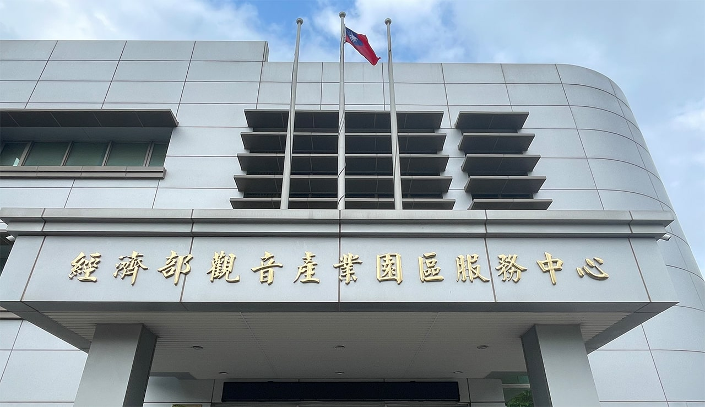
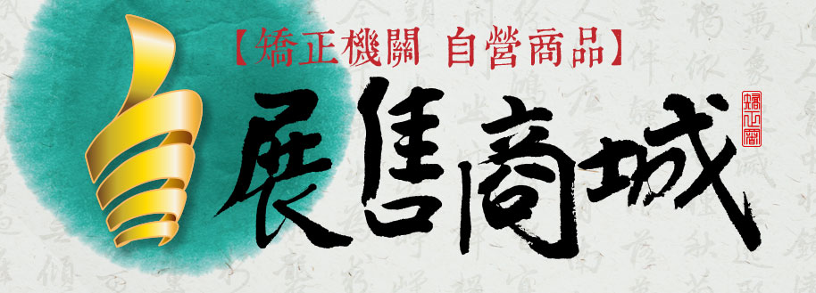

# 首頁 | 經濟部觀音產業園區服務中心

- 網站：www.bip.gov.tw
- 原始網址：https://www.bip.gov.tw/iphw/kuangin/
- 狀態：success
- 主題：自然景觀與生態、地方產業與農漁業、觀光景點與活動
- 關鍵字：觀音區、桃園市、地方旅遊
- 擷取時間：2026-10-29T13:55:04.879043+00:00

## 清理後正文

-
2026-10-29
-
2026-10-29
最新活動
-
2026-08-27 ~ 2026-12-31
-
2026-01-01 ~ 2026-12-31
:::
-
2026-10-29
-
2026-10-29
最新活動
-
2026-08-27 ~ 2026-12-31
-
2026-01-01 ~ 2026-12-31
本產業園區編訂係遵奉行政院前孫院長為解決桃園市濱海四區所面臨難題，於民國六十八年十一月二十四日專程蒞臨實地考察所作之裁示，並為配合政府改善投資環境，因應台灣北部地區工業引進帶動沿海地區之繁榮，而開發之政策性產業園區為配合工業引進用地需求量及開發資金籌措需要，於民國七十一年二月起在桃園市觀音區分三期開發，至民國七十九年十二月完成。開發總面積632.12公頃，係一綜合性產業園區，此項開發對當地的繁榮與發展有極大的貢獻。

## 圖片
-  — [原始圖片來源](https://www.bip.gov.tw/iphw/kuangin/images/rwd/cover/02.jpg) 
-  — [原始圖片來源](https://www.bip.gov.tw/iphw/_commons/images/adv/ATTCH3.jpg) 
-  — [原始圖片來源](https://www.bip.gov.tw/iphw/_commons/images/AA2.0.png) 

## 頁面連結
- [臺北分局](https://www.bip.gov.tw/iphw/tpb/)
- [經濟部產業園區管理局](https://www.bip.gov.tw/)
- [網站導覽](https://www.bip.gov.tw/iphw/kuangin/index.do?id=99)
- [常見問答集](https://www.bip.gov.tw/iphw/kuangin/tbfaq.do?method=list)
- [RSS](https://www.bip.gov.tw/iphw/kuangin/index.do?id=80)
- [【觀音產業園區】容許入區產業別及入區相關規定](https://www.bip.gov.tw/iphw/kuangin/entreg.do?method=goContent&sn=107682)
- [為促進大潭及觀音工業區車齡20年以上柴油車大客貨車及柴油施工機具自主管理，以降低...](https://www.bip.gov.tw/iphw/kuangin/bulletin.do?method=goContent&sn=109185)
- [敬啟者
請園區廠商報名11月12日上午場次(對象為園區廠商)
總局訂於115年1...](https://www.bip.gov.tw/iphw/kuangin/bulletin.do?method=goContent&sn=109184)
- [因應勞動部職業安全衛生署政策，「職業安全衛生管理人員及一般勞工」，在職教育訓練證...](https://www.bip.gov.tw/iphw/kuangin/activity.do?method=goContent&sn=29822)
- [115年度觀音產業園區在職教育訓練活動行事曆](https://www.bip.gov.tw/iphw/kuangin/activity.do?method=goContent&sn=29701)
- [https://assist.nat.gov.tw/](https://assist.nat.gov.tw/)
- [https://www.ida.gov.tw/](https://www.ida.gov.tw/)
- [https://www.taisugar.com.tw/chinese/CP3.aspx?n=10107](https://www.taisugar.com.tw/chinese/CP3.aspx?n=10107)
- [https://www.muga.org.tw/](https://www.muga.org.tw/)
- [https://www.roccoc.org.tw/](https://www.roccoc.org.tw/)
- [https://www.cnfi.org.tw/](https://www.cnfi.org.tw/)
- [https://www.moea.gov.tw/](https://www.moea.gov.tw/)
- [https://parksim.bip.gov.tw/smartpark/portal](https://parksim.bip.gov.tw/smartpark/portal)
- [https://shop.mjac.moj.gov.tw/](https://shop.mjac.moj.gov.tw/)
- [https://isafeevent.moe.edu.tw/](https://isafeevent.moe.edu.tw/)
- [跳到主要內容區塊](https://www.bip.gov.tw/iphw/kuangin/)
- [公佈欄](https://www.bip.gov.tw/iphw/kuangin/bulletin.do?method=list)
- [活動訊息](https://www.bip.gov.tw/iphw/kuangin/activity.do?method=list)
- [政令宣導](https://www.bip.gov.tw/iphw/kuangin/policy.do?method=list)
- [設立緣起與開發經過](https://www.bip.gov.tw/iphw/kuangin/index.do?id=10)
- [入區相關規定](https://www.bip.gov.tw/iphw/kuangin/entreg.do?method=list)
- [法令規章](https://www.bip.gov.tw/iphw/kuangin/index.do?id=download)
- [廠商名錄](https://www.bip.gov.tw/iphw/kuangin/factory.do?method=list)
- [污水處理](https://www.bip.gov.tw/iphw/kuangin/index.do?id=06)
- [焚化爐資訊](https://www.bip.gov.tw/iphw/kuangin/index.do?id=07)
- [求職求才](https://www.taiwanjobs.gov.tw/Internet/index/index.aspx)
- [網路資源](https://www.bip.gov.tw/iphw/kuangin/index.do?id=70)
- [意見信箱](https://www.bip.gov.tw/iphw/kuangin/index.do?id=20)
- [政府網站資料宣告](https://www.bip.gov.tw/page.aspx?pageid=2b22a8184c06e87f)
- [隱私權政策](https://www.bip.gov.tw/page.aspx?pageid=5890c0f4b258de11)
- [網站安全政策](https://www.bip.gov.tw/page.aspx?pageid=71edf48eb01bcb07)
- [通過AA無障礙網頁檢測](https://accessibility.moda.gov.tw/Applications/Detail?category=20250311105111)
