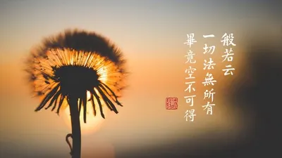
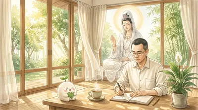

# #觀音 - 推薦內容｜方格子 vocus

- 網站：vocus.cc
- 原始網址：https://vocus.cc/tags/%E8%A7%80%E9%9F%B3
- 狀態：success
- 發表日期：2026-10-29T21:11:24+08:00
- 主題：地方產業與農漁業、觀光景點與活動
- 關鍵字：蓮花園休閒農業區、地方旅遊、觀光資訊
- 擷取時間：2026-10-29T13:55:07.891654+00:00

## 清理後正文

含有「觀音」共 424 篇內容
全部內容
發佈日期由新至舊
《仁王護國般若波羅蜜經》為本經的完整經題，簡稱《仁王經》。鑒於現今全球的災難頻發，護國息災非常迫切，此時弘揚與學習此經最為契機，因為這部經講的內容，就是護國，怎麼護國、息災。如能共同護持推廣，解行相應，必感得諸佛護念加持，減輕災劫風險，消災免難，轉危為安。
剛好昨天10/28(農曆9/19)是觀世音菩薩的出家日，
如果你與觀音菩薩有緣，也許你現在正經歷一些困惑、凡考、迷茫，或者在人生的某個轉角需要一份指引......
那麼這些話，就是菩薩提醒正在修行、整理過去、期盼未來的你的心靈指引
一、 種福與求福：從「求好運」到「做個種福的人」
很多人向菩
真正的安定，從來不是逃去一個無風無浪的世外桃源，而是回到生活裡，安頓好自己的七情六慾。
午後的廟埕前，香煙繚繞得讓人幾乎睜不開眼。你手裡緊緊拿著三炷香，雙膝沉沉跪在拜墊上，胸口堵著滿滿的委屈與疲憊，眼眶泛紅，嘴唇微顫著卻只能在心底反覆呢喃：「菩薩，我到底該怎麼辦？」
好不容易求了一支籤、擲了幾
一早，陽光明媚
放眼望去，金光閃耀
舉起手機隨手一拍
景色，色彩斑斕
沿著斜坡石磚走至觀音亭
凝視著稍遠處的山景
雲霧相伴，舒卷如畫
襯托著中台禪寺
只見觀音亭旁的蓮花們
正姿態優雅的綻放著
葉片愜意的漂浮在水面
承載著菩薩足跡步步芬芳
瞥一眼時間
差不多到了該返回圓覺
洗完最後一個碗，妳終於坐下來。飯還在桌上，筷子是冷的。朋友問：「最近還好嗎？」妳回：「我很好。」觀世音菩薩，給累壞了的妳一個很小的動作。
本篇深入解析希臘語邏各斯及布拉瓦茨基的三階演化理論，從未顯現的父親與半顯現的母親開始，經由第二邏各斯與第三邏各斯，揭示世界蛋、禪那佛、宇宙心智和阿賴耶等核心概念，說明「話語」如何化作宇宙現象與建築者的力量。文章亦對第一、第二、第三邏各斯的分化、含義及與印度、希臘、卡巴拉等傳統思想的對照。
限時公開
外在的聲音只是一陣風，為什麼你非要把它做成囚禁自己的牢籠？工程師的信噪比除錯 ✕ 觀世音菩薩的聽心智慧
「風吹疏竹，風過而竹不留聲；外在的評價只是一陣路過的氣流，別讓它吹散了你內在扎根的定力。」
高壓工位上的感官超載：現代人為什麼越來越聽不見自己
下午四點的辦公室，空氣裡瀰漫著讓人窒息的緊繃感
秋天涼爽氣候 想帶著孩子走進大自然
體驗不一樣的農村活動！
這次來到蓮花園休閒農業區
不僅能親自走進-洛神花田
體驗從採收到製作的洛神花蜜餞
原本以為洛神花 長得扁扁像蜜餞一樣
沒想到 竟然能長這樣？
這回從農作體驗到趣味活動
還能親手下田採摘及製作
讓孩子在玩樂中
園區也設有相
黑絲絨觀音蓮的深色絨面葉片與銀白葉脈，很適合放在身旁慢慢欣賞。
如果想把土培植株轉成水培，先把它當成一次需要追蹤的栽培嘗試。
1.選擇正在穩定生長的植株
先確認根系與根莖健康。衰弱、病害或環境不穩定時，先處理原本的問題，再評估轉換。
2.清根時，保留結實的部分
輕柔洗去介質，減少拉扯細根。確認軟爛

## 圖片
-  — [原始圖片來源](https://img.vocus.cc/Wad80fCaoYEiyzncSSfzAYDcpXe_phFFtBPGhl1-XmE/w:400/f:webp/plain/https://images.vocus.cc/a8a3eaf9-02f4-4f5f-8203-562ae455aaff.jpg) 
-  — [原始圖片來源](https://img.vocus.cc/dBX-xiiyDx67PazRsCy-oQ2An35e58Dsdu3y3uYakeo/w:400/f:webp/plain/https://images.vocus.cc/dad4b8d3-e113-4c7f-a2d7-c05bca35d301.jpg) 
-  — [原始圖片來源](https://img.vocus.cc/qCU2rzSGLZ1G-W4K655F6St9uF70mNBaJY1kCQcD-sg/w:400/f:webp/plain/https://images.vocus.cc/322c33f3-87d1-46bb-ba9a-004cd606e8a6.png) 

## 頁面連結
- [Wang CH的沙龍 2026/10/29](https://vocus.cc/salon/695f9ed3fd89780001a2b47c)
- [世界博物館旅行筆記之四: 波士頓美術館](https://vocus.cc/article/6ae32d66fd897800012b8963)
- [# 博物館](https://vocus.cc/tags/%E5%8D%9A%E7%89%A9%E9%A4%A8)
- [# 波士頓](https://vocus.cc/tags/%E6%B3%A2%E5%A3%AB%E9%A0%93)
- [# 美術館](https://vocus.cc/tags/%E7%BE%8E%E8%A1%93%E9%A4%A8)
- [一念相應一念佛 2026/10/29](https://vocus.cc/salon/amitabha-mindful)
- [仁王護國經大意 (第三十集)](https://vocus.cc/article/6ac9bdfffd897800013c8f97)
- [# 仁王護國經](https://vocus.cc/tags/%E4%BB%81%E7%8E%8B%E8%AD%B7%E5%9C%8B%E7%B6%93)
- [# 消災免難](https://vocus.cc/tags/%E6%B6%88%E7%81%BD%E5%85%8D%E9%9B%A3)
- [# 護國息災](https://vocus.cc/tags/%E8%AD%B7%E5%9C%8B%E6%81%AF%E7%81%BD)
- [伯塵｜星塵 2026/10/29](https://vocus.cc/salon/Bochen-Stardust)
- [觀音九語・照見人心：生命的修行與大圓滿](https://vocus.cc/article/6ae29743fd897800014bcbd7)
- [# 成長](https://vocus.cc/tags/%E6%88%90%E9%95%B7)
- [拜遍名剎才明白：為雙寶做早餐的晨光裡，我看懂了觀音媽媽的「心念即淨土」](https://vocus.cc/article/6ae162a8fd89780001bb3749)
- [# 修心](https://vocus.cc/tags/%E4%BF%AE%E5%BF%83)
- [https://vocus.cc/user/5eab7492fd897800019cf8b3](https://vocus.cc/user/5eab7492fd897800019cf8b3)
- [https://vocus.cc/user/5a8d4c9deceaed2050e38b2d](https://vocus.cc/user/5a8d4c9deceaed2050e38b2d)
- [法采創作園地 2026/10/28](https://vocus.cc/salon/6617b35ffd897800015d3575)
- [文字紀錄，護法博覽會第一天](https://vocus.cc/article/6ae14a71fd89780001b6c766)
- [# 中台禪寺](https://vocus.cc/tags/%E4%B8%AD%E5%8F%B0%E7%A6%AA%E5%AF%BA)
- [# 博覽會](https://vocus.cc/tags/%E5%8D%9A%E8%A6%BD%E6%9C%83)
- [# 精舍](https://vocus.cc/tags/%E7%B2%BE%E8%88%8D)
- [陳昆鴻的沙龍 2026/10/24](https://vocus.cc/salon/6ab496c90908954e7247034e)
- [洗完最後一個碗，妳的飯，涼了](https://vocus.cc/article/6adb9d29fd89780001723222)
- [# 觀世音菩薩](https://vocus.cc/tags/%E8%A7%80%E4%B8%96%E9%9F%B3%E8%8F%A9%E8%96%A9)
- [# 自我照顧](https://vocus.cc/tags/%E8%87%AA%E6%88%91%E7%85%A7%E9%A1%A7)
- [神秘學講堂 2026/10/22](https://vocus.cc/salon/occultschool)
- [邏各斯的宇宙話語起源](https://vocus.cc/article/6930f51dfd89780001a9f08f)
- [# 力量](https://vocus.cc/tags/%E5%8A%9B%E9%87%8F)
- [# 輻射](https://vocus.cc/tags/%E8%BC%BB%E5%B0%84)
- [老臣聊心室｜聽你的心，陪你調頻 2026/10/28](https://vocus.cc/salon/LUYILIFE)
- [在喧囂的世界裡，聽見自己真實的聲音：觀音心法的耳根圓通與情緒降噪](https://vocus.cc/article/6ad9ce40fd89780001183e3e)
- [# 靜心書寫](https://vocus.cc/tags/%E9%9D%9C%E5%BF%83%E6%9B%B8%E5%AF%AB)
- [# 靜心練習](https://vocus.cc/tags/%E9%9D%9C%E5%BF%83%E7%B7%B4%E7%BF%92)
- [# 自我關懷](https://vocus.cc/tags/%E8%87%AA%E6%88%91%E9%97%9C%E6%87%B7)
- [Cher雪兒吃喝玩樂 2026/10/21](https://vocus.cc/salon/cher88888)
- [秋日竟然還能坐大王蓮？洛神花蜜餞 DIY｜小小農夫採收洛神花體驗@桃園觀音蓮花園休閒農業區](https://vocus.cc/article/6ad8576afd89780001d55713)
- [# 洛神花](https://vocus.cc/tags/%E6%B4%9B%E7%A5%9E%E8%8A%B1)
- [# 體驗](https://vocus.cc/tags/%E9%AB%94%E9%A9%97)
- [# 大王蓮](https://vocus.cc/tags/%E5%A4%A7%E7%8E%8B%E8%93%AE)
- [植間小事 2026/10/16](https://vocus.cc/salon/Plant111)
- [黑絲絨觀音蓮想轉水培？先準備好，再看新根怎麼長](https://vocus.cc/article/6ad2487efd89780001afe53d)
- [# 觀音](https://vocus.cc/tags/%E8%A7%80%E9%9F%B3)
- [# 環境](https://vocus.cc/tags/%E7%92%B0%E5%A2%83)
