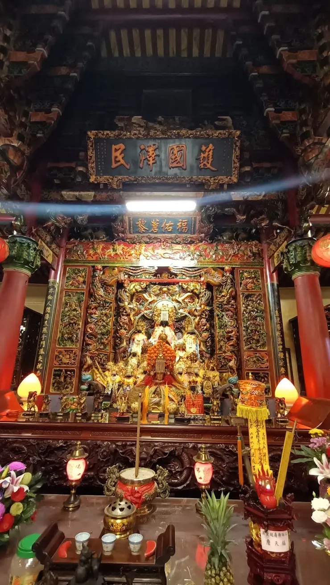
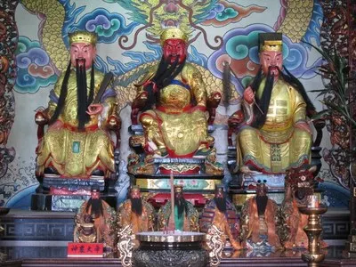
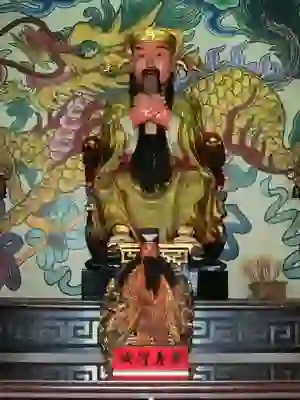

# 員林慈天宮一日遊：觀音佛祖庇佑的心靈之旅，探索員林信仰文化與美食景點｜悠遊時光

- 網站：vocus
- 原始網址：https://vocus.cc/article/6912ea84fd89780001be35a3
- 狀態：success
- 發表日期：2026-01-06T01:16:32.011Z
- 主題：歷史文化與信仰、地方產業與農漁業、觀光景點與活動
- 關鍵字：歷史文化、地方旅遊、觀光資訊
- 擷取時間：2026-10-29T13:55:09.968601+00:00

## 清理後正文

彰化員林祈福景點推薦｜慈天宮觀音佛祖靈驗加持，一日遊攻略含交通、美食與附近景點，體驗文化與信仰的完美融合！
一、歷史沿革與由來典故（主祀：觀音佛祖）
位於彰化縣員林市的【慈天宮】，是一座香火鼎盛、信眾雲集的觀音佛祖廟宇。創建於清代年間，早期信眾以地方仕紳與農商居多，為祈求風調雨順、家庭平安而奉請觀音佛祖鎮殿供奉。
慈天宮的觀音佛祖慈悲為懷、救苦救難，被地方信徒稱為「慈天媽」，每逢初一、十五或觀音誕辰（農曆二月十九、六月十九、九月十九），香客絡繹不絕，場面盛大。
相傳廟內的觀音佛祖靈驗無比，不論是求子、求財、問事業，皆有顯靈事蹟。早年廟前有清泉湧出，被認為是「觀音淨水」，可洗滌業障、保佑平安，因此也成為當地人求淨心靈的信仰中心。
二、參拜流程（區分介紹）
¥ 參拜慈天宮建議依序如下，循禮敬之心而行：
- 入廟前準備：
於山門前洗手淨心，若有開車前來可於廟方淨車區進行「車輛加持祈福」。
- 一拜天公爐：
先至廟埕中央的天公爐上香，向玉皇大帝稟報姓名與到訪目的。
- 二拜主神觀音佛祖：
進入正殿，虔誠參拜觀音佛祖，祈求慈悲加被、身心安泰。
- 三拜陪祀神明：
左右兩殿供奉文昌帝君、關聖帝君與地藏王菩薩，可依自身需求上香參拜。
- 四拜太歲殿與福德正神：
若值流年太歲，可安太歲、點光明燈祈求全年順遂。
- 五拜後殿與祖靈位：
表達感恩之情，並祈願祖德庇蔭、子孫昌盛。
- 抽籤問事：
慈天宮以「聖筊問事」靈驗著稱，信眾可向觀音佛祖祈求指引。
三、周邊造景與園區特色
慈天宮外觀融合閩南與日式廟宇風格，屋脊飛簷彩繪龍鳳，雕刻精緻。廟埕設有蓮花池與觀音立像，象徵「慈悲普渡」。
近年廟方重新整建園區，增設「祈福步道」、「蓮花燈隧道」及「平安鐘」，讓民眾能以更柔和的方式感受信仰氛圍。
夜間燈光點綴下，廟宇金碧輝煌，是員林夜遊拍照的隱藏景點。
四、淨車服務
¥ 慈天宮提供「汽機車加持淨香」服務：
- 流程：車主報名 → 廟方誦經祈福 → 主神加持香火水灑淨 → 貼上「平安符」
- 時間：農曆初一、十五及特定節慶開放
- 象徵：祈求行車平安、遠離災厄、財運亨通
五、注意要項
- 入廟請衣著整潔，不可喧嘩或攝影打擾儀式。
- 抽籤請誠心祈求，不可重複問同一件事。
- 若求得籤詩不解，可請義工或老師傅解籤。
- 廟內禁煙，香支以三柱為主，避免浪費。
六、重大慶典與活動
- 觀音佛祖聖誕（農曆二月十九）：誦經、平安宴、信徒繞境。
- 中元普渡法會（農曆七月十五）：超度冤親債主、祈求平安。
- 歲末祈安法會：感恩平安、添運納福。
- 觀音開庫日（農曆正月二十六）：信眾祈求財運昌隆。
- 點燈祈福儀式：每年農曆年前後開放報名，可點「平安燈」、「光明燈」及「財神燈」。
七、建築風格特色
慈天宮建築採「三川殿」格局，屋頂為燕尾脊設計，飛龍與鳳凰環繞，象徵祥瑞降臨。
主殿樑柱刻有「慈悲為懷」對聯，木雕與剪黏藝術保存完整。殿內觀音佛祖法相莊嚴，面容柔和，散發祥光。
天花板繪有「蓮花紋飾」，寓意清淨心境；整體廟宇氣勢雍容，極具地方文化美感。
八、交通指南
地址：彰化縣員林市
開放時間：每日 06:00～21:00
¥ 交通方式：
- 開車：國道1號 → 員林交流道 → 員林市區（設有停車場）
- 火車：搭乘台鐵至「員林站」，步行約10分鐘即可抵達
- 公車：彰化客運、員林客運皆有路線可達「慈天宮站」
九、在地美食推薦
^ 來慈天宮參拜後，別錯過員林的美食小吃：
- 阿明意麵：湯頭清爽、手工麵條Q彈。
- 員林肉圓：皮薄餡香，配蒜汁最對味。
- 珍珠奶茶創始地員林老店：傳說中珍奶的發源地之一。
- 米糕城：老字號米糕店，口味傳承三代。
十、周邊景點推薦
- 員林公園觀景台：俯瞰整個員林市區，夜景浪漫。
- 百果山探索樂園：親子同遊好去處，適合半日遊。
- 藤山步道：健行賞景兼養生。
- 員林老街：文創商店、在地甜品、咖啡館林立。
- 員林福寧宮：主祀天上聖母媽祖，可串聯參拜。
「常見問題 FAQ｜員林慈天宮一日遊懶人包」
Q1：員林慈天宮主祀哪一位神明？
A1：員林慈天宮主祀「觀音佛祖」，又稱「慈天媽」。祂以慈悲聞名，信徒常前來祈求平安、求子、問事業、求姻緣或指引方向。
Q2：慈天宮有哪些特色服務？
A2：除了一般參拜外，最受歡迎的是「淨車祈福」與「點光明燈」。每逢農曆初一、十五或節慶，廟方會舉行誦經加持儀式，讓車主與家人都能平安順行。
Q3：什麼時候去慈天宮人最多？
A3：人潮高峰多在觀音佛祖誕辰（農曆二月十九）、開庫日（正月二十六）及歲末祈安法會期間。建議提早前往，避開中午時段最擁擠。
Q4：慈天宮可以抽籤問事嗎？靈不靈？
A4：可以的。慈天宮以「觀音靈籤」著名，許多信徒反映非常準確。抽籤前要誠心稟報姓名與生辰，求得籤後可請廟方人員協助解籤。
Q5：廟內有提供香與供品嗎？
A5：有，廟方提供免費清香，也可至旁邊供品區購買水果或金紙，維持整潔、心誠為上。
Q6：員林慈天宮交通方便嗎？
A6：非常方便！可搭乘火車至「員林站」步行約10分鐘即可抵達。開車可從國道1號員林交流道下，廟旁設有停車場。
Q7：可以帶寵物進廟嗎？
A7：一般建議不要攜帶寵物進入正殿，但可於戶外園區活動，請務必繫上牽繩並保持環境整潔。
Q8：附近有什麼好吃的？
A8：必吃員林三寶：肉圓、意麵、米糕！此外還有珍珠奶茶創始店與老字號甜湯鋪，距離慈天宮步行5分鐘內即可到達。
Q9：慈天宮有配合觀光導覽或解說嗎？
A9：大型節慶期間會安排志工導覽團，介紹觀音信仰與廟宇歷史。平時可向服務台索取簡介或掃描導覽QR Code了解廟史。
Q10：建議安排多久的停留時間？
A10：約1至1.5小時最合適，可從參拜、抽籤到園區參觀皆能完整體驗，之後再前往員林老街或百果山接續旅程。
Q11：慈天宮是否有夜間點燈活動？
A11：有！每年農曆新年前後開放「光明燈」、「太歲燈」、「財神燈」等登記，夜間亮燈後整座廟宇金光閃耀，非常壯觀。
Q12：第一次來員林慈天宮該注意什麼？
A12：保持敬意、衣著整潔、香枝不宜多。若有進行淨車或點燈祈福，可先至服務台登記流程，廟方人員會親切指導。
作者｜悠遊時光
員林慈天宮不僅是一座供奉觀音佛祖的信仰重鎮，更是融合歷史文化與人文信仰的心靈療癒之地。無論是祈福、淨車、或單純尋找心的平靜，這裡都能讓人感受到觀音佛祖的慈悲與力量。

## 圖片
-  — [原始圖片來源](https://img.vocus.cc/tvG7oBb7eNpz0x2ugyVTZYGOjDB27eHbrecSewYLAsE/w:740/f:webp/plain/https://images.vocus.cc/bbbe4385-2cfc-411b-ba53-d8b0090fb127.jpg) 
-  — [原始圖片來源](https://img.vocus.cc/Gj-LFevFMlghwFex0bdAAYpRT3FWUKKeA18iCk3t9PI/w:400/f:webp/plain/https://images.vocus.cc/c8a2a728-44c3-4b62-b5a9-50f58990f887.jpg) 
-  — [原始圖片來源](https://img.vocus.cc/jf1yGoSgZlGpx-PwmBI7ldEFGa8wJJI1wnes2SjNpU0/w:300/f:webp/q:1/plain/https://images.vocus.cc/0487cd7c-2a4a-4a6a-ad39-894ca3ca2efd.jpg) 

## 頁面連結
- [https://vocus.cc/](https://vocus.cc/)
- [玉皇上帝、玄天上帝（上帝公）](https://vocus.cc/salon/688b0b79fd897800010bfb2f/room/690c4d38cebbddbc5cbb3cf4)
- [保生大帝（大道公、神農大帝、感天大帝）](https://vocus.cc/salon/688b0b79fd897800010bfb2f/room/690c7460cebbddbc5cbbef6f)
- [天上聖母（媽祖）](https://vocus.cc/salon/688b0b79fd897800010bfb2f/room/690c501fcebbddbc5cbb3d25)
- [中壇元帥（三太子）](https://vocus.cc/salon/688b0b79fd897800010bfb2f/room/690ca6d9cebbddbc5cbc81ba)
- [五府千歲（王爺，千歲，元帥，大夫）](https://vocus.cc/salon/688b0b79fd897800010bfb2f/room/690caca6cebbddbc5cbcb34d)
- [臨水夫人（陳靖姑/夫人）](https://vocus.cc/salon/688b0b79fd897800010bfb2f/room/690cb093cebbddbc5cbcb5e0)
- [福德正神（財神）](https://vocus.cc/salon/688b0b79fd897800010bfb2f/room/690d391bcebbddbc5cbe3031)
- [濟公活佛（禪師）](https://vocus.cc/salon/688b0b79fd897800010bfb2f/room/690d423dcebbddbc5cbe31a0)
- [地藏王菩薩（城隍爺，鍾馗爺）](https://vocus.cc/salon/688b0b79fd897800010bfb2f/room/690d4cb5cebbddbc5cbe6033)
- [齊天大聖](https://vocus.cc/salon/688b0b79fd897800010bfb2f/room/690d4d74cebbddbc5cbe6036)
- [關聖帝君（關公）](https://vocus.cc/salon/688b0b79fd897800010bfb2f/room/690d4f11cebbddbc5cbe6045)
- [廣澤尊王/開彰聖王](https://vocus.cc/salon/688b0b79fd897800010bfb2f/room/690d8880cebbddbc5cbf41a8)
- [清水祖師/八卦祖師/慚愧祖師](https://vocus.cc/salon/688b0b79fd897800010bfb2f/room/690d8d04cebbddbc5cbf41c4)
- [王母娘娘（地母、娘娘）](https://vocus.cc/salon/688b0b79fd897800010bfb2f/room/690d8d90cebbddbc5cbf767a)
- [特殊廟宇（其他）](https://vocus.cc/salon/688b0b79fd897800010bfb2f/room/690dcb0acebbddbc5cc063b5)
- [九天玄女](https://vocus.cc/salon/688b0b79fd897800010bfb2f/room/690ddb10cebbddbc5cc08f58)
- [三官大帝](https://vocus.cc/salon/688b0b79fd897800010bfb2f/room/69127c5bcebbddbc5cccf859)
- [水仙尊王](https://vocus.cc/salon/688b0b79fd897800010bfb2f/room/69151f96cebbddbc5cd4da46)
- [八仙系列](https://vocus.cc/salon/688b0b79fd897800010bfb2f/room/6949e7e2d12907429fc3ff47)
- [關於](https://vocus.cc/salon/688b0b79fd897800010bfb2f/about)
- [一、歷史沿革與由來典故（主祀：觀音佛祖）](https://vocus.cc/article/6912ea84fd89780001be35a3)
- [https://vocus.cc/user/688b0b01fd897800010bdd48](https://vocus.cc/user/688b0b01fd897800010bdd48)
- [https://vocus.cc/article/6900948dfd89780001856dfe](https://vocus.cc/article/6900948dfd89780001856dfe)
- [# 一日遊](https://vocus.cc/tags/%E4%B8%80%E6%97%A5%E9%81%8A)
- [# 信仰](https://vocus.cc/tags/%E4%BF%A1%E4%BB%B0)
- [# 連假](https://vocus.cc/tags/%E9%80%A3%E5%81%87)
- [# 特色](https://vocus.cc/tags/%E7%89%B9%E8%89%B2)
- [# 美食](https://vocus.cc/tags/%E7%BE%8E%E9%A3%9F)
- [# 參拜](https://vocus.cc/tags/%E5%8F%83%E6%8B%9C)
- [# 文化巡禮](https://vocus.cc/tags/%E6%96%87%E5%8C%96%E5%B7%A1%E7%A6%AE)
- [# 廟宇](https://vocus.cc/tags/%E5%BB%9F%E5%AE%87)
- [# 景點](https://vocus.cc/tags/%E6%99%AF%E9%BB%9E)
- [# 觀音](https://vocus.cc/tags/%E8%A7%80%E9%9F%B3)
- [# 祈福](https://vocus.cc/tags/%E7%A5%88%E7%A6%8F)
- [# 光明燈](https://vocus.cc/tags/%E5%85%89%E6%98%8E%E7%87%88)
- [# 員林](https://vocus.cc/tags/%E5%93%A1%E6%9E%97)
- [上一篇 新北代天府聖明宮一日遊攻略｜玉皇上帝、濟公活佛與千年豬神樹公的三教信仰秘境](https://vocus.cc/article/69426019fd897800012ef2ab)
- [下一篇 《蘇厝第一代天府真護宮一日遊：五府千歲（李・池・吳・朱・范）完整解說的歷史｜參拜流程、交通、美食與景點完整攻略》](https://vocus.cc/article/69283ef7fd8978000162cb74)
- [悠遊時光](https://vocus.cc/salon/688b0b79fd897800010bfb2f)
- [五股凌雲禪寺一日遊：巨型千手觀音、百年古剎、祈福能量滿滿的靜心旅程](https://vocus.cc/article/693b6252fd897800016ba368)
- [竹林山觀音寺一日遊：三百年林口觀音媽的庇佑之地｜歷史典故、參拜流程、交通、美食全攻略](https://vocus.cc/article/6916731cfd89780001984069)
- [靈仙洞巖最勝禪寺一日遊｜小敦煌秘境、觀音佛祖聖地、洞窟石刻的靈性之旅](https://vocus.cc/article/691c1f57fd89780001f1b4f6)
- [觀音佛祖（觀音菩薩）/如來佛祖](https://vocus.cc/salon/688b0b79fd897800010bfb2f/room/690c75b2cebbddbc5cbbf1b0)
- [# 方格新手](https://vocus.cc/tags/方格新手)
- [# 方格新手](https://vocus.cc/tags/%E6%96%B9%E6%A0%BC%E6%96%B0%E6%89%8B)
- [絕對零度的沙龍](https://vocus.cc/salon/659f20d9fd8978000173511b)
- [《一句「我以後不跟你買了」，讓我這個賣水果的想了很久》](https://vocus.cc/article/6ad45feefd89780001012d2e)
- [筱嵐的沙龍](https://vocus.cc/salon/6a0c8033fd897800014570df)
- [《恐怖心展》觀展隨筆：在別人的心魔裡，撞見自己的恐懼](https://vocus.cc/article/6ad76716fd89780001b363c2)
- [Greenland的建築旅行筆記](https://vocus.cc/salon/GREENLAND)
- [【奇蹟建築】妹島和世墨田北齋美術館](https://vocus.cc/article/6ad4a036fd897800010caa3a)
