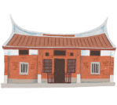

# 臺灣張永親-客庄小旅行

- 網站：romantichakka.com
- 原始網址：https://romantichakka.com/explore/HaFood?a=1955&id=3207
- 狀態：success
- 主題：自然景觀與生態、歷史文化與信仰、地方產業與農漁業
- 關鍵字：觀音區、桃園市、草漯沙丘、白沙岬燈塔、甘泉寺
- 擷取時間：2026-10-29T13:55:17.916335+00:00

## 清理後正文

:::
臺灣張永親
4.3
(323)
上一張
下一張
前往官網
店家電話 :
+886-3-4838939
店家地址 :
桃園市 觀音區 樹林里成功路一段817號
營業時間 :
星期一: 休息
星期二: 11:00 – 14:00, 17:00 – 21:00
星期三: 11:00 – 14:00, 17:00 – 21:00
星期四: 11:00 – 14:00, 17:00 – 21:00
星期五: 11:00 – 14:00, 17:00 – 21:00
星期六: 11:00 – 14:00, 17:00 – 21:00
星期日: 11:00 – 14:00, 17:00 – 21:00
#餐食
本頁店家資料由業者或公開資料來源提供，僅供參考，詳情請洽業者確認。
店家介紹
位於觀音的「臺灣張永親」是一間專賣熱炒與家常菜的老字號餐館，不少在地居民與上班族都會相約到此聚餐。餐廳菜色多元，從經典熱炒、簡單小菜到適合下酒的料理應有盡有，價格實惠，份量也很實在。店內空間寬敞，備有洗手間與酒水供應，是適合親友小聚或同事聚會的地方。每到用餐時段，總能見到熟客三五成群共享美食，氣氛親切不拘泥。若想在觀音找個簡單舒適的地方吃頓家常飯，這裡是不錯的選擇。
最後更新日期：2025-07-28
周邊資訊
周邊美食
周邊景點
周邊旅宿
旅遊諮詢
美吉兒西點麵包坊
桃園市 觀音區
4.2 ★
(59)
上讚美食
桃園市 觀音區
4 ★
(161)
柏園餐廳
桃園市 觀音區
4.3 ★
(811)
來來牛家莊
桃園市 觀音區
4 ★
(2081)
漯食Tashi brunch
桃園市 觀音區
4.5 ★
(395)
西西里披薩店Sicilia Pizzeria
桃園市 觀音區
4.7 ★
(1432)
安可土雞城
桃園市 觀音區
4.2 ★
(1801)
麥庭麵線勇
桃園市 觀音區
4.1 ★
(850)
莫內的花園
桃園市 觀音區
4.3 ★
(1497)
日日臭豆腐
桃園市 觀音區
4.6 ★
(28)
蓮荷園休閒農場
桃園市 觀音區
3.9 ★
(2529)
請左右移動看更多
GFun機能紡織生活館
桃園市 觀音區
4.7 ★
(212)
觀音區多功能場館
桃園市 觀音區
4.8 ★
(16)
觀音白玉海岸
桃園市 觀音區
4.2 ★
(99)
水之丘主題公園
桃園市 觀音區
4.2 ★
(905)
龍貓公車站
桃園市 觀音區
4 ★
(1908)
甘泉寺
桃園市 觀音區
4.6 ★
(1713)
草漯沙丘地景展示館
桃園市 觀音區
4.3 ★
(179)
蓮荷園休閒農場
桃園市 觀音區
3.9 ★
(2529)
觀音濱海遊憩區
桃園市 觀音區
4.4 ★
(1146)
白沙岬燈塔
桃園市 觀音區
4.2 ★
(6395)
觀音自行車道
桃園市 觀音區
4.3 ★
(277)
中台環境教育資源中心
桃園市 觀音區
2.6 ★
(8)
請左右移動看更多
mini嵐輕旅
草漯居
黃金海岸商務旅舘
桃園喜來登酒店
康莊蓮園民宿
桃園機場假日酒店
SNA VILLA品牌招待空間
林園居民宿
遇見126
日曜居
宿時代民宿
尞LIAU
請左右移動看更多
GFun機能服飾紡織生活館
0800-038838
桃園喜來登酒店
03-3851188
翌軒田園（丫昌伯美食屋.民宿）
03-4904140
高鐵桃園站旅遊服務中心
03-4532921
太平洋自行車博物館
03-4861231
桃園國際機場旅客服務中心-第一航廈
03-3982194
桃園國際機場旅客服務中心-第二航廈
03-3983341
請左右移動看更多
回列表

## 圖片
-  — [原始圖片來源](https://romantichakka.com/UserFiles/%E5%85%A8%E5%8F%B0%E5%9C%B0%E5%9C%96.png) 
-  — [原始圖片來源](https://romantichakka.com/UserFiles/%E6%B0%B4%E7%B4%8B%E8%84%88%E7%B5%A1new.png) 
-  — [原始圖片來源](https://romantichakka.com/UserFiles/%E6%90%9E%E6%B0%B4%E8%A1%8C%E5%B0%9E.png) 
-  — [原始圖片來源](https://romantichakka.com/UserFiles/%E6%8E%A8%E5%BB%A3%E6%B4%BB%E5%8B%95.png) 
-  — [原始圖片來源](https://romantichakka.com/UserFiles/%E6%B0%B4%E6%B0%B4%E7%99%BE%E7%A7%91.png) 
-  — [原始圖片來源](https://romantichakka.com/explore/UserFiles/menu/menu-1-2.png) 
-  — [原始圖片來源](https://romantichakka.com/explore/UserFiles/menu/menu-1-3.png) 
-  — [原始圖片來源](https://romantichakka.com/explore/UserFiles/menu/menu-2-1.png) 
-  — [原始圖片來源](https://romantichakka.com/explore/UserFiles/menu/menu-2-2.png) 

## 頁面連結
- [客庄小旅行](https://romantichakka.com/)
- [桐花樂活公園](https://romantichakka.com/attraction/articles?a=4379)
- [老街溪水岸自行車道](https://romantichakka.com/attraction/articles?a=4381)
- [水月休閒農場](https://romantichakka.com/attraction/articles?a=4380)
- [十二寮步道](https://romantichakka.com/attraction/articles?a=4382)
- [後湖溪生態園區](https://romantichakka.com/attraction/articles?a=4383)
- [苗栗客家圓樓](https://romantichakka.com/attraction/articles?a=956)
- [中壢老街溪步道](https://romantichakka.com/attraction/articles?a=952)
- [仙山登山步道](https://romantichakka.com/attraction/articles?a=953)
- [石門水庫步道](https://romantichakka.com/attraction/articles?a=4386)
- [苑港觀光漁港](https://romantichakka.com/attraction/articles?a=949)
- [English](https://romantichakka.com/en)
- [日本語](https://romantichakka.com/ja)
- [網站導覽](https://romantichakka.com/info/sitemap?a=996)
- [facebook](https://www.facebook.com/www.hakka.gov.tw/)
- [中文](https://romantichakka.com/zh-TW)
- [https://romantichakka.com/fapi/ArtPic?id=11272&w=1000](https://romantichakka.com/fapi/ArtPic?id=11272&w=1000)
- [前往官網](https://www.facebook.com/p/%E8%87%BA%E7%81%A3%E5%BC%B5%E6%B0%B8%E8%A6%AA%E5%8F%B0%E5%BC%8F%E5%BF%AB%E7%82%92%E5%B0%8F%E5%90%83%E5%BA%97-100064653284119/?locale=zh_TW)
- [桃園市 觀音區 樹林里成功路一段817號](https://maps.app.goo.gl/Ee62DgdtfGHjC5NJ9)
- [#餐食](https://romantichakka.com/explore/HaFood?a=1955&cate=1957)
- [美吉兒西點麵包坊
 
 
 桃園市 觀音區 
 4.2 ★

(59)](https://romantichakka.com/explore/HaFood?a=1955&id=3205)
- [上讚美食
 
 
 桃園市 觀音區 
 4 ★

(161)](https://romantichakka.com/explore/HaFood?a=1955&id=3215)
- [柏園餐廳
 
 
 桃園市 觀音區 
 4.3 ★

(811)](https://romantichakka.com/explore/HaFood?a=1955&id=3203)
- [來來牛家莊
 
 
 桃園市 觀音區 
 4 ★

(2081)](https://romantichakka.com/explore/HaFood?a=1955&id=3209)
- [漯食Tashi brunch
 
 
 桃園市 觀音區 
 4.5 ★

(395)](https://romantichakka.com/explore/HaFood?a=1955&id=3218)
- [西西里披薩店Sicilia Pizzeria
 
 
 桃園市 觀音區 
 4.7 ★

(1432)](https://romantichakka.com/explore/HaFood?a=1955&id=3219)
- [安可土雞城
 
 
 桃園市 觀音區 
 4.2 ★

(1801)](https://romantichakka.com/explore/HaFood?a=1955&id=3208)
- [麥庭麵線勇
 
 
 桃園市 觀音區 
 4.1 ★

(850)](https://romantichakka.com/explore/HaFood?a=1955&id=3228)
- [莫內的花園
 
 
 桃園市 觀音區 
 4.3 ★

(1497)](https://romantichakka.com/explore/HaFood?a=1955&id=3206)
- [日日臭豆腐
 
 
 桃園市 觀音區 
 4.6 ★

(28)](https://romantichakka.com/explore/HaFood?a=1955&id=4332)
- [蓮荷園休閒農場
 
 
 桃園市 觀音區 
 3.9 ★

(2529)](https://romantichakka.com/explore/HaFood?a=1955&id=3217)
- [GFun機能紡織生活館
 
 
 桃園市 觀音區 
 4.7 ★
(212)](https://romantichakka.com/explore/HaFood?a=1955&id=832)
- [觀音區多功能場館
 
 
 桃園市 觀音區 
 4.8 ★
(16)](https://romantichakka.com/explore/HaFood?a=1955&id=3750)
- [觀音白玉海岸
 
 
 桃園市 觀音區 
 4.2 ★
(99)](https://romantichakka.com/explore/HaFood?a=1955&id=3749)
- [水之丘主題公園
 
 
 桃園市 觀音區 
 4.2 ★
(905)](https://romantichakka.com/explore/HaFood?a=1955&id=3751)
- [龍貓公車站
 
 
 桃園市 觀音區 
 4 ★
(1908)](https://romantichakka.com/explore/HaFood?a=1955&id=3748)
- [甘泉寺
 
 
 桃園市 觀音區 
 4.6 ★
(1713)](https://romantichakka.com/explore/HaFood?a=1955&id=796)
- [草漯沙丘地景展示館
 
 
 桃園市 觀音區 
 4.3 ★
(179)](https://romantichakka.com/explore/HaFood?a=1955&id=883)
- [蓮荷園休閒農場
 
 
 桃園市 觀音區 
 3.9 ★
(2529)](https://romantichakka.com/explore/HaFood?a=1955&id=811)
- [觀音濱海遊憩區
 
 
 桃園市 觀音區 
 4.4 ★
(1146)](https://romantichakka.com/explore/HaFood?a=1955&id=816)
- [白沙岬燈塔
 
 
 桃園市 觀音區 
 4.2 ★
(6395)](https://romantichakka.com/explore/HaFood?a=1955&id=794)
- [觀音自行車道
 
 
 桃園市 觀音區 
 4.3 ★
(277)](https://romantichakka.com/explore/HaFood?a=1955&id=795)
- [中台環境教育資源中心
 
 
 桃園市 觀音區 
 2.6 ★
(8)](https://romantichakka.com/explore/HaFood?a=1955&id=848)
- [mini嵐輕旅](https://www.taiwanstay.net.tw/TSA/web_page/TSA020200.jsp?hohi_id=39245)
- [草漯居](https://www.taiwanstay.net.tw/TSA/web_page/TSA020200.jsp?hohi_id=31534)
- [黃金海岸商務旅舘](https://www.taiwanstay.net.tw/TSA/web_page/TSA020200.jsp?hohi_id=10890)
- [桃園喜來登酒店](https://www.taiwanstay.net.tw/TSA/web_page/TSA020200.jsp?hohi_id=2494)
- [康莊蓮園民宿](https://www.taiwanstay.net.tw/TSA/web_page/TSA020200.jsp?hohi_id=12469)
- [桃園機場假日酒店](https://www.taiwanstay.net.tw/TSA/web_page/TSA020200.jsp?hohi_id=6488)
- [SNA VILLA品牌招待空間](https://www.taiwanstay.net.tw/TSA/web_page/TSA020200.jsp?hohi_id=38302)
- [林園居民宿](https://www.taiwanstay.net.tw/TSA/web_page/TSA020200.jsp?hohi_id=1029)
- [遇見126](https://www.taiwanstay.net.tw/TSA/web_page/TSA020200.jsp?hohi_id=37239)
- [日曜居](https://www.taiwanstay.net.tw/TSA/web_page/TSA020200.jsp?hohi_id=38055)
- [宿時代民宿](https://www.taiwanstay.net.tw/TSA/web_page/TSA020200.jsp?hohi_id=38723)
- [尞LIAU](https://www.taiwanstay.net.tw/TSA/web_page/TSA020200.jsp?hohi_id=37691)
- [GFun機能服飾紡織生活館
 
 
 0800-038838](https://www.google.com/maps/search/?api=1&query=25.048294,121.116905)
- [桃園喜來登酒店
 
 
 03-3851188](https://www.google.com/maps/search/?api=1&query=25.061558,121.17595)
- [翌軒田園（丫昌伯美食屋.民宿）
 
 
 03-4904140](https://www.google.com/maps/search/?api=1&query=24.99076,121.13548)
- [高鐵桃園站旅遊服務中心
 
 
 03-4532921](https://www.google.com/maps/search/?api=1&query=25.013126,121.214516)
- [太平洋自行車博物館
 
 
 03-4861231](https://www.google.com/maps/search/?api=1&query=24.986002,121.03216)
- [桃園國際機場旅客服務中心-第一航廈
 
 
 03-3982194](https://www.google.com/maps/search/?api=1&query=25.077042,121.23196)
- [桃園國際機場旅客服務中心-第二航廈
 
 
 03-3983341](https://www.google.com/maps/search/?api=1&query=25.077028,121.23197)
- [回列表](https://romantichakka.com/explore/HaFood?a=1955&cate=&county=&dist=&q=&p=1)
- [水與客庄](https://romantichakka.com/SuiSuiHakka/articles?a=4388)
- [全台活動](https://romantichakka.com/SuiSuiHakka/articles?a=4392)
- [水紋脈絡](https://romantichakka.com/SuiSuiHakka/articles?a=4393)
- [搞水行尞](https://romantichakka.com/SuiSuiHakka/articles?a=4395)
- [尋聲水影](https://romantichakka.com/SuiSuiHakka/articles?a=4396)
- [水水百科](https://romantichakka.com/SuiSuiHakka/articles?a=4397)
- [新鮮事](https://romantichakka.com/News/articles?a=3)
- [客家新鮮事](https://romantichakka.com/News/articles?a=29)
- [社群講客家](https://romantichakka.com/News/articles?a=90)
- [客庄景點](https://romantichakka.com/attraction/articles?a=4)
- [認識客庄](https://romantichakka.com/attraction/articles?a=59)
- [好玩景點](https://romantichakka.com/attraction/articles?a=928)
- [客庄智慧觀光地圖](https://romantichakka.com/attraction/articles?a=929)
- [虛擬旅客](https://romantichakka.com/attraction/articles?a=930)
- [即時影像](https://romantichakka.com/attraction/articles?a=947)
- [桐花花況預測](https://romantichakka.com/attraction/articles?a=3831)
- [玩客攻略](https://romantichakka.com/explore/articles?a=927)
- [好客夯玩法](https://romantichakka.com/explore/articles?a=66)
- [客庄好食](https://romantichakka.com/explore/articles?a=67)
- [客家特色商品專區](https://romantichakka.com/explore/articles?a=1163)
- [HA-FOOD](https://romantichakka.com/explore/articles?a=1955)
- [樟之細路](https://romantichakka.com/trail/articles?a=5)
- [走訪細路](https://romantichakka.com/trail/articles?a=70)
- [1 
 小粗坑步道](https://romantichakka.com/trail/articles?a=969)
- [2 
 渡南古道&飛鳳古道](https://romantichakka.com/trail/articles?a=71)
- [3 
 石峎古道](https://romantichakka.com/trail/articles?a=970)
- [4 
 鳴鳳古道](https://romantichakka.com/trail/articles?a=971)
- [5 
 老官道(路)](https://romantichakka.com/trail/articles?a=972)
- [6 
 出關古道](https://romantichakka.com/trail/articles?a=973)
- [7 
 騎龍&茶亭古道](https://romantichakka.com/trail/articles?a=4451)
- [紀念戳章介紹](https://romantichakka.com/trail/articles?a=1750)
- [樟之細路數位集章活動說明](https://romantichakka.com/trail/articles?a=3716)
- [GPX路線地圖](https://romantichakka.com/trail/articles?a=1751)
- [客庄小旅行](https://romantichakka.com/HakkaTours/articles?a=6)
- [桐花小旅行](https://romantichakka.com/HakkaTours/articles?a=967)
- [推薦遊程](https://romantichakka.com/HakkaTours/articles?a=968)
- [達人帶路](https://romantichakka.com/HakkaTours/articles?a=1202)

> 備註：進階解析失敗，已使用內建解析器：AttributeError: 'NoneType' object has no attribute 'get'
