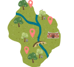
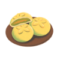
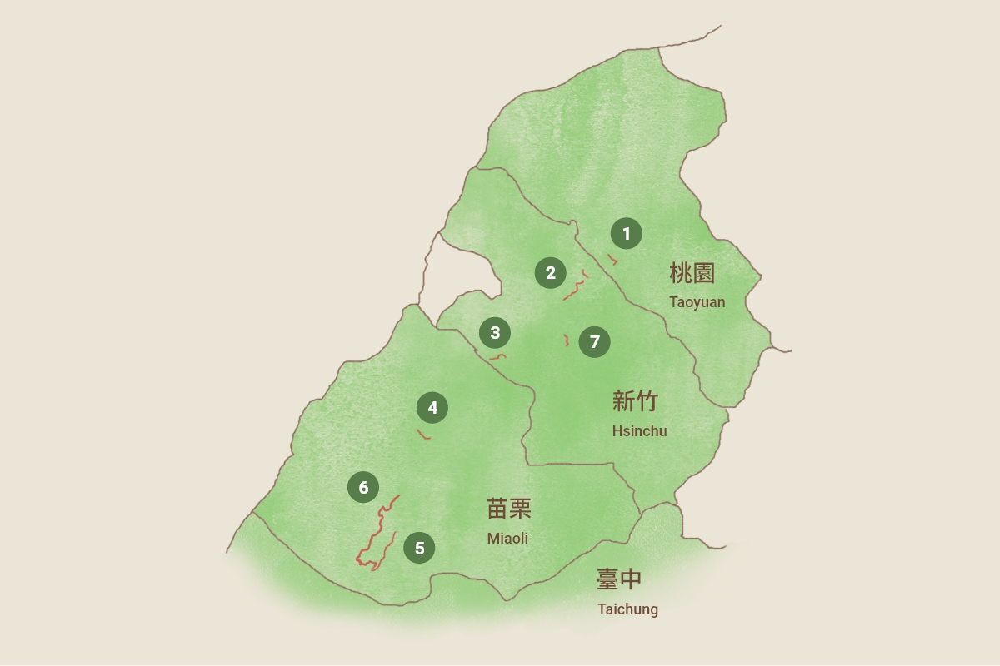
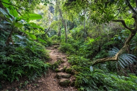
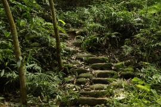
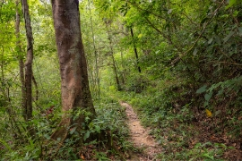

# 日日臭豆腐-客庄小旅行

- 網站：romantichakka.com
- 原始網址：https://romantichakka.com/explore/HaFood?a=1955&id=4332
- 狀態：success
- 主題：自然景觀與生態、歷史文化與信仰、地方產業與農漁業
- 關鍵字：觀音區、桃園市、草漯沙丘、藻礁、白沙岬燈塔
- 擷取時間：2026-10-29T13:55:22.732533+00:00

## 清理後正文

:::
日日臭豆腐
4.6
(28)
上一張
下一張
店家電話 :
+886-3-4736338
店家地址 :
桃園市 觀音區 中興路357號
營業時間 :
星期一: 15:00 – 21:00
星期二: 15:00 – 21:00
星期三: 15:00 – 19:00
星期四: 15:00 – 21:00
星期五: 15:00 – 21:00
星期六: 13:00 – 21:00
星期日: 13:00 – 20:00
#餐食
本頁店家資料由業者或公開資料來源提供，僅供參考，詳情請洽業者確認。
店家介紹
日日臭豆腐提供多樣化的在地庶民美食，招牌臭豆腐堅持現點現做，口感外酥內嫩，搭配特調醬料與爽脆泡菜，風味絕佳；特色的「骰子臭豆腐」則佐以蒜頭與胡椒鹽，酥脆鹹香。店內滷肉飯亦是人氣之選，米飯粒粒分明，佐以半熟荷包蛋與台式咖哩配菜，鹹淡適中且不油膩。
此外，飽滿多汁的烤香腸、口感紮實的烤雞肉捲，以及帶有獨特香氣回甘的茶葉蛋，皆是老饕推薦必點。
(照片來自店家官方提供，請勿轉載)
最後更新日期：2026-02-12
周邊資訊
周邊美食
周邊景點
周邊旅宿
旅遊諮詢
來來牛家莊
桃園市 觀音區
4 ★
(2081)
莫內的花園
桃園市 觀音區
4.3 ★
(1497)
季藝日本料理
桃園市 觀音區
4.4 ★
(1404)
1213金銀花農莊
桃園市 觀音區
4.1 ★
(67)
臺灣張永親
桃園市 觀音區
4.3 ★
(323)
美吉兒西點麵包坊
桃園市 觀音區
4.2 ★
(59)
上讚美食
桃園市 觀音區
4 ★
(161)
蓮荷園休閒農場
桃園市 觀音區
3.9 ★
(2529)
向陽農場
桃園市 觀音區
4 ★
(7832)
柏園餐廳
桃園市 觀音區
4.3 ★
(811)
漯食Tashi brunch
桃園市 觀音區
4.5 ★
(395)
請左右移動看更多
白沙岬燈塔
桃園市 觀音區
4.2 ★
(6395)
觀音濱海遊憩區
桃園市 觀音區
4.4 ★
(1146)
草漯沙丘地景展示館
桃園市 觀音區
4.3 ★
(179)
甘泉寺
桃園市 觀音區
4.6 ★
(1713)
中台環境教育資源中心
桃園市 觀音區
2.6 ★
(8)
觀音白玉海岸
桃園市 觀音區
4.2 ★
(99)
GFun機能紡織生活館
桃園市 觀音區
4.7 ★
(212)
藻礁生態環境教室
桃園市 新屋區
4.4 ★
(116)
新屋農博環境教育園區
桃園市 新屋區
3.9 ★
(282)
貝兒莫里農場
桃園市 新屋區
5 ★
(3)
蓮荷園休閒農場
桃園市 觀音區
3.9 ★
(2529)
觀新藻礁生態系野生動物保護區
桃園市 新屋區
4.1 ★
(875)
請左右移動看更多
mini嵐輕旅
草漯居
黃金海岸商務旅舘
尞LIAU
遇見126
康莊蓮園民宿
SNA VILLA品牌招待空間
請左右移動看更多
GFun機能服飾紡織生活館
0800-038838
太平洋自行車博物館
03-4861231
翌軒田園（丫昌伯美食屋.民宿）
03-4904140
桃園喜來登酒店
03-3851188
請左右移動看更多
回列表

## 圖片
-  — [原始圖片來源](https://romantichakka.com/UserFiles/%E5%85%A8%E5%8F%B0%E5%9C%B0%E5%9C%96.png) 
-  — [原始圖片來源](https://romantichakka.com/UserFiles/%E6%B0%B4%E7%B4%8B%E8%84%88%E7%B5%A1new.png) 
-  — [原始圖片來源](https://romantichakka.com/UserFiles/%E6%90%9E%E6%B0%B4%E8%A1%8C%E5%B0%9E.png) 
-  — [原始圖片來源](https://romantichakka.com/UserFiles/%E6%8E%A8%E5%BB%A3%E6%B4%BB%E5%8B%95.png) 
-  — [原始圖片來源](https://romantichakka.com/UserFiles/%E6%B0%B4%E6%B0%B4%E7%99%BE%E7%A7%91.png) 
-  — [原始圖片來源](https://romantichakka.com/explore/UserFiles/menu/menu-1-2.png) 
-  — [原始圖片來源](https://romantichakka.com/explore/UserFiles/menu/menu-1-3.png) 
-  — [原始圖片來源](https://romantichakka.com/explore/UserFiles/menu/menu-2-1.png) 
-  — [原始圖片來源](https://romantichakka.com/explore/UserFiles/menu/menu-2-2.png) 
-  — [原始圖片來源](https://romantichakka.com/explore/UserFiles/menu/menu-2-3.png) 
-  — [原始圖片來源](https://romantichakka.com/explore/UserFiles/menu/menu-2-4.png) 
-  — [原始圖片來源](https://romantichakka.com/explore/UserFiles/menu/menu-2-5.png) 
-  — [原始圖片來源](https://romantichakka.com/UserFiles/menu/menu-1-1.png) 
-  — [原始圖片來源](https://romantichakka.com/explore/UserFiles/menu/menu-3-1.png) 
-  — [原始圖片來源](https://romantichakka.com/explore/UserFiles/menu/menu-3-2.png) 
-  — [原始圖片來源](https://romantichakka.com/UserFiles/commodity/icom-cake.png) 
-  — [原始圖片來源](https://romantichakka.com/UserFiles/menu/5-brewing.png) 
-  — [原始圖片來源](https://romantichakka.com/UserFiles/route/megamenu-4-1.png) 
-  — [原始圖片來源](https://romantichakka.com/UserFiles/menu/menu-4-2.jpg) 
-  — [原始圖片來源](https://romantichakka.com/explore/UserFiles/menu/menu-4-3.jpg) 
-  — [原始圖片來源](https://romantichakka.com/explore/UserFiles/menu/menu-4-4.jpg) 

## 頁面連結
- [客庄小旅行](https://romantichakka.com/)
- [桐花樂活公園](https://romantichakka.com/attraction/articles?a=4379)
- [老街溪水岸自行車道](https://romantichakka.com/attraction/articles?a=4381)
- [水月休閒農場](https://romantichakka.com/attraction/articles?a=4380)
- [十二寮步道](https://romantichakka.com/attraction/articles?a=4382)
- [後湖溪生態園區](https://romantichakka.com/attraction/articles?a=4383)
- [苗栗客家圓樓](https://romantichakka.com/attraction/articles?a=956)
- [中壢老街溪步道](https://romantichakka.com/attraction/articles?a=952)
- [仙山登山步道](https://romantichakka.com/attraction/articles?a=953)
- [石門水庫步道](https://romantichakka.com/attraction/articles?a=4386)
- [苑港觀光漁港](https://romantichakka.com/attraction/articles?a=949)
- [English](https://romantichakka.com/en)
- [日本語](https://romantichakka.com/ja)
- [網站導覽](https://romantichakka.com/info/sitemap?a=996)
- [facebook](https://www.facebook.com/www.hakka.gov.tw/)
- [中文](https://romantichakka.com/zh-TW)
- [https://romantichakka.com/fapi/ArtPic?id=11405&w=1000](https://romantichakka.com/fapi/ArtPic?id=11405&w=1000)
- [https://romantichakka.com/fapi/ArtPic?id=11406&w=1000](https://romantichakka.com/fapi/ArtPic?id=11406&w=1000)
- [https://romantichakka.com/fapi/ArtPic?id=11407&w=1000](https://romantichakka.com/fapi/ArtPic?id=11407&w=1000)
- [https://romantichakka.com/fapi/ArtPic?id=11408&w=1000](https://romantichakka.com/fapi/ArtPic?id=11408&w=1000)
- [https://romantichakka.com/fapi/ArtPic?id=11409&w=1000](https://romantichakka.com/fapi/ArtPic?id=11409&w=1000)
- [桃園市 觀音區 中興路357號](https://maps.app.goo.gl/b6mNauJZtDDZRWS59)
- [#餐食](https://romantichakka.com/explore/HaFood?a=1955&cate=1957)
- [來來牛家莊
 
 
 桃園市 觀音區 
 4 ★

(2081)](https://romantichakka.com/explore/HaFood?a=1955&id=3209)
- [莫內的花園
 
 
 桃園市 觀音區 
 4.3 ★

(1497)](https://romantichakka.com/explore/HaFood?a=1955&id=3206)
- [季藝日本料理
 
 
 桃園市 觀音區 
 4.4 ★

(1404)](https://romantichakka.com/explore/HaFood?a=1955&id=2770)
- [1213金銀花農莊
 
 
 桃園市 觀音區 
 4.1 ★

(67)](https://romantichakka.com/explore/HaFood?a=1955&id=3204)
- [臺灣張永親
 
 
 桃園市 觀音區 
 4.3 ★

(323)](https://romantichakka.com/explore/HaFood?a=1955&id=3207)
- [美吉兒西點麵包坊
 
 
 桃園市 觀音區 
 4.2 ★

(59)](https://romantichakka.com/explore/HaFood?a=1955&id=3205)
- [上讚美食
 
 
 桃園市 觀音區 
 4 ★

(161)](https://romantichakka.com/explore/HaFood?a=1955&id=3215)
- [蓮荷園休閒農場
 
 
 桃園市 觀音區 
 3.9 ★

(2529)](https://romantichakka.com/explore/HaFood?a=1955&id=3217)
- [向陽農場
 
 
 桃園市 觀音區 
 4 ★

(7832)](https://romantichakka.com/explore/HaFood?a=1955&id=2996)
- [柏園餐廳
 
 
 桃園市 觀音區 
 4.3 ★

(811)](https://romantichakka.com/explore/HaFood?a=1955&id=3203)
- [漯食Tashi brunch
 
 
 桃園市 觀音區 
 4.5 ★

(395)](https://romantichakka.com/explore/HaFood?a=1955&id=3218)
- [白沙岬燈塔
 
 
 桃園市 觀音區 
 4.2 ★
(6395)](https://romantichakka.com/explore/HaFood?a=1955&id=794)
- [觀音濱海遊憩區
 
 
 桃園市 觀音區 
 4.4 ★
(1146)](https://romantichakka.com/explore/HaFood?a=1955&id=816)
- [草漯沙丘地景展示館
 
 
 桃園市 觀音區 
 4.3 ★
(179)](https://romantichakka.com/explore/HaFood?a=1955&id=883)
- [甘泉寺
 
 
 桃園市 觀音區 
 4.6 ★
(1713)](https://romantichakka.com/explore/HaFood?a=1955&id=796)
- [中台環境教育資源中心
 
 
 桃園市 觀音區 
 2.6 ★
(8)](https://romantichakka.com/explore/HaFood?a=1955&id=848)
- [觀音白玉海岸
 
 
 桃園市 觀音區 
 4.2 ★
(99)](https://romantichakka.com/explore/HaFood?a=1955&id=3749)
- [GFun機能紡織生活館
 
 
 桃園市 觀音區 
 4.7 ★
(212)](https://romantichakka.com/explore/HaFood?a=1955&id=832)
- [藻礁生態環境教室
 
 
 桃園市 新屋區 
 4.4 ★
(116)](https://romantichakka.com/explore/HaFood?a=1955&id=887)
- [新屋農博環境教育園區
 
 
 桃園市 新屋區 
 3.9 ★
(282)](https://romantichakka.com/explore/HaFood?a=1955&id=873)
- [貝兒莫里農場
 
 
 桃園市 新屋區 
 5 ★
(3)](https://romantichakka.com/explore/HaFood?a=1955&id=3745)
- [蓮荷園休閒農場
 
 
 桃園市 觀音區 
 3.9 ★
(2529)](https://romantichakka.com/explore/HaFood?a=1955&id=811)
- [觀新藻礁生態系野生動物保護區
 
 
 桃園市 新屋區 
 4.1 ★
(875)](https://romantichakka.com/explore/HaFood?a=1955&id=864)
- [mini嵐輕旅](https://www.taiwanstay.net.tw/TSA/web_page/TSA020200.jsp?hohi_id=39245)
- [草漯居](https://www.taiwanstay.net.tw/TSA/web_page/TSA020200.jsp?hohi_id=31534)
- [黃金海岸商務旅舘](https://www.taiwanstay.net.tw/TSA/web_page/TSA020200.jsp?hohi_id=10890)
- [尞LIAU](https://www.taiwanstay.net.tw/TSA/web_page/TSA020200.jsp?hohi_id=37691)
- [遇見126](https://www.taiwanstay.net.tw/TSA/web_page/TSA020200.jsp?hohi_id=37239)
- [康莊蓮園民宿](https://www.taiwanstay.net.tw/TSA/web_page/TSA020200.jsp?hohi_id=12469)
- [SNA VILLA品牌招待空間](https://www.taiwanstay.net.tw/TSA/web_page/TSA020200.jsp?hohi_id=38302)
- [GFun機能服飾紡織生活館
 
 
 0800-038838](https://www.google.com/maps/search/?api=1&query=25.048294,121.116905)
- [太平洋自行車博物館
 
 
 03-4861231](https://www.google.com/maps/search/?api=1&query=24.986002,121.03216)
- [翌軒田園（丫昌伯美食屋.民宿）
 
 
 03-4904140](https://www.google.com/maps/search/?api=1&query=24.99076,121.13548)
- [桃園喜來登酒店
 
 
 03-3851188](https://www.google.com/maps/search/?api=1&query=25.061558,121.17595)
- [回列表](https://romantichakka.com/explore/HaFood?a=1955&cate=&county=&dist=&q=&p=1)
- [水與客庄](https://romantichakka.com/SuiSuiHakka/articles?a=4388)
- [全台活動](https://romantichakka.com/SuiSuiHakka/articles?a=4392)
- [水紋脈絡](https://romantichakka.com/SuiSuiHakka/articles?a=4393)
- [搞水行尞](https://romantichakka.com/SuiSuiHakka/articles?a=4395)
- [尋聲水影](https://romantichakka.com/SuiSuiHakka/articles?a=4396)
- [水水百科](https://romantichakka.com/SuiSuiHakka/articles?a=4397)
- [新鮮事](https://romantichakka.com/News/articles?a=3)
- [客家新鮮事](https://romantichakka.com/News/articles?a=29)
- [社群講客家](https://romantichakka.com/News/articles?a=90)
- [客庄景點](https://romantichakka.com/attraction/articles?a=4)
- [認識客庄](https://romantichakka.com/attraction/articles?a=59)
- [好玩景點](https://romantichakka.com/attraction/articles?a=928)
- [客庄智慧觀光地圖](https://romantichakka.com/attraction/articles?a=929)
- [虛擬旅客](https://romantichakka.com/attraction/articles?a=930)
- [即時影像](https://romantichakka.com/attraction/articles?a=947)
- [桐花花況預測](https://romantichakka.com/attraction/articles?a=3831)
- [玩客攻略](https://romantichakka.com/explore/articles?a=927)
- [好客夯玩法](https://romantichakka.com/explore/articles?a=66)
- [客庄好食](https://romantichakka.com/explore/articles?a=67)
- [客家特色商品專區](https://romantichakka.com/explore/articles?a=1163)
- [HA-FOOD](https://romantichakka.com/explore/articles?a=1955)
- [樟之細路](https://romantichakka.com/trail/articles?a=5)
- [走訪細路](https://romantichakka.com/trail/articles?a=70)
- [1 
 小粗坑步道](https://romantichakka.com/trail/articles?a=969)
- [2 
 渡南古道&飛鳳古道](https://romantichakka.com/trail/articles?a=71)
- [3 
 石峎古道](https://romantichakka.com/trail/articles?a=970)
- [4 
 鳴鳳古道](https://romantichakka.com/trail/articles?a=971)
- [5 
 老官道(路)](https://romantichakka.com/trail/articles?a=972)
- [6 
 出關古道](https://romantichakka.com/trail/articles?a=973)
- [7 
 騎龍&茶亭古道](https://romantichakka.com/trail/articles?a=4451)
- [紀念戳章介紹](https://romantichakka.com/trail/articles?a=1750)
- [樟之細路數位集章活動說明](https://romantichakka.com/trail/articles?a=3716)
- [GPX路線地圖](https://romantichakka.com/trail/articles?a=1751)
- [客庄小旅行](https://romantichakka.com/HakkaTours/articles?a=6)
- [桐花小旅行](https://romantichakka.com/HakkaTours/articles?a=967)
- [推薦遊程](https://romantichakka.com/HakkaTours/articles?a=968)
- [達人帶路](https://romantichakka.com/HakkaTours/articles?a=1202)
- [自主制定遊程](https://romantichakka.com/HakkaTours/articles?a=3682)
- [旅遊服務](https://romantichakka.com/service/articles?a=7)
- [大眾運輸](https://romantichakka.com/service/articles?a=932)
- [影片專區](https://romantichakka.com/service/articles?a=931)
- [好站連結](https://romantichakka.com/service/articles?a=933)

> 備註：進階解析失敗，已使用內建解析器：AttributeError: 'NoneType' object has no attribute 'get'
