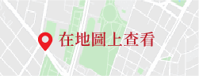
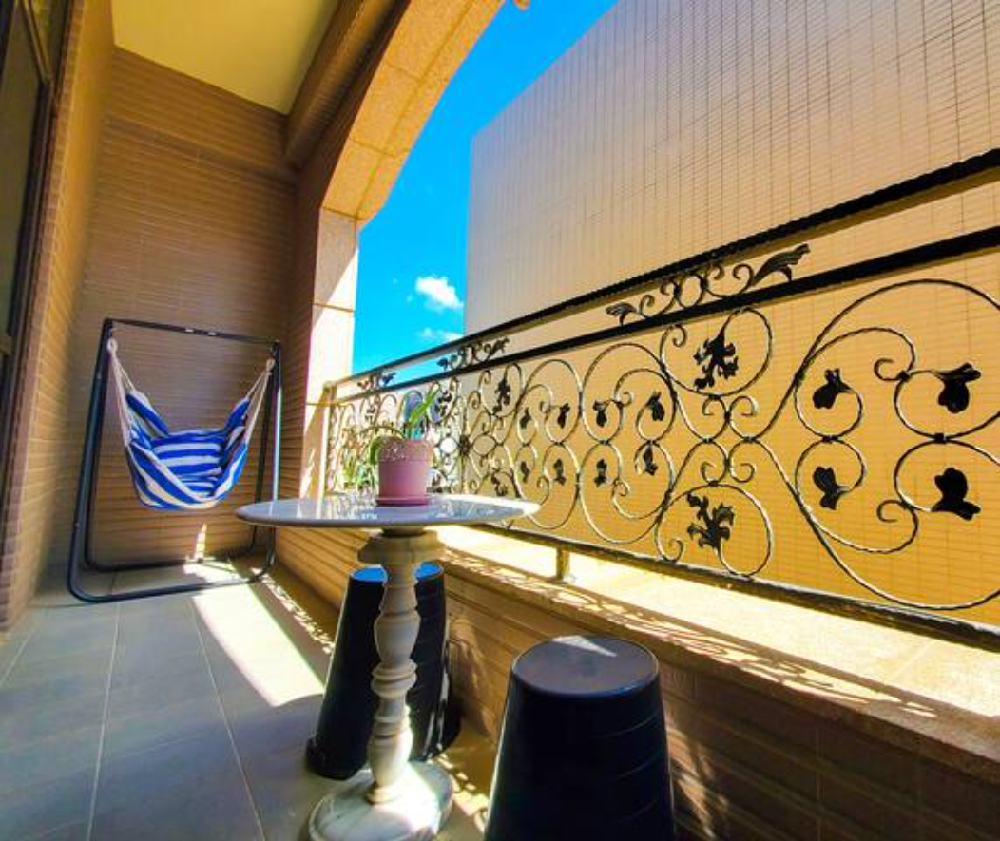

# 交通部觀光署旅宿網-草漯居交通部觀光署旅宿網

- 網站：www.taiwanstay.net.tw
- 原始網址：https://www.taiwanstay.net.tw/TSA/web_page/TSA020200.jsp?hohi_id=31534
- 狀態：success
- 主題：自然景觀與生態、地方產業與農漁業、觀光景點與活動
- 關鍵字：觀音區、桃園市、草漯沙丘、藻礁、永安漁港
- 擷取時間：2026-10-29T13:55:24.222764+00:00

## 清理後正文

交通部觀光署旅宿網-草漯居
交通部觀光署旅宿網
全台合法旅宿這裡搜
草漯居
分享LINE
分享FB
分享twitter
桃園市民宿122號
桃園市觀音區福二街46號
飯店簡介
Introduction
觀音草漯電梯別墅，共六層樓近百坪，最多可接待18位住客，除五間套房外，還有二樓客餐廳及五樓寬廣的公共空間，及4個車位（依車型大小而定）。五樓有休憩區和開闊露台,晴朗時六樓可見山稜線和海岸線。
我們提供高速無線上網，高畫質有線電視頻道，大金冷暖空調，自有停車位。密碼鎖進出，不與房東同住。備有洗浴用品，請自備牙刷，環保愛地球！
夜間十點後請降低音量。非住客請勿入內，否則視為住客收費，如有訪客需求請先行溝通，公共區有攝影機以維彼此權益。
草漯隸屬觀音區的一里，是個小而美的地方
。整個鬧區範圍不大，但應有盡有。我們的位置在鬧區旁的住宅區內，鬧中取靜、機能便利。
步行3分鐘至便利商店，4分鐘至壘球場運動公園，7分鐘至天幕籃球場。
開車8分鐘至白千層林道，10分鐘至草漯沙丘，20分鐘至藻礁生態區、青埔 X PARK、華泰outlet、永安漁港、竹圍漁港、桃園國際機場。
餐廳
會議場所
咖啡廳
酒吧
無線網路
停車場
自助洗衣 (免費)
地址：
桃園市觀音區福二街46號
電話或手機：
0982158770
傳真：
-
官方網站：
-
總房間數：
5間
定價：
NT$2,800~NT$5,000
可接待語言資訊：
中文、英語、日語、韓語
旅宿業自114年1月1日起不主動提供旅宿一次用備品，如住宿時仍有需求，
取得訊息為：
不提供，請旅客自備。
可向旅宿免費索取。
可向旅宿付費購買，詳細價格，請洽詢旅宿業者。
無障礙客房‧設施及友善環境
上一頁
:::
地址：106433臺北市忠孝東路4段290號9樓
電話：(02)2349-1500
星級旅館
全部
卓越五星
五星級
四星級
三星級
二星級
一星級
好客民宿
自行車友善旅宿
環保標章
溫泉標章
房價異常通報專區
旅宿行政資訊
公告訊息
旅館公會
民宿協會
觀光法規
E-learning
觀光名詞
檔案下載
業者專區
自然人憑證
相關相關連結
臺灣觀光資訊網
交通部觀光署行政資訊網
台灣好行旅遊服務網
台灣觀巴
台灣騎跡
觀光多媒體開放資料
環保標章旅館查詢
交通部中央氣象署
繁體

## 圖片
-  — [原始圖片來源](https://www.taiwanstay.net.tw/TSA/web_img/mapsee.png) 
-  — [原始圖片來源](https://www.taiwanstay.net.tw/TSA/twpic/152553.png) 
-  — [原始圖片來源](https://www.taiwanstay.net.tw/TSA/twpic/152563.png) 

## 頁面連結
- [網站導覽](https://www.taiwanstay.net.tw/TSA/web_page/sitemap.jsp)
- [首頁](https://www.taiwanstay.net.tw/)
- [優宿專區](https://www.taiwanstay.net.tw/TSA/web_page/TSA060100.jsp)
- [訂房快搜](https://www.taiwanstay.net.tw/TSA/web_page/TSA050100.jsp)
- [首頁](https://www.taiwanstay.net.tw/TSA/web_page/TSA010100.jsp)
- [分享LINE](https://social-plugins.line.me/lineit/share?url=https://www.taiwanstay.net.tw/TSA/web_page/TSA020200.jsp?hohi_id=31534)
- [分享FB](https://www.facebook.com/share.php?u=https://www.taiwanstay.net.tw/TSA/web_page/TSA020200.jsp?hohi_id=31534)
- [分享twitter](https://twitter.com/home/?status=https://www.taiwanstay.net.tw/TSA/web_page/TSA020200.jsp?hohi_id=31534)
- [https://www.google.com.tw/maps/preview?hl=zh-TW&q=桃園市觀音區福二街46號](https://www.google.com.tw/maps/preview?hl=zh-TW&q=桃園市觀音區福二街46號)
- [無障礙客房‧設施及友善環境](https://www.taiwanstay.net.tw/TSA/web_page/TSA020400.jsp?hohi_id=31534)
- [合法旅宿查詢](https://www.taiwanstay.net.tw/TSA/web_page/TSA020100.jsp)
- [跳到主要內容區塊](https://www.taiwanstay.net.tw/TSA/web_page/TSA020200.jsp?hohi_id=31534)
- [全部](https://www.taiwanstay.net.tw/TSA/web_page/TSA020100.jsp?hotel_level1=all)
- [卓越五星](https://www.taiwanstay.net.tw/TSA/web_page/TSA020100.jsp?hohl_evaluation1=7)
- [五星級](https://www.taiwanstay.net.tw/TSA/web_page/TSA020100.jsp?hohl_evaluation1=6)
- [四星級](https://www.taiwanstay.net.tw/TSA/web_page/TSA020100.jsp?hohl_evaluation1=5)
- [三星級](https://www.taiwanstay.net.tw/TSA/web_page/TSA020100.jsp?hohl_evaluation1=4)
- [二星級](https://www.taiwanstay.net.tw/TSA/web_page/TSA020100.jsp?hohl_evaluation1=3)
- [一星級](https://www.taiwanstay.net.tw/TSA/web_page/TSA020100.jsp?hohl_evaluation1=2)
- [好客民宿](https://www.taiwanstay.net.tw/TSA/web_page/TSA020100.jsp?hotel_hospitable_bnb1=1)
- [自行車友善旅宿](https://www.taiwanstay.net.tw/TSA/web_page/TSA020100.jsp?hofr_is_bike1=1)
- [環保標章](https://greenlifestyle.moenv.gov.tw/categories/accommodation?searched=true&page=1&level=&type=2&d=&city=&dist=&search=)
- [溫泉標章](https://www.taiwanstay.net.tw/TSA/web_page/TSA020100.jsp?hohid_spa1=1)
- [房價異常通報專區](https://www.taiwanstay.net.tw/TSA/web_page/TSA070100.jsp)
- [行政資訊](https://www.taiwanstay.net.tw/TSA/web_page/TSA040100.jsp)
- [旅館公會](https://www.taiwanstay.net.tw/TSA/web_page/TSA040500.jsp?hoas_type=0)
- [民宿協會](https://www.taiwanstay.net.tw/TSA/web_page/TSA040500.jsp?hoas_type=1)
- [觀光法規](https://law.tad.gov.tw/)
- [E-learning](https://elearning.taiwan.net.tw/Page/Index.aspx)
- [觀光名詞](https://admin.taiwan.net.tw/service/BioGlossary?a=52)
- [檔案下載](https://www.taiwanstay.net.tw/TSA/web_page/TSA040600.jsp)
- [業者專區](https://wholeway.taiwanstay.net.tw/TSD)
- [自然人憑證](https://wholeway.taiwanstay.net.tw/TSDnatural_login)
- [臺灣觀光資訊網](https://www.taiwan.net.tw/)
- [交通部觀光署行政資訊網](https://admin.taiwan.net.tw/)
- [台灣好行旅遊服務網](https://www.taiwantrip.com.tw/)
- [台灣觀巴](https://www.taiwantourbus.com.tw/C/tw/home)
- [台灣騎跡](https://taiwanbike.tw/)
- [觀光多媒體開放資料](https://media.taiwan.net.tw/zh-tw/portal)
- [環保標章旅館查詢](https://greenlife.epa.gov.tw/categories/accommodation?searched=true&page=1&level=&type=2&d=&city=&dist=&search=)
- [交通部中央氣象署](https://www.cwa.gov.tw/V8/C/)
- [網站安全策略](https://www.taiwanstay.net.tw/TSA/web_page/TSA990100.jsp)
- [個資宣告](https://www.taiwanstay.net.tw/TSA/web_page/TSA990200.jsp)
- [https://accessibility.moda.gov.tw/Applications/Detail?category=20241212162504](https://accessibility.moda.gov.tw/Applications/Detail?category=20241212162504)

> 備註：進階解析失敗，已使用內建解析器：AttributeError: 'NoneType' object has no attribute 'get'
